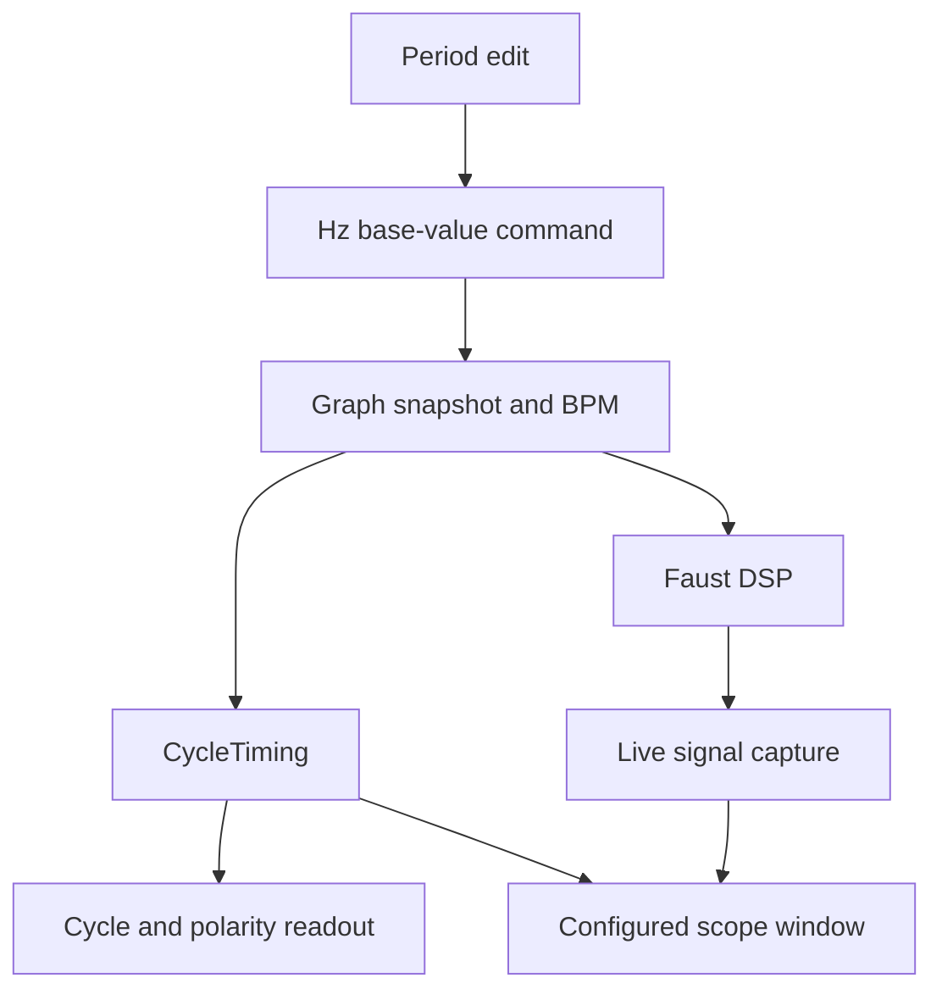

# Orbit 2 — Modular audio engine and hierarchical graph architecture

**Status:** Living architecture, implemented contracts and implementation roadmap  
**Implementation audit:** 2026-11-21 · main through [`4f8de46`](https://github.com/wgabel/orbit2/commit/4f8de46b03a6dd0f09f39d842a625f48c28f7f3c)  
**Target repository:** [wgabel/orbit2](https://github.com/wgabel/orbit2)  
**Original design date:** 2026-11-20

This document consolidates the design discussions for Orbit 2: the original browser boilerplate, separation of responsibilities, signal generation, modulation, audio processing, clocks, hierarchical node canvases, exposed input/output racks, and event-driven editing. It is intended as a reference for implementing the next iterations, not a claim that every proposed system already exists. Earlier implementation sketches, design rationale, examples and acceptance criteria are preserved even when later implementation records supersede the initial wording. The README remains the practical build/run guide.

## Reading guide and current implementation

**Status vocabulary:** Implemented = verified on the audited main branch; Partial = a defined subset delivered; In progress = implementation under review but not on main; Planned = design or future deliverable; Deferred = deliberately outside current scope.

| Capability | Current status | Design / evidence |
|---|---|---|
| Graph, validated commands, nested racks, dynamic Faust compilation, live parameter updates | Implemented · Phases 1–5 | Sections 2–5, 7–10 |
| Shared BPM, oscillators, noise, mixer, filter, EQ, delay, reverb, chorus | Implemented · 6.1–6.7, 6.12–6.15 | Sections 6 and 10 |
| Recovery, named patches, portable JSON, undo/redo | Implemented · 6.8–6.11 | Section 9 |
| Mute/bypass and individual presets | Implemented · 6.16–6.17 | Section 7 |
| Scope, spectrum, level and filter/EQ response | Implemented · 6.18.1–6.18.5; dedicated analyzer and advanced history planned | Sections 7 and 10; [PR #4](https://github.com/wgabel/orbit2/pull/4) |
| Cable badges, per-canvas preferences, anchored editing | Implemented core · 6.19.5; annotations and optional refinements planned | Section 7; [PR #1](https://github.com/wgabel/orbit2/pull/1), [#2](https://github.com/wgabel/orbit2/pull/2), [#3](https://github.com/wgabel/orbit2/pull/3) |
| Shared semitone tracking and Pitch Control | Implemented · 7.2.2 | Section 10; [PR #6](https://github.com/wgabel/orbit2/pull/6) |
| AD envelope and typed Trigger/Gate/Clock ports/adapters | Implemented · 7.1.1–7.1.2 | Section 10; [PR #7](https://github.com/wgabel/orbit2/pull/7), [#8](https://github.com/wgabel/orbit2/pull/8) |
| Manual Trigger, timed Gate and Clock sources | In progress · 7.1.3 | [PR #10](https://github.com/wgabel/orbit2/pull/10), not on audited main |
| ADSR/AR/Loop, playable note source, continuous keyboard transposer, sequencer, resonators, polyphony | Planned · remaining Phase 7 | Section 10; [PR #9](https://github.com/wgabel/orbit2/pull/9) is design documentation only |
| Post-mixer pitch shifter; recorded audio assets and sample synthesis | Planned · 6.20, Phase 8 | Section 10 |

Use the [roadmap](#13-implementation-roadmap) for delivery status, milestone identifiers and dependencies. Use the relevant architecture sections for implementation contracts and acceptance criteria. Where a design sketch and a later implementation record coexist, follow the latter for the current state.

## Contents

**Foundations — model, signal semantics and timing**

1. [Goals and current baseline](#1-goals-and-current-baseline)
2. [Fundamental concepts](#2-fundamental-concepts)
3. [Signals and node contracts](#3-signals-and-node-contracts)
4. [Parameters and modulation](#4-parameters-and-modulation)
5. [Ports and connections](#5-ports-and-connections)
6. [Audio time, oscillator phase and transport](#6-audio-time-oscillator-phase-and-transport)
**Editing, persistence and runtime**

7. [Hierarchical signal graphs and canvases](#7-hierarchical-signal-graphs-and-canvases)
8. [Input and output racks](#8-input-and-output-racks)
9. [Commands, events and transaction boundaries](#9-commands-events-and-transaction-boundaries)
    - [Workspace persistence and history](#workspace-persistence-and-history-phases-68611)
10. [Faust and real-time execution](#10-faust-and-real-time-execution)
    - [Runtime foundations and safety](#runtime-foundations-and-safety)
    - [Audio processors and effects](#audio-processors-and-effects)
    - [Signal observation and analysis](#signal-observation-and-analysis-phase-618)
    - [Musical control, performance and instrument synthesis](#musical-control-performance-and-instrument-synthesis)
    - [Keyboard performance and continuous pitch sequencer](#keyboard-performance-and-continuous-pitch-sequencer-phase-728--planned)
11. [Project organization and dependencies](#11-project-organization-and-dependencies)
**Delivery, verification and reference**

12. [Worked patch example](#12-worked-patch-example)
13. [Implementation roadmap](#13-implementation-roadmap)
    - [Roadmap at a glance](#roadmap-at-a-glance)
14. [Testing and acceptance criteria](#14-testing-and-acceptance-criteria)
15. [Decisions and open questions](#15-decisions-and-open-questions)
16. [References and glossary](#16-references-and-glossary)

## 1. Goals and current baseline

### Motivation

Orbit is a browser-based environment for designing synthesizers, drones, modulation systems and musical patches. The original React application provides inspiration for the graph editor, but Orbit 2 is intended to avoid tight coupling between the presentation, application state and real-time audio processing.

The goal is a modular architecture in which new generators, processors, parameter types and composite modules can be added without rewriting the rest of the application.

### Technology choices

| Technology | Responsibility |
|---|---|
| Blazor WebAssembly / C# | Browser UI, graph model, editing, validation and application services |
| Faust | Sample-level sound synthesis and DSP algorithms |
| WebAssembly | Execution format for compiled Faust DSP |
| Web Audio API / AudioWorklet | Real-time audio scheduling and output |
| Minimal JavaScript modules | Browser audio integration and lifecycle; not application business logic |
| GitHub Actions / Pages | Build, test and deployment of the static app |

**Original baseline (historical, Phases 1–2).** The initial implementation included the independent Orbit.Domain graph model (Phase 1) and a continuously running, fixed two-sine modulation graph (Phase 2). The browser bridge, build-time Faust compilation and separated application/UI/infrastructure projects support this playback path. Existing infrastructure concepts include AudioEngine, AudioContextManager, AudioClock, FaustModuleLoader, FaustNodeFactory, AudioVoice, AudioOutput and AudioEnvelope.

**Original next stage — now delivered in Phases 3–4:** validated commands and application events, then a reusable graph editor and general DSP compilation. The active modulation playback path and shared infrastructure provide the baseline.

### Design principles

1. Separation of concerns: UI, graph state, application commands and real-time DSP have different responsibilities.
2. Composition over specialization: a drone is a reusable graph, not a special monolithic synth class.
3. Depend on stable abstractions and use dependency injection at composition roots.
4. Generators and processors must not know which node is connected before or after them.
5. Modulation is a first-class feature of all appropriate continuous numerical parameters.
6. Every signal uses the same authoritative audio timing reference.
7. User-interface operations must not interrupt sound unnecessarily.
8. A new node should normally require a definition, a DSP implementation and registration, not changes to the graph editor's core.
9. Use descriptive names, small cohesive classes, and separate source files for independent objects.
10. Validate graph changes, preserve consistent state and test foundational behavior before adding numerous node types.

## 2. Fundamental concepts

| Concept | Definition |
|---|---|
| Signal | A stream of values indexed by time/sample frame. |
| Sample | A numerical value for one channel at a particular sample frame. |
| Sample frame | One time position containing a sample for each channel. |
| Node | A graph object with a stable identity, ports and parameters. |
| Generator | A node that produces a signal, e.g. sine oscillator, noise generator or clock. |
| Processor | A node that transforms one or more incoming signals, e.g. filter, gain, delay, mixer or reverb. |
| Modulator | A role: any suitable generator or processor whose output influences a parameter. |
| Parameter | A configurable object with a base value, metadata and, where supported, incoming modulation. |
| Port | A named, typed endpoint through which a signal enters or leaves a node. |
| Connection | An edge linking one output port to one input port. |
| SignalGraph | The model owning the nodes, connections and graph invariants. |
| Composite node | A node that contains an internal graph and exposes selected ports at its boundary. |
| Input Rack | The internal representation of a composite node's public inputs. |
| Output Rack | The internal representation of a composite node's public outputs. |
| AudioClock | The sample-frame and audio-time reference. |
| Transport | Musical time: play position, tempo, beats, bars and synchronization. |
| Phase accumulator | The evolving phase of an oscillator cycle. |
| Patch | A complete root graph with its nested graphs, settings and layout. |

The term **modulator** does not need to be a separate mandatory inheritance hierarchy. A sine generator at 440 Hz generates audible sound; the same generator at 0.5 Hz can modulate another signal. A filter can process an audible signal or a modulation signal. A low-pass-filtered noise source can create smoothly varying random modulation without requiring an entirely separate random-modulation architecture.

~~~mermaid
classDiagram
    class ISignalNode {
        Id
        Parameters
        Inputs
        Outputs
    }
    ISignalNode <|-- IGenerator
    ISignalNode <|-- IProcessor
    ISignalNode <|-- ICompositeNode
    IGenerator <|-- OscillatorGenerator
    IGenerator <|-- NoiseGenerator
    IProcessor <|-- Filter
    IProcessor <|-- Reverb
    IProcessor <|-- Mixer
~~~

Examples of node families (both implemented and planned; see the roadmap for delivery status):

- Generators: sine, triangle, band-limited sawtooth, square/pulse, noise, random, envelope, stepper, clock.
- Processors: gain, mixer, pan, low-pass/high-pass filters, EQ, delay, reverb, chorus, flanger, compressor, distortion, signal mapping, rectification.
- Composites: drone, effects rack, sequencer, reusable modulation system, complete synthesizer voice.

An ADSR envelope can be a generator with trigger/gate inputs. The distinction between generator and processor is useful for describing behavior, but the graph should rely on actual port contracts rather than assuming all generators have no inputs.

## 3. Signals and node contracts

### Signal representation

A sine wave, an LFO, an envelope and an audio recording are mathematically streams of values. Physical differences come from the waveform, time scale, channel count and the meaning assigned by the destination port.

For example, a bipolar sine signal at sample rate Fs can be generated as:

~~~
sample[n] = sin(2 * pi * phase[n])
~~~

An audio signal normally uses floating-point samples with a nominal range of -1 to +1. Intermediate floating-point calculations may exceed this range; the final output needs gain management. Modulation signals may be bipolar (-1 to +1), unipolar (0 to +1), or expressed in units explicitly defined by their port.

As a conceptual read-only description:

~~~csharp
public interface ISignal
{
    int SampleRate { get; }
    int ChannelCount { get; }
}
~~~

Do not construct a C# object for every individual sample or repeatedly transmit buffers between Blazor and JavaScript. Real-time buffers and state belong inside the DSP runtime. Audio-processing buffers should be allocated/reused efficiently.

### Common node contract

The following C# examples are design sketches for the proposed model, not existing compiled application files. Types referenced together are defined throughout this document; production implementations should live in separate files.

~~~csharp
public interface ISignalNode
{
    Guid Id { get; }
    string Name { get; }

    IReadOnlyList<Parameter> Parameters { get; }
    IReadOnlyList<PortDefinition> Inputs { get; }
    IReadOnlyList<PortDefinition> Outputs { get; }
}

public interface IGenerator : ISignalNode
{
}

public interface IProcessor : ISignalNode
{
}

public interface ICompositeNode : ISignalNode
{
    SignalGraph InternalGraph { get; }
}
~~~

The interface describes a node's graph-facing contract. It intentionally contains no ProcessSample method: the C# object describes DSP, while Faust performs DSP. Avoid exposing UI component references, JavaScript objects or AudioWorklet instances in the domain model.

Generators and processors are registered by stable node type keys, e.g. "generator.oscillator" or "processor.lowpass". A NodeRegistry holds the definitions, factory and metadata required to create new instances. DSP bindings are supplied separately by the compiler adapter.

### Graph ownership and fan-out

~~~mermaid
flowchart TD
    G[Oscillator] --> F[Low-pass filter]
    G --> D[Delay]
    F --> R[Reverb]
    D --> M[Mixer]
    R --> M
    M --> O[Output]
~~~

A generator output can have several outgoing edges. The generator itself does not own a NextNode pointer or a list of concrete downstream effects. SignalGraph owns connections and determines dependencies.

A mixer defines how several audio inputs are combined. A destination port must explicitly define its fan-in policy; for example, reject a second connection, sum inputs, or require an explicit mixer node.

## 4. Parameters and modulation

### Parameter definitions and instances

Every continuously adjustable numerical parameter should be an independent object rather than just a float property on an oscillator. The parameter has identity, units, range, a base value and semantics for applying incoming signals.

~~~csharp
public enum ParameterUnit
{
    Normalized, Hertz, Cents, Decibels, Seconds, Degrees,
    BeatsPerMinute, Ratio
}

public enum ParameterScale
{
    Linear, Logarithmic, PitchCents, Decibels
}

public record ParameterDefinition(
    string Key,
    string Name,
    double DefaultValue,
    double Minimum,
    double Maximum,
    ParameterUnit Unit,
    ParameterScale Scale,
    bool CanModulate
);

public sealed class Parameter
{
    public required Guid Id { get; init; }
    public required ParameterDefinition Definition { get; init; }

    // Changed through validated application commands.
    public double BaseValue { get; internal set; }

    // Stable input socket for incoming modulation, when supported.
    public Guid? ModulationPortId { get; init; }
}

public record ParameterAddress(
    Guid NodeId,
    Guid ParameterId
);
~~~

Parameter definitions can also describe control rate, display precision, smoothing time, bipolar/unipolar mapping, modulation limits and other metadata. Some discrete parameters, such as waveform selection, are configuration rather than continuously modulatable signals and should have a distinct contract where needed.

Examples:

| Component | Parameters |
|---|---|
| Oscillator | Frequency, amplitude, phase |
| Pulse generator | Frequency, pulse width, amplitude |
| Filter | Cutoff, resonance |
| Reverb | Mix, decay, size |
| Gain | Volume |
| LFO (same oscillator concept) | Frequency, amplitude, phase |
| Drone composite | Any explicitly exposed parameters, e.g. pitch, volume, cutoff |

BaseValue represents the user/preset setting. The runtime effective value can change at every sample independently of it. Never overwrite the stored base value with successive LFO samples.

### Modulation math

For additive linear modulation:

~~~
effective[n] = clamp(base + sum(source[i][n] * depth[i]), min, max)
~~~

For pitch modulation expressed in cents:

~~~
effectiveHz[n] = baseHz * 2^(sum(source[i][n] * depthCents[i]) / 1200)
~~~

For example:

- Oscillator B has a frequency of 440 Hz.
- Oscillator A produces a 0.5 Hz sine signal ranging from -1 to +1.
- The connection has a modulation depth of 100 Hz.
- B's frequency varies between 340 and 540 Hz, maintaining continuous phase.

~~~mermaid
flowchart LR
    A["Sine A: 0.5 Hz"] --> P["Frequency: base 440 Hz"]
    P --> B["Sine B: 340–540 Hz"]
    B --> O[Audio output]
~~~

For a musical vibrato, a modulation amount of +/-20 cents is more appropriate than +/-100 Hz. The exact mapping depends on ParameterScale, and parameter limits may apply after scaling.

For volume, decide whether the modulation is a linear amplitude offset, a multiplicative gain factor, or a dB offset. For cutoff, an exponential or logarithmic mapping often provides more musical behavior than a linear Hz offset. These decisions belong to the target's parameter definition.

### Multiple incoming modulation signals

| Source output | Target parameter | Example depth |
|---|---|---|
| LFO 1 | Oscillator 1 frequency | +/-20 cents |
| LFO 1 | Oscillator 2 frequency | +/-10 cents |
| LFO 2 | Drone volume | +/-0.2 linear gain |
| LFO 3 | Filter cutoff | +/-500 Hz |
| LFO 3 | LFO 1 frequency | +/-0.1 Hz |

A single source can feed several parameters; several sources can feed a single compatible parameter. The graph's modulation connections collectively form the modulation matrix; avoid maintaining a second independently editable list of the same routes.

A possible convenience view:

~~~csharp
public record ModulationRoute(
    PortAddress Source,
    ParameterAddress Target,
    double Amount
);
~~~

The route is derived from the canonical SignalConnection and the target parameter's modulation input.

### Audio-rate and control-rate

Slow modulation and audio-frequency modulation use the same conceptual signal machinery. Fine-grained continuous modulation must run on the audio engine, not through periodic C# events or JavaScript setInterval calls.

The DSP can optimize eligible control-rate or constant signals. Manual changes to base values should normally be smoothed to avoid abrupt jumps. Smoothing must not accidentally suppress intended audio-rate modulation; apply it deliberately to base changes and other appropriate control paths.

## 5. Ports and connections

### Ports

An explicit, typed port system separates nodes from their wiring.

~~~csharp
public enum PortDirection
{
    Input, Output
}

public enum SignalType
{
    Audio,
    Modulation,
    Trigger,
    Gate,
    Clock
}

public enum FanInPolicy
{
    Single,
    Sum
}

public record PortDefinition(
    Guid Id,
    string Name,
    PortDirection Direction,
    SignalType SignalType,
    int ChannelCount,
    FanInPolicy FanIn
);

public record PortAddress(
    Guid NodeId,
    Guid PortId
);
~~~

Signal types express semantics and validation rules, not necessarily different buffer implementations. Audio and modulation can both be floating-point streams. Converting an audio-rate oscillator output into modulation is permitted when compatible with the target; use explicit mapping or channel selection when required.

A Trigger and Clock carry one-sample binary pulses; a Gate carries a held binary level. All three are mono, single-source and unity-only. Clock can feed a Trigger input (a timing pulse is a valid occurrence), but other conversions require an explicit adapter.

The envelope accepts an ordinary oscillator signal on a dedicated continuous event-detection input, distinct from parameter modulation sockets. It also supports typed Trigger/Clock and Gate-rising input selection. See [Envelope generators and rhythmic triggers](#envelope-generators-and-rhythmic-triggers-planned-phase-71) for conversion, routing and timing rules.

### Connections

~~~csharp
public record SignalConnection(
    Guid Id,
    PortAddress Source,
    PortAddress Destination,
    double Amount = 1.0
);
~~~

Amount can be unity gain for normal audio routing and modulation depth for parameter inputs. The units and permitted mapping are determined by the receiving port/parameter, with optional future mapping configuration.

Each graph has a unique ID; node and port addresses are scoped within their graph. A fully qualified address includes the graph or composite instance path when flattening nested graphs.

Typical connection types:

| Source | Destination | Result |
|---|---|---|
| Generator output | Processor audio input | Sound processing |
| Generator output | Parameter modulation input | AM, FM, LFO modulation |
| Processor output | Parameter modulation input | Filtered/random/shaped modulation |
| Clock output | Sequencer clock input | Rhythmic synchronization |
| Envelope output | Gain parameter | Amplitude shaping |

### Validation

SignalGraphValidator verifies:

- Source/destination exist and have output/input direction respectively.
- Port types and channel counts are compatible or have an explicit adapter.
- The destination's fan-in rules are respected.
- Duplicate connections are rejected.
- Zero-delay dependency cycles are rejected, including cycles through modulation parameters and subgraph boundaries.
- Intentional feedback is allowed only via an explicitly supported delayed feedback mechanism; not all ordinary delay effects necessarily make arbitrary graph feedback safe.
- Connections never point to deleted nodes or ports.

For the first implementation, reject all cycles. Introduce explicit feedback later when the DSP compiler and tests support it.

## 6. Audio time, oscillator phase and transport

There are three independent concepts of time that must not be confused.

| System | Meaning |
|---|---|
| AudioClock | Absolute elapsed audio frames and sample rate |
| PhaseAccumulator | Progress through an individual generator cycle |
| Transport | Musical beat position, tempo, start/stop and synchronization |

### AudioClock

At 48 kHz, each channel has 48,000 samples per second. All nodes must use the same audio context's frame timing.

~~~csharp
public interface IAudioClock
{
    long CurrentSample { get; }
    int SampleRate { get; }
    double CurrentTime { get; }
}
~~~

In the real-time runtime, Web Audio's AudioWorkletGlobalScope supplies currentFrame, currentTime and sampleRate. The C# interface can expose a snapshot to the UI; the DSP itself uses its actual rendering context. It is not a separate C# timer.

~~~
timeSeconds = sampleFrame / sampleRate
samplePeriod = 1 / sampleRate
~~~

| Frames at 48 kHz | Duration |
|---:|---:|
| 1 | 20.833 microseconds |
| 128 | 2.667 ms |
| 480 | 10 ms |
| 24,000 | 0.5 s |
| 48,000 | 1 s |

Request 48 kHz if desired, but use the AudioContext's actual supported sample rate rather than assuming it. The engine must also work at 44.1 kHz and other supported sample rates. Use the actual provided buffer size rather than hardcoding 128 frames.

### Phase accumulator

An oscillator stores a fractional phase between 0 and 1. For each sample:

~~~
output[n] = sin(2 * pi * phase[n])
phase[n+1] = wrap(phase[n] + frequency[n] / sampleRate)
~~~

Example: 440 Hz at 48 kHz advances by 440 / 48000 = approximately 0.0091667 cycles per sample; one cycle lasts approximately 109.09 samples.

Frequency can change on every sample. Advance from the previous phase rather than recalculating phase as currentTime * currentFrequency, which can create discontinuities when the frequency changes.

At phase 0 the sine output is 0; at phase 0.25 it is +1; at 0.5 it is 0; at 0.75 it is -1.

A phase reset should be an explicit trigger with a defined behavior, not an accidental consequence of editing a parameter or reopening a canvas.

### Musical transport

~~~csharp
public interface ITransport
{
    double BeatsPerMinute { get; }
    double BeatPosition { get; }
    bool IsPlaying { get; }
}
~~~

While the transport is running:

~~~
beatsPerSecond = BPM / 60
beatIncrementPerSample = BPM / (60 * sampleRate)
~~~

At constant 120 BPM and 48 kHz:

| Note duration | Seconds | Frames |
|---|---:|---:|
| Eighth note | 0.25 | 12,000 |
| Quarter note (one beat) | 0.5 | 24,000 |
| Half note | 1 | 48,000 |
| Whole note / 4/4 bar | 2 | 96,000 |

Free mode uses an absolute frequency in Hz. Synchronized mode uses a musical division:

~~~
frequencyHz = BPM / (60 * beatsPerCycle)
~~~

At 120 BPM, one cycle per beat is 2 Hz; one cycle per 4/4 bar is 0.5 Hz.

The oscillator's synchronized frequency is also projected in the editor: the workspace supplies its committed BPM through the shared canvas to `NodeFrame`; `ParameterReadout` derives the value from the active division in the immutable node snapshot using `MusicalTime`. The shared `ParameterChoiceEditor` renders the optional readout below the choice. It is a calculated rate (including while stopped), not measured telemetry, a graph parameter or a stored value. The free frequency and its dormant connections remain unchanged. The readout updates with tempo, division, preset application and workspace restoration without a separate subscription or DSP update.

~~~mermaid
flowchart TD
    T[Committed workspace BPM] --> R[ParameterReadout]
    N[Active division in node snapshot] --> R
    R --> M[Shared MusicalTime conversion]
    M --> U[Choice editor: read-only Hz]
~~~

Tempo changes affect musical time, not audio sample rate. Integrate beat position over time so that tempo changes do not imply an arbitrary phase jump. Define whether a synchronized modulator is locked to the shared transport position or free-running at a synced rate. Two LFOs with the same frequency are not necessarily in phase unless they share an initial phase/reference or reset event.

The audio clock can continue while musical transport is stopped, allowing effects tails and free-running signals. The transport's start/stop/reset semantics need to be deliberate.

**Implemented Phase 6.1:** `MusicalTransportService` owns one domain `MusicalTransport` and reads the existing `IAudioClock`. It serializes asynchronous observations and edits, publishes immutable `TransportSnapshot` results, and never creates an audio context. The composition root registers one service for the patch. Tempo defaults to 120 BPM and is constrained to 20–300 BPM. The shared `TransportControls` panel displays tempo, beat position, sample rate and derived note/bar rates. Start follows observed root playback, Stop freezes position, replay resumes, and reset anchors beat zero while preserving tempo and running state. Tempo changes preserve accumulated beats. Suspension or clock identity changes freeze and re-anchor the timeline. Canvas navigation and worklet crossfades do not reset transport; tempo edits do not mutate the signal graph.

`MusicalDivision` and `MusicalTime` define reusable quarter-note-relative cycle lengths and the conversion to Hertz. The application timeline is calculated from actual sampled audio frames, not from UI timer ticks.

**Implemented Phase 6.2:** The transport-locked oscillator was initially proven with a separate sine node (superseded by Phase 6.4). A generic `ParameterChoiceEditor` renders discrete parameters without adding modulation ports. `ITransportSignalSink` publishes a new transport anchor on state changes through the existing browser adapter. A lazy `TransportSignalSource` owns one audio worklet per context, producing the shared beat position at the actual sample rate. The graph compiler adds one beat input only when an emitted node requests it through `FaustNodeContext.TransportBeat`, including for nested emitters. The same beat stream reaches old and new graphs during a crossfade. All supported cycle lengths divide a 12-beat wrap exactly in musical time, limiting floating-point drift. Audio-rate phase is shared; application commands still arrive at message boundaries rather than being scheduled at exact future samples.

**Implemented Phase 6.3:** A single `OscillatorGenerator` (type key `generator.oscillator`) replaces the sine-only domain model. Its `OscillatorWaveform` enumeration defines sine, triangle, square and sawtooth, with shared continuous frequency, amplitude and phase parameters and stable sockets. `RequiresRecompile` marks a structural parameter; choices are validated by the same graph command system, included in topology comparison, and compiled as constants instead of live sliders. The UI uses `ParameterChoiceEditor` with no waveform-specific Razor code. `OscillatorFaustEmitter` selects the DSP expression through `FaustOscillatorWaveforms`; the waveform is evaluated at the actual sample rate, with polynomial anti-alias corrections for steps/slopes and a normalized output bound. A waveform change crossfades the compiled graph; continuous edits still retain oscillator state. A free-running waveform may restart its phase on replacement. Noise is a separate generator family.

**Implemented Phase 6.4:** `OscillatorTimingMode` selects Free or Synchronized. `FaustOscillatorTiming` resolves phase separately from waveform evaluation: free frequency integration or shared beat/division. Both paths use the same `FaustOscillatorWaveforms` implementation. The redundant tempo sine node and emitter are removed. Musical division is a live discrete control; timing mode is structural. `ParameterActivation` describes a condition on an unconditional structural selector. `GraphNodeSnapshot.IsParameterActive` and `IsInputActive` drive both the editor and backend lowering. Inactive rate settings are retained, their editors hidden, and associated sockets/wires visibly dormant. `GraphFlattener` filters dormant inputs before dependency ordering and range estimation, so dead upstream nodes are not compiled. The editable graph continues to validate dormant routes to prevent reactivation cycles. Waveform and timing replacements share the original node and socket identities; synchronized phase follows the shared beat throughout free/sync changes and crossfades. Changing division can intentionally change phase; tempo changes preserve it.

**Implemented Phase 6.5:** `NoiseGenerator` (`generator.noise`) is independent of periodic oscillator timing. `NoiseColor` is a structural discrete choice (White, Pink, Brown); amplitude is the only continuous parameter and uses the existing modulation and control manifest. `NoiseFaustEmitter` delegates spectral shaping to `FaustNoiseSpectra`. A deterministic pseudorandom recurrence uses a graph-qualified node identity to distinguish streams; pink uses octave-spaced low-pass responses, brown uses a sample-rate-aware leaky integrator. The shaped signal is bounded to ±1 before effective amplitude scaling. Color replacement uses the established graph crossfade; amplitude updates preserve DSP state. Noise can drive audio or modulation routes, with no additional UI or infrastructure implementation.

~~~mermaid
flowchart TD
    N[Noise definition] --> E[NoiseFaustEmitter]
    E --> R[Node-local random recurrence]
    R --> C[Selected spectrum]
    C --> A[Bounded signal times effective amplitude]
    A --> O[Audio or modulation route]
~~~

## 7. Hierarchical signal graphs and canvases

### Composite nodes

This is the architectural feature that replaces separate hardcoded drone and patch editors.

A root patch is a SignalGraph. A drone is a composite node containing another SignalGraph. The subgraph may itself contain other composites, subject to reasonable nesting and recursion validation.

~~~mermaid
flowchart TD
    Root[Root patch graph] --> D1[Drone A graph]
    Root --> D2[Drone B graph]
    Root --> E[Master effect graph]
    D1 --> M[Modulation subgraph]
    D1 --> R[Effects subgraph]
~~~

Externally, each child appears as an ordinary node with named input and output ports. Internally, opening it reveals generators, modulators, processors, mixers, connections and boundary racks.

~~~csharp
public sealed class SignalGraph
{
    public Guid Id { get; init; }

    public IReadOnlyList<ISignalNode> Nodes { get; internal set; }
        = Array.Empty<ISignalNode>();

    public IReadOnlyList<SignalConnection> Connections { get; internal set; }
        = Array.Empty<SignalConnection>();
}

public interface ICompositeNode : ISignalNode
{
    SignalGraph InternalGraph { get; }
}
~~~

Actual mutation methods should protect graph invariants. The above represents an illustrative read model; the application command handler or domain operations own controlled mutation, rather than exposing freely modifiable Lists.

The initial domain implementation now creates an owned child graph via `CompositeNode`, with mandatory `InputRack` and `OutputRack` instances. A composite cannot be inserted into itself, an ancestor, or two graphs simultaneously. Concrete node instances cannot be shared across graphs, so mutable parameters remain independent. Child graphs reject master outputs. Snapshots recursively capture child graphs, revision and rack IDs; `GraphSnapshot.GetGraph` resolves a graph within that immutable patch. The session routes commands to owned descendants, and the editor uses the active canvas graph ID.

### The canvases

A main patch might contain:

~~~mermaid
flowchart LR
    L[LFO] --> A[Drone A]
    L --> B[Drone B]
    A --> M[Master mixer]
    B --> M
    M --> O[Output]
~~~

Opening Drone A reveals its own graph:

~~~mermaid
flowchart TD
    S[Sine] --> M[Mixer]
    T[Triangle] --> M
    N[Noise] --> M
    L[Internal LFO] --> F[Filter cutoff]
    M --> LP[Low-pass]
    F --> LP
    LP --> R[Reverb]
    R --> G[Gain]
    G --> O[Output rack]
~~~

The same canvas UI, interaction rules, connection rendering and node registry should be used for both root and nested graphs.

### Separation from visual layout

| Object | Responsibility |
|---|---|
| SignalGraph | DSP-relevant topology, node configuration and connections. |
| CanvasLayout | Positions, size, collapsed state, visual grouping and appearance. |
| CanvasNavigation | Current graph path, parent navigation, breadcrumb and selection. |
| PatchDocument | Root graph, nested graphs, layout data, metadata and schema version. |

Moving a node or changing zoom/selection must not recompile DSP. Opening or closing a subcanvas must not reset any oscillator or interrupt audio. A graph edit can affect audio; a purely visual edit must not.

The UI shows a breadcrumb such as Patch / Drone / Drone. `CanvasNavigationService` uses stable graph IDs to resolve the currently edited graph, caches each visited canvas projection and exposes an immutable breadcrumb entry per level. It releases removed subtree projections and returns to the closest surviving ancestor. `GraphCanvas` is keyed by graph ID to reset transient gestures on navigation; it fits only on first visit, preserving the stored viewport on return.

The editor catalog includes `DroneTemplate`, a composite factory with independent Pitch and Gain modulation inputs and Audio output, an internal sine and gain stage, and all rack connections. It is an ordinary editable graph, not an opaque DSP processor. Racks cannot be deleted independently; the master output is available only in the root catalog.

~~~mermaid
flowchart TD
    Workspace["GraphWorkspace"] --> Nav["CanvasNavigationService"]
    Nav --> Canvas["Active CanvasStateService"]
    Workspace --> Root["Root PatchSession snapshot"]
    Root --> Playback["GraphPlaybackControls"]
    Canvas --> Editor["Reusable GraphCanvas"]
    Root --> Ranges["Graph modulation ranges"]
    Ranges --> Editor
~~~

UI gestures dispatch commands using the active graph ID. `GraphPlaybackControls` stays attached to the root snapshot across navigation, so the same audio voice and revision remain active. The range and telemetry projections select the active graph using its ID while retaining the root revision for correctness.

### Implemented canvas state foundation

The presentation-state library is `Orbit.Presentation` (a plain .NET class library). It references Application and has no dependency on Blazor, browser APIs or processing. Each canvas/subcanvas can own one `ICanvasStateService` for its graph. Phase 5 adds graph-ID-targeted projections in a shared session with independent layouts and viewports.

| State | Owner | Change notification |
| --- | --- | --- |
| Nodes, ports, base parameters and routing | PatchSession / SignalGraph | Committed graph revision |
| World-coordinate node positions, selection and viewport | CanvasStateService | Local canvas state change |
| Effective audio parameter values | DSP runtime | Throttled meter snapshot |

`CanvasStateService` subscribes to unfiltered patch `GraphChangeSet` notifications and resolves its own graph from the final immutable root snapshot. A configurable `INodePlacementPolicy` supplies initial positions (default: a three-column grid). Existing positions are preserved, removed nodes and their incident connections are cleared from selection, and each active canvas emits one update per patch commit. New placements and selection cleanup increment the layout revision; a parameter-only graph change does not. Removing an ancestor composite invalidates descendant canvases, which emit `GraphRemoved` and reject local edits while retaining their last read-only snapshot for navigation.

**Interactive node placement.** The shared canvas measures its current visible screen rectangle (including page clipping) and existing frame sizes at Add time. `CanvasViewport.ScreenToWorld` converts that rectangle to world bounds; `GridNodePlacementPolicy.FindVisiblePosition` searches a bounded set of positions, including nearby measured frame edges, minimizing overlap for the measured shared frame width and estimated grid-slot height. It prefers a fully visible placement and then the center when overlap is equal. If a whole frame cannot fit without overlap, it prefers an unobstructed visible header even if the lower frame extends below the viewport; overlap is allowed when no free spot exists. Initial/unmeasured layouts still use the deterministic origin grid. The active canvas reserves the proposed placement only for the synchronous `AddNodeCommand`; reconciliation consumes it for the matching `NodeAdded` fact, publishing the committed graph and position together. A rejected command or stale canvas measurement leaves no pending placement. Undo/redo uses existing removed-position restoration, and ordinary persistence stores the resulting world coordinates, not measurements or reservations. No browser geometry enters Domain, graph commands or audio; existing positions and viewport stay unchanged.

~~~mermaid
sequenceDiagram
    participant W as Workspace
    participant C as Canvas
    participant L as Layout state
    participant S as Patch session
    W->>C: Measure visible area
    C->>L: Reserve world position
    W->>S: AddNodeCommand
    S->>L: Committed NodeAdded
    L-->>C: Snapshot with new position
~~~

~~~mermaid
flowchart TD
    Command["Graph command"] --> Commit["PatchSession commit"]
    Commit --> Graph["Graph snapshot"]
    Graph --> Canvas["CanvasStateService"]
    Layout["Pan / zoom / move / select"] --> Canvas
    Canvas --> Read["CanvasStateSnapshot"]
    Read --> View["GraphCanvas renderer"]
    Commit --> Audio["Future audio graph subscriber"]
~~~

`CanvasViewport` is an immutable transform with a finite pan and zoom between 0.25 and 4. It is independent of browser input and CSS. It provides world-to-screen, screen-to-world, screen-delta-to-world and pointer-anchored zoom operations. Pointer positions are viewport-relative. A drag delta is divided by zoom before changing a node's world position, while panning is measured in screen pixels. Reset returns to zero pan and 100% zoom. Fit-to-content is a renderer concern once measured node bounds are available.

Each view consumes an immutable `CanvasStateSnapshot` with separate graph and layout revision numbers, world positions, selected node/connection IDs and viewport. Layout changes never call `IPatchSession.Execute` or publish graph events. Graph and canvas dispatchers share the generic disposable `NotificationChannel<T>` implementation but remain separate notification instances. Listeners are notified after state commits; their failures do not undo state. Use the presentation dispatcher thread for interactive canvas operations and graph commands observed by the canvas; immutable snapshots may be handed to asynchronous processing. Consumers must dispose canvas subscriptions and the service when closing the corresponding canvas.

The geometry and projection are implemented and independently tested. The renderer consumes this state, including measured node bounds, pointer gestures and Bézier paths. Phase 5 implements nested navigation using the same renderer and a cached state per graph.

### Shared canvas and component standards

Every root canvas and nested canvas uses the same editor and viewport behavior. A canvas is a view over a signal graph, not a separate audio engine.

- Pan freely along both axes using a background drag (middle mouse or space + drag also works over nodes). Panning must not move graph nodes.
- Zoom with the wheel or toolbar controls, anchored at the pointer when zooming on the canvas. Show the current percentage at all times, with zoom in/out, reset to 100%, and fit-to-content controls. Use a configurable bounded zoom range (initially 25–400%).
- Keep the top controls compact: one workspace toolbar composes zoom, node catalog and root-owned playback/transport. The workspace delegates viewport actions to its active canvas reference while retaining the keyed canvas lifecycle. The canvas expands to fill remaining viewport height; counts and gesture hints sit in fixed, non-interactive viewport overlays outside the transformed graph world.
- Store viewport pan and zoom separately for each graph. Preserve them when navigating between root and child canvases. Use a single world-to-screen transform shared by nodes, ports, connections and hit testing: screen = world × zoom + pan.
- Render connections as cubic Bézier curves between the actual port anchors. Use one connection renderer for draft, connected, selected and invalid-preview states; keep wire endpoints attached during node movement, pan and zoom.
- Input ports appear on the left, outputs on the right, with accessible names and adequate hit targets. The port shape encodes signal type, not direction. Use both labels and shapes so color is never the only distinction.

#### Visual vocabulary

All nodes have a filled background and a role-specific accent color from shared semantic theme tokens. The colors below are the initial palette, not values hard-coded into individual components.

| Node role | Accent |
| --- | --- |
| Audio generator | Cyan / blue |
| Modulation source (e.g. sine used as an LFO) | Green |
| Signal processor / effect | Amber |
| Composite / drone | Violet |
| Input rack, output rack, master output | Slate |

A sine used as an LFO remains the same generator implementation: the displayed role does not create a new DSP class. Processors that produce modulation retain their processor role; port types distinguish their signals.

| Signal kind | Port shape |
| --- | --- |
| Audio | Circle |
| Modulation / continuous control | Diamond |
| Trigger | Triangle |
| Gate | Square |
| Clock | Hexagon |

Map these presentation shapes to the existing domain port kinds; introduce future kinds only when their domain semantics exist. Audio channel count is a label, not a separate signal kind.

#### Design token and theme system

The design system is a presentation-owned boundary. Static visual values must have a single JSON source, independent of markup, application commands and audio processing. Each root canvas and nested canvas uses the same semantic tokens and shared component styles.

| Level | Responsibility | Example |
| --- | --- | --- |
| Primitive | Raw shared palette, spacing, font sizes, radii, opacity and motion | `primitive.color.ink-950` |
| Semantic | Visual purpose independent of the widget | `semantic.color.generator` |
| Component | Reusable widget dimensions or semantic aliases | `component.node.min-width`, `component.slider.modulation-color` |

The base file is `src/Orbit.UI/DesignSystem/design-tokens.json`; `Themes/dark.json` and `Themes/light.json` supply the same semantic color keys. A theme cannot redefine component sizes: both themes share the same interaction geometry. Domain role colors, selection/focus, errors and modulation use semantic keys. New UI components should reference those keys instead of duplicating their values.

~~~mermaid
flowchart TD
    J["Shared token JSON"] --> G["Build-time generator"]
    T["Dark and light theme JSON"] --> G
    G --> V["Generated CSS variables"]
    V --> B["Base CSS"]
    V --> C["Component styles"]
    B --> R["Root and nested Blazor views"]
    C --> R
~~~

JSON aliases use `"{primitive.color.generator-blue}"` syntax and compile into CSS variable references. The deterministic generator validates token names, flattened name collisions, missing and circular references, and matching theme keys. It emits `wwwroot/css/tokens.css`, which is tracked and loaded before the base and component styles. CI verifies regenerated output and all published CSS assets; there is no runtime JSON reader or styling framework. Dark is the default, light can be activated by setting `data-theme="light"` on the HTML root. Theme selection UI/persistence is a future concern.

Example use in a shared node stylesheet:

~~~css
.node-frame {
    min-width: var(--component-node-min-width);
    border-radius: var(--component-node-border-radius);
    background: var(--semantic-color-surface);
}
.node-frame--generator {
    border-color: var(--semantic-color-generator);
}
~~~

Keep layout structure in CSS and markup, with numeric styling constants in JSON. Reuse token-based component styles for repeated UI controls (the existing button, slider and validation message are migrated). Only computed presentation geometry such as port coordinates, canvas transforms, live modulation percentages and Bézier path points can be provided dynamically by code. Parameter bounds, units, sample rates, transport settings, zoom interaction limits and graph rules are functional values, not visual tokens.

#### Reusable presentation building blocks

| Component | Single responsibility |
| --- | --- |
| GraphCanvas | Compose viewport, graph nodes, connections and local interaction state for any graph |
| CanvasViewport | Coordinate conversion, pan, zoom and viewport state |
| CanvasToolbar | Zoom controls, percentage readout, fit and reset |
| NodeFrame | Shared node background, role accent, header, input/output layout and content slot |
| PortConnector | Render shape, label, typed endpoint, hit area and connection gesture |
| ConnectionLayer / ConnectionPath | Render and hit-test Bézier connections using shared port geometry |
| ParameterSlider | Name, unit, editable numeric base value, min/max, range slider, inline error, modulation band and effective marker |
| ValidationMessage | Consistent field-level error presentation directly below an invalid value box |

Razor markup composes reusable components; code-behind handles presentation interaction. Domain validation and application commands remain authoritative. Node-specific views supply definitions and content, rather than duplicating viewport, slider, port or connection code. Theme tokens and reusable styles live in the UI project, never in Domain.

#### Parameter editor contract

A parameter's immutable definition supplies its name, unit (Hz, ratio, dB, etc.), minimum, maximum, modulation scale and capability. The parameter instance supplies its editable base value. A range slider and number box edit that same value; invalid, non-finite or out-of-range input stays in the field with an explanatory message beneath it and is not committed to the graph. Slider display scaling is independent of DSP modulation semantics.

Modulation adds two read-only visual values to the editor:

- A colored interval on the rail displays the predicted effective-value range; it is computed from the known modulation bounds and routing amounts, not from an animation timer. Unknown bounds are displayed as unknown.
- A moving marker and numeric live readout display the actual effective value sampled from the processing engine. The base thumb and numeric input stay stable.

For example, a frequency base of 440 Hz with a sine LFO at ±100 Hz displays a 340–540 Hz band, while the live marker follows the DSP frequency. Where modulation exceeds the editable base limits, the rail is clipped and the full effective bounds and current value remain visible in text.

Live telemetry is a passive, display-rate snapshot (around 20–30 Hz initially, batched per graph when scaled up), not an application event for every sample. Audio processing never waits for the UI. Do not persist telemetry or write it back to editable parameter values. A stopped or unavailable processor has no live marker.

**Stable modulation readouts.** The shared parameter slider renders Modulation and Live in fixed shrinkable columns, with each label above its single-line value. The predicted range receives more width than the instantaneous value. Tabular digits, non-wrapping text and constrained grid tracks prevent changing telemetry precision or magnitude from changing the node height or width; exceptional long values ellipsize with the full text retained in a tooltip and accessible readout. Unknown and stopped values occupy the same slots, and live outputs do not announce each telemetry update. Browser regression tests measure actual readout and node height with variable-length values and changing live telemetry.

**Frequency display scale (implemented).** `ParameterDefinition.DisplayScale` is optional immutable metadata, validated by `Parameter`; absent metadata preserves the original linear rail. A display scale contains strictly increasing positive physical values and normalized positions, from 0 to 1, spanning the parameter's physical bounds. Consecutive anchors define logarithmic segments (two anchors provide a conventional logarithmic rail). `ParameterSliderScale` in Orbit.Presentation provides forward and inverse mappings. `ParameterSlider` uses normalized native range input for non-linear scales, translates edits to physical values before validation/commands, and maps the base thumb, predicted interval endpoints and effective marker through the same forward mapping. Numeric edits remain exact; newly dragged values are rounded to six significant digits for readable precision. The normalized range provides the physical value through accessible value text. Marker percentages are clamped at rail limits, not written back to model or DSP. The oscillator's anchors are (0%, 0.01 Hz), (20%, 40 Hz), (85%, 1,000 Hz), (100%, 20,000 Hz), preserving the full range while assigning 65% of travel to the most-used musical band. `ParameterScale.Linear` still specifies additive Hz modulation and does not change; display metadata is excluded from DSP topology comparison and is not serialized in patches or presets. No node-specific UI is required.

~~~mermaid
flowchart TD
    R[Normalized slider position] -->|Inverse display scale| V[Physical base value]
    V --> D[DSP modulation in physical units]
    V --> M[Shared forward display scale]
    D --> E[Effective value]
    E --> M
    B[Predicted physical bounds] --> M
    M --> T[Thumb, band and marker]
~~~

The shared ParameterSlider is implemented in the editable node frames. The graph editor supports live base-value edits and effective modulation meters for reachable connected parameters. `GraphModulationRangeEstimator` calculates conservative parameter intervals from the committed snapshot using optional signal-bound rules on the registered DSP emitters. The weighted inputs are summed and clamped to parameter limits; unknown bounds propagate rather than inventing a range. `FaustNodeContext` inserts a passive meter after the effective value clamp, and the playback service maps its stable name to a parameter address. `GraphPlaybackControls` polls the service at 25 Hz; the workspace accepts only the matching graph revision and passes display data to the shared node frames. The base thumb is independent of the marker. Disconnected nodes can show predicted bounds but have no live sample.

Phase 4 implements the shared canvas, node frames, typed ports and connection renderer; Phase 5 reuses them for nested canvases.

### First visible editor implementation

`GraphWorkspace` constructs the root patch session from `ModulationDemoPatch.OpenSession`, owns one presentation state service, and translates completed user actions into typed commands. `GraphCanvas` consumes that state and is reusable for future child graphs. It composes `CanvasToolbar`, `NodeFrame`, `PortConnector`, `ConnectionLayer`, `ConnectionPath` and the existing `ParameterSlider` inside node frames. There is no per-node renderer duplication.

The canvas world is one transformed coordinate space shared by HTML node frames and SVG Bézier paths. The browser adapter (`wwwroot/js/canvasDom.js`) only measures actual DOM bounds/port centers, captures a pointer, and identifies the input under a dropped wire. The renderer converts measured offsets back into world coordinates, so zoom and panning do not change the topology or require new measurements. Nodes move using the state service and connections follow their positions. Fit uses measured frame bounds; `BezierConnection.Between` supplies horizontal tangents even for backwards edges.

The editor supports node addition/removal, base parameter edits, drag-to-connect or keyboard/click port activation, selection, background panning, middle-button panning from node headers, pointer zoom and fit, and nested canvas navigation. Space-drag remains a future enhancement. The fixed modulation proof is preserved separately from the dynamic Faust compiler.

### Reusable modules and presets

A saved composite definition consists of its graph, exposed ports and optional canvas layout. This supports:

- Drone presets and independent instances.
- Reusable effect racks and modulation systems.
- Grouping selected nodes into a composite and exposing crossing edges.
- Expanding/ungrouping composite nodes.
- Copying graph instances, including independent DSP state.

Define whether a preset is copied at instantiation or linked to a shared template. Start with independent instances, with stable instance-scoped IDs; do not accidentally share runtime phase, parameter state or filter state. Shared preset editing/versioning is a later feature.

**Implemented Phase 6.6:** The registry accepts composite preset catalog keys separately from the resulting domain type (`composite.graph`). Factory identity and type validation remain intact. Catalog labels are supplied by registration so adding a preset does not require a UI case. `DroneTemplate` shares the starter/layered graph-construction path. The Layered fifth preset creates three ratio-linked oscillators, pink noise, a `MixerProcessor` and final gain with editable Pitch/Gain rack inputs. The mixer exposes a summed mono input; its emitter and range rule use the existing weighted-input resolution. Each instance owns all its nodes, parameters, ports and DSP state independently; no saved-preset persistence is implied.

~~~mermaid
flowchart TD
    C[Preset catalog key] --> F[Composite factory]
    F --> G[Fresh composite graph]
    G --> S[Committed snapshot]
    S --> U[Shared canvas]
    S --> D[Existing Faust compiler]
~~~

### Node mute and processor bypass (Phase 6.16 — implemented)

Provide fast, reversible auditioning without deleting nodes, rewiring a graph, changing base parameters or overwriting connection amounts. A compact **M** action in the shared node header mutes a node's complete outgoing signal; a **B** action on an eligible processor bypasses its processing and passes its input signal through. These are distinct operations.

| Node category | Mute (M) | Bypass (B) |
|---|---|---|
| Generators and modulation sources | Silence all outputs | Not applicable (no dry input) |
| Eligible audio processors | Silence all outputs | Pass the original audio input unchanged |
| Composite drones and other composites | Silence all exposed outputs | Deferred until explicit dry routing is defined |
| Boundary racks and master output | Not applicable initially | Not applicable initially |

Bypass eligibility is an explicit reusable node capability, not a UI type switch or an assumption that every `IProcessor` has a meaningful dry path. Initially enable B for effects with one unambiguous compatible audio input/output. Only audio input passes through; modulation inputs continue controlling the inactive wet computation. Nodes can retain both states; mute takes precedence over bypass, and unmuting restores the prior bypass state.

~~~mermaid
flowchart TD
    I[Audio input] --> P[Processor DSP]
    I --> B[Smoothed bypass blend]
    P --> B
    B --> M[Smoothed mute gain]
    M --> O[Audio output]
~~~

For a linear lane ending at a mixer, muting its final node silences the entire lane's contribution, including effect tails, while the other lanes remain audible. This also works when the lane ends at a composite output. Muting an earlier node does not necessarily silence downstream delay or reverb tails immediately. Muting a source affects every outgoing branch, including modulation connections, so a fan-out graph is not equivalent to independently muting a single edge.

~~~mermaid
flowchart TD
    A[Oscillator A] --> E[Effects A] --> X[Mixer]
    B[Oscillator B] --> F[Muted last effect] -.-> X
    C[Oscillator C] --> G[Effects C] --> X
    X --> O[Audio output]
~~~

**Domain and application.** Model `IsMuted` and, where supported, `IsBypassed` as explicit node state separate from `ParameterDefinition` and layout; they are not numeric modulation targets. Introduce validated `SetNodeMutedCommand` and `SetNodeBypassedCommand` with graph/node IDs and desired state, plus typed before/after facts. Unsupported targets and no-op edits must not create revisions or history entries. Commit each action once through `PatchSession`; snapshots, history restoration, nested-graph routing, range projection and autosave observe the same committed state. Both operations are undoable and persisted. Update the patch schema compatibly so legacy patches restore unmuted and unbypassed; explicit states round-trip through named saves, recovery and export. Individual parameter presets do not include these audition switches.

**Live audio.** Extend graph lowering and runtime control manifests with stable graph-qualified host controls for mute gain and bypass blend. Do not encode the flags as structural Faust constants or treat their changes as topology changes. Preserve ordinary parameter controls, input routes, oscillator phase, delay/reverb state and shared transport; smoothly ramp mute toward silence and crossfade between dry and processed signals for bypass. Continue processing both paths initially, even while inaudible; CPU-saving suspension and state restoration are separate future features. Composite mute gates every flattened exposed output at the composite boundary (including modulation outputs), not each child node. Apply the gate before downstream fan-out. Effective modulation/range reporting must account for mute and bypass without pretending to know arbitrary wet signal bounds. Initial playback and crossfade replacements initialize from the current committed flags; stale runtime updates must not overwrite newer states.

**Presentation.** Extend the reusable `NodeFrame` header with compact M/B toggle buttons, accessible names, pressed state, tooltips and visible active styling drawn from the JSON design tokens. Prevent button pointer actions from starting node drags; keep selection, navigation and cable geometry intact. The same controls work in root and nested canvases without DSP-specific Razor. Make muted nodes recognizable even without relying on color alone; retain their wires and parameter editors.

**Implemented 6.16.1 — mute.** `SignalNode.SupportsMute` exposes the shared generator/processor/composite capability; `IsMuted` is a separate graph-owned flag. `SetNodeMutedCommand` validates the target and publishes `NodeMutedChanged` only on change; `GraphNodeSnapshot` captures both fields. Schema 1 `SavedNode.isMuted` is optional and missing flags restore as false. History uses the existing validated reconstruction path. `GraphFlattener` marks only composite output routes with their owning composite's mute state and origin. One host mute control is allocated per reachable eligible graph/node identity (shared across all its exposed output routes), independently of the ordinary parameter/meter manifest. The gate is downstream of the emitted expression and upstream of fan-out: the host initializes its target before playback and a sample-rate-aware 10 ms linear slew reaches exact silence/unity without recreating the voice. `GraphTopology` ignores mute state while playback resolves control targets from the latest accepted snapshot; topology replacements initialize from committed flags. Range estimation reports the settled muted output as zero even when the wet range was unknown; effective meters remain actual DSP observations during the ramp.

**Implemented 6.16.2 — bypass.** `AudioEffectProcessor` explicitly declares a compatible single dry audio path, validates its port contract and exposes the stable `BypassInputKey`. Gain, Filter, Parametric EQ, Delay, Reverb and Chorus opt in; Mixer remains a routing processor with no B action. `IsBypassed`, `SetNodeBypassedCommand` and `NodeBypassedChanged` follow the existing independent mute state and command pattern; optional schema 1 `SavedNode.isBypassed` restores false for legacy documents. `FaustAuditionControls` and `FaustAuditionControl` replace the mute-only manifest with one shared kind-qualified host control system for both flags. A bypass blend of 1 sends the weighted dry audio input unchanged; 0 sends the ordinary processor output. The wet computation and all modulation dependencies remain running. The shared 10 ms slew initializes from the committed flag, and the final mute gate takes precedence over the dry/wet blend. No recompilation or processor-specific emitter change is needed for either action. The interval estimator uses the routed dry input bound for settled bypass and zero for mute, including when wet bounds are unknown; temporary fade trajectories are not predicted as settled ranges. `NodeAuditionToggle` renders M/B with distinct active token colors and accessible pressed states inside `NodeFrame`; muted and bypassed parameter controls remain editable. Tests compare dry samples and resumed reverb tails with continuous reference DSP at 44.1/48 kHz, including simultaneous mute/bypass.

**Implementation record:**

- Implemented (6.16.1): reversible node mute with shared header control, persisted state, boundary-wide smooth gain and settled modulation range projection.
- Implemented (6.16.2): explicit effect bypass capability, independent persisted state, shared click-safe audition controls, dry range projection and continuously running wet DSP.

**Deferred routing actions.** Do not implement mute buttons on individual connections, connection solo, global node solo or group mute/solo in this phase. An existing connection amount of zero can temporarily silence a single branch, while endpoint mute covers ordinary linear mixer lanes. Revisit dedicated edge mute only if preserving independent amounts or fan-out auditioning becomes a genuine requirement. If introduced later, edge state must be distinct from configured amount and use the same reversible, click-safe runtime-control approach. Solo scope and multi-output bypass routing require explicit contracts rather than implicit graph traversal.

### Individual node presets (Phase 6.17 — implemented)

#### Model and catalog (6.17.1)

A node preset is a reusable immutable configuration of an existing registered node type, not a new node type, a factory, a DSP implementation, a patch or a live link to another node. Initially support leaf generators and processors with editable parameters; racks, master output without editable parameters, and composite graph definitions are not individual preset targets. Custom composite definitions remain a separate graph-template feature.

Use a versioned data-only `NodePreset` containing a stable preset ID, node type key, name, group, optional usage description and a map of stable parameter definition keys to validated base values. Include discrete structural selections and inactive conditional parameters so selecting a preset restores the complete configuration, including dormant settings. Do not store instance GUIDs, connections, connection amounts, positions, effective modulation samples or DSP state. The current patch stores its actual base values, not a dependency on the preset library. Editing or deleting a preset cannot change nodes that previously used it.

~~~json
{
  "schemaVersion": 1,
  "id": "reverb-dark-ambient",
  "nodeType": "processor.reverb",
  "name": "Dark Ambient",
  "group": "Atmospheric",
  "description": "Long, dark reverb for evolving drones.",
  "parameters": { "decay": 8.0, "damping": 0.8, "mix": 0.65 }
}
~~~

**Catalog and responsibilities.** Put the immutable model, catalog, validator and `NodePresetService` in `Orbit.Application/Presets`. Keep factory registration in `NodeRegistry`; use its stable type keys and parameter definitions to validate preset compatibility. Ship built-in presets as versioned JSON resources per node type, loaded by infrastructure through an application-facing catalog contract. Adding another built-in configuration must not require changes to C#, Faust or Razor. The service merges read-only built-ins with the custom library, groups by usage label and sorts consistently. Reserve the `Custom` group for user-created presets; do not allow imported content to impersonate built-ins. Use stable IDs rather than display names as selection keys; validate names, group labels, schema, duplicate IDs and finite in-range values. Explicitly reject incompatible or incomplete configurations unless a versioned migration supplies missing values.

**Implemented 6.17.1.** `NodePreset` defensively copies its complete stable-key parameter dictionary and validates version and metadata. `NodePresetValidator` derives eligible leaf types and parameter definitions from the composed `NodeRegistry` (generators/processors with editable parameters, excluding composites and catalog aliases). The same `ParameterDefinition.IsValidBaseValue` contract validates continuous values and discrete choices, including inactive settings. `NodePresetJsonReader` rejects unknown fields, duplicate JSON keys and malformed configurations without reflection-based deserialization. `EmbeddedNodePresetCatalog` discovers the per-type JSON arrays in `Orbit.Infrastructure/Presets/BuiltIn/` via `INodePresetCatalog`; the resources ship inside the assembly, avoiding independent downloads or stale catalog caches. `NodePresetService` validates the complete set at initialization, rejects globally duplicate stable IDs and the reserved Custom group, and returns read-only groups ordered by label and preset name with ordinal ID tie-breaking. Every eligible type has an empty Custom group ready for the future library. The composition root shares one registry between the editor and validator and eagerly verifies the catalog at startup. Ten initial examples cover all eight eligible types; application, selector and broader content follow in separate steps. No graph or DSP mutation is introduced here.

~~~mermaid
flowchart TD
    J[Embedded JSON resources] --> C[INodePresetCatalog]
    C --> S[NodePresetService]
    R[NodeRegistry] --> V[NodePresetValidator]
    V --> S
    S --> G[Immutable usage groups]
~~~

#### Atomic application (6.17.2)

**Atomic application.** Introduce `ApplyNodePresetCommand` targeting a graph ID and node ID with a validated type-key/value configuration. A domain batch parameter operation resolves and validates every key, value and target before mutating anything, including structural choices and stored inactive values. A failed or unchanged configuration produces no revision. A successful application preserves node, parameter and port IDs, connections and layout; publishes one `GraphChangeSet` with the individual `ParameterChanged` facts; records one undo entry; and triggers existing audio, range projection and autosave subscribers once. Do not loop through separate session commands. Topology comparison already distinguishes base-only changes from structural changes, so ordinary presets update active controls and structural choices use the existing crossfade policy. No preset-specific logic belongs in DSP or audio infrastructure. Existing pending slider history is finalized before a distinct preset application.

**Implemented 6.17.2.** `ApplyNodePresetCommand` carries an immutable `NodePreset` and the target graph/node IDs. `GraphCommandHandler` uses the registry-derived `NodePresetValidator` before calling `SignalGraph.SetNodeParameterValues`. The domain operation independently checks the actual node type, resolves the complete ordinal key set, validates every value through the same parameter validation as individual edits, and prepares all changed `ParameterValueChange` records before mutation. It returns only changed values in parameter definition order. The handler maps these to the existing `ParameterChanged` facts; `PatchSession` commits one root snapshot, one revision and one history entry. Only `SetParameterValueCommand` can participate in slider gesture grouping, so even a single-value preset remains a distinct operation. Rejected and identical configurations have no notification or history entry. Nested parameter and port IDs, dormant wires, audit flags and layouts stay intact; history restoration and patch serialization already carry all base settings. Playback consumes the final committed snapshot through its unchanged topology comparison and control manifest, so one live batch or one structural replacement is sufficient. Tests exercise invalid late values, no-ops, nested and root targets, undo/redo, audition state, and running playback updates.

~~~mermaid
flowchart TD
    C[ApplyNodePresetCommand] --> V[Registry compatibility validation]
    V --> G[SignalGraph: preflight all keys and values]
    G --> P[Apply changed base values]
    P --> E[One committed change set]
    E --> H[History and autosave]
    E --> D[Existing playback update]
    E --> U[Canvas projection]
~~~

~~~mermaid
flowchart TD
    B[Built-in JSON catalog] --> S[Node preset service]
    C[(Custom preset library)] --> S
    S --> U[Grouped preset selector]
    U --> A[Apply preset command]
    A --> P[Patch session and validation]
    P --> H[One undo entry]
    P --> D[Existing audio update]
    P --> V[Canvas and autosave]
~~~

#### Shared selector (6.17.3)

**Presentation.** Add a shared `NodePresetSelector` inside `NodeFrame`, below the header, using design tokens and the same component at every canvas level. Render groups via a compact accessible selector, provide a usage description and allow loading a preset without extra permanent toolbars. Show an unselected/modified state when the current base configuration does not match a preset; modulation alone does not mark it modified. Saving captures the current base configuration from an immutable snapshot. Built-ins cannot be overwritten, renamed or deleted; users can apply them, adjust values and save a new custom preset. Management actions (save as, deliberate overwrite, rename, delete) belong to a compact shared menu/dialog, not per-node implementations. Editing the preset library is separate from graph undo/redo; applying a preset is a graph edit.

**Implemented 6.17.3.** `NodePresetSelector` is composed once in `NodeFrame` immediately below the header. It consumes `NodePresetService` and an immutable `GraphNodeSnapshot`, resolves eligibility and ordered usage groups through the existing catalog, and exposes a native accessible grouped select with a description and an explicit modified/unmatched option. The empty Custom group stays visible but disabled. `NodePresetService.FindMatchingPreset` compares the complete stable-key base configuration, including inactive parameters, and chooses the first match in deterministic catalog order; effective telemetry and audition flags are not involved. The component skips rematching the same snapshot on layout/telemetry-only refresh. Selecting a preset emits `NodePresetApplyRequest` through the shared frame and canvas to the workspace, which addresses the active graph and executes the atomic command. The control is bound to the committed matching value, not a separately persisted selection; undo/redo, reload and direct edits therefore stay consistent. Pointer and keyboard events do not start canvas gestures, and committed edits trigger the existing measured connection geometry refresh. CSS reuses parameter-choice styling and existing JSON-derived semantic/node tokens, with a single-line description and full tooltip. Published browser tests cover grouped options, applied values, modified/undo state and nested playback without interruption. Custom management remains a later phase.

**Preset selector sizing.** The shared preset row reserves intrinsic-width columns for the label and the management button, with a shrinkable middle select column and a constrained parent grid track. Long built-in or custom names must not widen the node or push the management button past its border. Browser regressions check actual element bounds in root/nested canvases, including long custom names.

~~~mermaid
flowchart TD
    S[Node snapshot] --> M[Catalog match]
    C[Grouped preset catalog] --> M
    M --> U[NodePresetSelector]
    U --> R[Preset apply request]
    R --> W[GraphWorkspace]
    W --> P[ApplyNodePresetCommand]
    P --> S
~~~

#### Built-in content (6.17.4 — implemented at this milestone)

| Node | Presets | Built-in usage groups | Example presets |
|---|---:|---|---|
| Oscillator | 14 | Bass, Drones, Harmonic layers, Modulation, Rhythmic modulation | Sub Bass, Slow LFO, Deep Sine, Bright Saw |
| Noise | 7 | Atmosphere, Modulation, Texture | Wind, Deep Rumble, Bright Hiss |
| Gain | 6 | Gain staging, Layering, Modulation | Half Level, Quiet Bed, Modulation Center |
| Filter | 8 | Corrective, Resonance, Texture, Tone shaping | Warm Low-pass, Gentle High-pass, Vocal Resonance |
| Parametric EQ | 7 | Corrective, Texture, Tone shaping | Warmth, Presence, Remove Muddiness |
| Delay | 8 | Atmospheric, Rhythmic, Short reflections | Quarter Note, Triplet, Long Echo |
| Reverb | 8 | Atmospheric, Spaces, Texture | Small Room, Large Hall, Dark Ambient |
| Chorus | 7 | Modulated pitch, Texture, Thickening | Gentle Chorus, Deep Ensemble |

Examples describe intended usage, not a guarantee of a particular sound without suitable input/routing. Each supported node also exposes `Custom` even when empty. Presets should demonstrate meaningful settings, sensible output headroom and compatible parameter modes; factory defaults remain available independently.

**Implemented 6.17.4.** The embedded catalog now contains 65 presets across all eight eligible types. The 55 additions preserve the original ten IDs and configurations and introduce no new runtime mechanism or storage format. All entries include descriptions and complete stable-key values (including dormant parameters). CI validates every entry against the registry, applies it through the atomic graph command, checks exact selector matching and unchanged connections, and generates a reachable Faust graph for each configuration. Duplicate complete configurations within a node type would fail the matching test. Custom persistence is the next step.

The 65 presets across eight types describe the original completed 6.17.4 catalog, not a permanent inventory: 7.1.1 and 7.2.2 subsequently added five AD and five Pitch Control presets respectively.

#### Custom library (6.17.5)

**Custom persistence.** Define `INodePresetStorage` separately from `IPatchLibraryStorage`, with a browser adapter using the existing versioned IndexedDB interop and a dedicated logical store/namespace. Reuse validated serialization, transaction and error patterns where appropriate; never mix node presets with recovery records or named complete patches. Persist versioned data by stable ID, enforce unique names per node type (case-insensitive) and explicit overwrite semantics, and report storage failure without changing the current node. Custom presets survive reload and patch switching; eventually support portable individual JSON import/export with validation and conflict handling. Future audio-asset-valued configurations need explicit references and portability rules from Phase 8; scalar parameter presets do not embed recordings.

**Implemented 6.17.5.** `NodePresetLibraryService` owns serialized library operations. The application-facing `INodePresetStorage` is implemented by `BrowserPatchStorage` through its existing versioned persistence module. A disjoint `node-presets:custom` key contains the whole array of versioned configurations, using the strict reader and reflection-free `NodePresetJsonWriter`. Save as generates a GUID; rename and overwrite preserve identity; only custom IDs of the current node type may be managed. The catalog validates complete parameters, group, IDs and case-insensitive names (including built-ins) before the IndexedDB transaction. A compare-and-replace inside that same read/write transaction prevents lost updates from another tab; a rejected write or invalid loaded document leaves the published catalog unchanged. Initial loading is independent of patch recovery, and the manager can explicitly reload the library. `NodePresetService` merges sorted custom entries after built-in groups and assigns a catalog revision only after a committed change or successful load. Matching keeps deterministic built-in-first precedence when two configurations are identical. No library ID is stored on a graph node.

The shared `NodePresetSelector` opens one `NodePresetManager` panel at workspace level, scoped to the active node's immutable snapshot. It reuses the patch-manager panel styling and offers save as, rename, overwrite and delete without modifying node geometry. A catalog-revision parameter invalidates all visible selector matches even if their graph snapshots are unchanged. Workspace navigation or replacement closes the manager; the singleton library remains available across every canvas and patch. Library writes do not dispatch graph commands, change playback, or enter graph history; applying a preset still follows the existing atomic command.

~~~mermaid
flowchart TD
    N[Current node snapshot] --> M[Shared preset manager]
    M --> L[NodePresetLibraryService]
    L --> V[Validate candidate catalog]
    V --> S[IndexedDB compare-and-replace]
    S --> C[Publish custom catalog revision]
    C --> U[Refresh shared selectors]
    U --> A[Apply preset command]
~~~

#### Portable node presets (6.17.6)

**Implemented 6.17.6.** Portable files contain one schema-versioned `NodePreset` object, not the internal array or a patch document. The shared reflection-free JSON writer and strict reader use the same field names and stable parameter keys for both formats. Existing schema-1 library arrays remain unchanged; unknown schema versions are rejected until an explicit migration exists. Export is restricted to a saved custom preset and delegates to the existing browser download adapter through `INodePresetStorage`. The `NodePresetManager` limits file reads to 256 KiB, previews a completely validated custom configuration for the active node type, and offers three explicit actions: preserve identity (reject ID/name conflicts), save a copy with a new GUID and unique name, or replace a matching custom ID of the same type. Built-in IDs/groups cannot be imported or replaced. The candidate is validated again inside the serialized library edit, including name uniqueness and full parameter compatibility. Only a successful compare-and-replace publishes a catalog revision; erroneous files, cancellations, stale writes and failed storage leave existing entries unchanged. Import/export do not mutate the patch or history; applying a configuration is still a separate graph command.

~~~mermaid
flowchart TD
    F[Single preset JSON] --> V[Strict schema and node type validation]
    V --> P[Preview and explicit conflict choice]
    P --> C[Validate candidate catalog]
    C --> S[Existing atomic library transaction]
    S --> R[Refresh custom group]
~~~

#### Completed milestone integration record

- Implemented (6.17.1): immutable versioned individual node preset model, registry-derived validation and grouped embedded JSON catalog.
- Implemented (6.17.2): atomic preset application through validated batch parameter changes, one revision/undo entry, and existing live playback.
- Implemented (6.17.3): shared grouped node preset selector, description and exact base-configuration matching in every canvas.
- Implemented (6.17.4): expanded data-only catalog of 65 built-in configurations across all eight eligible node types.
- Implemented (6.17.5): custom preset library with stable IDs, explicit management, independent IndexedDB persistence and stale-write protection.
- Implemented (6.17.6): portable individual JSON presets with preview, compatibility validation and explicit conflict choices; signal observation next.

### Signal analysis and visualization (Phase 6.18 — partial)

**Status:** shared observation, scope/meter, FFT spectrum, integrated views and filter/EQ response (6.18.1–6.18.5) implemented. Dedicated sinks (6.18.6) and advanced history/comparison (6.18.7) planned.

Visualization is a shared observation system, not a DSP effect or a second audio engine. Distinguish actual live samples from a calculated/configured response. An oscillator's ideal shape is useful before playback; its live output can differ substantially due to modulation, anti-aliasing, mute and processing. Do not present a theoretical preview as measured audio.

| Visualization mode | Data | Typical use |
| --- | --- | --- |
| Oscilloscope | Audio-rate samples against elapsed time; adjustable timebase and optional trigger | Oscillator waveforms, LFOs, modulation and processed signals |
| Spectrum analyzer | FFT magnitude in dB versus frequency (logarithmic Hz axis for audio) | Harmonics, noise colors and effect output |
| Level meter | Peak and RMS over an explicit time window | Mixers, gain staging and clipping diagnosis |
| Frequency response | Calculated gain in dB versus frequency, based on processor configuration and sample rate | Parametric EQ and resonant filters |
| Spectrogram (later) | History of spectra versus time | Evolving drones and textures |
| Envelope preview (future envelope nodes) | Defined amplitude/control trajectory versus time or phase | Envelope generators and automation |

**Integrated UI.** Extend the reusable `NodeFrame` content with an optional `NodeVisualizationPanel` for eligible nodes. Use a small collapsible plot (initially 60–80 px high at normal zoom, design-token controlled), compact mode selector (waveform/spectrum/level/response as supported), input/output selector for eligible signals, and an accessible expand button. The expanded view can offer adjustable timebase, amplitude scaling, spectrum resolution, axes, cursor readout and comparisons without permanently increasing canvas height. Use the same plot components for compact and expanded views, root and nested canvases. Header and plot controls must not initiate node drags; layout changes must update measured port geometry. Indicate live, stopped, unavailable, preview and limited-capacity states explicitly, not only with color. An unconnected node that is not executing may display a labelled ideal preview if one is supported, otherwise report no live signal. Do not start audio merely to populate a preview.

**Reusable components and capability discovery.** Resolve supported modes and default observation targets through a registry keyed by node type/port capability, rather than a switch over DSP node names in Razor. `OscilloscopeView`, `SpectrumAnalyzerView`, `LevelMeterView` and `FrequencyResponseView` consume analysis/response data, not domain objects with browser handles. Reuse axes, scaling, plot viewport and controls where practical. Static styling (height, grid colors, traces, typography, spacing, focus and expanded-panel surfaces) uses existing JSON design tokens. Presentation settings such as visibility, mode, selected port and timebase belong to graph-qualified canvas layout preferences; extend the versioned workspace layout with backward-compatible defaults. Do not store live samples, FFT buffers, response caches or per-frame readings in patches or graph history. Toggling visibility, expanding, switching analysis modes and ordinary analysis subscriptions produce no graph command, undo entry, audio restart or graph compilation.

**Implemented Phase 6.18.4.** `NodeVisualizationCapabilities` discovers active mono audio/modulation ports for all node types and prefers output to input. `NodeVisualizationPanel` is composed once in `NodeFrame` and reused as the expanded workspace overlay; it replaces the old standalone scope panel. Both render the existing `SignalScope` with the same `scopeView` renderer and capture service. A compact plot is initially collapsed, with a tokenized 72 px waveform/spectrum canvas, source/mode selectors and peak/RMS readouts. Level mode uses only the meters. The expanded panel exposes all existing timebase/FFT settings. Opening an expanded plot unmounts that node's compact renderer, and closing restores it when configured visible. Only one expanded node per graph is stored; the existing selected-node scope button remains a shortcut. Intersection and document visibility pause animation and release leases; collapse, source change and graph navigation dispose inactive views. No separate DSP, fake previews or extra observation channels are added. Unavailable taps may reflect reachability or capacity.

`CanvasStateService` owns immutable node-qualified `NodeVisualizationSettings` and one expanded node ID in its local snapshot. `CanvasChangeKind.VisualizationChanged` triggers the existing autosave and post-render geometry measurement, not a graph edit. `SavedCanvas` schema 1 adds optional preferences and expanded node fields; missing fields use collapsed defaults, invalid settings normalize to supported choices, deleted ports fall back and dormant preferences reactivate when valid. Node deletion prunes preferences, with bounded restoration on graph undo; expanded selection closes. `CanvasNavigationService` captures each graph's independent preferences alongside positions and viewport. No runtime telemetry is serialized. Tests cover nested layout round-trips, old documents, invalid choices, history isolation, compact/expanded live modes, settings persistence and no playback revision change.

**Visualization sizing.** Both panels and their nested grids use shrinkable tracks; signal labels and select controls cannot expand the node. The plot canvas has a CSS-constrained width and inline-size containment so the high-DPI drawing buffer cannot feed back into intrinsic layout sizing. Meter tracks shrink independently of numeric readouts. Published browser tests assert that compact controls, plots and meters stay within node bounds in all three modes, including long custom rack port labels and a device-pixel ratio of two.

~~~mermaid
flowchart TD
    L[Canvas visualization preferences] --> N[NodeVisualizationPanel]
    N --> C[Compact view]
    N --> E[Expanded overlay]
    C --> S[Shared SignalScope]
    E --> S
    S --> T[Generation-qualified signal capture]
    L --> P[SavedCanvas layout]
~~~

**Processor response.** A frequency response plot is not a waveform, spectrum or amplitude envelope. For parametric EQ, frequency is the bell center, gain is the boost/cut and Q controls bandwidth. For filters, the same plot renders low-pass, high-pass, band-pass or notch responses. Define a pure numerical response contract/registry in `Orbit.Audio` for eligible DSP implementations. Derive frozen-coefficient transfer functions from the actual `FaustStateVariableFilter` algorithm, including its sample-rate frequency clamp, prewarping and gain-dependent damping; share coefficient definitions where feasible and test analytical predictions against offline Faust measurements. Do not substitute an unrelated browser biquad approximation. Use a logarithmic frequency axis up to Nyquist and a dB magnitude axis. Show the base-parameter response when stopped using a declared reference sample rate if no actual context exists; during playback use the active sample rate and optionally overlay the response at the latest effective parameter values from existing parameter telemetry. Time-varying modulation is not a stationary transfer function: label effective curves as instantaneous estimates, not exact spectral measurements. Mute/bypass state should be visible; distinguish the configured wet response from the currently passing signal. Later overlay measured input/output spectra on the same axis, keeping relative transfer gain and absolute signal magnitude clearly distinguished.

**Implemented Phase 6.18.5.** `IProcessorResponseAnalyzer` resolves configured and complete effective parameter snapshots through the pure `ProcessorResponseAnalyzer` registry. `StateVariableResponse` evaluates the bilinear-transform transfer magnitude of the emitted two-integrator filter, sharing its 0.45 × sample-rate cutoff limit. A bounded 161-point logarithmic curve plus the exact clamped center captures narrow bells and notches without infinity in render data. Both compact and expanded `NodeVisualizationPanel` instances expose Frequency response only for supported processors; the shared `ProcessorResponseView` is a tokenized SVG chart with relative gain in dB and 20 Hz–Nyquist frequency ticks. It uses a labelled 48 kHz reference before the audio clock is known and the observed context rate afterward, and caches unchanged curves. A dashed effective curve uses only current, complete modulation telemetry for the node and is explicitly an instantaneous estimate; unavailable telemetry removes that curve. The configured wet response remains visible when muted or bypassed, with a separate audition notice. Switching to response unmounts the sampled-signal scope; no additional DSP tap, sample transport, graph mutation or analysis timer is introduced. The existing persisted canvas mode preference accepts response for the two supported processor types and normalizes it for others. Numerical and offline Faust tests compare center, endpoints, boost/cut, Q, high-frequency clamp and measured response at 44.1 and 48 kHz.

**Dedicated analyzer node.** Integrated plots provide quick inspection without adding cables. A separate passive `Analyzer` sink can later be connected to any compatible audio or continuous modulation source, independently positioned and resized, with the same plot components. It adds no audible output, no delay to existing paths, and no DSP effect. Its input is an explicit observation root alongside the master sink, with ordinary validated graph commands, nested graph identity, persistence and undo/redo. Only the master remains the audible sink. A source connected solely to an analyzer may be evaluated for observation during playback; do not silently connect it to the master. Initial analyzer input is mono, with multi-channel selection deferred to the channel model.

~~~mermaid
flowchart TD
    A[Oscillator] --> M[Mixer]
    B[Noise] --> M
    M --> R[Reverb]
    R --> O[Master output]
    M --> V[Analyzer sink]
    M -. implicit observation .-> P[Integrated mixer plot]
~~~

The runtime signal tap design is described in [Faust and real-time execution](#signal-observation-and-analysis-phase-618). Both forms consume the same backend; an integrated visualization remains preferable for routine inspection, while dedicated analyzers support comparison and arbitrary routing without cluttering every node.

### Patch documentation and canvas annotations (Phase 6.19.1–6.19.4 — planned)

The independent cable badge/editor (6.19.5) has shipped; it does not depend on these presentation-only annotations.

Complex patches should explain their musical intent as well as their signal topology. A **Note** appears in the Add catalog alongside other canvas items, but is a presentation-only annotation, not a `SignalNode`. It has no ports, parameter definitions, DSP emitter, presets, audition controls, observation channels or routing dependencies. Do not register an inert DSP node merely to obtain a frame or persistence. Notes and organizational metadata must be editable during playback without a graph commit, graph-history entry, audio update, compilation, phase reset or capture invalidation.

#### Note card experience

- Add Note on the current root or nested canvas using the existing visible-world placement policy, taking measured signal nodes and note cards into account. Give each note a stable ID scoped to its owning graph; allow multiple independent notes. A sensible default title and empty body are sufficient.
- Render a reusable card with a draggable header, editable title, multiline body, collapse/expand, resize handle and a small palette of named semantic accents (e.g. neutral, idea, instruction, warning). Use existing design tokens, shared selection, keyboard accessibility and world-coordinate geometry; do not duplicate the graph viewport or implement a second editor. A note has a distinguishable icon and no sockets.
- Keep editing simple: plain text with preserved line breaks, selectable/copyable text and an explicit edit/apply/cancel interaction (or equivalent accessible inline editor). Text editing owns focus; typing, selecting text, native text undo and scrolling must not drag the canvas, delete signal nodes or trigger shortcuts. Collapse retains the complete content and expanded size. Allow deletion and duplication with a fresh annotation ID; text is always stored and displayed as data, never injected as HTML, CSS, JavaScript or Faust source. A restricted Markdown renderer can be evaluated later, with raw HTML disabled.
- Use selectable notes in Fit-to-content and shared hit testing, without counting them as signal nodes or introducing fake connectors. Notes remain visible when playback is stopped and survive pan/zoom, navigation, autosave, restart, named save and JSON import/export.

Example: a note titled “Thump — pitch and noise” explains a short high-frequency onset, descending pitch, longer low-frequency decay and a filtered noise transient; the neighboring nodes remain independently editable.

#### Descriptive patch features

| Feature | Ownership and initial behavior |
|---|---|
| Note | Independent graph-scoped canvas item with title, body, bounds, accent and collapsed state. |
| Node alias and attached note | Optional per-node presentation label and description keyed by graph/node ID; keep canonical type labels and IDs visible and unchanged. Show the alias in the shared frame, breadcrumbs/selection where useful; show a consistent description affordance without replacing real parameter editors. |
| Connection label | Optional short description keyed by graph/connection ID, e.g. “slow cutoff sweep”; display in the selected-wire editor and optionally near the wire, never in its routing or amount contract. |
| Visual group | Named, colored background frame with explicit member IDs and optional group description. Unlike a composite/drone, grouping never changes ownership, creates racks or reroutes signals. Start with manual membership, resize, and explicit move-group action that translates its members once; no implicit inclusion from overlapping bounds. Render behind nodes/cables and do not intercept normal member interactions. Group deletion removes the frame only; no implicit member deletion or mute. |
| Patch overview | Optional patch-level title, description, intended sound, playing/tuning instructions and tags, stored in `PatchDocument` rather than duplicating the named-library storage key. Surface in the existing patch manager and support searching/filtering saved-patch metadata. |

Do not use grouping, labels or notes as implicit graph commands. Later, an explicit upgrade from a visual group to a real composite may be considered under Phase 7 group/ungroup with validated routing and history. Node aliases are presentation metadata, not a new registered node type or a mutation of a composite's canonical name. Existing rack port names remain the actual public interface.

#### State, persistence and history

Use immutable records for annotation data with stable IDs and graph ownership. Data-only portable records belong in `Orbit.Application.Persistence`; validation, geometry, selection, edits and immutable annotation projections belong in `Orbit.Presentation.Canvas`. Extend `CanvasStateSnapshot` and `CanvasStateService` with dedicated annotation state, selection, explicit validated add/edit/move/resize/delete/duplicate operations and a layout notification. Reuse `CanvasNavigationService` capture/restore, placement and fit geometry. The UI only translates gestures, renders a shared annotation card and handles text drafts; no browser dependency enters the presentation model. Keep annotation IDs in a separate namespace/collection from node/connection IDs and check graph ownership before edits. Use shared geometry for bounds and a generic canvas-item abstraction only as needed, without forcing signal-specific sockets/editors onto notes.

Extend `SavedCanvas` with optional annotations, aliases, connection descriptions and groups; extend `PatchDocument` with optional overview metadata. The schema-1 pattern used for visualization settings allows additive fields with empty/default values for older files; update the source-generated JSON contract and document compatibility. Validate all unique IDs, known graph/target references, finite world bounds, supported accent tokens, size/count limits and text lengths (initial proposal: title 120 characters, body 16,000, up to 200 notes per graph; bound total document size as well). Reject malformed annotation documents atomically before replacing a running workspace; do not silently discard user text. Restore missing optional fields as empty. No extra IndexedDB store is required: notes travel with patch recovery, independent named snapshots, JSON and future portable packages. The overview's patch title is distinct from the external library entry name; no automatic rename of named saves.

Keep visual changes out of `IPatchSession.Execute` and `PatchHistory`. Existing graph undo/redo remains unchanged. Add a bounded presentation-only annotation edit history (explicit undo/redo actions, one committed content change or operation rather than keystroke entries); a text draft uses native text undo before Apply. Coalesce drag/resize into one operation; do not include viewport pan/zoom in annotation history. Reuse generic immutable history mechanics if extracted, with separate history and redo boundaries. Never undo an audio setting when a user intended to undo a note edit. Selection, uncommitted drafts and history are not persisted. Mark unapplied drafts clearly and prevent navigation/closing from silently discarding them. Content edits trigger existing debounced recovery persistence on commit; users can Save explicitly.

When a signal node or connection is deleted, prune its alias/attached description and group membership, retaining graph-ID-qualified metadata in the existing bounded removal/restoration pattern for graph undo. Independent notes remain; linked annotations must not attach to an unrelated new ID. Removing a composite removes its child canvas annotations from capture and preserves them in the bounded removed-layout cache for graph undo, just like its positions and visualization settings. No orphaned layout references are emitted on export. Future copy/paste or composite template duplication must remap annotation identities and target/member IDs as part of the same copy operation; copies do not share mutable text or metadata.

~~~mermaid
flowchart TD
    N[Note or organization edit] --> L[CanvasStateService layout commit]
    L --> V[Immutable canvas snapshot]
    L --> H[Annotation history]
    V --> R[Shared GraphCanvas renderer]
    V --> P[CanvasNavigation capture]
    P --> D[PatchDocument]
    D --> S[Recovery and named saves]
    G[PatchSession graph commit] --> A[Audio engine]
    G --> L
~~~

The only direction from the signal graph to annotations is reconciliation of identity/membership. No reverse dependency into the audio path is introduced. Test root and nested note edits, independent identities, undo/redo, visible placement at pan/zoom, bounds and fit, keyboard isolation, deletion/restoration, invalid import rejection, old documents, named snapshots and reload. Verify unchanged graph revision, signal node/edge count, compiler identity and active playback generation for every annotation action, including edits while playing. Ship a small annotated example patch when the shared documentation features are ready.

### Connection amount badges and inline editing (Phase 6.19.5 — implemented core)

**Implemented:** [PR #1](https://github.com/wgabel/orbit2/pull/1) added badges and selection, [PR #2](https://github.com/wgabel/orbit2/pull/2) persisted per-canvas visibility, [PR #3](https://github.com/wgabel/orbit2/pull/3) anchored the shared editor. Typed event labels and unity semantics arrived in [PR #8](https://github.com/wgabel/orbit2/pull/8). Automatic zoom suppression and per-edge predicted contribution remain refinements.

Every connection already owns a signed finite `SignalConnection.Amount`. Make this configured value readable directly on its cable, without requiring the user to select each connection. The badge is a derived presentation of the committed edge, distinct from the optional human-authored connection description in Phase 6.19.2. It never introduces a second copy of the amount, a new signal port, or a modulation destination.

| Receiving destination | Example badge | Meaning |
|---|---|---|
| Frequency / cutoff parameter | `+100 Hz` | Multiply the source by 100 Hz before adding to the base value. |
| Normalized amplitude / mix | `−0.3` | Inverted modulation coefficient, not the current effective amplitude. |
| Parametric EQ gain | `+6 dB` | Additive depth in the receiving parameter's unit, not an audio-route gain. |
| Phase parameter | `+90°` | Additive depth in degrees. |
| Audio input or intermediate rack/modulation route | `×0.5` | Dimensionless multiplier; the final parameter unit applies only at its direct input. |
| Typed event route | `Trigger`, `Gate` or `Clock` | Unity event semantics; type badge and no ordinary amount control. |

Extract shared destination/amount semantics and formatting from `ConnectionAmountEditor` into reusable presentation helpers, resolving the graph-qualified source and destination, target parameter, unit, active state and actual default amount (currently 1). Use the existing parameter unit vocabulary; display short, readable signed values, with full precision and route name available in the accessible label/inspector. A positive depth means a positive coefficient, not necessarily a positive signal; actual contribution depends on source amplitude, polarity and upstream routing. Do not label an audio multiplier as dB or present a depth as a measured live value. No special cases by node type.

**Visual placement and visibility.** Extend `ConnectionVisual` and the existing `ConnectionLayer`/`ConnectionPath` projection with the badge data and stable connection ID. Evaluate the same cubic `BezierConnection` used by the wire at its fixed midpoint in world coordinates; project using the same `CanvasViewport`. Render one reusable, tokenized HTML button aligned with the SVG cable, so pointer and keyboard behavior do not depend on SVG text hit testing. Labels follow live node movement, backwards cables, panning and zoom without separate topology or continuous DOM polling. Keep text legible and hit targets usable in screen space. Do not enlarge node frames or draw new signal connectors. Badges can overlap one another and are painted behind node frames; neither collision detection nor manual repositioning along the cable is required. A covered or hidden label remains discoverable by selecting the cable or using keyboard navigation. Avoid additional audio/animation work for labels; do not allocate a per-edge signal analyser.

Add a compact **Connection labels** toolbar choice with four modes, scoped to each root/nested canvas and persisted as an optional `SavedCanvas` preference (default All):

- **All:** show eligible configured amounts, subject to viewport and zoom limits.
- **Modified:** show amounts differing from the actual connection creation default (currently 1); selected connections also show their value.
- **Selected:** show selected connection amounts only.
- **Off:** hide all badges, retaining normal cable selection and the inspector.

**Planned refinement:** at low zoom suppress unselected badges automatically using a shared configurable threshold; retain an eligible selected badge when practical. Use existing signal colors and semantic surface/focus tokens. A negative amount displays its sign, a zero amount has a visibly faded line and `0`/`×0` label (not a distinct mute state), dormant connections keep their dashed style and show an explicit inactive indicator when labelled, and selection remains visually distinguishable. Zero and dormant are not interchangeable; amount edits and resets preserve edge identity and dormant settings. User-authored descriptions may be displayed as secondary text or a tooltip rather than competing with the numeric badge.

**Interaction and history.** Clicking a badge selects its existing connection exactly as clicking the wire does, using the same graph-qualified selection and the single `ConnectionAmountEditor`. Host that editor outside the transformed world in a bounded, accessible floating panel anchored to the cable midpoint in screen space, including when badges are hidden. Clamp it to the visible canvas and prefer placing it below or above the anchor; observe size and anchor changes without polling playback. Keep the draft and Apply/Cancel semantics, stop pointer/keyboard propagation during editing, avoid obscuring the active cable where possible, and close safely on navigation, deletion, Escape or selection change. An amount edit still dispatches `SetConnectionAmountCommand` once on explicit Apply, preserving validation, graph revision, undo/redo, range updates and existing playback replacement/crossfade. Display-mode changes, selection and opening/closing the form are layout changes only and never advance graph revision or compile DSP. The badge always displays the latest committed amount, not a partially typed input; undo/redo, imports and graph edits automatically refresh it.

**Optional individual contribution insight.** In the selected editor, reuse existing `GraphModulationRangeEstimator` source-bound / weighted-input rules (extract a shared per-edge projection if needed) to display the configured contribution interval independently of the other incoming edges. For a bipolar unit sine with depth +100 Hz and base 440 Hz, the contribution is −100…+100 Hz; 340…540 Hz is merely the resulting interval if that is the only modulation and no clamp applies. Show unknown bounds honestly and distinguish dormant/zero contributions. The combined clamped parameter range remains the existing slider's responsibility. No extra DSP capture, sample arrays or continuous updates are needed for a predicted interval. Defer measured per-edge telemetry until justified; future live readouts must distinguish configured amount, predicted contribution and actual signal.

~~~mermaid
flowchart TD
    G[Committed graph snapshot] --> P[Connection presentation]
    V[Canvas geometry and preferences] --> P
    P --> B[Amount badge on cable]
    B --> S[Select existing connection]
    S --> E[Shared amount editor]
    E --> A[Explicit Apply]
    A --> C[SetConnectionAmountCommand]
    C --> G
    C --> D[Existing history and playback]
~~~

Test exact destination units and signed amounts, zero versus dormant styling, typed-event restrictions when available, stable graph-qualified IDs, Bézier midpoint anchoring under node drag/pan/zoom, all four display modes, nested canvas persistence and legacy documents, accessible selection and keyboard isolation, no graph/audio changes for display actions, and exactly one validated graph/history entry on Apply with badge refresh after undo/redo. Verify that hidden labels do not disable cable hit testing, that long labels or dense patches do not create layout overflow, and that the floating editor remains in the visible canvas while panning, preserves the uncommitted draft, and closes without a graph command on Cancel or Escape. The initial badges can be delivered independently of notes, descriptions and groups; preserve the planned 6.19 numbering.

## 8. Input and output racks

The user's proposed solution is the standard interface between canvases: a special internal Input Rack node with named ports that automatically appear as input sockets on the composite node in the parent canvas. The corresponding internal sockets are outputs, allowing external signals to be routed to any compatible internal node.

Output Rack is its mirror image: internal input sockets correspond to public output sockets on the composite.

### Parent graph and child graph

~~~mermaid
flowchart TD
    L["Parent LFO"] --> P["Drone: Pitch input"]
    P --> IR["Child Input Rack: Pitch output"]
    IR --> A["Oscillator A pitch modulation"]
    IR --> B["Oscillator B pitch modulation"]
    A --> M[Internal mixer]
    B --> M
    M --> OR["Child Output Rack: Audio input"]
    OR --> O["Drone: Audio output"]
    O --> OUT[Parent mixer/output]
~~~

| Name | Parent composite socket | Inside corresponding rack |
|---|---|---|
| Pitch | Input | Output on Input Rack |
| Volume | Input | Output on Input Rack |
| Cutoff | Input | Output on Input Rack |
| Reverb mix | Input | Output on Input Rack |
| Audio | Output | Input on Output Rack |
| LFO out (optional) | Output | Input on Output Rack |

A single exposed input can fan out internally to multiple consumers. Named pairs represent the same boundary contract rather than two independent parameter values. For the initial version, allow one Input Rack and one Output Rack per composite to keep the interface easy to understand. The composite may have no exposed inputs, e.g. a self-contained drone.

### Shared definitions

~~~csharp
public record ExposedPort(
    Guid Id,
    string Name,
    SignalType SignalType,
    int ChannelCount,
    double? DefaultValue,
    FanInPolicy FanIn = FanInPolicy.Single
);

public interface IInputRack : ISignalNode
{
    IReadOnlyList<ExposedPort> Ports { get; }
}

public interface IOutputRack : ISignalNode
{
    IReadOnlyList<ExposedPort> Ports { get; }
}
~~~

A shared boundary definition is projected into two socket views with opposite directions. The stable port identity is preserved within the composite instance; the node/address distinguishes parent socket from internal rack socket. This is not two separately mutable collections.

The implementation uses immutable `ExposedPort` records (ID, name, signal type, channel count and receiver fan-in). Both socket views are created from that same definition. Port IDs are unique across the composite and names are unique per direction. Racks are graph-owned and cannot be added or removed separately. The domain transaction replaces the complete validated boundary views rather than mutating records in place; IDs remain stable across rename/reorder. Unconnected default values other than zero await further support.

Possible metadata includes units, ranges, unconnected default values, reorder position, labels and channel layout. For audio inputs, an unconnected default is normally silence; for a modulation input, zero is a useful default when the signal is additive. Defaults must be meaningful for the signal's declared type.

### Editing racks

- Add named port: parent composite socket appears automatically.
- Rename port: both views update without breaking connections because addressing uses IDs, not names.
- Reorder port: changes presentation without rewiring the graph.
- Change port type/channel count/fan-in: future operation; revalidate all affected internal and parent edges.
- Remove port: remove every incident connection on both sides in one validated command.
- Expose optional outputs such as internal LFOs, gates or audio buses, not only the final sound.
- Permit no implicit references from a parent directly to a child oscillator: all external signals cross published boundaries.

The implemented `CompositeBoundaryEditor` resolves the child graph's attached owner and parent, prepares a candidate list and uses `CompositeNode.ReplaceBoundary` to validate it before updating the two projections. The selected rack and outer composite share stable socket IDs and mirrored order, while separate port addresses keep connections local to each graph. The reusable `RackPortEditor` and `RackPortRow` send add, rename, move and remove commands through the existing workspace; the UI offers mono Audio and Modulation ports with a selectable receiver fan-in policy. The graph layer, not a listener or UI view, implements synchronization.

The racks do not generate additional samples or require a separate clock. During compilation, the boundary wiring is resolved to internal signal dependencies without artificial audio latency. The root graph's master output represents the physical playback destination; an internal Output Rack represents a graph boundary, not another speaker.

## 9. Commands, events and transaction boundaries

### Why an event system?

The user suggested broadcasting node connection, disconnection and rack port changes to listeners. This is a good fit for application/domain events, but structural changes should be owned by the graph, not independent node listeners.

A connection belongs to the graph and involves two endpoints. Removing a boundary port may affect both a child graph and its parent. If nodes mutate each other by reacting to events, event ordering can cause inconsistent state, circular reactions, duplicate recompilations and hard-to-debug behavior.

### Event scope

| Scope | Example events |
|---|---|
| Node | ParameterChanged, NodeRenamed |
| Graph | NodeAdded, NodeRemoved, ConnectionCreated, ConnectionRemoved, ConnectionAmountChanged, PortAdded, PortRemoved, PortRenamed |
| Patch/session | GraphChanged, PatchLoaded, TransportStarted, TransportStopped |
| Layout/UI | NodeMoved, SelectionChanged, CanvasOpened, CanvasClosed |

Use one application event dispatcher per active patch session. Events identify the originating GraphId and NodeId where applicable. A subscriber may filter by graph or subscribe across the patch.

A domain object can record events while being changed, but it should not directly call audio or UI listeners. The application layer publishes notifications only after validating and committing the complete change.

### Commands and events

| Command (request) | Event (successful fact) |
|---|---|
| AddNode | NodeAdded |
| RemoveNode | NodeRemoved |
| ConnectNodes | ConnectionCreated |
| RemoveConnection | ConnectionRemoved |
| SetConnectionAmount | ConnectionAmountChanged |
| SetParameterValue | ParameterChanged |
| AddExposedPort | PortAdded |
| RemoveExposedPort | PortRemoved |
| RenameExposedPort | PortRenamed |
| MoveNode | NodeMoved (layout-only) |

Commands may fail validation. Events communicate committed state, not an instruction to complete that state. Do not use events as a replacement for clear application service methods or as a mechanism for hidden mutation cascades.

### Implemented contracts (Phase 3 foundation)

The application layer provides `IPatchSession` for one root graph and its owned descendants. It owns the mutable graph tree, a command handler and a private event dispatcher. The domain remains independent of observers and the UI. All edits use typed commands; the five initial commands in the preceding table are implemented with the `Command` suffix. Exposed-port and layout commands are planned.

~~~csharp
using IPatchSession session = new PatchSession(BuiltInNodes.CreateRegistry());

using var canvasSubscription = session.Subscribe(change =>
    Console.WriteLine($"Render revision {change.Revision}"), session.GraphId);
using var nodeSubscription = session.Subscribe<NodeAdded>(change =>
    Console.WriteLine($"Added {change.Node.Id}"));

GraphCommandResult result = session.Execute(
    new AddNodeCommand(session.GraphId, OscillatorGenerator.NodeType));
~~~

The read contract is an immutable `GraphSnapshot` with graph ID, revision, node/parameter snapshots and immutable connections. The published change set contains the patch ID, command target graph ID, final root snapshot, all ordered facts from the operation, and a derived `TopologyChanged` flag. `ChangedGraph` resolves the edited graph within that root snapshot. It never exposes the mutable graph or mutable domain parameter instances. A snapshot taken at revision 3 does not change at revision 4.

| Class / interface | Responsibility |
| --- | --- |
| `IGraphCommand` | Target graph ID and requested edit |
| `GraphCommandHandler` | Apply one validated domain operation, construct facts |
| `IPatchSession` / `PatchSession` | Own graph, serialize edits, commit each successful revision |
| `GraphSnapshot` | Stable consistent read model for views and compiler |
| `IGraphEvent` | Typed committed fact, includes graph ID |
| `GraphChangeSet` | One revision's snapshot and all ordered facts |
| `GraphChangeDispatcher` | Session-local notification channel (internal) |
| `GraphCommandResult` | Committed change set, or no change, and subscriber errors |

A rejected command throws the existing domain validation exception (or registry/parameter validation error) before mutation. It produces no revision and no event. Setting a parameter to its current base value is a no-op. Node removal is one atomic domain operation: it removes all incident connections, then publishes their original immutable edge records and the removed node snapshot in one committed revision. This preserves data useful to future undo/redo.

Subscribe to a whole `GraphChangeSet` for graph projection and audio graph compilation; subscribe to typed events for a specific fact (for example, `ConnectionRemoved`). Subscription filters can target one graph. Registration order and fact order are deterministic within each changeset; registration changes during notification apply to the next revision. Subscribers are independently disposable, and closing the session clears them. Listener callbacks are synchronous and must return quickly; they should schedule independent asynchronous work rather than perform reentrant graph mutations. A listener exception is recorded in the command result, not treated as a failed edit or rollback. Other listeners still receive the facts.

The transaction boundary is **one validated command on an owned graph** (root or descendant). A boundary command targets the child and atomically changes its immediate parent too. The patch session resolves the target under its lock, applies domain validation, captures the entire root graph and publishes a single shared patch revision. Unfiltered listeners see every commit once; changeset filters match the command target or any affected fact's graph ID. Typed event filters match only the local fact. Foreign and removed child graphs are rejected. General multi-command transactions remain future work.

The first application consumer is `ModulationDemoPatch`: it uses the session to construct the existing fixed graph and maps the final snapshot to a playback request. The canvas and dynamic playback consume immutable snapshots; live playback subscriptions will follow when runtime replacement is implemented.

### Example: connecting two nodes

~~~mermaid
sequenceDiagram
    participant UI as Canvas
    participant App as Command service
    participant Graph as SignalGraph
    participant Bus as Event dispatcher
    participant DSP as Audio graph service
    UI->>App: ConnectNodes command
    App->>Graph: Validate and add connection
    Graph-->>App: Validated mutation
    App->>App: Commit snapshot and revision
    App->>Bus: Publish committed change set
    Bus-->>UI: Refresh graph view
    Bus-->>DSP: Request topology update
~~~

### Example: removing an exposed input port

1. The user requests `RemoveBoundaryPortCommand` with child graph ID, outer direction and port ID.
2. Resolve the actual composite instance and shared boundary identity.
3. Find all parent edges connected to the composite's input and all internal edges connected to the rack's matching output.
4. Validate the candidate boundary before mutation. Removal policy is to disconnect all affected edges.
5. Atomically update parent/child graph and remove the boundary definition.
6. Validate the resulting patch; commit exactly one revision.
7. Publish `ConnectionRemoved` facts and two `BoundaryPortChanged` facts (local node ID and opposite socket directions, before/after definitions and indices) in one committed change set.
8. Update both canvas projections and schedule one DSP graph update.
9. Future undo can restore the captured port definitions and removed edge records as one edit.

~~~mermaid
flowchart TD
    A[Remove port command] --> V[Validate parent and child]
    V --> P[Remove parent edges]
    V --> I[Remove child edges]
    P --> R[Remove shared port]
    I --> R
    R --> C[Commit revision]
    C --> E[Publish change set]
    E --> U[Update views]
    E --> D[Schedule DSP update]
~~~

### Subscribers

| Service | Responsibility |
|---|---|
| CanvasStateService | Updates rendered nodes, ports and edges; filters by current graph. |
| AudioGraphService | Applies base parameter changes or requests a topology compile. |
| UndoRedoService | Records reversible commands and change sets, not audio samples. |
| PatchPersistenceService | Saves compatible graph and layout state; may debounce autosave. |
| GraphDiagnosticsService | Logs or reports relevant application changes and compile status. |

Notice that the graph has no direct dependencies on these subscribers. Undo/redo must use validated commands or equivalent transactions, not reverse DSP samples. Subscriber failure should not silently roll back an already committed graph; report runtime sync errors separately.

### Workspace persistence and history (Phases 6.8–6.11)

**Status: Implemented.** These storage, session-history and gesture rules are architecture, not roadmap milestones. Layout and navigation remain separate from the signal graph.

Workspace persistence uses a data-only schema version 1. `PatchDocumentSerializer` captures immutable session snapshots with stable node, parameter, socket, connection and graph IDs. Parameter and port definitions are reconstructed by the registry using their stable keys; composites reconstruct their boundary definitions, preserving both rack identities and receiving-side fan-in. Invalid definitions, unknown schemas and invalid connections are rejected before a session is exposed. `CanvasNavigationService` captures and restores layout and navigation independently. `PatchPersistenceService` coalesces changes for 350 ms and serializes writes; `IPatchStorage` is implemented by `BrowserPatchStorage` through IndexedDB transactions. No live runtime state or selection is stored. Startup loads before rendering the workspace; a missing document seeds the demo, while a failed restore preserves the saved record and disables autosave for that session. Very fast reloads within the debounce window can lose the latest edit; storage is browser-local and can be cleared by the browser.

Phase 6.10 adds `PatchLibraryService` and `IPatchLibraryStorage`, using distinct named keys alongside the recovery key without changing the schema. Named snapshots are not live links to the editor; Save as rejects duplicate names and overwriting is explicit. JSON import/export uses the same serializer. Workspace replacement validates a candidate session and navigation, requires stopped playback, drains pending recovery writes and commits the replacement immediately; then the workspace recreates its keyed presentation and playback components. Invalid imports retain the existing graph and named snapshots.

Phase 6.11 puts `PatchHistory` inside `PatchSession`, retaining up to 100 successful graph command before/after snapshots. Undo/redo reconstructs the target graph using the persistence reconstruction path (without JSON or storage), validates before replacing, advances the current revision and publishes one `GraphChangeSet` containing `GraphHistoryRestored` facts for affected graphs, including added/removed descendants. This preserves the original patch identity, subscriptions, and current audio lifetime. Failed/no-op edits do not enter history; divergent commands clear redo. History is not persisted and begins empty after startup or patch replacement. Presentation retains bounded last-known layouts for recently removed nodes/graphs; standalone layout gestures and tempo are outside graph history.

Continuous parameter editing groups history separately from graph transactions. The shared parameter slider gives pointer drags and range keyboard gestures unique identities; `PatchSession.Execute` accepts an optional history gesture identity. `PatchHistory` retains the initial and latest immutable snapshots for consecutive parameter changes with the same identity, graph and parameter address, while every accepted value still commits and notifies the normal DSP, canvas and autosave subscribers. Release, cancellation, blur, navigation, undo/redo or an intervening successful edit finalizes the pending gesture. A stale completion cannot finalize a newer gesture. If the final value equals the initial value, no entry is added and redo is preserved. Numeric edits and discrete choices retain their ordinary command behavior. No UI component manages history snapshots directly.

~~~mermaid
sequenceDiagram
    participant U as Shared slider
    participant S as Patch session
    participant H as History
    participant D as DSP and autosave
    loop Drag updates
        U->>S: Value and gesture ID
        S->>H: Keep first and latest snapshots
        S->>D: Committed revision
    end
    U->>S: Gesture ended
    S->>H: Finalize one entry
~~~

~~~mermaid
flowchart TD
    C[Graph command] --> H[Patch session history]
    U[Undo or redo] --> H
    H --> V[Validated graph reconstruction]
    V --> R[New committed revision]
    R --> A[Audio update]
    R --> P[Canvas and autosave]
~~~

~~~mermaid
flowchart TD
    M[Patch manager] --> L[Patch library service]
    L --> S[Document serializer]
    L --> I[(Named snapshots)]
    S --> V[Validated candidate]
    V --> W[Workspace replacement]
    W --> R[(Recovery record)]
~~~

~~~mermaid
flowchart TD
    S[Patch session snapshot] --> D[Patch document serializer]
    L[Canvas navigation layouts] --> D
    T[Tempo] --> D
    D --> P[Patch persistence service]
    P --> B[IPatchStorage]
    B --> I[(IndexedDB)]
~~~

### Real-time signal versus event

| Application events | DSP signals |
|---|---|
| User actions, commands and state changes | Continuous real-time audio/modulation |
| C# application layer | Faust runtime / AudioWorklet |
| Occur when editing | Up to one value per frame per signal |
| May trigger a graph compile | Never trigger a compile simply because a waveform varies |

An LFO does not publish ParameterChanged 48,000 times a second. Its effective target values are calculated inside DSP. UI monitoring can receive throttled snapshots for metering/visualization; it is not the source of audio time.

## 10. Faust and real-time execution

### Runtime foundations and safety

#### Reusable DSP implementations

Small Faust components should accept the signals they need rather than hardcoding UI sliders and modulation.

~~~faust
import("stdfaust.lib");

// Reusable oscillator: inputs may vary at sample rate.
sineGenerator(frequency) = os.osc(frequency);

gainProcessor(signal, gain) = signal * gain;

// A reusable, simple combined oscillator and gain.
oscillator(frequency, volume) =
    sineGenerator(frequency) * volume;

// Minimal standalone example for a build-time test only.
frequency = hslider("frequency", 440, 20, 20000, 1);
volume = hslider("volume", 0.1, 0, 1, 0.001);
process = oscillator(frequency, volume);
~~~

For a real composed patch, the compiler emits base controls and composes the signal-valued inputs. In particular, an ordinary Faust slider is typically read at control/block rate; it is not the same as a sample-by-sample signal input. Avoid using setParamValue in a high-frequency loop to implement LFO modulation.

Conceptual Faust program with internal modulation:

~~~faust
import("stdfaust.lib");

baseFrequency = hslider("baseFrequency", 440, 20, 20000, 1);
lfoRate = hslider("lfoRate", 0.5, 0.01, 20, 0.01);
depth = hslider("depthHz", 100, 0, 400, 1);

lfo = os.osc(lfoRate);
effectiveFrequency = max(20, min(20000, baseFrequency + lfo * depth));
process = os.osc(effectiveFrequency) * 0.1;
~~~

This proves the important distinction: C# changes the base values and depth; Faust computes the modulation and oscillator phase at audio rate.

#### Runtime options

| Aspect | Separate DSP nodes | Compiled composite graph |
|---|---|---|
| Execution | Runtime worklets/nodes connected by Web Audio | A Faust program containing the connected nodes |
| Structural edits | Often dynamic reconnection | Recompile or use preallocated flexible routing |
| Audio-rate routing | Requires compatible signal ports and channel mapping | Internal signal composition |
| Overhead | Potentially many nodes/worklets and routing buffers | Potentially more compiler optimization |
| Complexity | Easier initial wiring in some cases | Requires graph compiler and safe replacement |

**Selected and implemented direction (Phases 4–5):** compile a flattened, connected patch (or a carefully partitioned graph) to Faust. This permits internal sample-level modulation and avoids a JavaScript object for each DSP step. The initial historical prototype was a fixed graph compiled at build time to verify the execution and modulation path (Phase 2); the dynamic compiler followed in Phase 4. One worklet per independently compilable drone is also a feasible intermediate choice if exported signal inputs/outputs support cross-drone modulation.

#### Graph compilation pipeline

~~~mermaid
flowchart TD
    P[Root SignalGraph] --> V[Validate graphs]
    V --> F[Flatten composite boundaries]
    F --> O[Order dependencies]
    O --> B[Build Faust program]
    B --> C[Compile to WASM]
    C --> E[AudioWorklet execution]
    E --> A[Audio output]
~~~

The implemented `GraphFlattener` resolves Input/Output Rack mappings before dependency ordering. For each mirrored socket pair, it introduces a backend-only mono pass-through expression with one input and one output. The original local edges are mapped to those endpoints without changing their amounts. This preserves sums, fan-out and nested routes; a disconnected input contributes zero. No extra DSP processor or sample delay is introduced. Only the root master is the audio sink.

Child leaf and edge IDs are deterministically qualified by owning graph ID; each synthetic route has a distinct identity derived from the composite and port IDs. The manifest reverses this mapping to the original graph ID and local parameter address. The model's snapshots, rack definitions and canvas state remain unchanged. The graph dependency order includes audio dependencies AND parameter modulation dependencies. A topological sort suffices for acyclic graphs. Any explicit feedback mechanism requires additional state/scheduling and compiler support.

The first implementation lives in the plain .NET `Orbit.Audio` library. `FaustGraphCompiler.Compile(GraphSnapshot)` returns a `FaustGraphProgram` containing the source, graph ID and revision, and a list of `FaustParameterControl` mappings. `GraphDependencyOrder` topologically sorts reachable audio and modulation dependencies. `IFaustNodeEmitter` is the strategy interface for one mono output; `OscillatorFaustEmitter` and `GainFaustEmitter` delegate shared routing, control creation and modulation to `FaustNodeContext`. The master output is the terminal expression. No UI or browser runtime is involved.

The first backend supports linear parameters, applying weighted incoming modulation to the smoothed base value and clamping to its definition. Oscillator frequencies also respect the actual sample rate. Disconnected components do not affect the source; master output without an incoming edge produces silence. Exactly one master output is required. Unsupported reachable node types and cycles are rejected.

Parameter controls use stable IDs and definition defaults in the source; edited base values are supplied separately so base-only changes can reuse compiled factories. `FaustParameterControl.GraphId` identifies its owning canvas. The playback service reads values from the owning graph and routes passive meters back via `GraphParameterTelemetry.GetValues(graphId)`. `IGraphModulationRangeEstimator.Estimate(rootSnapshot, graphId)` resolves the same boundaries so internal parameters account for external sources. Edge amounts currently appear as invariant literal coefficients, so depth edits require compiling another program until explicit depth controls are implemented. The probe CLI and offline WASM tests exercise an external LFO controlling internal pitch and gain and audio returning through the output rack.

The graph compiler produces stable parameter addresses and metadata so the browser audio engine can update base controls. Validate names/escaping when generating Faust source; do not concatenate unchecked user labels into executable code. Cache compiled factories by a structural signature where appropriate.

#### Updating without clicks

| Change | Runtime operation |
|---|---|
| Move/resize/open node | UI-only; no audio change |
| Set oscillator frequency | Update/smooth existing DSP control |
| Change LFO speed or depth | Update/smooth existing DSP control |
| Add/remove node | Recompile if topology cannot be updated dynamically |
| Create/remove connection | Update routing or compile a new graph |
| Change effect order | Update routing/compile |
| Rename a rack port | Update model/projection, typically no audio compile if stable addresses are unchanged |

The browser integration captures one committed snapshot per Play request and maps it to Faust source and initial values via `FaustGraphPlaybackService`. The pinned complete compiler bundle loads lazily inside `FaustCompilerWorker.js`, coordinated by `FaustCompilerClient`. It compiles outside both the UI and audio threads, and returns a WebAssembly module and metadata to the existing AudioWorklet node factory. The node uses the source-specific factory hash for its processor identity. The shared audio envelope handles start and stop.

Live base-only changes use the active compiler control manifest instead of recompiling. `GraphTopology` compares node/port/parameter definitions and connections (including weights), but ignores base values. `ActiveGraphPlayback` serializes revisions, stores the last accepted topology and values, and maps changed `ParameterAddress` instances to stable control names. The browser engine writes the existing worklet's parameters; Faust's `si.smoo` smooths the change without resetting oscillator phase. While initial compilation is in progress, the browser coalesces base updates before the initial attack.

Structural changes compile new source and compare it with the current program; identical source reuses the existing voice. A changed program is compiled by the worker and instantiated silently before replacement. `MarkRevisionAsync` supersedes in-flight work, and the browser rejects stale results before connecting them. `AudioEngine` treats the Play task as a logical lifetime that can span multiple voices. `AudioVoice` and `AudioEnvelope` schedule complementary linear gain ramps over 50 ms on the same audio clock, after which the retiring voice is disposed. Compiler failures retain the last accepted graph; Stop releases both voices and invalidates pending replacements. This preserves continuity of playback, not arbitrary DSP state.

Compile outside the audio rendering thread, preferably in an appropriate worker or build pipeline. A new graph should be prepared before swapping it in. Use revision numbers to discard stale compilation results and coalesce rapid structural edits. Keep the last good runtime active if compilation fails; report the error in the UI.

Deployment versions the complete audio and persistence JavaScript module trees, not just their entry points. `BrowserModulePaths` resolves both adapters' imports from the shared `OrbitBrowserAssetVersion` assembly metadata; local builds use default unversioned directories. CI rejects unversioned interop paths in the published editor test. IndexedDB database names and keys do not depend on the asset version.

When swapping graphs, use an appropriate short fade/crossfade and preserve state where possible. A newly compiled oscillator may restart phase and filters/effects may lose state; maintaining continuity across topology changes is a distinct engineering problem. Do not promise seamless arbitrary graph edits until tested. Consider the cost of running old and new graphs during a crossfade.

#### Real-time requirements

- A 128-frame block at 48 kHz represents only about 2.67 ms.
- Avoid allocation-heavy work, blocking I/O, graph compilation or ordinary UI event dispatch inside processing callbacks.
- Use actual sample rate/block sizes and reuse buffers.
- Manage summing levels, master gain and headroom to prevent clipping.
- Use suitable band-limited waveform implementations for saw/pulse etc. to control aliasing.
- Avoid abrupt parameter changes, accidental phase resets and unsafe feedback.
- Measure CPU and underruns with representative complex patches, including multiple drones.

### Audio processors and effects

#### Resonant filter implementation (Phase 6.7 — implemented)

`FilterProcessor` is a mono processor with a structural mode choice and two continuously modulatable parameters, cutoff in Hz and resonance Q. `FilterFaustEmitter` selects a response from one topology-preserving state-variable filter. `FaustStateVariableFilter` calculates trapezoidal integrator updates with audio-rate coefficients derived from cutoff and Q; two delayed feedback states remain internal to DSP, not editable graph cycles. The cutoff is limited to 0.45 times the actual sample rate and Q is constrained to 0.5–8. Mode changes preserve model identities and crossfade replacement DSP; base cutoff/Q changes preserve runtime state. Output bounds are deliberately unknown given resonance and time variation.

~~~mermaid
flowchart TD
    A[Audio input] --> F[Two-state filter]
    C[Cutoff and Q signals] --> F
    F --> S[Selected response]
    S --> O[Audio output]
~~~

#### Parametric EQ (Phase 6.12 — implemented)

`ParametricEqProcessor` is a mono single-band bell equalizer. It registers through the ordinary node and Faust emitter catalogs; generic parameter UI, modulation, persistence, history and nested graph compilation apply without special cases. Frequency (20–20,000 Hz), gain (−18 to +18 dB) and Q (0.2–10) are all continuous additive modulation targets in Hz, dB and ratio respectively. Defaults are 1 kHz, 0 dB and Q 1. The emitter bounds frequency at 0.45 times the actual sample rate.

The filter and EQ share `FaustStateVariableFilter.EmitCore`, which implements a two-state trapezoidal integrator. With `A = 10^(gain/40)` and damping `k = 1/(Q*A)`, the bell response is `x + k*(A*A-1)*band`. This gives unity at zero gain, reciprocal static boost/cut and audio-rate coefficient updates without resetting DSP state. Output range remains unknown for time-varying EQ; use gain stages for headroom. Offline tests measure gain and width at 44.1/48 kHz and stress all modulation inputs.

#### Feedback delay (Phase 6.13 — implemented)

`DelayProcessor` is a mono processor with one audio input/output, free delay time (0.01–2 s), feedback (0–0.9) and wet mix (0–1). The continuous parameters use the shared modulation system. Timing mode is structural; synchronized mode activates the shared musical-division definition and deactivates free-delay time and its incoming wires without deleting them. Musical divisions and their Faust beat conversion are shared with the oscillator. Delay time is `60 * beats / BPM` in synchronized mode, with smoothed transitions; the transport's phase-reset semantics do not reset an echo buffer.

The emitter uses one bounded `de.fdelay` buffer, linear fractional-sample interpolation and internal sample-delayed feedback; the additional `mem` aligns the first echo and subsequent repeat spacing with the requested time. Maximum allocation is mode-specific for up to 192 kHz (2 s free or 12 s synchronized at 20 BPM). The dry/wet mix is linear. Feedback is capped below unity, but returned output bounds remain unknown for arbitrary modulated inputs. Changing delay time can pitch-shift existing echoes; structural replacements crossfade and may lose the previous echo tail. Do not model internal feedback as an editable graph cycle.

Transport-aware DSP requests distinguish beat phase and absolute BPM. `FaustNodeContext.TransportTempo` requests one reserved host control `orbit_tempo`, excluded from editable parameter manifests. Existing beat consumers still use a single audio-rate input. `TransportSignalSource` initializes the BPM control from its current anchor and updates active and retiring DSP nodes on tempo changes, without deriving tempo from a quantized wrapped phase or requiring a phase worklet for tempo-only graphs. Unregister controls on voice disposal. Offline waveform tests verify timing and feedback at 44.1/48 kHz; live host control tests verify current tempo and subsequent edits.

#### Algorithmic reverb (Phase 6.14 — implemented)

`ReverbProcessor` is mono with continuous decay (RT60, 0.1–12 s), damping (0–1) and wet mix (0–1) controls. `ReverbFaustEmitter` reuses the standard parameter/modulation context and delegates to `FaustSchroederReverb`. Eight parallel feedback combs with distinct 25–37 ms delay lengths and four serial Schroeder all-pass diffusers form the late reverberation. Delay lengths are fixed in seconds, converted at the actual sample rate, and bounded by compile-time allocations sized up to 192 kHz. Each comb uses feedback `10^(-3 * delaySeconds / decay)` and a one-pole damping filter whose cutoff moves logarithmically from 20 kHz toward 500 Hz. Coefficients remain bounded below unity even under audio-rate modulation. RT60 is an approximate low-frequency decay target, not an exact broadband measurement. Wet summing has attenuation for headroom, not clipping or adaptive normalization. Output range remains unknown for arbitrary input and time-varying parameters.

Base edits and modulation retain the active delay state; dry/wet mix is linear (zero wet hides the tail but does not stop its computation). Stop and structural graph swaps use existing envelope/crossfade behavior and do not promise preservation of long reverb tails. This first implementation uses fixed geometry and mono routing; room size, stereo and alternative algorithms are later extensions. Offline tests use noise bursts to measure tail energy, decay, damping and dry bypass, with extreme modulation at 44.1/48 kHz.

#### Chorus (Phase 6.15 — implemented)

`ChorusProcessor` is a mono effect with rate (0.05–5 Hz), depth (0–10 ms), base delay (5–40 ms) and wet mix (0–1), all audio-rate modulatable. Milliseconds are a new shared parameter unit; append it to the unit enum and render it through the common unit formatter. Defaults are 0.6 Hz, 3 ms, 15 ms and 0.5. `ChorusFaustEmitter` uses an integrated free-running phase and two sine-modulated fractional delay taps separated by one-third of a cycle. The time excursion is limited to `min(depth, baseDelay - 1 ms)`; taps use actual sample rate and fixed buffers bounded to 50 ms at 192 kHz. Linear interpolation and equal averaging form the wet signal, which is blended linearly with dry input. No feedback, new audio clock, structural constants or special UI are required.

The conservative signal range is the input range expanded to include zero (initially empty delay buffers). All combinations are convex weighted sums, so no extra gain occurs. Base edits retain the phase and delay states; high-speed modulation may deliberately pitch-shift the wet signal. Stereo widening, alternate voice counts and tempo-locked chorus are future extensions. Offline tests verify dry amplitude, fixed fractional delay at zero depth, sideband spacing controlled by rate, and bounded output under extreme modulation at 44.1/48 kHz.

#### Pitch shifter (Phase 6.20 — planned)

`PitchShifterProcessor` transposes an incoming mono audio signal, including a complete chord or layered drone after a mixer, without intentionally changing the duration or playback tempo. It is distinct from a frequency shifter (which adds a fixed number of Hz and changes harmonic relationships), a delay-time sweep (which only shifts pitch while the delay changes), and Phase 7.2.2 shared oscillator pitch control (which changes the frequencies at their sources without resampling existing audio).

~~~mermaid
flowchart LR
    A[Oscillator 1] --> M[Mixer]
    B[Oscillator 2] --> M
    C[Oscillator 3] --> M
    M --> P[Pitch Shifter]
    P --> O[Output]
~~~

**Node contract.** Follow `AudioEffectProcessor` with one mono audio input/output, normal mute/bypass, and generic parameter editors, presets, history, nested routing and persistence. Start with continuously editable transpose (−12 to +12 semitones, default 0), fine tune (−100 to +100 cents, default 0) and wet mix (0–1, default 1). Coarse and fine pitch use the same shared unit conversion planned in Phase 7.2.2: `ratio = 2^((semitones + cents/100)/12)`. A +12-semitone shift doubles every spectral frequency; −12 halves them. Semitone and cent modulation have explicit receiving-port units, bounded totals and smoothed changes to the resampling rate; do not reinterpret the existing additive-Hz oscillator modulation. A known zero-shift setting should be transparent, with a defined, click-safe transition into and out of active transposition. Wet mix zero and bypass must pass the dry input unchanged.

**DSP contract.** Evaluate a bounded overlapping-window variable-delay/granular resampler first: read fractional positions from a fixed-size circular input buffer, advance read heads at the selected ratio, and overlap/crossfade multiple windowed grains at wrap boundaries. Derive read increments, grain lengths and allocation from the actual sample rate, share the existing Faust delay/interpolation primitives where appropriate, and select interpolation/filtering that controls aliasing on upward shifts. Retain DSP state while parameters change; do not create new editable feedback edges, recompile on pitch changes or allocate buffers in the audio callback. Measure and document wet latency, transient smearing, sidebands and tonal quality before choosing default window geometry. A basic granular algorithm can introduce modulation artifacts, particularly on polyphonic input; the goal is usable musical transposition, not a guarantee of lossless pitch conversion. If quality is insufficient, evaluate a phase-vocoder or alternative overlap-add approach as a separate measured refinement. Keep CPU and memory bounded, declare unsupported high-rate behavior, and preserve silence and finite output at all valid settings.

**Mixing and presentation.** Distinguish delayed wet audio from the undelayed dry path: intermediate mix settings and parallel paths may cause comb filtering; show the measured/nominal processing latency and document this limitation rather than adding implicit graph-wide latency compensation. The existing scope/spectrum can compare input and output; no stationary transfer-function response curve applies to a pitch-changing processor. Keep range estimation conservative/unknown until a demonstrably safe bound exists; no automatic normalization or clipping. Add presets for octave up/down, fifth up/down and fine detune, plus a mixed-oscillator example. Verify clean bypass/mute and unchanged graph topology on live edits, including nested composites and state continuity during playback.

**Verification.** At 44.1/48 kHz render single sine tones, a non-harmonically related two-tone mixture, a harmonic chord, transients and silence. Check each expected shifted spectral peak (including upward/downward octave, fifth and cent offsets), preserved frequency ratios, suppression of unintended aliases and excessive sidebands, bounded output and no cumulative tempo/duration change over sustained input. Measure impulse latency and transition discontinuities at zero shift, modulation extremes, mix endpoints and audition changes; test multiple independent instances and benchmark CPU/memory. No new external audio dependency or hardware integration is required for the first version.

### Signal observation and analysis (Phase 6.18 — partial)

**Phase 6.18.1 implementation.** Live playback enables up to eight auxiliary channels; the compiler's default mono-only mode remains available for offline comparisons and engines without capture support. The master input maps to channel zero, before the playback gain/envelope. The immutable manifest is keyed by patch, owning graph, node, port, direction and channel. Flattened endpoint aliases reuse compiled expressions; output candidates precede inputs in deterministic identity order, identical expressions share a slot, and omitted addresses report unavailable. No new dependency roots are introduced. The fixed conservative cap (nine total channels) is a prototype limit, not a device-specific performance guarantee.

The playback service also implements `ISignalAnalysisService`; both interfaces resolve to the same singleton. Each subscription lazily acquires a capture lease when read. Browser `SignalCapture` isolates master channel zero via a channel splitter for multichannel programs and allocates one analyser per requested channel, shared by at most 32 leases per voice. The diagnostic time-domain window is 1024 samples; Phase 6.18.2 extends the shared browser buffer to 8192 samples for coherent short windows, while diagnostic reads still copy only 1024 samples with sample rate and context time (not an exact sample-frame timestamp). Playback generation IDs change only on accepted voice replacement, not base edits or display subscriptions. Reads reject mismatched generations, warm-up is pending, and stop/replacement releases previous leases; a failed replacement leaves the last-good voice and manifest intact.

**Phase 6.18.2 implementation.** The selected-node scope is a reusable overlay, separate from graph history and node-specific editors. `NodeVisualizationPanel` (the successor to `SignalScopePanel` in Phase 6.18.4) chooses eligible graph-qualified mono ports; `SignalScope` owns a browser renderer and resolves a lightweight binding every 250 ms while visible. The renderer calls the same versioned audio module as playback directly, reads shared typed arrays at up to 30 Hz and never moves waveform samples through Blazor. A generation/source change, missing window, hidden view or disposal clears the bounded history; visibility changes release leases. Short windows use a newest complete zero-crossing or free-running window, with per-pixel min/max decimation. Long history stores up to 10,000 ten-millisecond extrema buckets, skips overlapping samples and leaves gaps on missed windows. Timing is approximate audio-context time, not an exact render-frame timestamp. Peak/RMS use the latest 20 ms and 0 dBFS at unit amplitude, independent of selected timebase. The view is stopped/unavailable until real capture is ready.

**Cycle timing refinement.** `CycleTiming` is a pure presentation projection from the immutable oscillator snapshot and committed BPM. Period is `1 / Hz`; positive and negative duration are period times the nominal positive/negative fractions (half for sine, triangle and saw; adjustable for square). The shared `CycleTimingReadout` uses fixed non-wrapping columns, adaptive units and an approximate instantaneous period from the existing frequency telemetry when modulated. Period edits in free mode invert seconds to Hertz and dispatch the ordinary validated base-value command, preserving modulation, undo, and serialization semantics. No new timing parameter or DSP state is stored. Negative signal does not necessarily mean silence, and modulation or downstream processing can change effective activity.

Square pulse width is a continuous, audio-rate modulatable ratio (0.01–0.99, default 0.5); its stable socket and parameter are active only for Square. The existing dormant-connection mechanism preserves links on other waveforms. The falling PolyBLEP edge moves with duty; rising edge, phase integration, amplitude bounds and transport behavior are unchanged. Schema-1 patches and presets with the original complete oscillator definition are upgraded with a default 0.5 width; old node, port and parameter identities remain intact. `One configured cycle` is eligible only on oscillator outputs, persisted as a display preference, and follows the projected frequency without changing the graph. Longer windows use bounded 100 s extrema history; shorter ones use raw samples and existing zero-crossing selection. It is not a phase-locked estimate of modulated cycles.

**Phase 6.18.3 implementation.** The same scope selects waveform or spectrum without touching the accepted runtime, graph history or capture lease. `SpectrumAnalyzer` is a pure browser-side radix-2 FFT plan with precomputed bit-reversal, twiddles and window weights, reusable typed arrays and bounded size 1024–8192. It reads the newest complete segment of the shared capture synchronously; DC mean is removed before applying the Hann/rectangular window. Single-sided peak amplitude uses the coherent window gain; the Nyquist bin is not doubled. Squared amplitudes are exponentially smoothed using elapsed audio-context time (off, 150 ms, 500 ms); repeat timestamps reuse the last result. Settings, mode, source, generation, visibility and capture loss reset the plan/smoothing. The positive-frequency log axis spans the first bin to Nyquist, the peak readout reports the dominant bin center rather than false continuous-frequency precision, and max-per-pixel decimation preserves narrow peaks. The amplitude dBFS scale references a full-scale peak sine, not RMS or power spectral density; window leakage and finite frequency resolution still apply. `signalPlot` centralizes theme-driven Canvas preparation and `spectrumPlot` owns frequency-domain geometry. No additional analyser nodes, audio callback work or sample interop are introduced.

~~~mermaid
flowchart TD
    C[Shared captured samples] --> V{Selected view}
    V --> T[Waveform and trigger]
    V --> F[Window and FFT]
    F --> S[Power smoothing]
    S --> P[Log frequency plot]
    C --> L[Peak and RMS]
~~~

~~~mermaid
flowchart TD
    P[Selected port address] --> B[Accepted binding]
    B --> C[Shared browser capture]
    C --> W[Window and trigger]
    C --> H[Bounded min/max history]
    C --> L[Peak and RMS]
    W --> D[Canvas renderer]
    H --> D
    L --> D
~~~

~~~mermaid
flowchart TD
    F[Faust program] --> S[Channel splitter]
    S -->|Channel zero| G[Voice envelope and gain]
    G --> D[Audio destination]
    S -->|Selected channels| A[Shared analyzers]
    A --> L[Bounded capture leases]
~~~

The current compiler lowers the entire reachable, flattened patch to one Faust program with a mono master output. `FaustOutputMonitor` reads passive scalar bargraphs for effective parameters; those readings are throttled scalar telemetry, not consecutive samples suitable for waveform or FFT analysis. Do not split the graph into one AudioWorklet per node, reconstruct oscillator samples in Blazor, or infer a live waveform from parameter telemetry. Extend the shared compiler/runtime with passive signal taps that reference actual existing expressions, never independent copies of oscillator or effect state.

**Addresses and manifest.** Use an immutable graph-qualified `SignalObservationAddress` (patch/graph/node/port identity plus direction and channel, where appropriate). An input observation reads the actual weighted/routed input expression; an output observation reads the emitted signal including mute/bypass gates, not the raw pre-gate expression. Resolve composite/rack boundary ports through `GraphFlattener` origins and routing mappings so parent and child views refer to the correct real signal. Return a `SignalTapManifest` alongside the existing Faust control manifest: map stable observation addresses to backend channels/slots and associate them with the accepted program/playback generation. Do not expose generated Faust identifiers as durable graph identities. The master output tap must have an explicit documented placement relative to the shared playback envelope/master gain.

**Initial backend strategy.** Prototype a bounded set of host-only observation channels in the compiled Faust output, in addition to channel zero carrying the existing mono master. Faust parallel composition can return multiple signals without introducing additional audible paths. The browser audio adapter must explicitly split/select the master channel before the existing gain/envelope/output path; observation channels must never be implicitly downmixed, connected to speakers or treated as user-facing multichannel ports. Prove the pinned FaustWasm worklet's output/channel configuration, browser limits and offline equivalence before integrating this strategy. Expose a bounded set of reachable observation addresses per compiled topology; support live slot selection with precompiled routing or a bounded set of fixed channels as practical, measuring the cost of evaluating selectors. Pick the strategy/capacity by profiling and expose an unavailable/capacity state for addresses that cannot be observed. Opening/collapsing a plot, changing modes or inspecting an available tap must not trigger a structural rebuild; avoid unbounded per-node auxiliary channels. Only intentional graph edits (such as adding a dedicated analyzer or changing its input) follow existing compilation/replacement policy. Keep optional observation failures isolated from the last good audio runtime.

~~~mermaid
flowchart TD
    F[Flattened Faust program] --> S[Channel splitter and tap manifest]
    S --> M[Master channel only]
    S --> T[Observation channels]
    M --> E[Existing gain and envelope]
    E --> O[Audio destination]
    T --> A[Shared analysis service]
    A --> W[Waveform and level]
    A --> P[Spectrum]
~~~

**Analysis lifecycle.** Define application-facing `ISignalAnalysisService`/subscription contracts that address signals without browser or Faust types and identify the accepted playback, sample rate, sample frame/time where available and availability. Keep latest observation data outside graph revisions; the runtime owns buffers and view lifetimes. `Orbit.Audio` compiles tap manifests and owns pure response math; `Orbit.Infrastructure` manages Web Audio channel isolation, `AnalyserNode` or bounded sample capture, FFT/level acquisition and disposal. Native `AnalyserNode` provides time-domain and frequency-domain buffers without altering its input; allocate reusable typed arrays and share analysis for multiple views of the same tap. Use a bounded decimated/min-max history for slow LFOs and long timebases rather than a huge FFT or unbounded history; preserve peaks when downsampling. Use coherent time windows and clearly labelled dBFS/reference levels. Render live Canvas plots on the browser side, with Blazor supplying sparse configuration and subscriptions, not sending sample-rate arrays or triggering render-tree updates per frame. Response curves are computed on parameter changes or throttled effective-value updates, independent of live audio capture.

~~~mermaid
sequenceDiagram
    participant V as Visualization panel
    participant S as Analysis service
    participant R as Active audio runtime
    V->>S: Subscribe by signal address
    S->>R: Resolve active tap
    loop Visible view refresh
        R-->>S: Latest bounded buffer
        S-->>V: Waveform or spectrum
    end
    V->>S: Hide, navigate or dispose
    S->>R: Release unused subscription
~~~

Keep analysis subscriptions reference-counted and restricted to visible compact/expanded plots; prioritize explicitly expanded/selected targets when capacity is reached. Suspend drawing and unnecessary analysis off-screen, in hidden tabs and on stopped playback; throttle visible refresh to a configurable target around 30 Hz. Bound memory, analyzer count, sample window and frequency-bin count. Avoid allocations, locks, blocking operations, FFT/UI drawing or message flooding in the audio rendering callback. Measure CPU and memory with representative nested drone patches at 44.1/48 kHz and establish device-appropriate limits. A shared analyser/tap must not create extra audible routing, change peak level, phase, timing, or transport, even while a graph is crossfading.

Rebind subscriptions atomically to the latest accepted runtime and manifest on graph replacement, discard stale frames/callbacks, and label a brief transition or missing tap rather than showing old-node data under a new identity. Failed replacement retains last-good audio and its corresponding analysis; Stop, workspace replacement and node removal release buffers and browser handles. Preserve the existing effective-parameter meter path independently. Analyzer-only graph branches, if added, are explicit reachability roots; ordinary visual preferences do not change graph reachability. Use deterministic offline fixtures to prove identical audible master samples with observations enabled/disabled, correct root/nested mapping, known sample and FFT/level results, and no output leakage even when taps contain a distinct louder signal.

### Musical control, performance and instrument synthesis

#### Envelope generators and rhythmic triggers (Phase 7.1 — partial)

**Status:** 7.1.1 AD envelope and 7.1.2 typed ports/adapters implemented; 7.1.3 rhythmic sources under review; AR/ADSR/Loop, advanced visualization and custom envelopes planned. AD presets and an impact composite have shipped; additional envelope presets and worked patches (7.1.6) remain partial.

**Purpose and boundaries.** Introduce one registered `EnvelopeGenerator` (`generator.envelope`) with a unipolar modulation output (0–1 by default). It generates a time-dependent control signal, not a sound oscillator, and is independent of its destinations. It can drive amplitude, linear-Hz frequency, filter cutoff, gain, effect mix or any other compatible parameter; the target retains its own units, clamp and modulation depth. Do not embed a separate envelope implementation in every oscillator or effect. This is unrelated to the existing browser `AudioEnvelope`, which manages playback voice fades and graph replacements.

**Start with existing oscillators.** An oscillator already provides a repeatable waveform at free Hz or a shared BPM division. The first AD implementation needs only a dedicated mono continuous input, `Signal trigger`, accepting Audio or Modulation signals through the current compatibility rules. Use a shared sample-rate edge detector (Schmitt thresholds initially high 0.1, low 0.0); a low sample arms it and crossing the high threshold emits one rising-edge event. Continuous high values do not retrigger; a disconnected input is inactive. The detector initializes unarmed, so a new graph starting with an already-high input does not create a phantom hit. A square oscillator is the simplest source; sine and triangle work too. The detector sees the weighted input, so use a unity connection by default. The input is single-source, distinct from parameter sockets. The later typed-event implementation must retain this working oscillator input and its saved wiring, not require users to rebuild patches.

~~~mermaid
flowchart TD
    O[Existing oscillator] -->|Rising edge| P[Pitch AD envelope]
    O -->|Rising edge| A[Amplitude AD envelope]
    P -->|Frequency modulation| S[Audio oscillator]
    A -->|Amplitude modulation| S
    S --> M[Master output]
~~~

**Envelope shapes.** Implement a single DSP state machine with selectable modes, shared segment evaluation and stable parameter identities. Modes are discrete settings; retain dormant parameter values/connections through mode changes using the existing activation system. An AD trigger runs to completion independently of input high duration. AR and ADSR use gate duration; Loop repeats the AD trajectory with an optional rest, and Custom later supports a validated, bounded sequence of user-edited points. Do not require custom point editing for the initial node.

| Mode | Stages and behavior | Typical use |
|---|---|---|
| AD | Attack to 1, decay to 0, then idle until the next rising edge | Drums, impacts, transient pitch sweeps |
| AR | Attack to 1, hold until gate falls, release to 0 | Swells and gated textures |
| ADSR | Attack to 1, decay to sustain, hold while gate is high, release on gate fall from any stage | Notes and instrument articulations |
| Loop | Repeat completed AD segments with optional rest while enabled | Repetitive LFO-like shaped modulation |
| Custom (later) | Bounded list of timed, shaped segments with explicit end/loop behavior | Complex automation |

~~~mermaid
stateDiagram-v2
    [*] --> Idle
    Idle --> Attack: Rising trigger
    Attack --> Decay: Attack complete
    Attack --> Sustain: AR attack complete
    Decay --> Idle: AD complete
    Decay --> Sustain: ADSR decay complete
    Sustain --> Release: Gate falls
    Attack --> Release: Gate falls in gated mode
    Decay --> Release: Gate falls in gated mode
    Release --> Idle: Release complete
    Attack --> Attack: Retrigger
    Decay --> Attack: Retrigger
    Release --> Attack: Retrigger
    Sustain --> Attack: Retrigger
~~~

**Parameters and continuity.** Attack, decay and release are durations (milliseconds, using actual sample rate); sustain is a level, not a duration. Provide a short nonzero default attack (e.g. 8 ms), adjustable duration up to multi-second swells, and bounded linear/exponential-style curves that reach their exact endpoints. A zero-duration stage may be supported deliberately for control-only transients; it can cause clicks when used on amplitude, and looping must never spin through zero-time stages. Support continuous parameter modulation where meaningful: latch effective segment duration/curve at segment entry for deterministic timing, and smooth changes to a held sustain level. Later consider explicitly specified in-flight time warping rather than letting slider changes discontinuously reposition progress. Retrigger from the instantaneous output, not a forced zero; early gate-off releases from the current value. No implicit reset on ordinary base edits or visualization. Test an explicit overlap/retrigger policy, including rapid events and gate release; do not promise click-free output for arbitrary downstream modulation/overdrive or DSP topology replacements.

**Worked impact patch.** One existing square oscillator at 1 Hz (or half-note at 120 BPM) feeds two AD envelopes. The pitch AD has 1 ms attack and 120 ms decay, with an approximately exponential decay; the amplitude AD has 8 ms attack and 500 ms decay. Connect pitch to the audio oscillator's free Frequency with depth 300 Hz and base 55 Hz; effective frequency sweeps from 355 Hz to 55 Hz. Connect amplitude with depth 0.8 and base 0. A third independent AD may control filtered noise amplitude or cutoff. Combine lanes through a mixer with sufficient headroom; use the scope to check peak levels and avoid confusing clipping with envelope discontinuities. The amplitude smooths the start while the shorter pitch sweep gives the transient its character. The graph requires no change to existing oscillator code.

**Implemented Phase 7.1.1.** Add **AD Envelope** from the node catalog or use the editable **Impact — AD percussion** composite and connect its Audio output to Master output. The envelope has independent Attack (1–10000 ms), Decay (1–20000 ms), Attack curve and Decay curve (0.25–8, where 1 is linear). Defaults are 8 ms, 500 ms, 1 and 3; larger decay exponents fall more quickly, larger attack exponents start more slowly. All four are ordinary modulatable controls with the shared parameter editor, preset system and signal scope. `FaustSchmittEdge` implements the detector; `FaustEnvelopeSegments` holds per-instance state and evaluates normalized power curves. On the event sample, preserve the previous output and latch attack controls; after N = max(1, round(ms × sample rate / 1000)) further samples reach exactly 1, latch decay controls, and after D further samples reach exactly 0. A retrigger takes priority over stage completion. Falling edges never interrupt AD. The node conservatively predicts 0–1 for destinations, uses the ordinary signal weighting rules, and base edits do not rebuild the Faust program. The composite and five node presets are regular editable, persistable graphs/configurations; dedicated envelope visualization, other modes, and typed event sources remain later phases.

**Explicit rhythmic infrastructure (Phase 7.1.2 and later).** Trigger, Gate and Clock have reusable typed routing contracts. Manual and transport-clock sources are planned for 7.1.3:

| Source / adapter | Meaning | First consumer(s) |
|---|---|---|
| Signal-to-trigger adapter | One-sample pulse on a qualified rising edge (shared detector above) | Envelope, sequencer, sample restart |
| Manual Trigger | One pulse per accepted runtime action; no persisted pressed state | Audition one-shots, trigger fan-out |
| Gate | Normalized 0/1 held level; rising activates, falling releases | AR/ADSR, gated playback |
| Clock | One timing pulse per rhythmic boundary, free Hz or transport-synchronized musical division | Envelopes, gates, steps and sample playback |

Use scalar per-sample streams internally (event pulse 1 for exactly one sample, 0 otherwise; gate 0/1), with typed ports enforcing intent. Keep signal-to-event conversion explicit; do not treat arbitrary positive audio as a typed trigger or permit event streams to be multiplied by ordinary audio gain/modulation depth. Typed event links have unity semantics and single-source input policy; fan-out is supported. Multiple events may later combine through an explicit merge/logic adapter, with coincident pulses coalesced by a documented policy. Add conditional source selection or a separate typed input alongside the existing oscillator input, with a single active source and retained dormant connections. Phase 7.1 must extend graph validation, connection editing, rack mirroring/flattening, dependency ordering, persistence, range/observation handling and shared port rendering (triangle Trigger, square Gate, hexagon Clock) consistently. Test nested fan-out without duplicate or delayed events; add multi-output compiler support only when a node actually needs it. Mute on event/gate sources must suppress pulses or close the gate rather than slew a boolean through fractional values.

**Implemented Phase 7.1.2.** `Signal to Trigger` and `Signal to Gate` use the same 0.1/0.0 Schmitt thresholds on their weighted mono continuous input. Trigger starts unarmed, emits a single sample on each qualified rise and never synthesizes a startup-high pulse; Gate starts closed, opens at high (including startup high), holds in the deadband and closes at low. AD now exposes a structural Trigger source choice: Continuous signal (legacy/default), Trigger / clock (binary pulses consumed directly), or Gate rising edge (the existing Schmitt detector; falling does not release AD). All three sockets keep distinct identities and dormant wires. Schema-1 AD documents and presets get only the new identities/default selector; existing wires and values remain unchanged. Event ports are mono and single-source, Clock-to-Trigger is the only cross-event compatibility, event amounts are exactly 1 on connect/edit/restore, and composite racks mirror the same constraints. Faust routes events without gain arithmetic or delay, scopes can observe binary streams, and mixed-output composites reuse the same mute control while continuous outputs ramp and events switch immediately. Muting a Gate closes it; unmuting while high restores its level, while Trigger never replays missed events. Event badges display the type and the inspector has no amount field. The compiled tests measure exact fan-out/rack alignment, Schmitt transitions and mute behavior at 44.1/48 kHz. Clock generation and manual actions remain Phase 7.1.3; AR/ADSR gate release remains 7.1.4.

~~~mermaid
flowchart TD
    O[Oscillator] --> X[Signal-to-trigger adapter]
    B[Shared transport] --> C[Clock node]
    U[Manual runtime action] --> T[Trigger node]
    X --> E[Envelope]
    C --> E
    T --> E
    C --> Q[Step sequencer]
    E --> M[Parameter modulation]
~~~

**Timing and host commands.** The shared sample clock owns all state transitions. Free clocks integrate phase; BPM clocks use the existing shared transport beat/division, including nested graphs and live tempo changes. Detect each rhythmic crossing once, accounting for the transport's 12-beat wrap/reset and pause/resume; document the first-pulse and missed-boundary behavior rather than replaying missed beats. A pulse fanned out to multiple consumers is shared on the same render sample. Manual trigger and gate actions are transient, graph-qualified runtime requests with accepted generation checks, not `SetParameterValueCommand` or domain change events: no undo entry, autosave, repeated graph compilation or accidental triggering of a replacement voice. Prototype an appropriate FaustWasm/AudioWorklet event-control path (bounded pending events, explicit pulse generation and release) before implementing host actions; a rapid UI button press must not be lost merely because ordinary slider values are coalesced or smoothed. Initially host messages have render-quantum boundary latency; future scheduled commands can target a specific audio frame. Do not conflate that limitation with internally generated DSP pulses, which are sample-aligned. Replacements start from defined idle state and must not synthesize false pulses; arbitrary state transfer remains separate work.

**Layering and UX.** Keep `EnvelopeGenerator`, parameter/port definitions and validation in Domain; registry/presets and runtime action contracts in Application; reusable edge detector, segment math, state machine and emitters in Audio; browser transport/event delivery in Infrastructure. Use `NodeFrame`, ordinary conditional parameter editors, tokenized event sockets, a capability-driven trigger action (where applicable) and the shared Phase 6.18 visualization panel for the configured envelope curve and optionally its measured output/playhead. Static preview is valid while stopped; live telemetry is generation-qualified, not persisted and never drives DSP. Provide built-in AD impact, slow swell and ADSR examples using the preset catalog, plus a complete impact example patch with wiring. Custom envelope definitions will need immutable versioned point data and atomic history once implemented; they are distinct from live playhead telemetry.

**Acceptance.** Test actual compiled Faust at 44.1/48 kHz: falling/constant/disconnected input, oscillator rising edges, exact segment timing/endpoints and bounded amplitude, onset slope, retrigger continuity, early gate release, sustain, looping with zero-duration safeguards, shared trigger alignment across nested graphs, typed route validation and persistence, tempo/division/reset/wrap behavior, manual action latency and stale generation rejection, and no recompile or graph/history mutation on events. Render the worked pitch/amplitude patch offline to verify its frequency and level trajectories and distinguish clipping from amplitude jumps. Published browser tests cover shared editors/visualizations, presets, live parameter changes and transient actions. Phases 7.1.1–2 provide continuous AD and typed event conversion/routing; gate release, additional modes and rhythmic runtime sources remain future work.

#### Musical instrument synthesis and physical modelling (Phase 7.2 — partial)

**Status:** shared oscillator pitch and Pitch Control (7.2.2) implemented. The instrument recipes below use existing capabilities; additional packaged instrument templates, playable note sources, keyboard pitch sequencing, resonators and polyphony are planned.

**Goal and scope.** Build editable synthesized instrument approximations from reusable oscillators, noise, filters, effects, envelopes, pitch controllers and resonators. Do not create a separate DSP class for each instrument. An instrument template is an ordinary composite graph with stable named rack inputs, independent state and an audio output. Preserve the possibility of opening it, inspecting its components, changing routing and saving a new configuration. This is sound design, not a claim of exact reproduction of acoustic instruments. Sample-based approximations and hybrid instruments can additionally use Phase 8 assets later.

##### Existing capabilities and worked instrument patches

Start with a built-in example-patch/composite catalog using existing nodes and the existing registered template mechanism. No DSP node or event source is needed for these initial sustained versions. Examples contain documented settings and safe gain staging, not just a name on an oscillator preset. Add the Phase 6.19 notes and labels when available; independent examples can ship before that work. Starting configurations are illustrative and should be adjusted by listening and examining the shared scope/FFT, not treated as measured acoustic spectra.

| Instrument | Existing synthesis recipe | Later improvement |
|---|---|---|
| Organ | Additive bank of sines at a fundamental and integer multiples, weighted mixer, chorus/reverb. | Pitch tracking, gate, independent drawbar-style macro controls. |
| Flute | Dominant sine at 220 Hz (amplitude 0.3), second harmonic at 440 Hz (0.05), quiet white noise (0.03) through a band-pass around 1.8 kHz with Q 2, summed with modest reverb. | Breath/vibrato controls, shaped attack/release and consistent relative pitch tracking. |
| Analog brass | Saw/triangle layers, resonant low-pass, EQ and reverb. | Separate amplitude/filter envelopes and velocity-dependent brightness. |
| Bowed strings | Detuned saw/triangle oscillator layers, resonant filtering, chorus and reverb. | Bow-like excitation, slow attack, vibrato and resonant body. |
| Didgeridoo / vocal drone | Low sawtooth around 65 Hz, quiet brown noise, independently tuned parallel band-pass filters or EQ bands and slowly moving cutoff. | Several independently controllable vocal/formant resonances and breath excitation. |
| Handpan, bell, gong and struck wood | Approximate a fixed-pitch ring with an oscillator bank or filtered noise; natural repeated strikes require envelope or impulse excitation. | Damped modal resonators with independent frequency, decay and level; velocity and trigger input. |
| Piano / plucked strings | Limited with continuous oscillators; do not market a static harmonic patch as a natural piano. | Short excitation, multiple decaying modes, later string/waveguide or sample hybrid modelling. |

An organ example at 130.81 Hz uses five sine voices at ratios 1:2:3:4:5 and amplitudes 0.30, 0.15, 0.10, 0.05 and 0.025. Its fundamental and harmonics can be mixed before effects with sufficient peak headroom. A flute example uses both tonal and breath lanes; later an ADSR can shape the tonal amplitude while a separate envelope controls the breath lane. Apply vibrato to the shared pitch reference rather than modifying only the fundamental when harmonic tuning must remain intact.

~~~mermaid
flowchart TD
    P[Shared pitch] --> A[Fundamental oscillator]
    P --> B[Harmonic oscillators]
    A --> M[Weighted mixer]
    B --> M
    N[Noise] --> F[Breath filter]
    F --> M
    M --> G[Envelope-controlled gain]
    G --> R[Reverb]
    R --> O[Audio output]
~~~

##### Reusable musical pitch and note control

Existing frequency modulation is linear Hz. Multiplying or adding the same Hz depth to several different-frequency oscillators does not generally preserve musical intervals. Keep all existing free/BPM timing, frequency ports, base values, connections and additive behavior compatible. Introduce shared pure pitch conversion and an explicit pitch-tracking mode or capability for pitched generators and resonators, with semantic modulation input measured in semitones (fine tuning in cents). Define one convention: `p=0` means the configured base tuning; `f = f_base * 2^(p/12)` for semitone offset p. Fine offsets can be fractional. A separate existing linear-Hz input is added after pitch scaling where supported; clamp the final physical frequency to its existing valid/sample-rate range. The order must be identical in DSP and prediction. Default pitch tracking off for existing patches; inactive connection/settings are retained with the conditional parameter system. Use shared parameter definitions, display mapping and live values, not a note-specific UI in each oscillator. Musical note names and optional Hz readout can be derived by a pure tuning utility; changing the tuning mode must not silently reinterpret previously saved Hz amounts.

Before typed note events are needed, expose a manual `Pitch Control` source with semitone and cents parameters and a single continuous semitone-offset output. Fan out to the new pitch inputs of any number of free-frequency oscillators or expose that control through a composite rack. A bank tuned to 110, 165 and 220 Hz becomes 220, 330 and 440 Hz at +12 semitones; all relative tuning survives without the extra buffering or resampling of Phase 6.20. Editing the shared control uses existing smoothed parameter updates and preserves oscillator phase. Keep connection units and range predictions explicit; provide a worked oscillator-bank patch and test independent pitch-control instances, octave/fifth ratios, nested fan-out, and legacy additive-Hz connections. No gate, trigger, keyboard or note-source implementation is required for this initial shared control.

**Implemented Phase 7.2.2.** `MusicalPitch` defines A4=440 Hz/MIDI 69, fractional semitone ratios and cent conversion. `PitchControlGenerator` (`generator.pitch-control`) emits one mono modulation signal `semitones + cents/100`, using standard smoothed controls (−48…+48 st, −100…+100 cents) and five built-in presets. On each oscillator select **Pitch tracking (free): Semitones**, then connect Pitch Control's Pitch output to its Pitch input with amount 1; repeat for all voices before summing their ordinary audio outputs in a Mixer. The amount is a multiplier of the source's numeric semitone signal, not the instantaneous transposition: amount 0.5 halves the offset and −1 inverts it. The oscillator's own Pitch offset adds to incoming contributions and clamps to ±60 st. `ParameterActivation` supports conjunctions of unconditional structural choices, so the socket and offset remain dormant when tracking is off or timing is BPM-synchronized. Schema-1 pre-pitch oscillators and presets receive zero/off defaults while preserving existing identities and Hz wiring. The Faust free-running phase integrates `clamp(baseHz * 2^(pitch/12) + additiveHz, 0.01, min(20000, 0.49*SR))`; enabling tracking is structural, but subsequent pitch edits preserve phase and never recompile. The estimator applies the same order using physical bounds (before audio-context sample-rate limiting), and the frequency control's passive meter reports actual shifted Hz. The configured cycle and period editor account for the local pitch ratio; live cycle uses measured effective Hz. The generator is always styled as a modulator, not an audio voice; it can be muted to neutral 0 st. The worked three-voice bank is generated by ordinary graph commands in `Orbit.Audio.Probe` and measured at 44.1/48 kHz; tests cover octave/fifth/cents, phase continuity, independent instances, nested rack routing and persistence. Future resonators reuse the same pitch convention when implemented.

After Phase 7.1 typed events, add a generic monophonic `NoteSource` or equivalent composable runtime sources. Store note/tuning/velocity configuration in the graph, but treat key press/release as transient actions. The first version implements a reference MIDI-note-number convention (A4 = 440 Hz, note 69) without requiring hardware MIDI: emit a held semitone offset `noteNumber - 69`, Gate, one-sample Trigger and velocity 0–1. Pitch and velocity use ordinary continuous modulation connections with explicit unit semantics; Gate/Trigger reuse the typed contracts. A single pitch source can drive multiple generators with different base frequencies and resonators with different ratios, preserving intervals. If one multi-output node requires compiler work, introduce general output-address lowering with per-instance state reuse and tests; do not duplicate the note state machine in independent DSP emitters. Begin with an accessible on-screen keyboard/manual note action and clearly defined last-note priority, repeated note, legato/retrigger and key-release rules. Optional hardware MIDI is a separate browser input adapter using the same application event contract, not a Domain dependency.

~~~mermaid
flowchart TD
    K[Keyboard or sequencer] --> N[Note source]
    N -->|Pitch offset| S[Pitched oscillator bank]
    N -->|Gate or trigger| E[Shared envelope]
    N -->|Velocity| G[Gain or excitation]
    E --> G
    S --> G
    G --> O[Audio output]
~~~

Runtime note actions are generation-qualified and scheduled on the shared sample timeline, following Phase 7.1 event delivery. Do not rebuild or recompile the graph for notes, change persisted base settings, or record note-on/off in graph undo history. Pitch/velocity update coherently with gate/trigger on the intended sample; stop, navigation/runtime replacement, losing input focus or disconnection must not leave a stuck gate. Reject stale events and bound queues. Keep a held note's sound stable across ordinary parameter edits; failed structural replacements retain the last-good runtime. Test note-to-Hz mapping, exact octaves, harmonic ratios under vibrato, monotonic pitch modulation, conditional connections and accurate range estimation. Full polyphonic note allocation is deferred until monophonic performance is reliable.

##### Keyboard performance and continuous pitch sequencer (Phase 7.2.8 — planned)

###### Feature summary

Add a keyboard-playable, monophonic musical control sequencer that can be used either as a conventional note sequencer or as a **continuous transposer** for evolving drones. Its outputs are control signals, not audio. In continuous mode a key press changes the pitch of an already-playing oscillator bank; key release does not silence it, restart oscillator phases, reset LFOs, retrigger envelopes or clear effect tails. The same pitch progression can be performed live, recorded with quantization, constructed without real-time performance, edited, and looped in synchronization with the patch transport. Long ambient steps must be as intentional as short rhythmic steps; a 20-second retune is a first-class use case, not 160 empty sixteenth notes.

###### Relationship to existing nodes

Keep `Pitch Control` (7.2.2) a simple manual transpose/fine-tune source. Add a dedicated `Note Sequencer` (proposed stable type `generator.note-sequencer`) sharing the keyboard adapter, musical-note conversion and event primitives of `NoteSource` (7.2.3). Do not add compulsory keyboard behavior to every oscillator or scalar pitch editor. The sequencer's Pitch output connects directly to the existing semitone inputs (amount 1 for normal tracking), including exposed rack inputs. An independent Pitch Control can remain connected for global fine tuning or manual transpose; contributions add under the existing bounds. This is source-level transposition, not the buffered audio Pitch Shifter of 6.20. The sequencer's own output does not produce sound, and a pitch cable alone does not implicitly open a gate.

| Output | Meaning |
|---|---|
| Pitch | Continuous semitone offset, held between note changes; reuse `MusicalPitch` and existing pitch-port units. |
| Gate | Optional typed held-note articulation output; open for the selected duration in Note mode, closed in Continuous pitch mode (where it is not required). |
| Trigger | Optional typed single-sample pulse at a Note-mode onset/retrigger; disabled/dormant in Continuous pitch mode. |
| Velocity | Optional continuous 0–1 note intensity, configured or supplied per step; ordinary modulation only, not an automatic gain change. |

The initial continuous-pitch implementation can ship with Pitch only, independently of full gate/trigger articulation and polyphony. Adding outputs later follows existing stable-port migration and conditional activation contracts. Use the A4/MIDI 69 convention by default: the emitted offset is `noteNumber - referenceNote`, plus a bounded fine offset if exposed. An optional reference note makes a drone's existing base tuning the zero-transpose key (e.g. choose A2 for a 110 Hz fundamental); it does not change oscillator base Hz. Retain exact note labels and explain that the actual frequency still depends on the receiving oscillator's base and other pitch modulation. Enforce the existing receiving pitch and frequency clamps; restrict octave selection to the supported note/offset range rather than silently generating out-of-range values.

###### Performance modes

| Behavior | Note mode | Continuous pitch mode (drone) |
|---|---|---|
| Live key down | Set pitch, begin/retrigger articulation | Set and latch pitch; no implicit trigger |
| Live key up | Release gate, or return to last held note according to documented monophonic priority | Leave pitch unchanged |
| Empty step | Rest, unless a preceding configured note explicitly sustains/ties through it | Hold previous pitch |
| Next populated step | New note onset with configurable duration | Retune without interrupting audio |
| Glide | Optional legato/pitch smoothing | Optional continuous retuning in seconds or beats |
| Stop sequence | Release any sequencer-owned gate | Hold last pitch; explicit Reset returns to configured starting pitch |

Do not treat empty steps as pitch zero, because zero is itself a valid unison offset. Store step occupancy explicitly. Define an initial pitch (default zero semitones); leading empty steps use it on first play/reset, then hold the previous loop's last pitch on subsequent passes. All-empty loops hold the initial or live latched pitch indefinitely, without emitting events. On ordinary Note-mode loop wrap, retrigger the first populated step according to its articulation; permit explicit ties across the boundary only when validated to avoid perpetual or stuck gates. Stopping root playback still uses the existing audio release/cleanup lifecycle.

###### Keyboard input and UI

Provide an explicit Performance mode/capture toggle in the shared toolbar, a graph-qualified selected/armed performance target, and an accessible on-screen piano using the same action contract. Use physical `KeyboardEvent.code` mapping for conventional QWERTY piano layout: A S D F G H J K for C D E F G A B C, W E T Y U for the corresponding black keys, Z/X for octave down/up (with visible key hints and current octave). Support rebinding/layout adaptation later without embedding browser details in Domain. Keyboard events supply note-on/off, not pressure; use a configurable velocity (e.g. 0.8) in the first version. Ignore auto-repeat and modifiers/shortcuts, track held physical codes, release held Note-mode gates on blur, visibility loss, switching target, leaving Performance mode and stop; do not reset a continuous-mode latch merely because a key was released or focus was lost. Disable capture inside inputs, text editors, sliders, dialogs or other editable controls. Only an explicitly armed node receives keyboard input, regardless of pointer position; playback of other sequencers continues independently. Do not globally intercept normal editor shortcuts while Performance mode is off.

The node uses the shared frame, design tokens, controls, presets and visualization conventions. A compact grid shows step number, note name/offset, empty/rest/hold state, selected edit step and a separate moving playhead; highlight beat groups in synchronized mode. Show live/loop, record/stop, mode, step count, timing, quantization, octave/reference, initial/current pitch and glide, with expanded editing where helpful. Step count is adjustable (initial proposal 1–64, default 16); retain deterministic inactive steps when shrinking or explicitly confirm truncation according to ordinary graph editing policy. Use keyboard/pointer accessible per-step selection and insert/replace/clear; add explicit Rest/Hold and Tie controls as applicable. Default view must remain legible at canvas zoom and must not resize every time telemetry changes. Named presets and worked patches should reuse the same bounded versioned pattern representation rather than hidden special cases.

###### Time model

A step is one equal-duration slot of the loop, not necessarily a conventional sixteenth note. Separate playback step duration from recording quantization. Provide:

- Synchronized timing: rational beat durations (e.g. 1/16 = 1/4 beat, 1/8 = 1/2 beat, 1 beat, 1/2 bar, 1 bar) and a positive integer bar/beat multiplier for multi-bar steps. Clearly define bars using an explicit beats-per-bar convention (initially four, unless shared meter configuration is introduced). Support at least 10 bars per step; derive total loop beats and seconds from the selected step length and current BPM. Tempo changes preserve accumulated musical position and proportionally adjust the remaining duration of the step; never restart the progression merely because BPM changed.
- Free timing: positive bounded seconds per step (proposed 10 ms–600 s initially, validate/profile limits); unaffected by BPM changes and measured from the shared sample timeline, not a wall clock. This is intentionally not tempo-locked. Show resulting loop duration in seconds/minutes.
- A root transport-locked loop anchored to a documented beat origin (default transport zero) and, if provided, an explicit re-anchor/launch action on a selected boundary. All independently configured sequencers share the sample clock and, in synchronized mode, the same beat origin. Stop/replay follows the existing transport freeze/resume contract; transport Reset deterministically repositions synchronized sequencers to their first step. Define Free-mode reset/restart and freeze semantics explicitly as well. Canvas navigation must not reset playback of a sequencer in a playing graph.

At 120 BPM and 4 beats per bar, one beat is 0.5 s and one bar is 2 s. A 16-step loop at 1/16 is 2 s; at 1 bar it is 32 s; at 10 bars per step it is 320 s (5 min 20 s). A four-step pattern with 10 bars per step has an 80-second loop and retunes at 0, 20, 40 and 60 seconds. Free timing of 20 s yields the same interval initially but does not track later BPM changes.

###### Long-duration transport requirement

The existing transport signal wraps at 12 beats for oscillator precision; this cannot distinguish long sequence positions by itself. Extend the shared transport contract with a precision-safe epoch/cycle count plus within-wrap beat phase, or an equivalent bounded sample/beat cursor that preserves absolute musical position across wrap, tempo changes, reset, suspend/resume and crossfades. Do not derive a 40-beat step or multi-minute loop from the 12-beat phase alone, use a single ever-growing low-precision Faust float, or introduce a separate browser interval timer per node. Preserve existing synchronized oscillator behavior. Use fractional accumulation/remainder handling for durations that are non-integer sample counts; compute crossings/loop modulo against the shared timeline to avoid cumulative drift and duplicate/missed transitions. Account explicitly for wrap/reset identity and a long render/UI stall without replaying obsolete events. Reuse a shared transport signal rather than creating per-sequencer clocks when possible.

###### Recording and editing workflow

Keep the loop pattern (what is played) separate from transient performance/recording state (what is being played right now).

1. Live mode: keyboard input immediately updates the ongoing pitch or note articulation. The last chosen pitch is retained in Continuous mode even with no keys held. No permanent step is modified unless recording or editing is explicitly enabled.
2. Live quantized recording: arm a node, choose loop length/step duration and quantization, start with optional count-in/metronome, then perform. Timestamp physical note events against the shared audio/transport timeline, map each onset to the nearest allowed slot (deterministic ties, with wraparound), and store the result in the pending take. For a 16-step sixteenth-note grid with quarter-note quantization the selectable onset steps are 1, 5, 9 and 13. Finer recording resolution than playback slots is not supported in the first equal-step representation; constrain the choice or explicitly change the sequence resolution rather than silently dropping intended events. For coarser quantization require a compatible integer spacing (or documented compatible slots with deterministic wrap). For free timing quantize to step boundaries or integer multiples in seconds. Playing nothing leaves unrecorded slots empty; in overdub it leaves existing steps unchanged. An explicit replace take begins empty; overdub begins from the committed pattern. A later note mapped to the same slot replaces the earlier note deterministically (monophonic), never adds another independent voice. Live monitoring can be immediate and imperfectly timed; quantized playback is exact on the next applicable boundary/loop. If nearest quantization refers to an already-passed boundary, update the pattern for its next occurrence, not backwards or by scheduling a burst of overdue notes. Make this distinction visible. In Note mode optionally quantize end/duration independently and clamp a note's gate to its allowed non-overlapping span; in Continuous mode releases never insert rests.
3. Step recording: no real-time performance is necessary. Select a cursor, press a mapped note key to enter that note, then advance by a selectable 1/2/4/8 slots. Space inserts explicit Rest (Note mode) or Hold (Continuous mode) and advances; only intercept Space while this mode owns input. Arrow keys or click select a slot without editing. Skipped slots remain unchanged in overdub and empty in replace. Wrap the cursor predictably or stop at the end according to a visible option. Auto-advance 4 on an empty sixteen-step pattern gives notes at 1, 5, 9, 13 without manually entering three gaps each time.
4. Manual editing: select a step to assign a note, clear/delete, configure duration/tie and velocity where supported, or edit glide. Supply clear all, replace and overdub with appropriate confirmation for destructive pattern changes. Start with deterministic patterns; probability, swing, ratchets, chords and per-step variable duration can be separately designed later, not implied by the first contract.

###### Glide and continuity

Interpolate semitones rather than linear Hz, so each tracked oscillator moves through the same musical intervals. Use an audio-rate bounded ramp from the current evaluated pitch to the next note over the configured time (0 means immediate subject to existing click-prevention smoothing; positive values may be seconds or an explicit beat duration). For example 4 seconds of glide on a 20-second step reaches the new pitch after four seconds and holds it for sixteen. If a new target arrives before the previous ramp ends, re-target from the instantaneous value without jumping. Define zero/longer-than-step behavior, optional separate live versus sequence glide later, and prevent cascaded parameter smoothing from unexpectedly changing advertised glide duration. A held/empty step is not a new ramp target. Do not restart the carrier phase or downstream effect state. Optional pitch-mode muting yields neutral zero offset through the normal audition contract; document what unmuting restores.

###### Implementation boundaries and runtime
- Domain: immutable bounded per-node pattern data (stable node/graph identity, explicit occupied/rest/tie state, note number, optional duration/velocity; validated count, timing, reference, glide and mode). Version the payload and specify migration/defaults. Do not store held keys, playhead, transient target, timestamps or pending take as committed graph state.
- Application: reusable note-input/action contract, performance target ownership, pure timing/mapping/quantization and editing policies, graph commands for pattern changes and atomic take commit. Share conversion with `MusicalPitch`. A complete recording take is one undoable committed graph edit (Cancel restores the previous pattern), not a revision per key; manual edits participate in normal history/autosave. Pending audition updates are transient and generation-qualified. Support compatible named patches, JSON import/export, nested graph/rack instances and independent pattern identity. Retain the last good state on invalid import.
- Presentation/UI: browser-neutral cursor/draft/playhead view model; Blazor owns composition and reusable controls. Use a narrow browser input adapter for physical event capture/timestamps and normal C# use cases for validated actions. Do not use telemetry refresh or Blazor component rerender cadence as a scheduler. Show current step/target from revision- and generation-matched passive telemetry at existing display rates.
- Infrastructure: use the existing audio-engine interop and bounded worklet event path; convert host timestamps to the current audio clock/transport rather than trusting DOM arrival as an exact audio sample. Reject stale generation, retired voice, invalid position and queue overflow safely. Immediate laptop reactions are limited by host/message/render-quantum latency; internally scheduled playback and pitch transitions run on sample-aligned boundaries. No browser background/global keyboard access is promised.
- Audio: one stateful per-instance sequencer/held-pitch/ramp evaluator with stable output addressing, integrated via graph-to-Faust compilation and worklet processing; multiple outputs reuse state rather than separately evaluating clocks. Use a bounded runtime pattern update mechanism (prototype fixed-capacity runtime controls/tables or a worklet-supported buffer/event contract) so notes, cursor actions, loop playback and ordinary same-capacity pattern changes do not compile the graph or reset active state. Apply committed pattern/timing updates atomically at a documented boundary and reconcile pending take audition; structural capacity or port changes may use the normal replacement/crossfade contract. Define how a replacement re-anchors a transport-locked sequence, restores held pitch from accepted runtime state where compatible and invalidates old messages; failed replacements retain the last good runtime. No unbounded allocations or graph edits in the audio callback. Do not promise arbitrary DSP state transfer across topology changes; distinguish that from phase- and tail-preserving ordinary pitch changes.

###### Worked usage — slow drone progression

Build three oscillators at 110, 165 and 220 Hz, enable free-frequency Semitones tracking on each, feed their audio to a Mixer, then shared effects and Master output. Connect Note Sequencer Pitch to each Pitch input with amount 1; set reference A2 so playing A2 leaves those frequencies unchanged. Select Continuous pitch, four steps, 10 bars per step, 120 BPM (or Free 20 s), and glide 4 seconds. Enter A2, D3, E3, A2 by step recording or play them at the desired times during a live take. The bank changes tuning at 0/20/40/60 seconds, reaches each changed target over four seconds, and loops after 80 seconds. At +12 semitones all three frequencies double. Leave Gate and Trigger disconnected: the oscillators, amplitude/brightness LFOs and reverb continue naturally even when the user's fingers are off the keyboard. A sixteen-step pattern with 1/16 timing and quarter-note recording quantization instead produces the same four-onset layout in two seconds. To play a conventional melody, select Note mode, route Pitch to oscillator(s), Gate to ADSR and envelope output to a gain stage; empty/rest steps now close the gate unless explicitly sustained. Multiple nodes (e.g. bass loop, slow drone progression and percussion) can have distinct lengths/durations while their synchronized boundaries follow the same patch transport. For polyphonic chords, defer independent note/voice allocation to 7.2.6; repeated transposition of an oscillator chord is already possible with one pitch output.

~~~mermaid
flowchart TD
    K["Laptop keyboard / on-screen keys"] --> P["Performance input / recording"]
    T["Shared transport and sample clock"] --> Q["Note Sequencer"]
    P --> Q
    Q -->|Pitch| B["Pitch-tracking oscillator bank"]
    B --> M["Mixer / gain"]
    Q -->|Optional Gate in Note mode| E["ADSR"]
    E -->|Optional amplitude control| M
    M --> FX["Effects / output"]
~~~

###### Verification and acceptance

Test exact physical key mapping, octave/reference conversion, target isolation, auto-repeat, input/shortcut isolation, focus-loss release and repeated/overlapping keys. Test the three entry workflows, independent resolution/quantization, ties/leading and all-empty patterns, auto-advance 4, overwrite/overdub/cancel/undo, collision and late/wrapped recording behavior, invalid pattern rejection and JSON/nested/preset round-trips. Compile/render pitch-only and note-mode fixtures at 44.1/48 kHz (including 20-second steps, multi-minute loop boundaries, non-integer sample durations and several 12-beat transport wraps); verify common sample positions across sequencers of different lengths, tempo edit continuity, reset/stop/replay, suspend and crossfade policies, drift bounds, glide interruption/zero duration, actual frequency ratios, phase continuity, intact envelope/effect behavior and finite output. Verify that performance actions and same-capacity runtime edits never trigger a compile per note, only completed pattern edits are saved, retired generations cannot retune active nodes, and CPU/memory are bounded with several active sequences. Use published browser tests for input, grid editing and playhead behavior and deterministic compiled/probe tests for timing; document measured live-input latency separately from exact sequencer timing.

##### Resonator processor and modal synthesis

A resonator is an **audio-input processor**, not an oscillator that always generates a sound. An impulse or noise burst supplies excitation; the internal resonant state rings at its tuned frequency even after input returns to zero. A sustained input may continue exciting it. This makes body resonances and struck instruments possible without a recording. Begin with one `processor.resonator` using the existing node registry, common parameter UI, modulation, bypass/dry contract where appropriate and shared visualization. It is useful by itself for ringing textures and as a component of modal synthesis.

| Initial parameter | Meaning and implementation |
|---|---|
| Frequency (Hz) | Resonant center frequency with the normal non-linear display scale and optional shared pitch tracking; bounded below Nyquist. |
| Decay (seconds, T60) | Time for free-decaying amplitude to fall by 60 dB; positive, finite, bounded (initial proposal 0.02–20 s, tuned through profiling). |
| Excitation gain | Linear control of input energy into the resonator; bounded and modulatable. |
| Output gain / mix | Explicit level/headroom and optional dry/wet audition using existing effect contracts; no undocumented automatic loudness normalization. |

In `Orbit.Audio`, implement a reusable sample-rate-aware damped second-order mode; one candidate is the complex state recurrence `z[n] = r * exp(i*theta) * z[n-1] + g*x[n]`, with real or imaginary output explicitly chosen and documented, `theta = 2*pi*f/Fs`, and `r = exp(-ln(1000)/(T60*Fs))`. For fixed coefficients a free amplitude decays to 0.001 after T60; poles stay inside the unit circle for finite positive decay. Derive a real-valued equivalent for Faust, share coefficients with any pure response provider and compare against compiled DSP. A selected normalization convention must explicitly distinguish impulse response from sustained-input resonant gain; longer decay can increase steady-state level, so bound excitation and document headroom. Do not substitute an arbitrary high-Q low-pass or tune Q as if it were independently specified decay. Verify stable coefficient changes (frequency, decay), finite ranges and smoothing under audio-rate modulation; the rotation-state form with bounded radius preserves a useful stability invariant even with time-varying coefficients. Keep all inner feedback sample-delayed inside the emitter, not a cycle in the editable graph. Initial state is zero; silence alone does not self-oscillate. Retain resonant state for ordinary live base edits, and document possible tail loss during topology replacement. Use conservative prediction only when provable; otherwise mark output range unknown. No fake acoustic output should enter signal analysis.

**Modal synthesis** models a vibrating object as several independently tuned decaying modes. First build an editable composite `Modal Instrument` with regular individual resonators connected in parallel to one excitation input and summed with per-mode weights. This proves the model and uses existing graph/rack/mixer infrastructure. A reusable compact `ModalResonatorBank` processor can follow when the composite becomes cumbersome or profiling justifies sharing computation. It reuses the same mode algorithm, not a second synth engine. Its bounded immutable mode definitions contain stable per-mode IDs, frequency ratio (or fixed Hz), decay/T60 and relative gain. A common base pitch tunes the whole bank, with explicit brightness/decay/intensity macros where meaningful. Bound mode count (initially 4–16), define fixed versus tracking mode and safe frequency limits, preserve identity on edits, and validate mode payloads through graph commands, snapshots, JSON and history. Structural changes such as mode count or definitions may recompile/crossfade; common continuous controls use existing live parameter updates. Either extend presets with a separately versioned validated mode payload later or store the initial mode combinations as composite templates; never silently drop them from scalar presets. Begin with editable ordinary nodes and reuse the shared response/analysis views for configured versus measured resonances; add a specialized mode-table editor only if generic parameters/composite editing cannot express the data well.

~~~mermaid
flowchart TD
    T[Trigger or note velocity] --> E[Short AD envelope]
    N[Noise burst] --> X[Excitation gain]
    E --> X
    X --> R1[Low mode]
    X --> R2[Middle mode]
    X --> R3[High mode]
    R1 --> M[Weighted mixer]
    R2 --> M
    R3 --> M
    M --> O[Audio output]
~~~

Use a very short AD-controlled white noise burst or a bounded pulse from the rhythmic infrastructure for a strike. The latter needs an explicit audio-excitation adapter rather than an implicit Trigger-to-Audio wire. Example synthetic handpan-like modes at 220, 440 and 660 Hz with respective T60 values around 1.5, 0.8 and 0.4 s and decreasing gains give a tuned ring that changes naturally over time. These are starting values for an approximation, not a measured handpan model. An inharmonic metal/bell template can use non-integer frequency ratios and longer independent decays; a wood template shorter T60 values and quieter upper modes. Velocity controls energy at the excitation input; multiple strikes superpose in the resonator states according to their excitation and headroom. Resonators must not be reset for every strike. Consider bowed/plucked-string waveguides, tube models and formant banks only after the simpler resonators have been measured; advanced models need independent stability and performance criteria.

##### Reuse, polyphony and verification

Use ordinary composite templates with named macro-style rack inputs (`Pitch`, `Gate`, `Velocity`, `Brightness`, `Excitation`, etc., exposing only applicable ports), shared preset catalog and annotation features. For rate-dependent tuning, a pitched bank receives the same semitone signal, not one Hz amount per oscillator guessed from a UI. Phase 7.1 ADSR enables held instruments, and AD/pulses enable strikes. Begin with monophonic templates, then design a bounded polyphonic voice allocator (fixed precompiled voice capacity, explicit voice stealing/release and peak headroom). Note actions must activate existing voice states rather than add/remove graph nodes, allocate in the audio callback or recompile per key. Independent notes retain independent envelopes and resonator tails; polyphonic performance must be profiled before promising a large voice count. Hardware MIDI, sequencer-driven pitch and sample hybrids reuse the same pitch/note/action interface when available.

Keep Domain node definitions/validation independent from browser/Faust, Application contracts/commands and template registry independent from the renderer, pure pitch/coefficient math and emitters in Audio, worklet event delivery in Infrastructure, and readable projection/controls in Presentation/UI. Maintain immutable snapshot and portable persistence compatibility. Compile and render deterministic impulse/noise fixtures at 44.1/48 kHz: verify resonant center/decay T60, zero-input silence, frequency tracking, spectral ratios, stable fast modulation, independent per-mode decays, retrigger superposition, finite bounds and no unintended master clipping or instability. Test live note/gate timing, no graph mutation per note, stale events, nested racks, voice independence and bounded CPU/memory. Reuse the shared scope and spectrum for actual signal and processor response views for configured stationary response. No new sample observation channels are required for synthesis. Annotated example patches and listening checks complement, but do not replace, numerical regression tests.

### Sample-based synthesis and audio assets (Phase 8 — planned)

Imported recordings (voice, instruments, field recordings) are reusable immutable assets, not graph parameters or DSP source code. A `SamplePlayer` generator reads an asset and emits an ordinary audio signal, allowing the same routing, modulation, nesting and effects as oscillator generators. Other sample-based generators reuse the asset subsystem.

**Storage and ownership.** Introduce a domain asset identity and data-only metadata (ID, name, format, duration, source sample rate and channel count). Application interfaces such as `IAudioAssetStore` and `AudioAssetLibraryService` manage importing, listing, resolving and validating assets. Browser infrastructure stores original encoded bytes as IndexedDB blobs in a separate asset store; the patch document holds stable asset IDs, not PCM arrays or base64. A decoded PCM cache is runtime-only and bounded by memory usage. Multiple node instances can share one immutable asset while retaining independent parameters, playheads and DSP state. Replacing a recording creates a new identity; do not overwrite data referenced by saved patches or undo history. Deletion must account for saved patches, recovery, active sessions, history and in-flight runtime builds; defer automatic garbage collection until reference tracking is reliable. Browser storage is local, subject to quota and eviction; report failures and retain existing assets and patches.

~~~mermaid
flowchart TD
    F[Imported recording] --> L[Audio asset library]
    L --> I[(IndexedDB binary assets)]
    L --> D[Browser decoder]
    D --> B[Decoded PCM cache]
    P[Patch snapshot with asset IDs] --> R[Audio runtime preparation]
    B --> R
    R --> G[Faust graph and AudioWorklet]
    G --> O[Audio output]
~~~

**Playback contract.** The initial generator supports one-shot, forward/reverse looping and ping-pong playback; amplitude, signed playback rate (pitch and time change together), start/end region and loop crossfade are continuous controls where appropriate. Use the existing modulation and conditional-parameter mechanisms; an explicit mode defines whether a playhead advances normally or follows a modulatable normalized position (scrubbing). Treat mode and asset selection as discrete configuration, not numeric modulation. Begin with mono output and an explicit downmix policy for stereo; preserve original channels so multichannel support can follow. Define region bounds, interpolation, zero-rate behavior, end-of-file silence and restart semantics. Trigger/gate integration follows the clock/trigger node contract when available. Waveform previews use decimated peak data, not audio-thread callbacks.

**DSP integration.** Prototype Faust `soundfile` indexed reads and the installed FaustWasm runtime before choosing the binding strategy. Keep decoded PCM and resource manifests outside generated Faust source; no recompilation solely to embed sample bytes. Resolve all assets and prepare buffers off the render thread before starting or swapping voices. Use actual source/runtime sample rates, interpolated fractional indices, bounded memory, and loop crossfades to prevent clicks. Runtime identity must include the resource bindings as well as DSP topology/source so identical code cannot reuse obsolete assets. Cancel stale preparations by revision, keep the last good graph on failure, and reuse the existing crossfade and disposal lifecycle. Do not promise playhead continuity across arbitrary structural swaps until tested. No sample arrays pass through Blazor interop per audio block.

**Persistence and portability.** Version the patch schema for asset references with backwards-compatible migration of existing asset-free patches. Asset selection is a validated graph command, participates in snapshots, undo/redo and autosave, and preserves IDs across nested graphs. Missing assets remain explicit unresolved references with relink UI; a runtime requiring missing data must not silently play substitute audio. Extend patch export with a versioned self-contained `.orbit` archive (JSON manifest and binary assets); keep existing JSON import/export for asset-free patches and clearly flag reference-only exports. Validate archive size, paths, formats, hashes and references before committing imported data; deduplicate immutable assets and remap conflicting IDs transactionally. No cloud upload is required.

**Future consumers.** `GranularGenerator` reads overlapping enveloped grains from the same asset, with modulatable position, grain length, density, pitch, spread and deterministic random seed where appropriate. `WavetableGenerator` uses separately prepared periodic tables derived from recordings, with interpolation and anti-aliasing; an arbitrary speech segment is not necessarily a suitable single cycle. `EnvelopeFollower` is an audio-input processor emitting a modulation signal with attack/release and gain, usable with recordings or any other audio source; it does not need direct asset ownership.

## 11. Project organization and dependencies

The current solution includes Domain, Application, Presentation, Infrastructure, UI and Audio components. Orbit.Domain isolates the graph model from application services and browser-specific infrastructure.

~~~
Orbit.Domain/
  Graphs/
    SignalGraph.cs
    SignalConnection.cs
    SignalGraphValidator.cs
  Nodes/
    ISignalNode.cs
    IGenerator.cs
    IProcessor.cs
    ICompositeNode.cs
    CompositeNode.cs
    InputRack.cs
    OutputRack.cs
  Parameters/
    Parameter.cs
    ParameterDefinition.cs
    ParameterAddress.cs
    ParameterScale.cs
    ParameterUnit.cs
  Ports/
    PortDefinition.cs
    ExposedPort.cs
    SignalType.cs
  Timing/
    IAudioClock.cs
    ITransport.cs

Orbit.Application/
  Graphs/
    NodeRegistry.cs
    Commands/                  # typed graph commands and command handler
    Events/                    # graph facts, change set, internal dispatcher
    Sessions/                  # IPatchSession, PatchSession and result
    Snapshots/                 # immutable graph/node/parameter records
  Notifications/
    NotificationChannel.cs
  Services/
    AudioGraphService.cs
    UndoRedoService.cs
    PatchPersistenceService.cs
  Interfaces/
    IAudioEngine.cs
    IGraphCompiler.cs

Orbit.Presentation/
  Canvas/
    CanvasPoint.cs
    CanvasViewport.cs
    CanvasStateService.cs
    ICanvasStateService.cs
    CanvasStateSnapshot.cs
    GridNodePlacementPolicy.cs
    INodePlacementPolicy.cs
    CanvasStateChange.cs

Orbit.Audio/
  Dsp/
    Generators/
      Sine.dsp
      Triangle.dsp
      Noise.dsp
    Processors/
      Gain.dsp
      LowPass.dsp
      Reverb.dsp
    Utilities/
      Mixer.dsp
      ParameterModulation.dsp

Orbit.Infrastructure/
  Audio/
    BrowserAudioEngine.cs
    FaustGraphCompiler.cs
  wwwroot/audio/
    audio.js
    AudioEngine.js
    AudioContextManager.js
    FaustModuleLoader.js
    FaustNodeFactory.js
    AudioOutput.js
    ...

Orbit.UI/
  Components/
    Canvas/
    Nodes/
    Ports/
    Parameters/
    Navigation/
  Layout/
  State/                       # future navigation and Blazor view state
  Program.cs

Orbit.Tests/
  Domain/
  Application/
  Compiler/
  Integration/
~~~

The exact folders are illustrative and should be adjusted to existing solution naming and conventions, not blindly added all at once.

### Dependency direction

~~~mermaid
flowchart TD
    UI[Orbit.UI] --> APP[Orbit.Application]
    APP --> DOM[Orbit.Domain]
    INF[Orbit.Infrastructure] --> APP
    INF --> DOM
    INF --> DSP[Orbit.Audio / Faust assets]
    UI --> INF
~~~

The UI-to-infrastructure dependency is restricted to composition/setup, where dependencies are injected (e.g. Program.cs). Presentation components consume application contracts. Domain must not reference Blazor, infrastructure or Faust-specific runtime objects.

### Application startup and connection of layers

Program.cs in the Blazor UI is the composition root. It registers the application services, graph registry, event dispatcher, compiler and browser audio engine implementations through dependency injection. The canvas renders the graph model through a view state/projection. User input invokes commands on the application services, not direct modifications of DSP state by the UI.

~~~mermaid
flowchart TD
    P[Program.cs / DI] --> U[Blazor canvas]
    U --> C[Application commands]
    C --> G[Domain graph]
    G --> E[Committed events]
    E --> S[Audio graph service]
    S --> B[Browser audio bridge]
    B --> F[Faust AudioWorklet]
    F --> O[Browser output]
~~~

The existing bridge manages browser restrictions such as starting/resuming AudioContext after a user gesture. Faust is the processing engine, not the author of the application model. JavaScript remains the infrastructure boundary, not a second independently managed graph database.

## 12. Worked patch example

A concrete example that can be used as a reference for the first-to-later implementation.

### Root patch

- External sine generator acting as LFO at 0.1 Hz.
- Drone A composite node exposing Pitch, Volume, Cutoff and Reverb mix.
- Drone B composite node exposing similar controls.
- Master mixer/output.

The external LFO can affect Drone A pitch with a depth of +/-20 cents and Drone B volume with a different mapping. Each drone has independent internal generators and state, but both take timing from the same audio engine.

### Drone A internal graph

- Input Rack: Pitch, Volume, Cutoff, Reverb mix.
- Sine A: base 110 Hz.
- Triangle B: base 220 Hz.
- Noise source: low level.
- Internal LFO at 0.2 Hz modulating the filter cutoff.
- Mixer sums oscillator outputs with gain staging.
- Low-pass filter.
- Reverb.
- Gain processor.
- Output Rack: Audio (stereo, with channel adaptation as required).

~~~mermaid
flowchart TD
    IR["Input rack: Pitch"] --> A[Sine 110 Hz]
    IR --> B[Triangle 220 Hz]
    A --> M[Mixer]
    B --> M
    N[Noise] --> M
    M --> F[Low-pass]
    L["Internal LFO"] --> F
    F --> R[Reverb]
    R --> G[Gain]
    G --> OR[Output rack]
~~~

Other exposed inputs connect to the matching cutoff, reverb mix and gain parameter sockets. The pitch input maps to cents for both pitched generators so their intervals remain intact.

### Illustrative persisted graph

The following JSON is a compact illustrative schema only; a production schema uses stable IDs uniformly (examples use short strings for readability). It shows the idea of recording nodes, parameters, connections and boundary definitions rather than serializing live browser objects.

~~~json
{
  "schemaVersion": 1,
  "name": "Two-sine modulation proof",
  "transport": { "beatsPerMinute": 120 },
  "rootGraph": {
    "id": "root",
    "nodes": [
      {
        "id": "lfo",
        "type": "generator.oscillator",
        "parameters": { "frequency": 0.5 }
      },
      {
        "id": "oscillator",
        "type": "generator.oscillator",
        "parameters": { "frequency": 440, "amplitude": 0.1 }
      },
      {
        "id": "output",
        "type": "output.master"
      }
    ],
    "connections": [
      {
        "id": "mod-route",
        "source": { "nodeId": "lfo", "portId": "signal-out" },
        "destination": {
          "nodeId": "oscillator",
          "portId": "frequency-modulation-in"
        },
        "amount": 100,
        "amountUnit": "hertz"
      },
      {
        "id": "audio-route",
        "source": { "nodeId": "oscillator", "portId": "signal-out" },
        "destination": { "nodeId": "output", "portId": "audio-in" }
      }
    ]
  },
  "canvasLayouts": {
    "root": {
      "lfo": { "x": 20, "y": 80 },
      "oscillator": { "x": 250, "y": 80 },
      "output": { "x": 480, "y": 80 }
    }
  }
}
~~~

A composite node would additionally contain its nested graph and the shared exposed port definitions. Persist data, not C# interface implementations/delegates or live DSP runtime instances. Use a type registry and versioned DTOs to deserialize.

## 13. Implementation roadmap

Do not attempt to build the entire modular synth in one change. Establish and test each foundation.

### Roadmap at a glance

Keep identifiers stable even when independent milestones ship out of numerical order. The following is a recommended dependency-aware delivery order, not a deadline or a requirement to finish every earlier number.

| Track | Delivered now | Next work |
|---|---|---|
| Foundation and editor | 1–5; 6.1–6.17 | Deferred version-aware reload / additional graph reuse |
| Visualization | 6.18.1–6.18.5 | 6.18.6 analyzer sink, 6.18.7 advanced comparisons and profiling |
| Patch organization | 6.19.5 core | 6.19.1–6.19.4 notes, descriptions, groups, discovery; optional badge refinements |
| Rhythmic articulation | 7.1.1–7.1.2 | 7.1.3 (in review), 7.1.4 ADSR/AR/Loop, then 7.1.5–7.1.7 |
| Keyboard and sequencing | 7.2.2 shared pitch | 7.2.8a–c live pitch, long transport, recording; 7.2.3 and 7.2.8d when event/gated articulation is ready |
| Instruments | Existing oscillator/effect capabilities and AD impact preset | 7.2.1 recipes/templates, 7.2.4 resonator, 7.2.5 modal synthesis, 7.2.6 polyphony, 7.2.7 physical models |
| Standalone audio transposition | Design only | 6.20.1–6.20.2; independent of keyboard tracking |
| Audio assets | Design only | Phase 8 |

The most direct drone-performance path is 7.2.2 (delivered) → 7.2.8a–c. Gated instruments depend on rhythmic sources, ADSR and monophonic note delivery. Presentation-only annotations, dedicated analysis and the post-mixer pitch shifter can proceed independently.

**Detailed milestone register.** The following retains the original deliverables and implementation records, including earlier milestones for regression and architectural context.

### Phase 1 — Domain primitives, graph ownership and tests (implemented)

- Define SignalGraph, ISignalNode, generator/processor contracts, Parameter, PortDefinition and SignalConnection.
- Define stable ID rules, signal compatibility and fan-in/fan-out.
- Add registry with a minimal sine generator, gain and master output.
- Implement graph validation and reject dependency cycles.
- Add unit tests for the independent graph model, without requiring a browser or audio device.

Deliverable: create and validate a small graph without a UI or a real audio device.

### Phase 2 — Shared timing and first sample-rate modulation (implemented)

- Use the actual AudioContext sample rate/frame clock.
- Introduce transport model and a time snapshot interface; add BPM synchronization incrementally.
- Create reusable Faust sine function taking a signal-valued frequency.
- Compile an initial fixed graph: LFO -> target frequency -> audible oscillator -> output.
- Support base frequency, modulation depth, start/stop with smoothing.
- Verify continuous phase and parameter behavior at 44.1/48 kHz.

Deliverable: audible two-sine modulation proof, no per-sample C#/JS message loop.

### Phase 3 — Commands and event dispatch (implemented)

- Implemented: typed ConnectNodes, RemoveConnection, SetParameterValue, AddNode and RemoveNode commands.
- Implemented: validated single-command commits, immutable snapshots and revisioned change sets.
- Implemented: patch-session dispatcher with disposable typed and whole-change-set subscriptions, isolation and failure reporting.
- Implemented: the fixed modulation patch is constructed through the session commands.
- Implemented: independently tested canvas state projection, layout-only events, node placement, selection, pan and pointer-anchored zoom in Orbit.Presentation.
- Historical next steps — delivered in Phase 4 (canvas renderer and dynamic audio graph subscriber) and Phase 5 (multi-graph transactions and composite support).

Deliverable: a graph edit reaches independent subscribers once, with valid model state.

### Phase 4 — Flat canvas and dynamic graph compiler (implemented)

- Reuse the implemented JSON design token system for canvas, node, port, connection and parameter styles.
- Implemented: reusable canvas renderer with role-colored nodes, typed ports and visible Bézier connections, plus pointer pan/zoom and fit.
- Implemented: drag-to-connect, click-to-connect, delete selected connections/nodes, node placement and shared base parameter editor.
- Implemented: dependency ordering and extensible C# graph-to-Faust source compiler with stable parameter controls (sine, gain, master output), plus offline WASM probe tests.
- Implemented: on-demand graph playback from the editor, with a lazy Faust compiler worker, revision status and safe start/stop. The original fixed UI is retired.
- Implemented: live base-value updates on the running worklet, including startup queuing, revision ordering, smoothed controls and structural-change detection.
- Implemented: automatic structural replacement, stale-revision invalidation, same-source reuse, 50 ms audio-clock crossfade and last-good-graph recovery.
- Implemented: effective parameter telemetry and animated modulation indicators; conservative ranges are estimated from the graph and live values come directly from Faust passive meters.
- Historical next step — delivered: composite nodes and nested canvases (Phase 5).
- Implemented: compile asynchronously, track graph revision and safely swap runtime.
- Implemented: tests for fan-out and multiple modulation sources.
- Delivered later in Phases 6.6–6.7: low-pass effect and mixer.

Deliverable: construct and edit a graph of two generators, a filter, mixer/output and modulation edges on the canvas while audio runs.

### Phase 5 — Composite nodes and rack interfaces (implemented)

- Implemented: ICompositeNode, graph-owned Input Rack and Output Rack, immutable shared boundary identities, recursion checks and nested snapshots.
- Implemented: child graph command routing, patch-wide committed snapshots, exact graph event filters and independent graph-ID-targeted canvas projections.
- Implemented: recursive DSP boundary flattening, stable graph-qualified control/meter mappings, child modulation range estimation and live child parameter edits.
- Implemented: graph navigation, breadcrumb component, cached independent canvas layouts, starter drone catalog and root playback across canvas changes.
- Implemented: editable Input Rack and Output Rack ports, projected automatically onto composite node sockets.
- Implemented: transactional add/rename/reorder/remove-port commands crossing parent/child boundaries, with one changeset and affected-graph notification filters.
- Implemented: reuse the same canvas UI for all levels.
- Implemented: selected-wire amount editing in root and nested canvases. Keep immutable edge identity and endpoints; commit a graph-local `ConnectionAmountChanged` with before/after values. Signed finite amounts support polarity inversion and silent connected routes. Direct parameter targets use their own unit; boundary/audio edges use multipliers. Existing range estimation, topology comparison and crossfade apply the revised coefficient from the committed snapshot.

Deliverable: open a drone node's internal canvas, connect external LFO to a named input, route it internally and hear the modulation.

### Phase 6 — Transport synchronization, drone presets and editor features (partial)

#### Phase 6.1–6.15 — Foundations, nodes and workspace management (implemented)

##### Timing and sound generation

- Implemented (6.1): shared patch-wide transport service, BPM editor, sample-frame-derived musical position, start/stop/resume/reset semantics, and musical divisions.
- Implemented (6.2): audio-rate shared transport phase, tempo-synchronized sine LFO, validated musical division parameter choices, root/nested and crossfade phase sharing.
- Implemented (6.3): one reusable oscillator with waveform selector (sine, triangle, square, sawtooth), phase, normalized output and structural change crossfade.
- Implemented (6.4): unified free/synchronized oscillator timing modes, conditional rate controls, dormant wires and active DSP lowering.
- Implemented (6.5): separate white/pink/brown noise generator with modulatable amplitude and structural color selection.
- Implemented (6.6): independent layered drone preset, generic composite preset catalog registration and mono weighted mixer.
- Implemented (6.7): unified resonant filter processor (low-pass, high-pass, band-pass, notch), with audio-rate cutoff and Q modulation.

##### Workspace persistence and history

- Implemented (6.8): versioned `PatchDocument` serialization, including root/nested graph identities, rack definitions, primitive parameter values and separate canvas layout. Reconstruction uses registered leaf factories and validated domain graph operations, not persisted DSP definitions.
- Implemented (6.9): browser-local IndexedDB, debounced autosave and startup recovery of all visited layouts, active canvas and BPM; playback starts stopped.
- Implemented (6.10): named independent patch snapshots, new/open/overwrite/delete, JSON import/export, validated workspace replacement while stopped.
- Implemented (6.11): bounded patch-wide graph command history with atomic undo/redo and fresh committed revisions, including nested boundaries and stable edge/node identities.

##### Audio effects

- Implemented (6.12): single-band parametric EQ with continuously modulatable frequency, gain in dB and Q, sharing the state-variable filter core.
- Implemented (6.13): mono feedback delay with free and synchronized timing, fractional delay, audio-rate modulation and live shared BPM.
- Implemented (6.14): mono algorithmic reverb with audio-rate decay, damping and wet mix, bounded feedback combs and all-pass diffusion.
- Implemented (6.15): two-voice mono chorus with modulatable rate, depth, base delay and wet mix; shared millisecond parameter unit and conservative output bounds.

Deliverable: several independently configurable drones from one reusable modular architecture.

#### Cross-cutting follow-up items

- Deferred: deployment-version detection and safe workspace-save/reload prompt for long-lived tabs whose versioned lazy modules have been removed by a later Pages deployment.
- Partial: independent composite and individual preset reuse implemented; general graph/subgraph copies and linked/versioned template reuse remain planned.

#### Phase 6.16 — Node audition actions (implemented)

- **6.16.1 — Node mute (implemented):** explicit model/snapshot state, validated command, backward-compatible persistence, history and click-safe live controls; support leaf and composite outputs and shared M header button.
- **6.16.2 — Processor bypass (implemented):** explicit eligible dry-path capability, independent state, validated command and smoothed blend; shared B header button, mute precedence and preserved wet processing state.
- **Deferred:** connection mute and solo, global/group solo, composite bypass routing and CPU-saving branch suspension until separately justified.

Deliverable: audition or silence entire linear lanes by muting their final node, and compare effects with their dry input without deleting or rewiring anything, including during playback.

#### Phase 6.17 — Individual node presets (implemented)

- **6.17.1 — Model and catalog (implemented):** versioned immutable parameter configurations, stable IDs, registry-derived type/key validation and grouped embedded JSON resources with starter examples for all eligible node types.
- **6.17.2 — Atomic application (implemented):** validated multi-parameter graph operation and `ApplyNodePresetCommand`, one committed revision and undo entry; tested nested nodes, dormant connections, audition state and live playback updates/replacements.
- **6.17.3 — Shared selector (implemented):** compact accessible grouped `NodePresetSelector`, descriptions, base-configuration matching/modified state, shared token styling, and root/nested browser coverage; no node-specific UI.
- **6.17.4 — Built-in content (implemented):** 65 configurations with meaningful usage groups for all eight eligible generators and processors, including chorus; validate, apply and match every shipped preset in CI.
- **6.17.5 — Custom library (implemented):** persistent `Custom` group for every eligible node type, save as, explicit overwrite, rename/delete and independent instances; IndexedDB reload and workspace-switch coverage.
- **6.17.6 — Portable node presets (implemented):** versioned individual JSON import/export with validated preview, explicit copy or matching-ID replacement, transactional validation and schema-1 compatibility.

Deliverable: choose or create a grouped configuration for any eligible node without changing its identity or wiring; apply in one undoable operation during playback and reuse across patches. Custom composite graph templates (including internal wiring and exposed racks) remain separate Phase 7 work, with a consistent catalog experience.

#### Phase 6.18 — Signal analysis and visualization (partial: 6.18.1–6.18.5 implemented)

- Partial (6.18): shared observation, visualization, integrated node plots and processor response curves implemented; passive analyzer sinks and advanced analysis planned.

- **6.18.1 — Observation infrastructure (implemented):** bounded Faust output taps, explicit master-channel isolation, graph-qualified manifest, generation-aware capture leases and analysis contracts. Offline/worklet regression coverage for master equivalence, nested routing, mute/bypass, leakage and bounded resources. Device-scale profiling and long-history capture remain later analysis work.
- **6.18.2 — Oscilloscope and level meter (implemented):** reusable selected-node scope, browser-side time-domain display, peak/RMS, timebase, zero-crossing trigger and bounded slow-modulation history. Known sine, clipped and low-rate modulation regression coverage.
- **Parameter editing UX refinement (implemented):** independent display-scale metadata, segmented logarithmic oscillator frequency rail and consistent modulation visualization; unchanged physical values and DSP semantics.
- **6.18.3 — Spectrum analyzer (implemented):** reusable FFT display with logarithmic frequency and calibrated peak dBFS axes, selectable window/resolution and time-based power smoothing; known fundamental/harmonic/noise tests and shared capture with the oscilloscope.
- **6.18.4 — Integrated and expanded views (implemented):** capability-driven shared `NodeVisualizationPanel`, compact collapsible waveform/spectrum/level plots, expand/mode/source controls, visible-only rendering, tokenized design and compatible per-graph layout persistence; no graph history or DSP restarts for display changes.
- **Cycle timing and pulse width refinement (implemented):** shared nominal cycle/polarity durations, seconds-based editing of free oscillator rate, approximate live period, conditional modulatable square duty with schema-1 compatibility, and oscillator-output one-configured-cycle scope with bounded history.
- **6.18.5 — Processor response curves (implemented):** pure tested response providers matching the actual parametric EQ and four filter modes, configured and instantaneous effective parameter response, sample-rate-aware logarithmic axis, stopped previews, audition notices and shared compact/expanded layout persistence; numerical and measured offline Faust parity.
- **6.18.6 — Dedicated analyzer sink (planned):** validated passive mono observation node for any compatible signal, reusable visualization panels, independent placement/resizing, analyzer-only reachability, nested graph persistence and undo/redo; prove audible master isolation.
- **6.18.7 — Advanced analysis (planned):** synchronized input/output spectral comparisons, bounded spectrogram history and profiling of multi-drone workloads; reuse chart infrastructure for future envelopes, automation and sample-based nodes.

Deliverable: inspect an oscillator waveform, harmonics, modulation and levels directly on the node; expand the same visualization without changing playback; see an EQ/filter's configured response when stopped and effective response during playback; attach an independent analyzer anywhere in a patch without changing its audible path.

#### Phase 6.19 — Patch documentation and canvas organization (partial: 6.19.5 implemented core)

- Partial (6.19): presentation-only notes, node/connection descriptions, visual groups and searchable patch documentation planned; connection amount badges and inline editing implemented (core).

- **6.19.1 — Note cards (planned):** graph-scoped non-DSP annotation model, shared visible placement/fit, editable title and multiline body, semantic colors, resize/collapse/delete/duplicate, accessible text editing, bounded annotation history and additive `SavedCanvas` persistence; prove playback and graph history isolation in root/nested browser tests. Independent of remaining signal-analysis work; may be implemented early without renumbering Phase 6.18.
- **6.19.2 — Node and connection descriptions (planned):** presentation-only aliases, attached descriptions and wire labels keyed by stable graph/node/connection IDs; consistent shared editors, dormant/deleted target reconciliation and undo restoration.
- **6.19.3 — Visual groups (planned):** explicit member references, named/color-coded background regions, resize and atomic movement of members, annotation history and persistence; no new signal graph, rack, audio behavior or implicit deletion of members.
- **6.19.4 — Patch overview and discovery (planned):** optional title, description, usage instructions and tags in the portable document; patch manager metadata display/search/filter and compatible import/export; annotated example patches, including an impact recipe when AD envelopes are available.
- **6.19.5 — Connection visualization and inline editing (implemented core):** shared committed amount badge with destination units, signed/zero/dormant states, fixed Bézier midpoint behind nodes (no collision detection or manual positioning), All/Modified/Selected/Off persisted display preference, and one anchored floating amount editor with explicit Apply/Cancel and Escape. Remaining refinements: automatic zoom suppression and optional per-edge predicted contribution. Verify display-only isolation and ordinary graph undo/redo for actual amount edits in root and nested canvases. Badges may be implemented independently of other Phase 6.19 steps.

Deliverable: a musician can open a previously saved or shared complex patch, identify its sections, understand modulation intent and recover design notes without altering sound or reading source code.

#### Phase 6.20 — Audio pitch shifting (planned)

- **6.20.1 — Pitch shifter processor (planned):** mono post-mixer transposition with semitone/cents and wet mix controls, shared pitch-ratio mathematics, bounded overlapping-window Faust resampling, click-safe zero shift, standard audition and live parameter updates; test polyphonic spectral ratios, duration, latency, artifacts and resource bounds at 44.1/48 kHz. Ship independently of oscillator pitch tracking or typed note events.
- **6.20.2 — Quality and usage (planned):** tune window/interpolation choices against multi-tone and transient fixtures, measure latency and CPU cost, document dry/wet and parallel-path limitations, include octave/fifth/detune presets and a reusable mixed-drone example. Investigate higher-quality algorithms only if measured needs justify them.

Deliverable: transpose an entire mixed oscillator bank or another audio source using a single downstream node, with documented latency and quality tradeoffs; use Phase 7.2.2 source-level pitch tracking when generators are individually accessible and clean transposition is preferred.

### Phase 7 — Advanced functionality and performance (partial)

- Partial: filters, EQ, delay, chorus and reverb implemented in Phase 6; flanger, compression and further processing planned.
- Planned: random, step sequencers, automation, explicit feedback; reuse the Phase 7.1 event and envelope infrastructure.
- Partial: shared musical pitch control implemented (7.2.2); note control, resonator and modal instrument templates planned; reuse Phase 7.1 articulations and existing composite graphs (Phase 7.2).
- Additional routing adapters and channel handling; extend Phase 6.18 observation infrastructure to multichannel signals and future node types.
- Group/ungroup nodes; versioned reusable graph definitions.
- Improve graph swap continuity, compile cache and performance profiling.
- Validate original Orbit's clicking/underrun concerns with large patches.

Deliverable: a scalable modular environment, adding functionality through node definitions rather than hardcoded editors.

#### Phase 7.1 — Envelope generators and rhythmic triggers (partial: 7.1.1–7.1.2 implemented)

- **7.1.1 — Oscillator-driven AD envelope (implemented):** reusable sample-rate edge detector, continuous oscillator trigger input, shared AD segment state machine, configurable durations/curves, unipolar range prediction, shared parameter UI, five presets, editable impact patch and compiled DSP timing/continuity tests. No dedicated trigger source required.
- **7.1.2 — Typed rhythmic ports and adapters (implemented):** Trigger, Gate and Clock contracts, explicit continuous-signal edge/gate adapters, single-source unity event links, nested rack/flattening/validation/persistence support and tokenized event sockets; preserve the existing oscillator trigger route with conditional source selection.
- **7.1.3 — Rhythmic sources (in progress — PR #10):** manual trigger and gate runtime actions, free/BPM clock using shared transport, gate duration and trigger fan-out; no graph revision or recompilation on events; generation-safe worklet delivery and timing tests.
- **7.1.4 — AR, ADSR and Loop (planned):** gate-aware stage transitions, sustain/release, repeat/rest and rapid retrigger continuity using the same envelope node and conditional parameters.
- **7.1.5 — Envelope visualization (planned):** configured curve, optional live measured output/playhead and compact/expanded shared visualization; no graph mutation or DSP dependency on display.
- **7.1.6 — Presets and worked patches (partial — AD presets and impact composite delivered in 7.1.1):** grouped AD/percussion, AR/swell, ADSR/voice, rhythmic modulation presets and independently routed multi-envelope impact examples, validated in CI.
- **7.1.7 — Custom multi-point envelopes (planned):** bounded versioned breakpoint definitions, reusable segment evaluation, atomic edit/history and compatible persistence; documented loop and trigger behavior.

Deliverable: an oscillator can repeatedly trigger a percussion envelope without any new timing node; later explicit trigger, gate and clock nodes can drive several independently shaped envelopes or other event consumers in sample-aligned fashion. Phase 6.18 visualization remains the shared display foundation; sequencers and sample playback reuse the event contracts.

#### Phase 7.2 — Musical instrument synthesis and physical modelling (partial: 7.2.2 implemented)

- **7.2.1 — Existing-node instrument templates (planned):** editable organ, flute, brass, string and didgeridoo approximations using harmonic oscillators, filtered noise, mixers, effects and safe gain staging; validate worked patches and document settings. Can ship before envelopes or other Phase 7.2 steps.
- **7.2.2 — Musical pitch tracking (implemented for oscillators):** pure note/Hz/semitone/cents conversion, opt-in pitch tracking and conditional semitone inputs, shared `Pitch Control` source with transpose/fine tune and presets, audio-rate mapping and range prediction, effective Hz telemetry, stable intervals, compatible migration and nested fan-out. Independent of typed note events and Phase 6.20; future resonators reuse the convention.
- **7.2.3 — Monophonic note source (planned):** sample-aligned pitch/gate/trigger/velocity outputs, on-screen and laptop keyboard note actions through a shared explicit performance-input adapter (reused by 7.2.8), and generic multi-output lowering where required; reuse Phase 7.1 event delivery and ADSR, no recompilation or graph history on note events. Define release/retrigger, legato and focus-loss behavior.
- **7.2.4 — Resonator processor (planned):** reusable damped-mode Faust emitter with independently modulatable frequency, decay/T60 and excitation/output gain, stable sample-rate-aware coefficient math, compatible persistence/presets and impulse/spectrum/stability regression tests. Independent of note-source work; ordinary signals can excite it.
- **7.2.5 — Modal synthesis (planned):** parallel resonator composite first, then bounded configurable modal bank if needed; short AD/noise or pulse excitation, independent tuned/inharmonic mode ratios and decays, shared pitch and velocity, handpan-like, bell, gong and wood templates, response and spectrum views.
- **7.2.6 — Playable instrument templates and polyphony (planned):** add reusable note-controlled organ, flute, brass, bowed-string and modal instruments with expressive rack inputs, annotated recipes, optional browser MIDI adapter and bounded precompiled voice allocation once monophonic timing is proven. Profile CPU/memory, voice stealing and independent releases before increasing voice counts.
- **7.2.7 — Further physical models (planned):** investigate string/waveguide, tube/formant and hybrid sample excitation models only after verified resonator/modal performance, with explicit stability, tuning and resource acceptance criteria.
- **7.2.8 — Keyboard performance and continuous pitch sequencing (planned):** shared laptop/on-screen input capture, live latched transposition, editable bounded note patterns, BPM/free seconds step timing including multi-bar ambient durations, sample-aligned looping, glide, quantized live recording, step recording with rests/holds/auto-advance, manual grid editing and atomic pattern history. Deliver in increments: (a) keyboard capture and live pitch-only latch on 7.2.2 using the 7.2.3 shared input/runtime contract; (b) pitch-only pattern engine, long-transport extension, playback, glide and manual/step editing; (c) quantized live recording/overdub, take history/persistence and worked drone patches; (d) Note-mode gate/trigger/velocity articulation using 7.1.3–7.1.4 and 7.2.3. Parts (a–c) may ship before ADSR, resonators or polyphony; keep (d) dependent on their relevant note/event prerequisites. Profile and verify long synchronized loops, tempo changes, wrap/reset, live input latency, phase/tail continuity and runtime updates without per-note recompilation.

Deliverable: play and edit a synthesized instrument as an ordinary Orbit2 graph; excite a handpan-like modal bank with short bursts and different pitches/velocities; use the same pitch, gate, envelope and resonator components for sustained and percussive sounds without hardcoded instrument-specific DSP; perform and loop quantized pitch progressions over rhythmic or multi-minute ambient timescales without interrupting continuous drones. Phase 8 later adds recorded assets and hybrid techniques.

### Phase 8 — Audio assets and sample-based synthesis (planned)

- **8.1 — Audio asset library (planned):** import browser-decodable audio files, validate size/format, store original binary assets and metadata in IndexedDB, list and resolve by stable ID, and verify reload and deduplication. Prototype the FaustWasm soundfile binding and measure decoded memory requirements.
- **8.2 — Sample Player (planned):** integrate asset references into graph commands, snapshots, persistence and history; implement independent playheads, amplitude/rate modulation, playback modes, bounded loop region and click-safe looping. Validate nested graphs, live edits and resource-aware runtime replacement.
- **8.3 — Waveform editor (planned):** reusable waveform preview with region selection, playhead telemetry and relink/missing-asset feedback; reuse design tokens and shared parameter controls.
- **8.4 — Portable patch packages (planned):** versioned `.orbit` archives containing the graph document and required binary assets; safe transactional import, deduplication, missing-asset handling and backwards-compatible JSON patches.
- **8.5 — Granular Generator (planned):** overlapping grains, positional and grain-parameter modulation, bounded polyphony and CPU/memory tests.
- **8.6 — Wavetable Generator (planned):** extract or import periodic tables, prepare anti-aliased mip levels, implement morph/interpolation and pitch/phase modulation.
- **8.7 — Envelope Follower (planned):** general audio-to-modulation processor with adjustable attack/release and output scaling; test routing into existing parameters.

Deliverable: import a voice recording, persist and reuse it in multiple independent nodes or nested drones, share a self-contained patch, and transform the same source into evolving granular and wavetable textures. Existing Phase 6/7 effects work remains on the roadmap.

## 14. Testing and acceptance criteria

The core model should be independently unit testable without a browser or Faust. Offline DSP tests and browser integration tests cover the actual audio path.

| Area | Essential acceptance test |
|---|---|
| Node model | Create sine/processor nodes with stable port and parameter identities. |
| Connection validation | Reject invalid endpoints, incompatible ports, duplicate edges and forbidden cycles. |
| Modulation | Base 440 Hz with +/-100 Hz source yields 340–540 Hz without changing BaseValue. |
| Multiple sources | One LFO routes to several parameters; a parameter combines multiple valid sources. |
| Phase | Frequency changes advance existing phase instead of accidentally resetting it. |
| Sample rate | Oscillator frequency and tempo sync correct at both 44.1 and 48 kHz. |
| Transport | 120 BPM quarter note = 0.5 seconds; synchronized LFOs share expected phase/reset. |
| Envelope and rhythmic events (partial: AD and typed adapters implemented) | Oscillator edges trigger one AD each, exact duration/endpoints at 44.1/48 kHz, retrigger from current value, gate-off release, shared trigger fan-out, typed routing and nested persistence, no phantom pulses across transport wraps/replacements and no graph revisions on runtime actions. |
| Pitch and instruments (partial: shared pitch tracking implemented) | Reference-note conversion and exact octave/harmonic ratios, compatible additive Hz and pitch modes, sample-aligned pitch/gate/trigger/velocity, no graph commits on note actions, independent voices, valid editable templates and bounded CPU/headroom. |
| Keyboard performance / continuous sequencing (7.2.8 — planned) | Keyboard isolation, latched pitch, exact multi-bar loop boundaries, quantized recording and holds/rests, glide, atomic pattern edits, generation-safe runtime updates, no per-note compilation and no interruption of continuous drone state. |
| Audio pitch shifting (Phase 6.20, planned) | Single-tone and mixed-chord spectral peaks follow the same transposition ratio at 44.1/48 kHz, sustained duration/tempo preserved, latency and alias/sideband quality measured, silent and bounded output under extreme modulation, transparent dry/zero shift, click-safe audition, independent instances and bounded CPU/memory. |
| Resonators and modal synthesis (planned) | Compiled impulse responses at 44.1/48 kHz match tuned center and amplitude T60, silence does not self-oscillate, repeated excitation retains ringing state, rapid modulation stays finite/stable, modal frequency and independent decays match configuration, and template/bank state round-trips with undo and persistence. |
| Fan-out | One output can feed several processors without duplicating generator runtime state. |
| Composite | Flattening a subgraph produces equivalent routing to a flat graph. |
| Rack ports | Add/remove/rename/reorder updates both views; rename/reorder retains connections. |
| Rack deletion | Parent and child connections removed atomically; no dangling references. |
| Events | Successful command publishes committed change set; rejected command publishes no change event. |
| Subscribers | Disposing subscription stops delivery; independent listeners can coexist. |
| UI separation | Node movement/opening subcanvas does not recompile or restart audio. |
| Compile revisions | Stale results cannot replace a newer successful runtime. |
| DSP failure | Last valid runtime remains active; error is displayed to the user. |
| Presets | Two instances have independent parameters and DSP state. |
| Node audition (implemented) | Mute last node in one mixer lane while preserving other lanes; mute fan-out including composite and modulation outputs; bypass eligible effects with unchanged dry signal; retain DSP state, parameters and wiring, verify smooth transitions without recompilation, mute precedence, undo/redo and compatible persistence. |
| Individual node presets (implemented) | Validate every shipped configuration; reject invalid batch without mutation; application preserves identities and wiring, emits one revision and undo entry; base-only updates avoid recompilation; custom groups survive reload and library edits do not alter existing nodes. |
| Signal analysis (implemented core; advanced analysis planned) | Compare master samples with taps on/off; no observation-channel leakage, phase reset or graph compile on view changes; verify root/nested port mapping, weighted input and post-mute/bypass output, known waveform/FFT/peak/RMS, slow LFO history, stale-frame rejection, hidden-view cleanup and bounded resources. |
| Processor response (Phase 6.18.5 — implemented) | EQ center gain, Q bandwidth, filter modes and Nyquist limits match offline Faust measurements at 44.1/48 kHz; distinguish base/effective estimates, live spectra and stopped previews. |
| Analyzer sink (planned) | Analyzer-only branches are observable but silent at the master; explicit graph edits round-trip with undo and persistence; visualization preferences restore without changing graph topology or audio. |
| Patch documentation (planned) | Notes, aliases, labels and groups round-trip with root/nested layouts and named snapshots; old documents restore empty annotations, invalid data is rejected atomically, annotation history and text editing remain independent of graph history, and graph revision, compilation and playback generation stay unchanged. |
| Connection visualization (Phase 6.19.5 — implemented core) | Badge units and signs match committed receiving-port semantics; zero/dormant states remain distinct; labels follow cable midpoints behind nodes and obey visibility preferences; the editor clamps to usable canvas geometry; display changes leave graph and playback unchanged, while explicit Apply commits one amount change and undo/redo restores its badge. |
| Output safety | Controlled master gain, no unexpected discontinuity when changing base values. |
| Persistence | Save/load nested graph and layout with stable IDs and equivalent connectivity. |
| Audio assets (planned) | Import and reload binary recordings, share immutable data across nodes, preserve IDs through undo/redo, handle quota and missing assets without corrupting patches. |
| Sample playback (planned) | Verify pitch/rate at 44.1/48 kHz, independent playheads, interpolation, loop bounds/crossfades, reverse and one-shot termination; reject stale asset loads during live replacement. |
| Portable packages (planned) | Round-trip a patch and its assets in a fresh browser; reject malformed, oversized or conflicting archives without partial workspace replacement. |

Use OfflineAudioContext or an appropriate offline DSP renderer for deterministic audio tests where possible. Measure spectral/frequency behavior, sample continuity and expected modulation envelopes. Browser playback and workload tests are needed to catch real-time underruns and device-specific behavior.

## 15. Decisions and open questions

### Agreed or recommended architectural direction

- Use C#/Blazor for application logic and presentation; Faust/WASM for the real-time processing.
- Model every generator, processor and composite with a common node contract.
- Treat modulation as a connection of signals to parameter inputs.
- Keep base values separate from DSP-effective values.
- Own topology in SignalGraph and separate its state from canvas geometry.
- Build a single universal graph editor with nested canvases.
- Represent a drone as a composite graph, not a dedicated monolithic engine.
- Use named Input Rack and Output Rack ports as explicit graph boundaries.
- Keep boundary identity stable across renames and reordering.
- Run all audio-rate computation on a shared authoritative audio clock.
- Provide transport and phase accumulation as distinct concepts.
- Start envelopes with oscillator-edge detection; add reusable typed triggers, gates and clocks with sample-rate semantics, independent of graph edit events.
- Use validated commands and graph/patch-level events with node identification.
- Publish changes only after complete validated transactions.
- Prefer combined/flattened Faust processing for the long term; verify initial simpler execution first.
- Observe actual graph signals through bounded passive taps and shared analysis subscriptions; keep live telemetry and chart settings separate from DSP graph state. Use response calculations matching the real DSP rather than simulated live audio.

### Original design questions and current resolution

The table preserves the initial recommendations for context; the status column distinguishes decisions already made from questions that still need further implementation.

| Question | Initial recommendation | Current resolution |
|---|---|---|
| Runtime partitioning | Start fixed small Faust graph, then prototype whole-graph compilation; partition only if justified. | Whole-graph compilation and nested flattening implemented; alternative partitioning remains optional. |
| Parameter mapping | Explicit target scale and units; linear, cents, dB, then custom mappings. | Explicit units, scale, display scale and bounded modulation implemented; semitone mapping in 7.2.2. |
| Audio/modulation compatibility | Explicit port semantics with safe adapters; allow audio-rate FM. | Typed ports and validation implemented, including explicit event adapters in 7.1.2. |
| Multiple input connections | Per-port policy; explicit mixer for complex audio routing. | Per-port fan-in and weighted mono mixer implemented. |
| Feedback | Reject cycles first; add explicitly delayed feedback after tests. | Editable cycles still rejected; delay/reverb internal feedback implemented, explicit graph feedback planned. |
| Rack count | One Input Rack and one Output Rack per composite initially. | One input and one output rack per composite implemented, editable stable ports. |
| Transport sync | Define phase lock/reset versus rate sync separately. | Free and synchronized oscillator timing implemented; long-duration sequence precision extension planned. |
| Topology changes | Prepare/compile asynchronously, preserve last good runtime, fade swap; improve state transfer later. | Worker compilation, revision rejection, last-good recovery and crossfade implemented; arbitrary state transfer planned. |
| Preset templates | Independent copies initially; linked/versioned definitions later. | Independent composite instances and individual parameter presets implemented; linked/versioned composite reuse planned. |
| Undo history | Store reversible commands/change sets, including multi-graph operations. | Snapshot-based bounded graph history and grouped gestures implemented; annotation history planned. |
| Discrete parameters | Distinct configuration contract where continuous modulation is inappropriate. | Structural choice metadata and conditional activation implemented. |
| Signal tap capacity | Prototype fixed channels versus precompiled selectable slots with explicit master isolation; profile before choosing a bounded capacity, never recompile for ordinary plot mode/visibility changes. | Bounded auxiliary channels and isolated master implemented; multi-drone profiling and advanced analysis planned. |

## 16. References and glossary

### Technical references

- [Orbit 2 repository](https://github.com/wgabel/orbit2) — existing proof-of-concept project.
- [Faust documentation](https://faustdoc.grame.fr/) — DSP language and architecture.
- [Faust architecture files and sample-accurate control](https://faustdoc.grame.fr/manual/architectures/) — sample-rate processing and host control timing.
- [Faust optimization and control-rate behavior](https://faustdoc.grame.fr/manual/optimizing/) — explains block-level control reads versus sample-rate processing.
- [Faust signal API](https://faustdoc.grame.fr/tutorials/signal-api/) — programmatic creation/compilation of signal expressions.
- [FaustWasm](https://github.com/grame-cncm/faustwasm) — browser-compatible Faust compiler and Web Audio bindings.
- [Faust soundfile support](https://faustdoc.grame.fr/manual/soundfiles/) — indexed access to externally supplied audio data.
- [Web Audio decoding](https://developer.mozilla.org/en-US/docs/Web/API/BaseAudioContext/decodeAudioData) — asynchronous decoding and sample-rate conversion.
- [Web Audio API specification](https://www.w3.org/TR/webaudio/) — AudioContext, AudioWorklet, sample rate, current frame/time and render quanta.
- [Faust parallel composition](https://faustdoc.grame.fr/manual/syntax/) — returning multiple signals from a compiled program.
- [Web Audio AnalyserNode](https://www.w3.org/TR/webaudio-1.0/#AnalyserNode) — time-domain and frequency-domain observation.

### Glossary

- **DSP:** Digital signal processing.
- **LFO:** Low-frequency oscillator; a generator used at low frequency, commonly as modulation.
- **FM:** Frequency modulation.
- **AM:** Amplitude modulation.
- **Hz:** Cycles per second.
- **Cent:** 1/100 of a semitone; 1,200 cents = one octave.
- **BPM:** Beats per minute.
- **Sample rate:** Number of sample frames processed per second.
- **Render quantum:** A block of frames delivered for audio processing.
- **Phase:** Position within a repeating oscillator cycle.
- **Graph topology:** The pattern of nodes and connections independent of canvas positions.
- **Composite:** A node encapsulating a nested graph.
- **Boundary port:** A public input/output of a composite represented internally by a rack socket.
- **Domain event:** A notification describing a successfully committed domain change.
- **Signal tap:** A passive observation of an existing DSP signal, not an audible routing edge or an independent DSP instance.
- **FFT:** Fast Fourier transform, used to estimate frequency content from a finite time-domain buffer.
- **Frequency response:** Gain versus frequency of a system with fixed coefficients; distinct from the spectrum of a particular input/output signal.
- **Envelope:** A shaped control trajectory over time, typically attack/decay or attack/decay/sustain/release.
- **Trigger:** A discrete event that starts or retriggers an operation; a gate is a held activation level and a clock supplies rhythmic events.

---

**Summary:** The C# graph describes the instrument, Faust executes it, and Blazor visualizes and edits it. Every drone is a graph that can be opened, connected, saved and reused. Every appropriate parameter can receive signals. All real-time computations share audio timing; application events coordinate edits without becoming part of the real-time processing loop.
