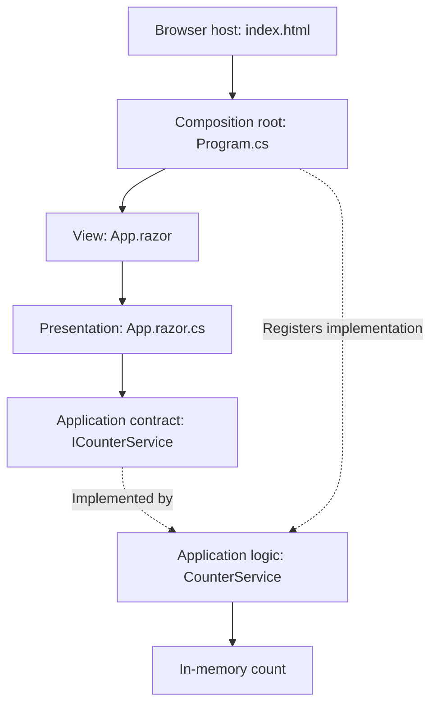
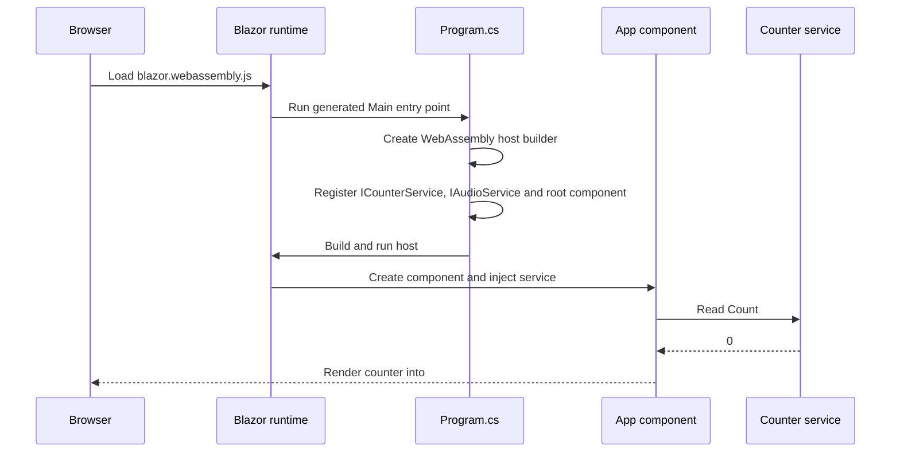
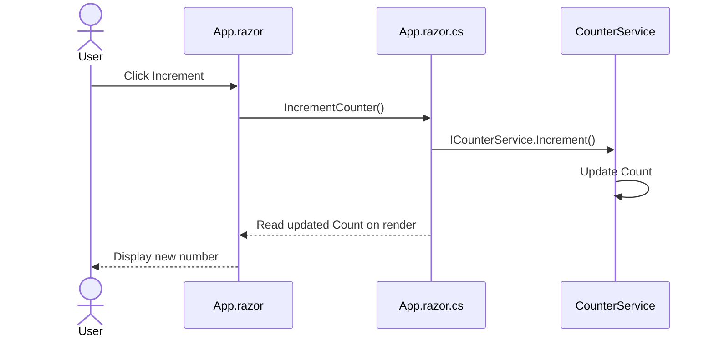
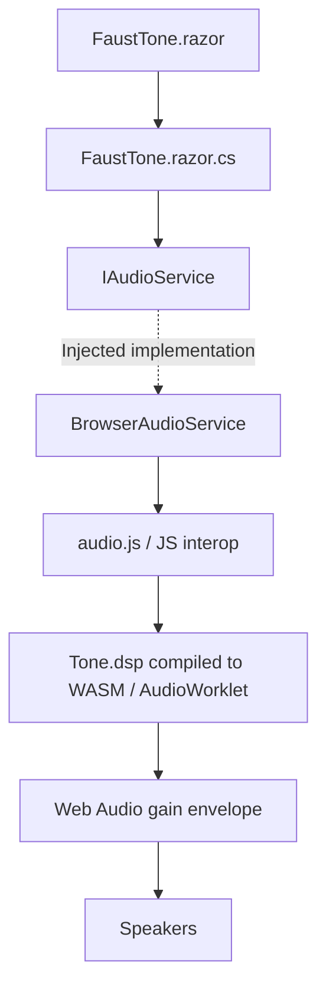

# Orbit 2

Orbit 2 is a small browser-based experiment for redesigning Orbit using a layered .NET architecture. It uses standalone Blazor WebAssembly for the UI and a separate, framework-independent C# application library.

The counter demonstrates isolated C# application state and dependency injection. A second component plays a short 440 Hz sine tone generated by Faust DSP in a WebAssembly AudioWorklet. Neither experiment requires React, TypeScript or an ASP.NET backend. Node.js/npm are used only to compile Faust at build time.

## Requirements and local execution

- .NET 10 SDK
- Node.js 24 (with npm, for the Faust compiler only)
- A modern browser supporting Web Audio and AudioWorklet

From the repository root:

```sh
npm exec --yes --package=@grame/faustwasm@0.19.0 -- faust2wasm-ts src/Orbit.Audio/Tone.dsp src/Orbit.UI/wwwroot/faust/generated
dotnet run --project src/Orbit.UI --urls http://localhost:5000
```

Open http://localhost:5000. Clicking **Increment** calls the C# application service and displays its updated count. Clicking **Play Faust tone** plays a quiet 400 ms sine wave. Re-run the Faust compile command after changing the DSP source.

## Architecture and layer boundaries



| Layer | Current implementation | Responsibility |
| --- | --- | --- |
| Browser host | `wwwroot/index.html` | Loads styles and the Blazor runtime; provides the mount element for the UI. |
| Composition root | `Program.cs` | Creates the WebAssembly host, registers services and mounts the root component. This is where concrete implementations are wired together. |
| View (UI) | `App.razor`, `wwwroot/styles.css` | Defines appearance, displays values and binds user actions to presentation handlers. |
| Presentation | `App.razor.cs` | Connects the UI to the application service through its interface. It contains event handlers and view-facing properties, not application rules. |
| Application | `ICounterService.cs`, `CounterService.cs` | Defines the contract, implements the increment operation and owns the current state. |
| Data/state | `CounterService.Count` | An in-memory integer owned by the service. There is no database or persistence layer yet. |
| Audio application contract | `IAudioService.cs` | Abstracts audio initialization and playback. |
| Browser infrastructure | `BrowserAudioService.cs`, `wwwroot/faust/audio.js` | Translates C# calls into Web Audio operations and loads the compiled Faust node. |
| Processing/DSP | `src/Orbit.Audio/Tone.dsp` | Generates a sine wave inside a separate AudioWorklet thread, independently of Blazor's rendering lifecycle. |

The application library does not reference Blazor or the UI project. The UI project references the application library, but the dependency cannot go in the opposite direction.

**There are two places where the layers meet:** `Program.cs` is the composition root (wiring and dependency injection), while `App.razor.cs` and `FaustTone.razor.cs` are presentation boundaries (interaction between the view and the application contract).

## Application startup flow



1. The browser first loads `src/Orbit.UI/wwwroot/index.html`. Its `#app` element initially displays loading text.
2. The framework script `_framework/blazor.webassembly.js` loads the .NET WebAssembly runtime and the compiled application.
3. The first **application-owned C# code** to execute is in `src/Orbit.UI/Program.cs`. Its top-level statements are compiled into an entry-point method by the C# compiler; there is no manually declared `Main()` method.
4. `WebAssemblyHostBuilder.CreateDefault(args)` creates the host builder.
5. `builder.RootComponents.Add<App>("#app")` registers the root Blazor component and identifies its mount element.
6. `builder.Services.AddSingleton<ICounterService, CounterService>()` tells dependency injection how to resolve the interface. The service instance is shared within this running client application. The audio adapter is similarly registered as `IAudioService`.
7. `await builder.Build().RunAsync()` builds and starts the host. Blazor creates the root component, resolves and injects the service, and renders the view.
8. `App.razor` reads the `Count` property from its code-behind, which in turn reads `ICounterService.Count`.

`App.razor` and `App.razor.cs` are two partial definitions of the same generated `App` component class. The Razor markup supplies the view, while the C# file supplies the presentation behavior. They are kept separate for readability, not separate runtime objects.

## Increment button: UI to processing and back



1. The button in `App.razor` binds its click event to `IncrementCounter()`.
2. Blazor invokes that handler in `App.razor.cs`.
3. The handler calls `ICounterService.Increment()`. Dependency injection provides the actual `CounterService` implementation.
4. `CounterService.Increment()` modifies its own `Count` property.
5. After the component event handler completes, Blazor schedules a render. The view reads `Count` again through the presentation layer and displays the new value.

This is ordinary C# method execution, not a network request. The browser holds the service state in memory. Reloading the application creates a new instance, so the counter resets.

## Faust tone: UI to audio processing



The Faust program is intentionally only one oscillator:

```faust
import("stdfaust.lib");
process = os.osc(440);
```

1. When the child component renders, its code-behind initializes the injected audio service, which imports the JavaScript interop module without activating sound.
2. Clicking the button calls `IAudioService.PlayTestToneAsync()`, implemented by `BrowserAudioService`.
3. The adapter invokes `playTestTone()` in `audio.js`. On the first click, it creates/resumes an AudioContext, loads the precompiled Faust WASM binary and metadata, and creates a monophonic AudioWorklet node.
4. The Faust oscillator generates audio samples at 440 Hz. A Web Audio gain node schedules a short fade-in and fade-out to avoid clicks, at a peak gain of 0.1.
5. The browser sends the signal to its audio output. Subsequent clicks reuse the same graph.

Only the small infrastructure adapter uses handwritten JavaScript. Faust, not C# or JavaScript, defines the oscillator. The sample processing takes place on the audio rendering thread; Blazor manages only UI and control flow.

### Faust build-time integration

The pinned [official FaustWasm compiler](https://github.com/grame-cncm/faustwasm) compiles the tracked `Tone.dsp` file using the command above. It writes `dsp-module.wasm`, `dsp-meta.json`, the Faust runtime and example templates to `wwwroot/faust/generated/`. These files are reproducible build output and ignored by Git. The browser loads the compiled WASM and bundled runtime; it does not download or execute the Faust compiler.

## Repository layout and file responsibilities

```text
Orbit.slnx                          # Solution containing both projects
src/
  Orbit.Application/
    Orbit.Application.csproj        # Framework-independent class library
    Services/
      ICounterService.cs             # Contract consumed by the UI
      CounterService.cs              # Operation and state ownership
      IAudioService.cs               # Audio application contract
  Orbit.Audio/
    Tone.dsp                         # Faust source: the actual oscillator
  Orbit.UI/
    Orbit.UI.csproj                  # Blazor WASM project and dependencies
    Program.cs                       # C# entry point and composition root
    App.razor                        # Root component markup and event bindings
    App.razor.cs                     # Root component presentation logic
    Components/
      FaustTone.razor                # Single audio playback button
      FaustTone.razor.cs             # Audio presentation logic
    Infrastructure/
      BrowserAudioService.cs         # C# to JavaScript audio interop
    wwwroot/
      index.html                     # Browser entry document and mount point
      styles.css                     # Visual presentation
      faust/
        audio.js                     # Web Audio / Faust adapter
        generated/                   # Generated DSP WASM and runtime (ignored)
.github/
  workflows/
    build-and-deploy.yml             # Compile and deploy static output
.gitignore                           # Exclude generated and local build files
README.md                            # Architecture and development documentation
```

## How the architecture can evolve

The counter demonstrates the boundary between UI and application logic. As Orbit grows, additional projects can be introduced when needed, rather than coupling unrelated responsibilities to the component.

- `Orbit.Domain`: patch, oscillator, effect and node-graph models and domain rules.
- `Orbit.Application`: use cases and contracts for manipulating patches and coordinating processing.
- `Orbit.Infrastructure`: concrete persistence, file storage and browser integration adapters.
- `Orbit.Audio`: expand the existing DSP source folder into a dedicated audio engine with oscillators, modulation and effects.
- `Orbit.UI`: Razor components and presentation logic; no actual sound generation or low-level storage implementation.

These are proposed future responsibilities. The existing Audio folder contains only the first Faust oscillator; the two .NET projects remain UI and Application. The concrete implementations will be connected through dependency injection in the composition root. An audio processing engine would run independently of Blazor UI updates, with a browser audio adapter passing control parameters to it.

## Build and deployment

```sh
npm exec --yes --package=@grame/faustwasm@0.19.0 -- faust2wasm-ts src/Orbit.Audio/Tone.dsp src/Orbit.UI/wwwroot/faust/generated
dotnet build Orbit.slnx
dotnet publish src/Orbit.UI -c Release -o publish
```

GitHub Actions runs the same Faust compile step before publishing. The publish command produces the browser application in `publish/wwwroot`. GitHub Actions builds pull requests and publishes pushes to `main` to GitHub Pages. The workflow changes the HTML base path to `/orbit2/` for deployment and uploads the published static files before the deployment job.

To enable Pages, open **Settings → Pages → Build and deployment → Source**, select **GitHub Actions**, then run the **Build and deploy** workflow manually or push to main.

Expected project site: https://wgabel.github.io/orbit2/
