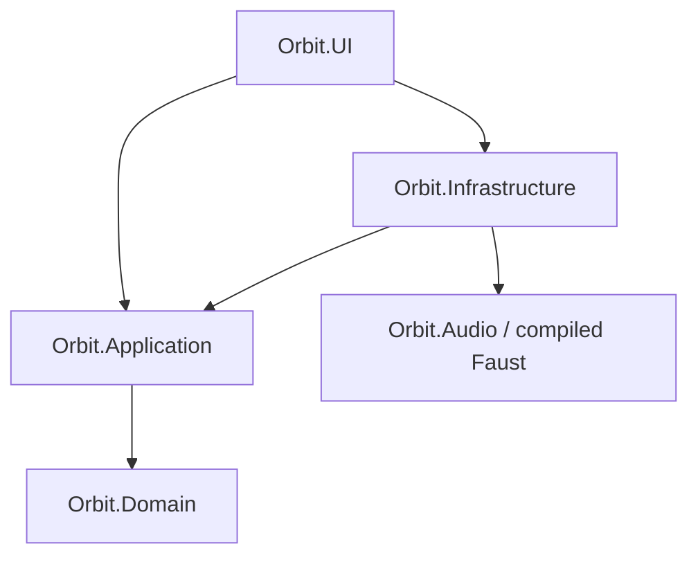
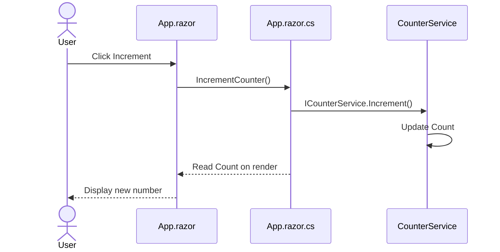
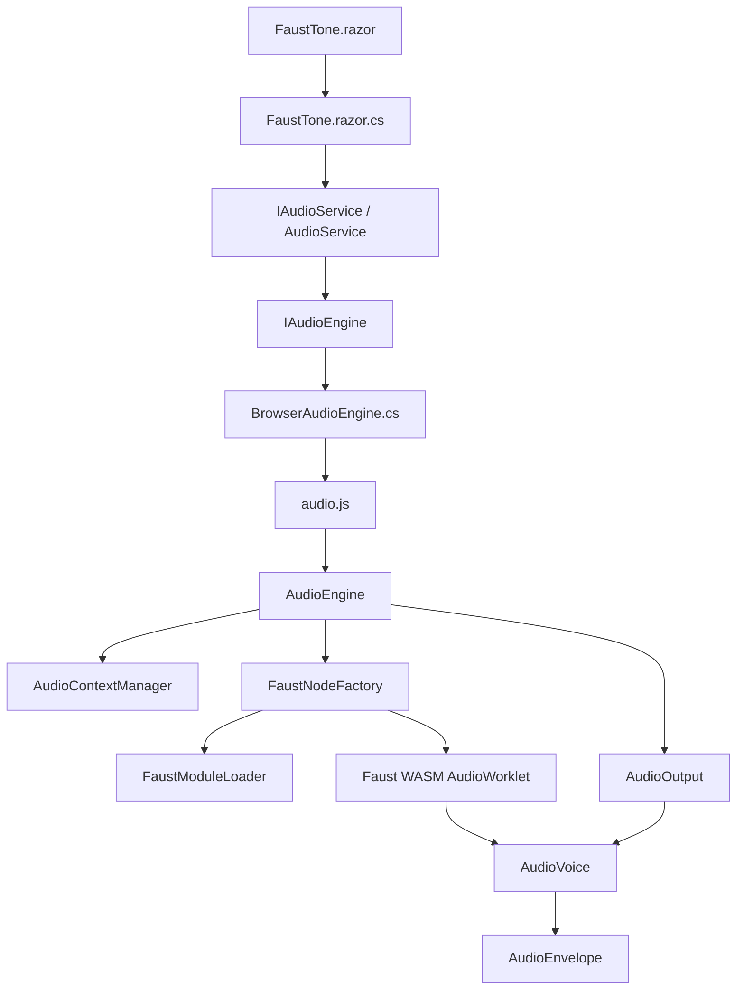

# Orbit 2

A browser-based experiment for rebuilding Orbit with independent C# application logic, Blazor WebAssembly UI and Faust DSP. The existing counter demonstrates state ownership; the Faust button demonstrates real-time audio processing. No React or TypeScript is used.

The long-term modular synthesizer design is documented in [ORBIT2-ARCHITECTURE.md](ORBIT2-ARCHITECTURE.md). Phase 1 adds the independent signal graph model; the original tone demo remains the running audio example.

## Requirements and local execution

- .NET 10 SDK
- Node.js 24 with npm (build tooling and infrastructure tests only)
- A modern browser supporting Web Audio and AudioWorklet

From the repository root:

```sh
npm exec --yes --package=@grame/faustwasm@0.19.0 -- faust2wasm-ts src/Orbit.Audio/Dsp/Oscillators/Sine.dsp src/Orbit.Infrastructure/wwwroot/audio/generated/sine
dotnet run --project src/Orbit.UI --urls http://localhost:5000
```

Open http://localhost:5000. **Increment** increases the counter; **Play Faust tone** plays a 440 Hz sine wave for 400 ms at 0.1 linear gain with gentle fades.

## Project boundaries



| Layer | Project | Responsibility |
| --- | --- | --- |
| UI/presentation | Orbit.UI | Razor components, code-behind, view state and styles. |
| Application | Orbit.Application | Framework-neutral contracts, request models, node registry, counter state and audio use cases. |
| Domain | Orbit.Domain | Signal graphs, nodes, parameters, ports, connections and graph validation. |
| Infrastructure | Orbit.Infrastructure | C# adapter and modular browser audio runtime. No UI or use-case policy. |
| Processing/DSP | Orbit.Audio | Faust programs that generate samples. Compiled into WASM during build. |

The infrastructure implements contracts declared by Application. The UI composition root registers concrete implementations; UI components consume application-facing interfaces only. There is no database or persistence layer yet.

The infrastructure uses the .NET Razor class library SDK solely to package browser-side static assets. It exposes them under `_content/Orbit.Infrastructure/audio/` in the published app and contains no Razor views.

## Startup sequence

1. `src/Orbit.UI/wwwroot/index.html` loads the fingerprinted Blazor bootstrap script and defines the `#app` mount point.
2. Blazor starts .NET WebAssembly, invoking the compiler-generated entry point in `Program.cs`.
3. `Program.cs` creates the host, registers the root component and binds interfaces to implementations via DI: `ICounterService → CounterService`, `IAudioService → AudioService`, `IAudioEngine → BrowserAudioEngine`.
4. The host starts and renders `App.razor`. Its code-behind reads the counter service.
5. The child `FaustTone` renders. Its code-behind calls `IAudioService.InitializeAsync()`, which imports the infrastructure's JavaScript entry module via the adapter. No sound or AudioContext starts during initialization.
6. The **Play Faust tone** button becomes enabled. AudioContext creation/resume is deferred to the actual click to respect autoplay restrictions.

`App.razor` and `App.razor.cs` are partial definitions of the same component class, as are `FaustTone.razor` and its code-behind.

## Counter event flow



Counter state is in memory, not in the UI. Reloading the application creates a new service instance and resets the counter.

## Audio event flow



1. The button invokes the presentation handler, which delegates to `IAudioService.PlayTestToneAsync()`.
2. `AudioService` creates a framework-neutral `PlaybackRequest` with processor ID, sound ID, duration, gain and a named frequency parameter.
3. `BrowserAudioEngine` implements the `IAudioEngine` contract and calls the entry module through Blazor JS interop.
4. `audio.js` is the browser-side composition root. It registers the processor catalog, constructs components with explicit dependencies and exports `play`, `stop` and `dispose`.
5. `AudioEngine` orchestrates playback, resumes the shared AudioContext via `AudioContextManager` first, and reserves the requested sound ID.
6. `FaustNodeFactory` retrieves the compiled and cached WASM module through `FaustModuleLoader`, creates a fresh AudioWorklet node and sets the named DSP parameters.
7. `AudioOutput` connects that source through an independent `AudioVoice` gain to the shared master output. `AudioEnvelope` schedules the fades and duration against the audio clock; the voice handles cleanup.
8. The worklet generates audio on the audio rendering thread. UI rendering or JavaScript timer accuracy does not determine the waveform or the fade duration.

The public port supports stopping a playback by its sound ID. Each playback owns a node and independent gain; nodes are disconnected and destroyed on completion or cancellation. Compiled modules are cached, and only one AudioContext is shared.

The Faust program itself is reusable and parameterized:

```faust
import("stdfaust.lib");
declare name "Sine";
frequency = hslider("frequency", 440, 20, 20000, 1);
process = os.osc(frequency);
```

## Browser infrastructure components

| Component | Responsibility |
| --- | --- |
| audio.js | Compose dependencies and expose the narrow interop API; no playback or DSP logic. |
| AudioEngine.js | Coordinate playback, validate requests, manage active sound IDs and cleanup. |
| AudioContextManager.js | Create, resume and close the one shared AudioContext. |
| FaustModuleLoader.js | Download and cache compiled modules and metadata; retry failed loads. |
| FaustNodeFactory.js | Create independent Faust worklet nodes and map parameters using their published paths. |
| AudioOutput.js | Own master output; create separate, initially silent voice paths. |
| AudioVoice.js | Own one playback's source/gain lifecycle; stop and release resources. |
| AudioEnvelope.js | Schedule gain changes on the audio clock, including click-reducing ramps. |

## Signal graph foundation (Phase 1)

The independent domain model describes topology without generating samples. It has no browser or Faust dependency. Signal nodes expose read-only port and parameter collections; SignalGraph owns validated connection and parameter edits.

- A sine generator has a frequency and amplitude parameter, each with its own modulation input. The same sine node can serve as an audible oscillator or an LFO.
- A gain processor has a mono audio input, gain modulation input and audio output; master output is a terminal mono input.
- Typed ports allow one output to feed several inputs, and modulatable parameters accept multiple sources. Connection amounts represent audio gain or target-specific modulation depth.
- Graph validation rejects missing or reversed endpoints, incompatible types/channels, duplicate edges, single-input conflicts and cycles (including modulation cycles).
- Removing a node removes its incident edges in the same operation. Parameter settings remain base values and never receive audio-rate samples.
- The application registry creates independently identified node instances. The tone demo is deliberately unchanged: the graph is not yet compiled into executable Faust DSP.

A small graph can be built and validated without a UI or audio device:

```csharp
using Orbit.Application.Graphs;
using Orbit.Domain.Graphs;
using Orbit.Domain.Nodes.Generators;
using Orbit.Domain.Nodes.Outputs;
using Orbit.Domain.Parameters;
using Orbit.Domain.Ports;

var registry = BuiltInNodes.CreateRegistry();
var graph = new SignalGraph();
var lfo = registry.Create(SineGenerator.NodeType);
var oscillator = registry.Create(SineGenerator.NodeType);
var output = registry.Create(MasterOutput.NodeType);

graph.AddNode(lfo);
graph.AddNode(oscillator);
graph.AddNode(output);

var lfoFrequency = lfo.Parameters.Single(p => p.Definition.Key == "frequency");
graph.SetParameterValue(new ParameterAddress(lfo.Id, lfoFrequency.Id), 0.5);

var frequencyInput = oscillator.Inputs.Single(p => p.Key == "frequency-modulation-in");
graph.Connect(new PortAddress(lfo.Id, lfo.Outputs.Single().Id),
    new PortAddress(oscillator.Id, frequencyInput.Id), amount: 100);
graph.Connect(new PortAddress(oscillator.Id, oscillator.Outputs.Single().Id),
    new PortAddress(output.Id, output.Inputs.Single().Id));
```

This describes a 0.5 Hz LFO modulating the second oscillator's 440 Hz base frequency by ±100 Hz. The actual sample-rate calculation and playback of this graph are planned in Phase 2.

## Repository layout

```text
Orbit.slnx
src/
  Orbit.Domain/
    Orbit.Domain.csproj
    Graphs/
    Nodes/
    Parameters/
    Ports/
  Orbit.Application/
    Orbit.Application.csproj
    Interfaces/IAudioEngine.cs
    Models/PlaybackRequest.cs
    Graphs/NodeRegistry.cs
    Graphs/BuiltInNodes.cs
    Services/
      IAudioService.cs
      AudioService.cs
      ICounterService.cs
      CounterService.cs
  Orbit.Audio/
    Dsp/Oscillators/Sine.dsp
  Orbit.Infrastructure/
    Orbit.Infrastructure.csproj
    Audio/BrowserAudioEngine.cs
    wwwroot/audio/
      audio.js
      AudioEngine.js
      Components/
        AudioContextManager.js
        AudioOutput.js
        AudioVoice.js
        AudioEnvelope.js
      Faust/
        FaustModuleLoader.js
        FaustNodeFactory.js
      generated/sine/                 # compiled WASM and runtime; ignored
  Orbit.UI/
    Orbit.UI.csproj
    Program.cs
    App.razor
    App.razor.cs
    Components/FaustTone.razor
    Components/FaustTone.razor.cs
    wwwroot/index.html
    wwwroot/styles.css
tests/audio/                         # isolated browser infrastructure tests
tests/Orbit.Domain.Tests/            # framework-neutral graph and registry tests
.github/workflows/build-and-deploy.yml
README.md
ORBIT2-ARCHITECTURE.md
.gitignore
```

## Development principles

- Single responsibility; constructor injection; composition over inheritance.
- Application contracts, data and use cases never depend on Blazor or browser APIs.
- UI logic remains in code-behind; no audio implementation or source parameters in Razor.
- C# and JS composition roots are the only places where concrete dependencies are wired.
- Browser components are independently testable and have no global mutable state outside the composed engine.
- The real-time DSP and envelopes use the audio rendering system, not UI rendering or timers.
- Add new DSP programs by registering their generated artifacts in the processor catalog; extend infrastructure only for genuinely new capabilities.

## Build, tests and deployment

Run the Faust compile command shown above before building. The official pinned FaustWasm compiler generates the browser-only runtime and WASM output; the compiler is not shipped or executed in the browser.

```sh
dotnet test tests/Orbit.Domain.Tests/Orbit.Domain.Tests.csproj -c Release
node --test tests/audio/*.test.mjs
dotnet build Orbit.slnx
dotnet publish src/Orbit.UI -c Release -o publish
```

GitHub Actions tests the domain and registry, compiles Faust, tests the infrastructure modules, builds the referenced .NET projects, checks the published static assets and deploys `publish/wwwroot` to GitHub Pages. For main deployments it rewrites the HTML base path to `/orbit2/`. Blazor's build-time fingerprinting and generated import map version the runtime assets, reducing mixed-version caching when a deployment replaces browser modules.

Open https://wgabel.github.io/orbit2/ after deployment.
