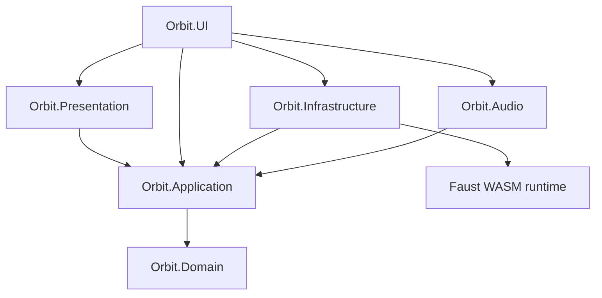
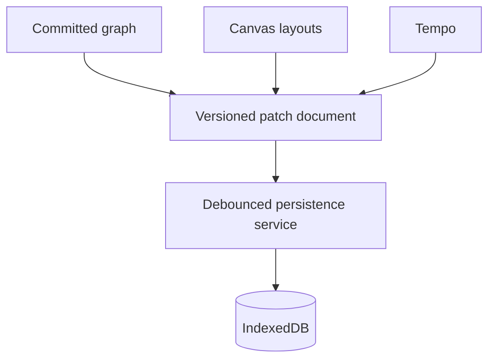
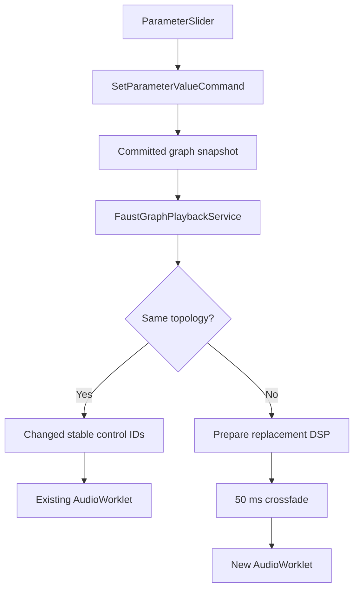
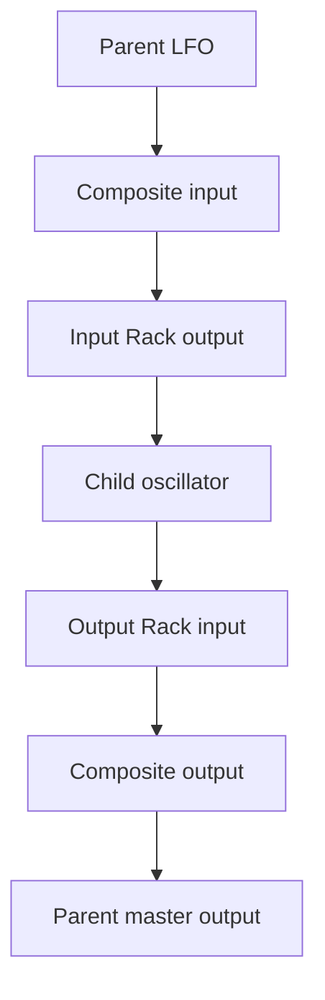

# Orbit 2

A browser-based modular synthesizer built with independent C# application logic, Blazor WebAssembly UI and Faust DSP. No React or TypeScript is used.

The long-term modular synthesizer design is documented in [ORBIT2-ARCHITECTURE.md](ORBIT2-ARCHITECTURE.md). Phase 1 adds the independent signal graph model. Phase 2 executes a fixed modulation graph using Faust and exposes the shared audio clock. Phase 3 adds a session-owned command and committed event system plus the framework-neutral canvas presentation state. Phase 4 connects the editable graph to a runtime Faust compiler and AudioWorklet playback. Phase 5 begins with composite nodes and immutable nested graph snapshots.

## Requirements and local execution

- .NET 10 SDK
- Node.js 24 with npm (build tooling and infrastructure tests only)
- A modern browser supporting Web Audio and AudioWorklet

From the repository root:

```sh
npm exec --yes --package=@grame/faustwasm@0.19.0 -- faust2wasm-ts src/Orbit.Audio/Dsp/Oscillators/ModulatedSine.dsp src/Orbit.Infrastructure/wwwroot/audio/generated/modulated-sine
npm install --no-audit --no-fund --ignore-scripts --no-save @grame/faustwasm@0.19.0
node scripts/prepare-faust-compiler.mjs
node src/Orbit.UI/DesignSystem/generate-tokens.mjs
dotnet run --project src/Orbit.UI --urls http://localhost:5000
```

Open http://localhost:5000. Use **Play patch** to compile and play the current graph, and **Stop** to release it with a short fade. The initial patch is a sine LFO modulating a sine carrier through a gain node. The status reports the playing graph revision. Edit frequency, amplitude, gain or routing while audio runs: base values update in place, and changed DSP programs crossfade automatically.

## Project boundaries



| Layer | Project | Responsibility |
| --- | --- | --- |
| UI | Orbit.UI | Razor components, code-behind and styles. |
| Presentation state | Orbit.Presentation | Testable canvas layout, viewport transforms and selection; no Blazor or audio dependency. |
| Application | Orbit.Application | Framework-neutral contracts, request models, node registry, timing contracts and audio use cases. |
| Domain | Orbit.Domain | Signal graphs, nodes, parameters, ports, connections and graph validation. |
| Infrastructure | Orbit.Infrastructure | C# adapter and modular browser audio runtime. No UI or use-case policy. |
| Processing/DSP | Orbit.Audio | Graph-to-Faust source compiler and Faust programs that generate samples. |

The infrastructure implements contracts declared by Application. The UI composition root registers concrete implementations; UI components consume application-facing interfaces only. The current editor workspace is recovered from browser-local IndexedDB; no server database or account is required.

## Workspace recovery (Phases 6.8–6.9)

Orbit automatically saves the committed patch, including nested graphs, rack definitions, dormant connections, base parameter values, BPM, per-canvas node positions and viewport, and the active graph. After the last edit autosave waits 350 ms, then replaces the recovery document in IndexedDB in one transaction. Reload restores that document before the canvas is shown. Playback remains stopped and live telemetry, beat position, and selection are not persisted. A missing document opens the demo; an incompatible or unreadable document is retained and autosave disabled for that session with a visible warning. Browser data clearing/private browsing can remove this local data.

### Named patches and portable files (Phase 6.10)

Open **Patches** in the header to save the current workspace by name, open an existing snapshot, explicitly overwrite or delete it, create a new patch, or export/import a JSON file. Named snapshots are independent of the automatic recovery record. New patches start with a master output; opening/importing requires stopped playback, validates the complete candidate before replacement, and commits recovery immediately. Invalid files leave the current graph intact. The JSON file uses the same versioned document as autosave.

### Graph history (Phase 6.11)

Undo and Redo in the shared toolbar restore up to 100 successful graph commands, including nested edits, parameter values, connections and rack boundaries, without stopping playback. Each operation publishes a new committed revision and uses the normal audio update and autosave paths. New edits discard redo history; loading a patch or refreshing starts a fresh history. Canvas pan, zoom, movement, selection and tempo are not graph commands and are not undoable. Recently deleted nodes and canvases recover their last layout when restored.

Dragging a parameter range slider is one undoable gesture, regardless of how many live values it emits. Keyboard range adjustment groups repeated key input until release; cancellation or blur finalizes the current value. Returning to the starting value leaves history unchanged. A separate gesture or unrelated graph command starts a separate undo step.



The infrastructure uses the .NET Razor class library SDK solely to package browser-side static assets. Local builds expose the default module directories under `_content/Orbit.Infrastructure/`; deployed builds use commit-versioned `audio-<commit>/` and `persistence-<commit>/` directories. The shared module-path resolver ensures .NET always imports matching JavaScript, including workers and generated Faust assets. IndexedDB names and keys stay unchanged across deployments. The library contains no Razor views.

## Startup sequence

1. The browser loads the fingerprinted Blazor bootstrap from `src/Orbit.UI/wwwroot/index.html`.
2. Blazor starts .NET WebAssembly and invokes `Program.cs`, the composition root.
3. The composition root registers one `BrowserAudioEngine` behind both `IAudioEngine` and `IAudioClock`, plus `IGraphPlaybackService` implemented by `FaustGraphPlaybackService` and the graph compiler.
4. The host renders `App.razor`, which mounts `GraphWorkspace` and `GraphPlaybackControls`. The controls initialize the audio module through the application service. AudioContext creation/resume is deferred to the Play button's user gesture.
5. Once initialized, the component enables the playback controls.

## Audio event flow

~~~mermaid
flowchart TD
    View["GraphPlaybackControls"] --> Service["IGraphPlaybackService"]
    Service --> Compiler["FaustGraphCompiler"]
    Compiler --> Request["PlaybackRequest"]
    Request --> Port["IAudioEngine"]
    Port --> Adapter["BrowserAudioEngine"]
    Adapter --> Entry["audio.js"]
    Entry --> Engine["AudioEngine"]
    Engine --> Context["AudioContextManager"]
    Engine --> Factory["FaustNodeFactory"]
    Factory --> Worker["FaustCompilerClient / Worker"]
    Worker --> DSP["WASM AudioWorklet"]
    Engine --> Output["AudioOutput"]
    DSP --> Output
    Output --> Voice["AudioVoice / AudioEnvelope"]
~~~

1. Play captures the committed graph snapshot. The C# service compiles it into Faust source and the initial host control values.
2. The adapter invokes the JavaScript entry module; the audio engine resumes the shared AudioContext before any worker download.
3. `FaustNodeFactory` requests a compiled factory from the lazy compiler worker. The worker loads the pinned packaged Faust bundle, compiles the source outside the main and audio threads, and returns the WebAssembly module and DSP metadata.
4. The node factory instantiates a mono AudioWorklet with a source-specific processor identity and applies the host values; the graph supplies gain, with additional output headroom.
5. `AudioOutput` connects the node through an independent initially silent voice. `AudioEnvelope` schedules the attack and release against the audio clock. Stop cancels pending startup or releases an active voice and frees its resources.
6. `GraphPlaybackControls` observes startup status and passes newly committed snapshots to the playback service. Base-only edits update the existing worklet; changed DSP programs are prepared and crossfaded automatically. It samples passive parameter meters at 25 Hz and passes revision-matched frames to the workspace.

### Live parameter update flow



The service compares the new snapshot to the last accepted playback topology, including edge amounts, ports and parameter definitions. Base-only changes use the compiler's existing control manifest and send only changed base values through `IAudioEngine.SetParametersAsync`. Structural edits regenerate source; if the source is identical (for example an unconnected node), the voice is reused. Otherwise `ReplaceAsync` prepares a new worklet while the old stays audible, then schedules a 50 ms complementary linear crossfade on the audio clock. The application serializes updates, announces new revisions immediately and skips superseded compilations before they become audible. A compilation failure leaves the last good graph playing and displays an error; correcting the graph retries automatically. Stop cancels pending replacements and releases every active voice. A replacement may reset oscillator/effect state; the crossfade reduces discontinuities, not a guarantee of phase preservation.

## Browser infrastructure components

| Component | Responsibility |
| --- | --- |
| audio.js | Compose dependencies and expose the narrow interop API; no playback or DSP logic. |
| AudioEngine.js | Coordinate playback, validate requests, manage active sound IDs and cleanup. |
| AudioContextManager.js | Create, resume and close the one shared AudioContext. |
| AudioClock.js | Read the existing context's frame-time snapshot without starting audio. |
| FaustCompilerClient.js | Own the lazy compiler worker, match asynchronous replies, propagate errors and dispose it. |
| FaustCompilerWorker.js | Serialize Faust compilations and return compiled modules and metadata; no audio render work. |
| FaustModuleLoader.js | Download and cache compiled modules and metadata; retry failed loads. |
| FaustOutputMonitor.js | Cache passive Faust output meter readings for display-rate snapshots. |
| FaustNodeFactory.js | Create independent Faust worklet nodes and map parameters using their published paths. |
| AudioOutput.js | Own master output; create separate, initially silent voice paths. |
| AudioVoice.js | Own one playback's source/gain lifecycle; stop and release resources. |
| AudioEnvelope.js | Schedule gain changes on the audio clock, including click-reducing ramps. |

## Signal graph foundation (Phase 1)

The independent domain model describes topology without generating samples. It has no browser or Faust dependency. Signal nodes expose read-only port and parameter collections; SignalGraph owns validated connection and parameter edits.

- One Oscillator generator supports sine, triangle, square and sawtooth. Frequency, amplitude and phase offset have modulation inputs; waveform is a discrete choice. The node can be an audible oscillator or an LFO.
- A gain processor has a mono audio input, gain modulation input and audio output; master output is a terminal mono input.
- Typed ports allow one output to feed several inputs, and modulatable parameters accept multiple sources. Connection amounts represent audio gain or target-specific modulation depth.
- Graph validation rejects missing or reversed endpoints, incompatible types/channels, duplicate edges, single-input conflicts and cycles (including modulation cycles).
- Removing a node removes its incident edges in the same operation. Parameter settings remain base values and never receive audio-rate samples.
- The application registry creates independently identified node instances. Phase 2 provides a specific mapping from a validated graph to a precompiled Faust program; Phase 4 implements general-purpose source compilation for the supported flat node types.

A small graph can be built and validated without a UI or audio device:

```csharp
using Orbit.Application.Graphs;
using Orbit.Domain.Graphs;
using Orbit.Domain.Nodes.Generators;
using Orbit.Domain.Nodes.Outputs;
using Orbit.Domain.Parameters;
using Orbit.Domain.Ports;

var registry = BuiltInNodes.CreateRegistry();
var graph = new SignalGraph();
var lfo = registry.Create(OscillatorGenerator.NodeType);
var oscillator = registry.Create(OscillatorGenerator.NodeType);
var output = registry.Create(MasterOutput.NodeType);

graph.AddNode(lfo);
graph.AddNode(oscillator);
graph.AddNode(output);

var lfoFrequency = lfo.Parameters.Single(p => p.Definition.Key == "frequency");
graph.SetParameterValue(new ParameterAddress(lfo.Id, lfoFrequency.Id), 0.5);

var frequencyInput = oscillator.Inputs.Single(p => p.Key == "frequency-modulation-in");
graph.Connect(new PortAddress(lfo.Id, lfo.Outputs.Single().Id),
    new PortAddress(oscillator.Id, frequencyInput.Id), amount: 100);
graph.Connect(new PortAddress(oscillator.Id, oscillator.Outputs.Single().Id),
    new PortAddress(output.Id, output.Inputs.Single().Id));
```

This describes a 0.5 Hz LFO modulating the second oscillator's 440 Hz base frequency by ±100 Hz. Phase 2 implements this particular modulation topology, including a gain stage, as an audible proof.

## Shared timing and audio-rate modulation (Phase 2)

The original Phase 2 playback proof built a fixed modulation graph through ModulationDemoPatch and PatchSession. Its precompiled DSP and offline tests remain as regression fixtures; the standalone demo UI and service have now been retired in favor of the editable graph.

~~~mermaid
flowchart LR
    LFO["Sine LFO · 0.5 Hz"] --> P["Frequency · 440 ± 100 Hz"]
    P --> OSC["Sine carrier"]
    OSC --> G["Voice gain and envelope"]
    G --> O["Master output"]
~~~

- ModulatedSine.dsp computes the LFO, effective frequency and carrier at the real audio sample rate. It uses the same reusable sine function for both oscillators. Faust smooths base settings before applying sample-rate modulation and clamps the effective frequency to a safe range.
- The same voice lifecycle is used by dynamic patch playback: it sustains until stopped, schedules a release using Web Audio time and disposes the voice.
- The default values produce a frequency changing from approximately 340 Hz to 540 Hz every two seconds. Depth 0 produces the base frequency without vibrato.
- AudioClock observes the single existing AudioContext's actual sample rate and elapsed context time. Its snapshot returns the estimated frame position at the rendering quantum boundary, not an independent clock. It does not start or resume the context.
- MusicalTransport converts sample-frame differences into beats and tempo-synchronized frequency. Tempo changes preserve beat position, stopping freezes it, and resuming continues from that position. The patch-wide transport is now wired to the browser clock (Phase 6.1).

### Shared musical transport (Phase 6.1)

The workspace has one tempo control (20–300 BPM, default 120), current beat number, real sample rate when available, and reset. The transport starts when patch playback is observed to be running, freezes on Stop, resumes at the previous beat when playing again, and resets to zero without changing tempo. Editing tempo before playing requires no audio context. Editing tempo during playback does not commit a graph revision or restart audio. Enter a value and choose **Apply tempo**.

~~~mermaid
flowchart TD
    A["Shared AudioContext"] --> C["IAudioClock"]
    C --> T["MusicalTransportService"]
    T --> M["MusicalTransport"]
    M --> S["TransportSnapshot"]
    S --> U["TransportControls"]
    U --> T
~~~

`MusicalTransportService` is registered once in the composition root and serializes clock observations, tempo changes and reset. `GraphPlaybackControls` observes the root playback lifetime and supplies the transport panel with immutable snapshots; it does not integrate beats itself. All nested canvases use that same transport; opening a drone or replacing its DSP never resets musical time. A suspended or replaced audio context freezes/re-anchors the timeline instead of jumping to another beat.

`MusicalTime` maps `MusicalDivision` to quarter-note beat lengths and converts them to Hz: for example at 120 BPM a quarter-note cycle is 2 Hz and a 4/4 bar is 0.5 Hz. Dotted and triplet divisions are defined too.

### Tempo-synchronized oscillator (Phase 6.2 / 6.4)

Add an **Oscillator** to any canvas and choose **Synchronized (BPM)** under Timing mode. Select a waveform and musical division (for example, 1/4 note), connect Signal to a frequency, amplitude or other modulation socket, and adjust the connection amount in the receiving parameter's units. At 120 BPM, a quarter note gives two cycles per second; a bar gives one cycle every two seconds. Change BPM while playing or reset transport to hear the synchronized modulation respond. Phase offset (degrees) and amplitude remain independently modulatable. Division is a validated discrete live choice, not a modulation socket.

~~~mermaid
flowchart TD
    T["MusicalTransportService"] --> A["Transport anchor"]
    A --> W["Transport AudioWorklet"]
    W --> F["Faust graph: shared beat input"]
    F --> R["Root tempo LFO"]
    F --> D["Nested tempo LFO"]
    R --> P["Modulated parameters"]
    D --> P
~~~

The application publishes transport anchors only when transport state changes. The browser owns one lazy `TransportSignalSource` per audio context; its worklet produces one beat sample per audio frame. When a reachable emitter requests the transport beat from `FaustNodeContext`, `FaustGraphCompiler` adds one beat input to the compiled graph. Every synchronized oscillator calculates phase in cycles as `beat / beatsPerCycle + phaseDegrees / 360`, then evaluates its chosen waveform. The 12-beat wrap keeps Float32 precision while preserving phase for all current divisions. Old and new graphs during a crossfade share the same source. Free-running oscillators use Hertz and need no transport input.

Steady-state phase is calculated at the actual audio sample rate (including 44.1 and 48 kHz). Start/stop/reset/tempo commands anchor to the observed audio frame and arrive at an audio-worklet message boundary; scheduled sample-exact command execution and rhythmic clock/trigger nodes remain future work.

### Reusable oscillator (Phase 6.3)

Select **Oscillator** from Add node (the default waveform is sine), then choose Sine, Triangle, Square or Sawtooth in the node itself. The starter patch and drone still default to sine. Every shape has the same output port and independently modulatable frequency (0.01–20,000 Hz), amplitude (0–1) and phase offset (0–360°); changing waveform leaves all node, parameter, port and connection identities untouched. The choice editor is the same reusable component used for musical division.

~~~mermaid
flowchart TD
    N["OscillatorGenerator"] --> P["Parameter definitions"]
    P --> U["Shared parameter editors"]
    U --> C["SetParameterValueCommand"]
    C --> G["Committed graph"]
    G --> F["OscillatorFaustEmitter"]
    F --> W["Selected waveform DSP"]
    W --> S["Signal output"]
~~~

`OscillatorWaveform` defines stable discrete choices; `ParameterDefinition.RequiresRecompile` distinguishes DSP-shaping choices from live controls. `GraphTopology` includes structural values, so selecting a different waveform recompiles the program and crossfades the replacement; ordinary frequency/amplitude/phase changes update the existing worklet. The compiler emits only the selected shape—not four parallel oscillators. A free-running oscillator integrates frequency into one phase signal at the actual sample rate, wraps phase plus the offset, evaluates the chosen waveform and clamps its normalized result before amplitude scaling. Saw and square use polynomial step corrections (PolyBLEP), and triangle uses a slope correction (PolyBLAMP) to reduce aliasing. This avoids a fixed audio-rate frequency floor for slow modulation. Equal peak amplitude is not equal perceived loudness; loudness matching is a separate feature.

### Unified timing modes (Phase 6.4)

The separate tempo sine node has been removed. All four oscillator waveforms work in both timing modes.

| Timing mode | Active rate parameter | Frequency modulation input |
|---|---|---|
| Free (Hz) | Frequency | Active |
| Synchronized (BPM) | Musical division | Dormant (cables preserved) |

`ParameterDefinition.ActiveWhen` references an unconditional local structural choice. The snapshot exposes `IsParameterActive` and `IsInputActive`, which drive the shared editor and backend. The inactive editor is hidden, but its stored value and socket survive. Dormant frequency connections remain visible as muted dashed wires, may be edited, and automatically reactivate when returning to free mode. `GraphFlattener` excludes dormant receiving routes from the backend graph before dependency ordering and range analysis. This prevents unused upstream DSP/control allocation; the original committed graph stays untouched. The graph still validates all connections, including dormant ones, so reactivation cannot create a cycle.

~~~mermaid
flowchart TD
    M["Timing mode"] --> H["Free: instantaneous Hz"]
    M --> B["Sync: transport beat / division"]
    H --> P["FaustOscillatorTiming"]
    B --> P
    P --> W["Shared phase-to-waveform DSP"]
    W --> S["Signal output"]
~~~

Changing timing mode is a structural edit and crossfades to the new program. Changing musical division is a discrete live control; it intentionally reinterprets the current beat relative to the selected cycle length (it can change phase immediately). Tempo edits preserve beat position without recompiling. Free and synchronized settings are remembered independently. Noise remains a separate generator family.

In synchronized mode the oscillator shows a read-only **Synchronized frequency** in Hz below Musical division. It follows the committed patch tempo and division even when playback is stopped and inside nested graphs. It does not change the stored free frequency or create a new modulation input.

### Noise generator (Phase 6.5)

Choose **Noise** in Add node, then select White (broadband), Pink (approximately equal power per octave), or Brown (bass-weighted). Amplitude defaults to 0.2 and supports audio-rate modulation from 0–1. Connect Signal to audio or a modulation input in any canvas. Unlike a periodic oscillator, noise has no frequency, phase or transport controls.

~~~mermaid
flowchart TD
    R[Node-specific random stream] --> C[Selected spectral shaping]
    C --> B[Bound to -1 through +1]
    B --> A[Modulatable amplitude]
    A --> S[Signal output]
~~~

`NoiseGenerator` uses the shared choice and slider editors. `NoiseFaustEmitter` selects the spectrum at compile time; changing color retains the connections and crossfades the replacement. Amplitude changes update the existing DSP. `FaustNoiseSpectra` uses a deterministic node-specific integer recurrence, octave-spaced low-pass responses for approximate pink noise and a leaky integrator for brown noise (not an unbounded random walk). Filter coefficients use the actual sample rate. The output is bounded before amplitude scaling, so existing modulation range prediction applies. Noise colors are not loudness matched. A structural replacement restarts the pseudorandom sequence.


There is no per-sample C# or JavaScript event loop. The audio engine controls waveform generation; browser timers observe playback for resource cleanup, and the UI reads passive meter snapshots at display rate. Graph playback currently stages graph edits until the next start.

## Graph commands and committed events (Phase 3 foundation)

The application layer owns graph edits through `IPatchSession`. Each session owns one root graph, its descendants, and one notification dispatcher. Neither views nor processing components mutate the graph directly. Domain validation still occurs inside `SignalGraph`; no second set of graph rules is introduced.

~~~mermaid
sequenceDiagram
    participant Caller as Editor / patch builder
    participant Session as PatchSession
    participant Domain as SignalGraph
    participant Listeners as Subscribers
    Caller->>Session: Execute graph command
    Session->>Domain: Validate and apply edit
    Domain-->>Session: Success
    Session->>Session: Capture snapshot and revision
    Session->>Listeners: Publish one committed change set
    Session-->>Caller: Result and listener errors
~~~

| Command | Successful event |
| --- | --- |
| `AddNodeCommand` | `NodeAdded` |
| `ConnectNodesCommand` | `ConnectionCreated` |
| `RemoveConnectionCommand` | `ConnectionRemoved` |
| `SetConnectionAmountCommand` | `ConnectionAmountChanged` (same edge identity, before and after coefficients) |
| `RemoveNodeCommand` | All incident `ConnectionRemoved` facts, then `NodeRemoved`, in one change set |
| `SetParameterValueCommand` | `ParameterChanged` (not topology) |

Example: two independent listeners receive the same successful edit.

~~~csharp
using Orbit.Application.Graphs;
using Orbit.Application.Graphs.Commands;
using Orbit.Application.Graphs.Events;
using Orbit.Application.Graphs.Sessions;
using Orbit.Domain.Nodes.Generators;

using IPatchSession session = new PatchSession(BuiltInNodes.CreateRegistry());
using var graphListener = session.Subscribe(change =>
    Console.WriteLine($"Revision {change.Revision}, {change.Snapshot.Nodes.Count} nodes"));
using var nodeListener = session.Subscribe<NodeAdded>(change =>
    Console.WriteLine($"Added {change.Node.Name}"));

var result = session.Execute(new AddNodeCommand(session.GraphId, OscillatorGenerator.NodeType));
~~~

- The result includes the immutable committed root snapshot and ordered events. `GraphChangeSet.GraphId` identifies the command target; `ChangedGraph` returns its local snapshot. One revision identifies the entire patch, even after future edits.
- Rejected commands and unchanged base-value edits do not increment the revision or publish anything. Validation exceptions are returned to the caller through the existing exception contract.
- Subscriptions are disposable, session-scoped and optionally filtered by the command or affected fact's graph ID. A boundary edit publishes one changeset to each affected graph, while typed subscriptions receive only that graph's facts. Unfiltered subscribers see every commit exactly once. Delivery is synchronous and serialized; listeners should schedule asynchronous work and return quickly. A failed listener is reported in `GraphCommandResult.SubscriberErrors`, without rolling back the change or blocking other subscribers.
- Layout events and DSP telemetry are separate from graph commands. Audio and canvas projections will subscribe to committed changes when the dynamic editor/compiler are introduced.
- The existing fixed demo now constructs its graph with these commands and derives its playback request from the final snapshot. Its precompiled regression DSP remains independent of the live graph.

See [the architecture document](ORBIT2-ARCHITECTURE.md#9-commands-events-and-transaction-boundaries) for the transaction boundary, event flow, and future nested-graph requirements.

## Canvas presentation state (Phase 3 foundation)

`Orbit.Presentation` is a plain .NET project for UI state and geometry. It references Application, not Blazor or infrastructure. Each future root or nested canvas owns a `CanvasStateService` instance observing the graph's committed revisions.

~~~mermaid
flowchart TD
    Session["PatchSession"] --> Snapshot["Committed graph snapshot"]
    Snapshot --> State["CanvasStateService"]
    Gesture["Layout gesture"] --> State
    State --> View["Immutable canvas snapshot"]
    View --> Renderer["Future graph canvas"]
    State --> Event["Canvas state notification"]
~~~

| Type | Responsibility |
| --- | --- |
| `CanvasPoint` | Finite world/screen coordinate at the service boundary |
| `CanvasViewport` | Pan, zoom, pointer-anchored coordinate conversion |
| `INodePlacementPolicy` / `GridNodePlacementPolicy` | Initial nonoverlapping grid positions for new nodes |
| `ICanvasStateService` / `CanvasStateService` | Reconcile committed graph edits; manage layout and selection |
| `CanvasStateSnapshot` | Immutable graph snapshot plus layout revision, positions, viewport and selection |
| `CanvasStateChange` | Local notification with the consistent final presentation snapshot |

A node movement, selection, pan or zoom increments only the layout revision. A graph commit updates the graph revision and reconciles deleted nodes/edges and newly added positions. Existing positions and viewport remain stable; a parameter change does not alter the layout revision. Graph and layout notification channels reuse the same generic `NotificationChannel<T>` implementation, but are separate instances with independent subscribers.

~~~csharp
using Orbit.Application.Graphs;
using Orbit.Application.Graphs.Commands;
using Orbit.Application.Graphs.Sessions;
using Orbit.Domain.Nodes.Generators;
using Orbit.Presentation.Canvas;

using IPatchSession session = new PatchSession(BuiltInNodes.CreateRegistry());
using ICanvasStateService canvas = new CanvasStateService(session);
using var listener = canvas.Subscribe(change =>
    Console.WriteLine($"{change.Kind}, layout revision {change.Snapshot.LayoutRevision}"));

session.Execute(new AddNodeCommand(session.GraphId, OscillatorGenerator.NodeType));
var nodeId = canvas.Snapshot.Graph.Nodes.Single().Id;
canvas.MoveNode(nodeId, new CanvasPoint(200, 100));
canvas.PanBy(new CanvasPoint(-40, 80));
canvas.ZoomAt(2, new CanvasPoint(200, 100)); // 200%, anchored to pointer
~~~

The coordinate transform is `screen = world * zoom + pan`, so moving a node by a screen delta at 200% zoom changes its world position by half that delta. Zoom is clamped to 25–400%. Canvas instances have independent state. Use the presentation dispatcher thread for layout and graph edits observed by the canvas; previously captured immutable snapshots can be read by asynchronous work. Dispose each canvas to unsubscribe from the session.

This foundation is tested independently of Blazor. The first visible graph editor uses these snapshots and transforms, and fit-to-content uses measured node bounds.

## First visual graph editor (Phase 4)

The application opens a persistent editable patch session with the initial modulation topology (LFO → sine generator → gain → output). The editor uses the existing domain registry; add nodes, delete selected nodes or wires, and edit the base values using the shared ParameterSlider. These changes commit graph revisions, not audio events.

- Drag a node header to move it. Drag empty background or middle-drag a node header to pan.
- Wheel zoom is anchored at the pointer; the toolbar shows the current zoom, zoom buttons, reset and fit-to-content.
- Begin from an output and drag to an input, or click the output then click an input. Escape cancels. The existing domain validation rejects incompatible, duplicate or cyclic edges.
- Nodes use role-colored frames and typed port shapes. A generator feeding only modulation inputs is visually an LFO; no different DSP type is required.
- SVG paths use cubic Bézier geometry shared by all connections, with endpoints measured from actual port markers. Click a wire to select it.
- The compact workspace shares one toolbar for zoom, node creation/deletion, playback and transport. Breadcrumbs sit beside the title; node/connection count and interaction hints are non-interactive canvas overlays. The canvas fills remaining viewport height, with a token-defined minimum. Playback remains owned by the root workspace while the keyed canvas changes on navigation.
- All static dimensions and colors are sourced from design tokens. Layout state is separate from graph state.

~~~mermaid
flowchart TD
    Workspace["GraphWorkspace"] --> Session["PatchSession"]
    Workspace --> State["CanvasStateService"]
    Session --> State
    State --> Renderer["GraphCanvas"]
    Renderer --> Components["NodeFrame / PortConnector / ConnectionLayer"]
    Renderer --> DOM["canvasDom.js · DOM only"]
    Renderer --> Workspace
~~~

The small DOM adapter measures port/node geometry, captures pointers and resolves a dropped input. It does not own graph state or compute audio. The C# presentation library provides viewport and Bézier geometry. The workspace translates edits into session commands.

The editor uses GraphPlaybackControls to play any supported committed patch. Edits update the playing revision automatically, either through live base controls or by crossfading a replacement worklet. The obsolete fixed proof UI has been removed.

### Editing connection amounts

Click a Bézier connection to select it and open the shared `ConnectionAmountEditor`. Enter a signed number and choose **Apply amount**. For direct parameter modulation the editor displays the target unit (Hz, normalized, ratio, etc.); for audio and intermediate boundary routes it displays a multiplier. Each route has its own coefficient. A zero amount silences its contribution without removing the wire; a negative amount inverts its signal. The source amplitude still determines the actual excursion.

~~~csharp
session.Execute(new SetConnectionAmountCommand(graphId, connectionId, 100));
~~~

For a unit-amplitude bipolar sine, depth 100 into a 440 Hz frequency gives 340–540 Hz; depth 0.2 into amplitude gives a ±0.2 contribution before clamping. At a composite boundary, amounts multiply along the route, and the final parameter's unit applies only at its input.

`SignalGraph.SetConnectionAmount` replaces the immutable edge in place, retaining ID, endpoints and order. The session commits one revision and publishes `ConnectionAmountChanged` with the before/after records. Invalid or unchanged values do not commit. The canvas retains the selection; range estimation and playback receive the new snapshot. As amounts are presently source literals, a reachable changed amount recompiles and crossfades while playing. Explicit Apply avoids recompiling each intermediate keystroke.

## Faust graph compiler (Phase 4)

`Orbit.Audio` is a plain .NET library that consumes a committed `GraphSnapshot` and produces a `FaustGraphProgram`: Faust source plus graph ID, revision and stable host control mappings. It does not load WASM, own the browser audio device or have any dependency on the canvas.

~~~mermaid
flowchart TD
    S["GraphSnapshot"] --> C["FaustGraphCompiler"]
    C --> B["GraphFlattener"]
    B --> O["GraphDependencyOrder"]
    O --> R["Registered node emitters"]
    R --> P["FaustNodeContext"]
    P --> F["Faust source + control mappings"]
    F --> W["Faust WASM compilation"]
    W --> T["Offline sample rendering tests"]
~~~

- The compiler walks backward from the sole master output and orders all reachable audio and modulation dependencies. Disconnected nodes are excluded; a disconnected master produces silence.
- `IFaustNodeEmitter` is the backend extension point. Oscillator and gain have independent implementations. `FaustNodeContext` handles routing, weighted input summation, parameter slider generation, smoothing, clamping, validated structural constants and the optional transport dependency.
- Each parameter control uses its node and parameter IDs, never user labels. The program source is stable across base-value edits; the latest values travel separately in the control map and must be applied before playback.
- For linear parameters, effective value = clamped (smoothed base + sum of incoming signals × connection amounts). Frequency also stays below the sample-rate-dependent Nyquist limit. Modulation signals themselves run at audio rate.
- Connection amounts are baked into this first source representation. Changing connection amounts or topology requires recompilation; a future runtime can expose depth controls without recompiling.
- The current backend supports mono free or tempo-synchronized periodic oscillators, gain, nested composite boundaries and exactly one root master output. Cycles and unsupported reachable node types are rejected.

CI exports an actual nested graph using `tests/Orbit.Audio.Probe`, compiles the generated source using the pinned Faust CLI, then renders it offline at 44.1 and 48 kHz. Tests verify that an external LFO can fan out through two rack inputs to internal pitch and gain, that audio returns through the output rack, and that a host can change an internal frequency control without recompiling.

To reproduce the graph compiler probe locally (Bash, .NET 10 and Node):

~~~bash
export ORBIT_GRAPH_PROBE_DIR="$(mktemp -d)"
dotnet run --project tests/Orbit.Audio.Probe/Orbit.Audio.Probe.csproj -- "$ORBIT_GRAPH_PROBE_DIR"
npm exec --yes --package=@grame/faustwasm@0.19.0 -- faust2wasm-ts "$ORBIT_GRAPH_PROBE_DIR/program.dsp" "$ORBIT_GRAPH_PROBE_DIR/compiled"
node --test tests/compiler/*.test.mjs
~~~

The browser compiler supports live base-value updates, automatic runtime replacement with revision tracking and passive meters for connected modulation parameters.

## Shared UI components

`ParameterSlider` is the first reusable presentation building block. It takes a domain parameter definition, editable base value and optional read-only modulation range and effective value. The same component renders all three settings, validates draft input without committing invalid values and reports errors to its parent.

~~~mermaid
flowchart TD
    D["ParameterDefinition + base value"] --> UI["ParameterSlider"]
    UI --> V["Validated base edit"]
    V --> Parent["Owning editor"]
    DSP["Faust effective frequency meter"] --> M["FaustOutputMonitor"]
    M --> S["Application service"]
    S --> UI
~~~

The editable thumb and numeric input stay at the base value. A colored band shows the effective range predicted by `GraphModulationRangeEstimator`, which resolves upstream signal bounds and connection amounts, sums modulation and applies parameter limits. Each registered DSP emitter supplies its optional output-bound rule; unsupported bounds are shown as unknown. For example, a 440 Hz base with a full-amplitude sine and a connection amount of 100 Hz gives a 340–540 Hz band.

The separate moving marker and Live label reflect actual Faust bargraph readings at 25 Hz, not a simulated LFO. Meter names map to stable node/parameter addresses. Frames are accepted only for the applied graph revision, and markers disappear while stopped or while a new graph is pending. The estimated band remains visible when stopped. Telemetry never changes the base parameter or emits graph commands.

Future root and nested canvases share the same viewport, node frame, port connector and Bézier connection components. Their interaction and visual contracts are defined in [the architecture document](ORBIT2-ARCHITECTURE.md#shared-canvas-and-component-standards).

### Frequency control design note

The current oscillator frequency control spans 0.01–20,000 Hz linearly. For LFO use this makes useful slow rates occupy almost none of the slider travel. A future rate-oriented control should provide a convenient 0.01–100 Hz modulation range (possibly logarithmic or with coarse/fine editing) without changing the generator's underlying audio-rate frequency capability. The period is `1 / frequency`: higher rates produce shorter cycles, but can become too fast to observe or use as slow modulation.

## Composite graph foundation (Phase 5)

`CompositeNode` implements `ICompositeNode` and creates a distinct `SignalGraph`, one `InputRack` and one `OutputRack`. Each named `ExposedPort` is projected as a parent socket and an opposite-direction child rack socket with the same ID. Connections remain local to their graph; the boundary is the only permitted route between them.



The domain rejects recursive ownership, shared concrete node instances, cross-graph connections, standalone rack insertion/removal and child master outputs. `GraphNodeSnapshot.Composite` captures the child graph and rack IDs without referencing mutable objects. `GraphSnapshot.GetGraph` resolves nested graph IDs within the captured patch revision.

The existing commands now address the root or any owned child by its graph ID, with one serialized session commit and one patch revision. For example, after creating a composite (using a registered factory), add a generator to its child:

```csharp
var childGraphId = compositeSnapshot.Graph.Id;
session.Execute(new AddNodeCommand(childGraphId, OscillatorGenerator.NodeType));
```

`CanvasStateService(session, childGraphId)` projects that child and maintains its own layout, selection and viewport. It observes root commits to stay synchronized with the patch. If its owning composite is removed, the canvas becomes unavailable and emits `GraphRemoved`; stale commands are rejected by the session.

`GraphFlattener` now resolves the complete nested patch before DSP ordering. Each mirrored socket pair becomes a transparent backend-only route; both sides retain their own edge amounts. A disconnected receiving socket contributes zero. Fan-in sums at the receiving socket and fan-out reuses the resulting signal. No extra audio clock, DSP processor or sample delay is introduced at a boundary.

~~~mermaid
flowchart TD
    L["Root LFO"] -->|"× 100 Hz"| I["Pitch socket / Input Rack"]
    I --> F["Child sine frequency"]
    F --> S["Child sine"]
    S --> G["Child gain"]
    G --> O["Output Rack / Audio socket"]
    O --> M["Root master output"]
~~~

Child leaf identities are qualified by graph ID in generated Faust controls. The manifest maps each control back to the original graph ID and local parameter address, so live base edits reuse the current worklet and telemetry can be read using `frame.GetValues(childGraphId)`. The range estimator uses the same flattened routes via `Estimate(rootSnapshot, childGraphId)`, taking external modulation into account.

### Editing a drone

1. Select **Drone (composite)** in Add node, then click **Add**. Each instance starts with a sine, a gain processor, Input Parameters Rack (Pitch and Gain) and Output Rack (Audio), wired internally.
2. Route the drone's Audio output to the root master. Remove the existing master connection first if necessary (the master accepts one input).
3. Connect a root generator to the drone's Pitch or Gain socket. Click **Open Drone** to edit the internal graph. The exposed inputs appear as output sockets on the Input Parameters Rack.
4. Use the breadcrumbs to go back to an ancestor canvas. The same editor, interactions and parameter controls work at every depth, including adding another drone.

`BuiltInNodes.CreateEditorRegistry()` includes the starter `DroneTemplate` factory; the leaf registry remains available to custom callers. `CanvasNavigationService` owns and caches an independent `CanvasStateService` for each visited graph, preserving pan, zoom, positions and selection. Removed subtrees are disposed and navigation returns to the nearest surviving ancestor. The workspace sends edits to the active graph ID but keeps one playback controller bound to the **root** snapshot. Navigation alone does not advance the patch revision or restart audio.

### Layered fifth drone preset (Phase 6.6)

Choose **Drone — Layered fifth** in Add node. It instantiates a fresh editable composite with a 110 Hz sine, 165 Hz triangle, slightly detuned 220.7 Hz sine, quiet pink noise, a mono mixer and gain stage. Pitch routes use frequency ratios (1, 1.5, 220.7/110), so the external Pitch modulation shifts the voices together proportionally; Gain modulates the final stage. The default summed peak bound is 0.42 before the master stage. Each voice remains individually editable.

~~~mermaid
flowchart TD
    P[Pitch rack] --> A[110 Hz sine]
    P --> B[165 Hz triangle]
    P --> C[220.7 Hz sine]
    A --> M[Mixer]
    B --> M
    C --> M
    N[Pink noise] --> M
    M --> G[Gain]
    R[Gain rack] --> G
    G --> O[Audio out]
~~~

`NodeRegistry.RegisterCompositePreset` maps a catalog key to a factory producing the existing `composite.graph` node type. Labels are catalog metadata, not UI switch cases. `DroneTemplate` shares graph construction for the starter and layered factories. `MixerProcessor` has one summed mono input and a single output; each connection's amount controls its contribution. Its DSP emitter and range rule reuse the common weighted-input resolution. No new audio runtime or editor is required. The mixer does not normalize arbitrary input sums; use gain staging.

### Editing a rack interface

Open a drone and choose **Edit ports** on either rack. The shared editor supports adding a named mono Audio or Modulation port, selecting single-source or summed fan-in on its receiving socket, renaming, reordering, and removing ports. Changes immediately appear on both the rack and the parent node. Renaming/reordering maintains stable IDs and preserves connections; removing a port disconnects every affected edge on both sides in one committed revision. Audio continues using the root patch (topology changes can replace the worklet through the existing crossfade).

`CompositeBoundaryEditor` validates the full proposed boundary before mutation. `PatchSession` captures the entire resulting hierarchy and publishes `ConnectionRemoved` facts followed by two `BoundaryPortChanged` facts for the parent and child. Commands target the child graph ID with a direction relative to the **outer** composite:

```csharp
session.Execute(new AddBoundaryPortCommand(childGraphId, PortDirection.Input,
    "Cutoff", SignalType.Modulation, FanInPolicy.Sum));
```

Changing an existing port's signal type, channel count or fan-in, and undo are future operations; in this version those properties are chosen when creating a port.

### Node mute (Phase 6.16.1)

Use **M** in an oscillator, processor or composite node header to silence all of its outgoing signals (including modulation). Click it again to restore output. Mute preserves wiring, parameters and running DSP state; it ramps the output gain over 10 ms without recompiling the graph. Muting the final effect of a lane also silences that effect's tail; muting an earlier generator does not immediately remove downstream reverb or delay tails. The muted state survives reload and is undoable/redoable. Racks and the master output do not offer M.

### Processor bypass (Phase 6.16.2)

Use **B** on Gain, Filter, Parametric EQ, Delay, Reverb or Chorus to hear the unprocessed audio input. Click again to restore processing. The shared audition control crossfades over 10 ms between the dry input and normal effect output without recompilation; the wet path continues running, preserving its delay buffers, reverb tail and modulation. B is independent of M: if both are active, the output is silent, and unmuting restores the bypassed signal. Bypass preserves wiring and parameters and is undoable and persisted. Mixers, generators, composites and racks do not have a defined bypass path. Keep headroom when bypassing attenuation such as a Gain node: the incoming level passes through unchanged.

### Individual node preset foundation (Phase 6.17.1)

The application has a `NodePresetService` catalog of versioned, complete base parameter configurations keyed by stable node type and preset ID. Read-only built-ins are grouped by usage and stored in embedded JSON arrays in `src/Orbit.Infrastructure/Presets/BuiltIn/`. Ten initial configurations cover oscillator, noise, gain, filter, EQ, delay, reverb and chorus, with a reserved Custom group per eligible type. Configurations include discrete and dormant values, but no instance identities, wiring, mute/bypass state, layout or live samples. `NodePresetValidator` uses the registered parameter definitions to reject incomplete, invalid or incompatible presets. The complete catalog is validated by unit tests and at app startup. Add data to the appropriate JSON resource without registering a new node or changing DSP.

### Atomic node preset application (Phase 6.17.2)

The application can apply any compatible preset to a root or nested node through one `ApplyNodePresetCommand`. The graph validates every stable parameter key and value before changing anything. It retains node, parameter and port identities, wiring, mute/bypass state and layout, including dormant modulation routes that reactivate when a preset switches the node back to the relevant mode. One committed revision contains all changed `ParameterChanged` facts and is one undoable action; invalid or identical presets do not commit. Slider gesture history remains independent. Ordinary base-value changes update the existing DSP voice and structural changes use its existing replacement/crossfade path. Saved patches retain actual values, not a reference to the preset.

~~~csharp
session.Execute(new ApplyNodePresetCommand(graphId, nodeId,
    nodePresetService.GetPreset("oscillator-deep-sine")));
~~~

### Shared node preset selector (Phase 6.17.3)

Eligible generators and processors now show a **Preset** selector just below their header, on every canvas. Choose a grouped configuration to apply it immediately as one graph edit, including during playback. Its usage description appears below the control (hover for the full text). The selector shows **Modified / no preset** if the current base settings do not exactly match a catalog entry. Manual edits and undo/redo update the selected name; modulation, mute and bypass do not affect matching. The Custom group stays visible even if empty. Composites, racks and nodes without configurable parameters do not show the selector.

### Expanded built-in presets (Phase 6.17.4)

The catalog contains 65 built-in presets, including the ten original configurations. Each eligible node has several usage groups and complete parameter configurations, including values dormant in the chosen mode.

| Node | Presets | Examples |
|---|---:|---|
| Oscillator | 14 | Sub Bass, Detuned Companion, Slow Drift, Bar Swell |
| Noise | 7 | Wind, Deep Rumble, Fine Grain |
| Gain | 6 | Quarter Level, Quiet Bed, Modulation Center |
| Filter | 8 | Dark Drone, Vocal Resonance, Moving Notch |
| Parametric EQ | 7 | Warmth, Presence, Formant Peak |
| Delay | 8 | Dotted Quarter, Double Track, Long Echo |
| Reverb | 8 | Soft Chamber, Long Wash, Subtle Glue |
| Chorus | 7 | Subtle Double, Slow Drift, Wet Vibrato |

These configurations use the existing selector, graph commands and audio engine without new DSP or node-specific UI. The tests apply and match every shipped preset and generate a reachable Faust graph. Sound depends on routing, modulation and input levels; leave headroom when layering or using resonance and feedback.

### Custom node preset library (Phase 6.17.5)

Click **…** beside the node's Preset selector to open its shared custom preset manager. Enter a unique name (up to 80 characters) and optional description, then choose **Save as** to capture the node's complete base configuration. Select an existing custom preset in the manager to rename it, explicitly overwrite its values with the current node settings, or delete it. Name uniqueness is case-insensitive within each node type. Built-ins cannot be edited. Close the manager to choose the saved preset in the Custom group on any compatible node. If several presets have identical values, the selector displays the first exact match in catalog order (built-ins first).

The library is browser-local IndexedDB data independent of named patches and autosave. Custom presets are available after reload and when switching patches; saving, renaming, overwriting and deleting never change the graph or its undo history. If another tab changes the library before a write, reload the library and retry. A storage or validation failure preserves the existing configurations.

### Portable node presets (Phase 6.17.6)

In the custom preset manager, choose a saved preset and **Export selected JSON** to download a single versioned configuration. On another browser (or another patch), open the manager for the same node type, choose **Import preset JSON**, review the name, type, schema and description, and select an import action:

- **Import preset** keeps the file's ID and name, rejecting either ID or name conflicts.
- **Import as copy** creates a new ID and requires a unique copy name.
- **Replace** appears only if the file's ID matches a custom preset of this type; it explicitly replaces that entry with the file's settings and metadata.

Files must contain a single schema-1 custom preset with all registered parameter keys and valid values, including inactive settings. The manager rejects incompatible types, unknown versions, duplicate keys, invalid values and built-in identities. The file contains no patch, wiring, instance identity or DSP state. Preview, cancellation, export and import do not alter the current node; use the selector to apply the imported configuration as a separate graph edit. Import is limited to 256 KiB and is saved atomically through the existing library transaction.

### Signal observation infrastructure (Phase 6.18.1)

The audio runtime now compiles up to eight host-only auxiliary observation channels from existing reachable signals, with channel zero reserved for the mono master before playback gain and envelope. Graph-qualified addresses resolve nested sockets and racks to real weighted input or post-mute/bypass output samples. The browser explicitly isolates channel zero; taps never feed speakers. The shared analysis service provides generation-checked, bounded sample windows and releases its browser analyzers with subscriptions or playback. Addresses beyond the fixed capacity or outside the reachable graph are unavailable without changing playback.

### Oscilloscope and level meter (Phase 6.18.2)

Select a node by its header, then choose **Show scope** at the upper left of the canvas. Choose a mono input or output (output is preferred by default). Start playback to inspect actual DSP samples. The scope provides 5/20/50 ms waveform windows with free-running or rising/falling zero-crossing trigger, and 1/5/10 s history for slow modulation. The history preserves min/max peaks in 10 ms buckets and displays gaps where samples were not captured. Peak and RMS meters report the latest 20 ms in dBFS (±1 is 0 dBFS); signals at or above full scale are highlighted. The waveform scales automatically to accommodate modulation outside ±1. Close the view to release its capture; changing source or display controls never edits the graph. Unavailable taps and stopped playback are shown explicitly.

### Chorus (Phase 6.15)

Add **Chorus** to thicken an audio signal using two short modulated delay voices. Rate (0.05–5 Hz, default 0.6), depth (0–10 ms, default 3), base delay (5–40 ms, default 15) and wet mix (0–1, default 0.5) all support live modulation. Depth is the peak delay excursion around the base delay; it is bounded to keep both taps at least 1 ms from the present. With depth zero the effect is a fixed short delay; mix zero passes the original signal unchanged. With modulation the moving taps introduce pitch variations; the mono wet signal averages both voices. The internal phase continues through base edits. No feedback is used, so the effect does not accumulate echoes. Stereo chorus can follow when the graph supports multichannel DSP.

~~~mermaid
flowchart TD
    A[Audio input] --> T[Two fractional delay taps]
    L[Phase-offset modulation] --> T
    T --> M[Dry/wet mix]
    A --> M
    M --> O[Audio output]
~~~

### Reverb (Phase 6.14)

Add **Reverb** to create a dense, decaying mono acoustic tail. Decay (RT60, 0.1–12 seconds, default 2.5) controls the approximate time for low-frequency reflections to decay by 60 dB. Damping (0–1, default 0.4) progressively absorbs high frequencies; wet mix (0–1, default 0.35) blends the original and reverberated audio. All three parameters support live modulation. The algorithm combines eight damped feedback delays and four all-pass diffusers with sample-rate-scaled lengths. The room geometry is fixed in this first implementation; longer decay increases sustain, not the physical size of the simulated space. Mix 0 bypasses the audible tail without discarding its state. Keep headroom for resonant accumulation; structural graph replacement may reset the tail.

~~~mermaid
flowchart TD
    A[Audio input] --> C[Eight damped feedback delays]
    C --> D[Four all-pass diffusers]
    D --> M[Dry/wet mix]
    A --> M
    M --> O[Audio output]
~~~

### Delay (Phase 6.13)

Add **Delay** between any audio source and output. Free timing uses a modulatable delay time of 0.01–2 seconds (default 0.30). Synchronized timing uses a musical division from the shared transport BPM, up to one bar (12 seconds at 20 BPM); the free-time wire remains dormant until free mode returns. Feedback (0–0.9, default 0.35) and wet mix (0–1, default 0.35) are modulatable in either mode. Wet mix 0 preserves the dry input; 1 outputs only the delayed sound. Feedback repeats decay without an editable graph cycle. Delay time changes intentionally create pitch movement, as with a tape delay; base edits and tempo changes update the running worklet, while timing mode changes crossfade a graph replacement and may reset its echo tail.

~~~mermaid
flowchart TD
    A[Audio input] --> S[Sum]
    S --> D[Fractional delay]
    D --> F[Bounded feedback]
    F --> S
    D --> M[Dry/wet mix]
    A --> M
    M --> O[Audio output]
~~~

### Parametric EQ (Phase 6.12)

Add **Parametric EQ** to an audio path to boost or cut one frequency band. Frequency (20–20,000 Hz, default 1,000 Hz), gain (−18 to +18 dB, default 0 dB) and Q (0.2–10, default 1) each have an independent modulation socket. Gain of 0 dB is transparent; higher Q narrows the bell. The shared state-variable DSP core applies effective values at audio rate; base edits do not recompile. Chain multiple instances for multiband EQ. Allow headroom for boost and modulation; output is not clipped or normalized.

~~~mermaid
flowchart TD
    I[Audio input] --> E[Parametric EQ]
    L[Modulation signals] -->|Frequency, gain, Q| E
    E --> O[Audio output]
~~~

### Resonant filter processor (Phase 6.7)

Add **Filter** between a generator or mixer and the master output. Choose Low-pass, High-pass, Band-pass or Notch. Cutoff (20–20,000 Hz, default 1,000 Hz) and resonance Q (0.5–8, default 0.707) have independent modulation sockets. At Q 0.707, low-pass/high-pass are approximately Butterworth responses; higher Q emphasizes the cutoff region. Band-pass and notch use cutoff as their center frequency.

~~~mermaid
flowchart TD
    I[Audio input] --> F[State-variable filter]
    C[Effective cutoff] --> F
    Q[Effective resonance Q] --> F
    F --> M[Selected response]
    M --> O[Audio output]
~~~

`FilterFaustEmitter` uses a topology-preserving state-variable filter with two trapezoidal integrator states. The coefficients follow the effective parameters at sample rate; cutoff is additionally limited to 45% of the actual sample rate to avoid the Nyquist singularity. Mode selection is structural and crossfades; live cutoff and Q edits preserve the existing state. The raw filter response is not clipped or normalized, since resonance can amplify and modulation can add energy. Use a gain stage for headroom. The range estimator intentionally returns unknown for filter output rather than inventing a fixed bound.

## Design system

All static UI colors, typography, spacing, borders, control dimensions and animation durations are defined in JSON in `src/Orbit.UI/DesignSystem/`. Presentation components consume CSS custom properties rather than hardcode visual values.

~~~mermaid
flowchart TD
    JSON["design-tokens.json"] --> Generator["generate-tokens.mjs"]
    Themes["Themes/dark.json and light.json"] --> Generator
    Generator --> Tokens["wwwroot/css/tokens.css"]
    Tokens --> CSS["Base and component styles"]
    CSS --> UI["Blazor UI"]
~~~

| Token level | Role | Example |
| --- | --- | --- |
| Primitive | Shared palette, spacing and other raw values | `primitive.color.ink-950` |
| Semantic | Meaning independent of component | `semantic.color.canvas` |
| Component | Specific reusable control appearance | `component.slider.thumb-size` |

The generator flattens token paths into CSS variables, e.g. `--component-slider-thumb-size`. A JSON value such as `"{semantic.color.modulation}"` is an alias, emitted as a CSS `var(...)` reference. The dark theme defines the default color roles; the light theme defines the identical roles with alternate palette aliases. Both share the same sizing and component rules. The default remains dark; an app-level theme controller can later set `data-theme="light"` on the root HTML element without rebuilding or changing Razor views.

To change the design, edit the token JSON or theme files, then regenerate and test:

~~~sh
node src/Orbit.UI/DesignSystem/generate-tokens.mjs
node src/Orbit.UI/DesignSystem/generate-tokens.mjs --check
node --test tests/ui/*.test.mjs
~~~

Commit the regenerated `wwwroot/css/tokens.css` together with source JSON. The generated file is tracked so a fresh checkout can build directly with .NET; do not edit it manually. CI regenerates it, rejects differences from the tracked output, tests token references and styles, and verifies all published CSS assets. Node is only used at build time, not in browser rendering.

`wwwroot/index.html` loads the generated variables first, then `base.css` and `components.css` (which imports each reusable component stylesheet). No styling constants belong in Razor markup or C#; computed geometry such as the live marker position and modulation band percentage remains presentation state. Audio values, ranges and DSP settings remain in the domain/application layers.

## Repository layout

```text
Orbit.slnx
src/
  Orbit.Domain/
    Orbit.Domain.csproj
    Graphs/
    Nodes/
    Parameters/
    Ports/
    Timing/
  Orbit.Application/
    Orbit.Application.csproj
    Interfaces/IAudioEngine.cs
    Models/PlaybackRequest.cs
    Graphs/NodeRegistry.cs
    Graphs/BuiltInNodes.cs
    Graphs/ModulationDemoPatch.cs
    Graphs/Commands/                  # typed commands and validated command handler
    Graphs/Events/                    # committed facts and session-local dispatcher
    Graphs/Sessions/                  # IPatchSession, PatchSession, result
    Graphs/Snapshots/                 # immutable graph/node/parameter read models
    Notifications/NotificationChannel.cs # reusable instance-local notification channel
    Interfaces/IAudioClock.cs
    Models/ModulationDemoSettings.cs
    Services/
      IGraphPlaybackService.cs
  Orbit.Presentation/
    Orbit.Presentation.csproj
    Canvas/                           # state, viewport, geometry, roles and layout events
  Orbit.Audio/
    Orbit.Audio.csproj
    Compilation/                      # graph ordering, backend emitters and control mapping
    Playback/FaustGraphPlaybackService.cs
    Dsp/Oscillators/ModulatedSine.dsp
  Orbit.Infrastructure/
    Orbit.Infrastructure.csproj
    Audio/BrowserAudioEngine.cs
    wwwroot/audio/
      audio.js
      AudioEngine.js
      Components/
        AudioContextManager.js
        AudioClock.js
        AudioOutput.js
        AudioVoice.js
        AudioEnvelope.js
      Faust/
        FaustCompilerClient.js
        FaustCompilerWorker.js
        FaustModuleLoader.js
        FaustNodeFactory.js
        FaustOutputMonitor.js
      generated/                      # compiled WASM and runtime; ignored
  Orbit.UI/
    Orbit.UI.csproj
    Program.cs
    App.razor
    Components/Canvas/               # shared canvas, playback controls, node, port and wire components
    Components/Parameters/ParameterSlider.razor
    Components/Parameters/ParameterSlider.razor.cs
    Components/Parameters/ParameterValidation.cs
    Components/Parameters/ValidationMessage.razor
    DesignSystem/
      design-tokens.json
      Themes/dark.json
      Themes/light.json
      generate-tokens.mjs
    wwwroot/index.html
    wwwroot/js/canvasDom.js            # DOM measurements and pointer capture only
    wwwroot/css/
      tokens.css                      # generated, tracked
      base.css
      components.css                  # shared stylesheet imports
      components/                     # button, panel, slider, validation, graph editor
tests/ui/                            # design token and stylesheet contract tests
tests/audio/                         # isolated browser infrastructure tests
scripts/prepare-faust-compiler.mjs   # copies pinned bundled compiler assets
tests/Orbit.Domain.Tests/            # graph, registry, transport and command/event tests
tests/Orbit.Presentation.Tests/      # layout projection and viewport tests
.github/workflows/build-and-deploy.yml
README.md
ORBIT2-ARCHITECTURE.md
.gitignore
```

## Development principles

- Single responsibility; constructor injection; composition over inheritance.
- Application contracts, data and use cases never depend on Blazor or browser APIs.
- UI logic remains in code-behind; no audio implementation or source parameters in Razor.
- Define static visual values in the design token JSON and consume semantic/component CSS variables in reusable styles. The only inline CSS values are computed presentation geometry.
- C# and JS composition roots are the only places where concrete dependencies are wired.
- Browser components are independently testable and have no global mutable state outside the composed engine.
- The real-time DSP and envelopes use the audio rendering system, not UI rendering or timers.
- Add new DSP programs by registering their generated artifacts in the processor catalog; extend infrastructure only for genuinely new capabilities.

## Build, tests and deployment

Run the Faust compile and compiler-bundle preparation commands shown above before building or running the complete audio test suite. The generated directory is ignored by Git. If upgrading an existing checkout, remove the obsolete locally generated sine folder before publishing. The pinned FaustWasm compiler generates the precompiled regression fixture; its separate bundled compiler is loaded lazily by the browser worker for editable patches.

```sh
dotnet test tests/Orbit.Domain.Tests/Orbit.Domain.Tests.csproj -c Release
dotnet test tests/Orbit.Presentation.Tests/Orbit.Presentation.Tests.csproj -c Release
node src/Orbit.UI/DesignSystem/generate-tokens.mjs --check
node --test tests/ui/*.test.mjs
node --test tests/audio/*.test.mjs
dotnet build Orbit.slnx
dotnet publish src/Orbit.UI -c Release -o publish
```

GitHub Actions tests the domain, registry, transport, and presentation state, regenerates and tests the design system, compiles the active Faust program, tests infrastructure and renders the actual compiled modulation DSP at 44.1 and 48 kHz, builds the referenced .NET projects, checks the published static assets and deploys `publish/wwwroot` to GitHub Pages. For main deployments it rewrites the HTML base path to `/orbit2/`. Blazor's build-time fingerprinting and generated import map version the runtime assets, reducing mixed-version caching when a deployment replaces browser modules.

Open https://wgabel.github.io/orbit2/ after deployment.
