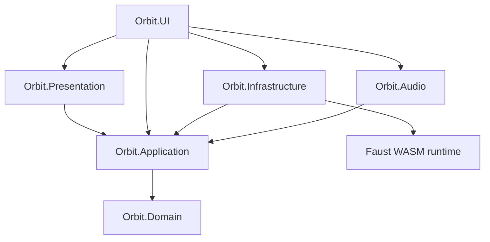
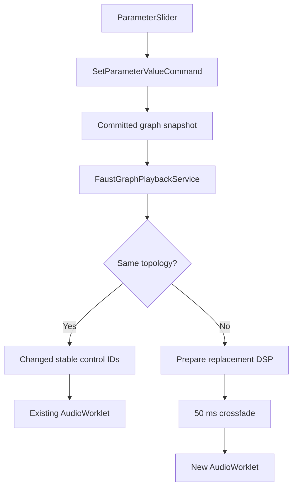
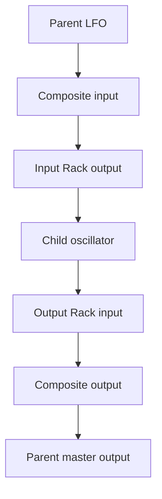

# Orbit 2

A browser-based modular synthesizer built with independent C# application logic, Blazor WebAssembly UI and Faust DSP. No React or TypeScript is used.

The long-term modular synthesizer design is documented in [ORBIT2-ARCHITECTURE.md](ORBIT2-ARCHITECTURE.md). Phase 1 adds the independent signal graph model. Phase 2 executes a fixed modulation graph using Faust and exposes the shared audio clock. Phase 3 adds a session-owned command and committed event system plus the framework-neutral canvas presentation state. Phase 4 connects the editable graph to a runtime Faust compiler and AudioWorklet playback. Phase 5 begins with composite nodes and immutable nested graph snapshots.

## Requirements and local execution

- .NET 10 SDK
- Node.js 24 with npm (build tooling and infrastructure tests only)
- A modern browser supporting Web Audio and AudioWorklet

From the repository root:

```sh
npm exec --yes --package=@grame/faustwasm@0.19.0 -- faust2wasm-ts src/Orbit.Audio/Dsp/Oscillators/ModulatedSine.dsp src/Orbit.Infrastructure/wwwroot/audio/generated/modulated-sine
npm install --no-audit --no-fund --ignore-scripts --no-save @grame/faustwasm@0.19.0
node scripts/prepare-faust-compiler.mjs
node src/Orbit.UI/DesignSystem/generate-tokens.mjs
dotnet run --project src/Orbit.UI --urls http://localhost:5000
```

Open http://localhost:5000. Use **Play patch** to compile and play the current graph, and **Stop** to release it with a short fade. The initial patch is a sine LFO modulating a sine carrier through a gain node. The status reports the playing graph revision. Edit frequency, amplitude, gain or routing while audio runs: base values update in place, and changed DSP programs crossfade automatically.

## Project boundaries



| Layer | Project | Responsibility |
| --- | --- | --- |
| UI | Orbit.UI | Razor components, code-behind and styles. |
| Presentation state | Orbit.Presentation | Testable canvas layout, viewport transforms and selection; no Blazor or audio dependency. |
| Application | Orbit.Application | Framework-neutral contracts, request models, node registry, timing contracts and audio use cases. |
| Domain | Orbit.Domain | Signal graphs, nodes, parameters, ports, connections and graph validation. |
| Infrastructure | Orbit.Infrastructure | C# adapter and modular browser audio runtime. No UI or use-case policy. |
| Processing/DSP | Orbit.Audio | Graph-to-Faust source compiler and Faust programs that generate samples. |

The infrastructure implements contracts declared by Application. The UI composition root registers concrete implementations; UI components consume application-facing interfaces only. There is no database or persistence layer yet.

The infrastructure uses the .NET Razor class library SDK solely to package browser-side static assets. Local builds expose them under `_content/Orbit.Infrastructure/audio/`; deployed builds also use a commit-versioned `audio-<commit>/` directory for the complete relative-import tree, including the worker and generated Faust assets. This prevents mixed-version browser caches. The library contains no Razor views.

## Startup sequence

1. The browser loads the fingerprinted Blazor bootstrap from `src/Orbit.UI/wwwroot/index.html`.
2. Blazor starts .NET WebAssembly and invokes `Program.cs`, the composition root.
3. The composition root registers one `BrowserAudioEngine` behind both `IAudioEngine` and `IAudioClock`, plus `IGraphPlaybackService` implemented by `FaustGraphPlaybackService` and the graph compiler.
4. The host renders `App.razor`, which mounts `GraphWorkspace` and `GraphPlaybackControls`. The controls initialize the audio module through the application service. AudioContext creation/resume is deferred to the Play button's user gesture.
5. Once initialized, the component enables the playback controls.

## Audio event flow

~~~mermaid
flowchart TD
    View["GraphPlaybackControls"] --> Service["IGraphPlaybackService"]
    Service --> Compiler["FaustGraphCompiler"]
    Compiler --> Request["PlaybackRequest"]
    Request --> Port["IAudioEngine"]
    Port --> Adapter["BrowserAudioEngine"]
    Adapter --> Entry["audio.js"]
    Entry --> Engine["AudioEngine"]
    Engine --> Context["AudioContextManager"]
    Engine --> Factory["FaustNodeFactory"]
    Factory --> Worker["FaustCompilerClient / Worker"]
    Worker --> DSP["WASM AudioWorklet"]
    Engine --> Output["AudioOutput"]
    DSP --> Output
    Output --> Voice["AudioVoice / AudioEnvelope"]
~~~

1. Play captures the committed graph snapshot. The C# service compiles it into Faust source and the initial host control values.
2. The adapter invokes the JavaScript entry module; the audio engine resumes the shared AudioContext before any worker download.
3. `FaustNodeFactory` requests a compiled factory from the lazy compiler worker. The worker loads the pinned packaged Faust bundle, compiles the source outside the main and audio threads, and returns the WebAssembly module and DSP metadata.
4. The node factory instantiates a mono AudioWorklet with a source-specific processor identity and applies the host values; the graph supplies gain, with additional output headroom.
5. `AudioOutput` connects the node through an independent initially silent voice. `AudioEnvelope` schedules the attack and release against the audio clock. Stop cancels pending startup or releases an active voice and frees its resources.
6. `GraphPlaybackControls` observes startup status and passes newly committed snapshots to the playback service. Base-only edits update the existing worklet; changed DSP programs are prepared and crossfaded automatically. It samples passive parameter meters at 25 Hz and passes revision-matched frames to the workspace.

### Live parameter update flow



The service compares the new snapshot to the last accepted playback topology, including edge amounts, ports and parameter definitions. Base-only changes use the compiler's existing control manifest and send only changed base values through `IAudioEngine.SetParametersAsync`. Structural edits regenerate source; if the source is identical (for example an unconnected node), the voice is reused. Otherwise `ReplaceAsync` prepares a new worklet while the old stays audible, then schedules a 50 ms complementary linear crossfade on the audio clock. The application serializes updates, announces new revisions immediately and skips superseded compilations before they become audible. A compilation failure leaves the last good graph playing and displays an error; correcting the graph retries automatically. Stop cancels pending replacements and releases every active voice. A replacement may reset oscillator/effect state; the crossfade reduces discontinuities, not a guarantee of phase preservation.

## Browser infrastructure components

| Component | Responsibility |
| --- | --- |
| audio.js | Compose dependencies and expose the narrow interop API; no playback or DSP logic. |
| AudioEngine.js | Coordinate playback, validate requests, manage active sound IDs and cleanup. |
| AudioContextManager.js | Create, resume and close the one shared AudioContext. |
| AudioClock.js | Read the existing context's frame-time snapshot without starting audio. |
| FaustCompilerClient.js | Own the lazy compiler worker, match asynchronous replies, propagate errors and dispose it. |
| FaustCompilerWorker.js | Serialize Faust compilations and return compiled modules and metadata; no audio render work. |
| FaustModuleLoader.js | Download and cache compiled modules and metadata; retry failed loads. |
| FaustOutputMonitor.js | Cache passive Faust output meter readings for display-rate snapshots. |
| FaustNodeFactory.js | Create independent Faust worklet nodes and map parameters using their published paths. |
| AudioOutput.js | Own master output; create separate, initially silent voice paths. |
| AudioVoice.js | Own one playback's source/gain lifecycle; stop and release resources. |
| AudioEnvelope.js | Schedule gain changes on the audio clock, including click-reducing ramps. |

## Signal graph foundation (Phase 1)

The independent domain model describes topology without generating samples. It has no browser or Faust dependency. Signal nodes expose read-only port and parameter collections; SignalGraph owns validated connection and parameter edits.

- A sine generator has a frequency and amplitude parameter, each with its own modulation input. The same sine node can serve as an audible oscillator or an LFO.
- A gain processor has a mono audio input, gain modulation input and audio output; master output is a terminal mono input.
- Typed ports allow one output to feed several inputs, and modulatable parameters accept multiple sources. Connection amounts represent audio gain or target-specific modulation depth.
- Graph validation rejects missing or reversed endpoints, incompatible types/channels, duplicate edges, single-input conflicts and cycles (including modulation cycles).
- Removing a node removes its incident edges in the same operation. Parameter settings remain base values and never receive audio-rate samples.
- The application registry creates independently identified node instances. Phase 2 provides a specific mapping from a validated graph to a precompiled Faust program; Phase 4 implements general-purpose source compilation for the supported flat node types.

A small graph can be built and validated without a UI or audio device:

```csharp
using Orbit.Application.Graphs;
using Orbit.Domain.Graphs;
using Orbit.Domain.Nodes.Generators;
using Orbit.Domain.Nodes.Outputs;
using Orbit.Domain.Parameters;
using Orbit.Domain.Ports;

var registry = BuiltInNodes.CreateRegistry();
var graph = new SignalGraph();
var lfo = registry.Create(SineGenerator.NodeType);
var oscillator = registry.Create(SineGenerator.NodeType);
var output = registry.Create(MasterOutput.NodeType);

graph.AddNode(lfo);
graph.AddNode(oscillator);
graph.AddNode(output);

var lfoFrequency = lfo.Parameters.Single(p => p.Definition.Key == "frequency");
graph.SetParameterValue(new ParameterAddress(lfo.Id, lfoFrequency.Id), 0.5);

var frequencyInput = oscillator.Inputs.Single(p => p.Key == "frequency-modulation-in");
graph.Connect(new PortAddress(lfo.Id, lfo.Outputs.Single().Id),
    new PortAddress(oscillator.Id, frequencyInput.Id), amount: 100);
graph.Connect(new PortAddress(oscillator.Id, oscillator.Outputs.Single().Id),
    new PortAddress(output.Id, output.Inputs.Single().Id));
```

This describes a 0.5 Hz LFO modulating the second oscillator's 440 Hz base frequency by ±100 Hz. Phase 2 implements this particular modulation topology, including a gain stage, as an audible proof.

## Shared timing and audio-rate modulation (Phase 2)

The original Phase 2 playback proof built a fixed modulation graph through ModulationDemoPatch and PatchSession. Its precompiled DSP and offline tests remain as regression fixtures; the standalone demo UI and service have now been retired in favor of the editable graph.

~~~mermaid
flowchart LR
    LFO["Sine LFO · 0.5 Hz"] --> P["Frequency · 440 ± 100 Hz"]
    P --> OSC["Sine carrier"]
    OSC --> G["Voice gain and envelope"]
    G --> O["Master output"]
~~~

- ModulatedSine.dsp computes the LFO, effective frequency and carrier at the real audio sample rate. It uses the same reusable sine function for both oscillators. Faust smooths base settings before applying sample-rate modulation and clamps the effective frequency to a safe range.
- The same voice lifecycle is used by dynamic patch playback: it sustains until stopped, schedules a release using Web Audio time and disposes the voice.
- The default values produce a frequency changing from approximately 340 Hz to 540 Hz every two seconds. Depth 0 produces the base frequency without vibrato.
- AudioClock observes the single existing AudioContext's actual sample rate and elapsed context time. Its snapshot returns the estimated frame position at the rendering quantum boundary, not an independent clock. It does not start or resume the context.
- MusicalTransport converts sample-frame differences into beats and tempo-synchronized frequency. Tempo changes preserve beat position, stopping freezes it, and resuming continues from that position. It is tested independently; live transport synchronization and graph editing are later features.


There is no per-sample C# or JavaScript event loop. The audio engine controls waveform generation; browser timers observe playback for resource cleanup, and the UI reads passive meter snapshots at display rate. Graph playback currently stages graph edits until the next start.

## Graph commands and committed events (Phase 3 foundation)

The application layer owns graph edits through `IPatchSession`. Each session owns one root graph, its descendants, and one notification dispatcher. Neither views nor processing components mutate the graph directly. Domain validation still occurs inside `SignalGraph`; no second set of graph rules is introduced.

~~~mermaid
sequenceDiagram
    participant Caller as Editor / patch builder
    participant Session as PatchSession
    participant Domain as SignalGraph
    participant Listeners as Subscribers
    Caller->>Session: Execute graph command
    Session->>Domain: Validate and apply edit
    Domain-->>Session: Success
    Session->>Session: Capture snapshot and revision
    Session->>Listeners: Publish one committed change set
    Session-->>Caller: Result and listener errors
~~~

| Command | Successful event |
| --- | --- |
| `AddNodeCommand` | `NodeAdded` |
| `ConnectNodesCommand` | `ConnectionCreated` |
| `RemoveConnectionCommand` | `ConnectionRemoved` |
| `RemoveNodeCommand` | All incident `ConnectionRemoved` facts, then `NodeRemoved`, in one change set |
| `SetParameterValueCommand` | `ParameterChanged` (not topology) |

Example: two independent listeners receive the same successful edit.

~~~csharp
using Orbit.Application.Graphs;
using Orbit.Application.Graphs.Commands;
using Orbit.Application.Graphs.Events;
using Orbit.Application.Graphs.Sessions;
using Orbit.Domain.Nodes.Generators;

using IPatchSession session = new PatchSession(BuiltInNodes.CreateRegistry());
using var graphListener = session.Subscribe(change =>
    Console.WriteLine($"Revision {change.Revision}, {change.Snapshot.Nodes.Count} nodes"));
using var nodeListener = session.Subscribe<NodeAdded>(change =>
    Console.WriteLine($"Added {change.Node.Name}"));

var result = session.Execute(new AddNodeCommand(session.GraphId, SineGenerator.NodeType));
~~~

- The result includes the immutable committed root snapshot and ordered events. `GraphChangeSet.GraphId` identifies the command target; `ChangedGraph` returns its local snapshot. One revision identifies the entire patch, even after future edits.
- Rejected commands and unchanged base-value edits do not increment the revision or publish anything. Validation exceptions are returned to the caller through the existing exception contract.
- Subscriptions are disposable, session-scoped and optionally filtered by the command or affected fact's graph ID. A boundary edit publishes one changeset to each affected graph, while typed subscriptions receive only that graph's facts. Unfiltered subscribers see every commit exactly once. Delivery is synchronous and serialized; listeners should schedule asynchronous work and return quickly. A failed listener is reported in `GraphCommandResult.SubscriberErrors`, without rolling back the change or blocking other subscribers.
- Layout events and DSP telemetry are separate from graph commands. Audio and canvas projections will subscribe to committed changes when the dynamic editor/compiler are introduced.
- The existing fixed demo now constructs its graph with these commands and derives its playback request from the final snapshot. Its precompiled regression DSP remains independent of the live graph.

See [the architecture document](ORBIT2-ARCHITECTURE.md#9-commands-events-and-transaction-boundaries) for the transaction boundary, event flow, and future nested-graph requirements.

## Canvas presentation state (Phase 3 foundation)

`Orbit.Presentation` is a plain .NET project for UI state and geometry. It references Application, not Blazor or infrastructure. Each future root or nested canvas owns a `CanvasStateService` instance observing the graph's committed revisions.

~~~mermaid
flowchart TD
    Session["PatchSession"] --> Snapshot["Committed graph snapshot"]
    Snapshot --> State["CanvasStateService"]
    Gesture["Layout gesture"] --> State
    State --> View["Immutable canvas snapshot"]
    View --> Renderer["Future graph canvas"]
    State --> Event["Canvas state notification"]
~~~

| Type | Responsibility |
| --- | --- |
| `CanvasPoint` | Finite world/screen coordinate at the service boundary |
| `CanvasViewport` | Pan, zoom, pointer-anchored coordinate conversion |
| `INodePlacementPolicy` / `GridNodePlacementPolicy` | Initial nonoverlapping grid positions for new nodes |
| `ICanvasStateService` / `CanvasStateService` | Reconcile committed graph edits; manage layout and selection |
| `CanvasStateSnapshot` | Immutable graph snapshot plus layout revision, positions, viewport and selection |
| `CanvasStateChange` | Local notification with the consistent final presentation snapshot |

A node movement, selection, pan or zoom increments only the layout revision. A graph commit updates the graph revision and reconciles deleted nodes/edges and newly added positions. Existing positions and viewport remain stable; a parameter change does not alter the layout revision. Graph and layout notification channels reuse the same generic `NotificationChannel<T>` implementation, but are separate instances with independent subscribers.

~~~csharp
using Orbit.Application.Graphs;
using Orbit.Application.Graphs.Commands;
using Orbit.Application.Graphs.Sessions;
using Orbit.Domain.Nodes.Generators;
using Orbit.Presentation.Canvas;

using IPatchSession session = new PatchSession(BuiltInNodes.CreateRegistry());
using ICanvasStateService canvas = new CanvasStateService(session);
using var listener = canvas.Subscribe(change =>
    Console.WriteLine($"{change.Kind}, layout revision {change.Snapshot.LayoutRevision}"));

session.Execute(new AddNodeCommand(session.GraphId, SineGenerator.NodeType));
var nodeId = canvas.Snapshot.Graph.Nodes.Single().Id;
canvas.MoveNode(nodeId, new CanvasPoint(200, 100));
canvas.PanBy(new CanvasPoint(-40, 80));
canvas.ZoomAt(2, new CanvasPoint(200, 100)); // 200%, anchored to pointer
~~~

The coordinate transform is `screen = world * zoom + pan`, so moving a node by a screen delta at 200% zoom changes its world position by half that delta. Zoom is clamped to 25–400%. Canvas instances have independent state. Use the presentation dispatcher thread for layout and graph edits observed by the canvas; previously captured immutable snapshots can be read by asynchronous work. Dispose each canvas to unsubscribe from the session.

This foundation is tested independently of Blazor. The first visible graph editor uses these snapshots and transforms, and fit-to-content uses measured node bounds.

## First visual graph editor (Phase 4)

The application opens a persistent editable patch session with the initial modulation topology (LFO → sine generator → gain → output). The editor uses the existing domain registry; add nodes, delete selected nodes or wires, and edit the base values using the shared ParameterSlider. These changes commit graph revisions, not audio events.

- Drag a node header to move it. Drag empty background or middle-drag a node header to pan.
- Wheel zoom is anchored at the pointer; the toolbar shows the current zoom, zoom buttons, reset and fit-to-content.
- Begin from an output and drag to an input, or click the output then click an input. Escape cancels. The existing domain validation rejects incompatible, duplicate or cyclic edges.
- Nodes use role-colored frames and typed port shapes. A generator feeding only modulation inputs is visually an LFO; no different DSP type is required.
- SVG paths use cubic Bézier geometry shared by all connections, with endpoints measured from actual port markers. Click a wire to select it.
- All static dimensions and colors are sourced from design tokens. Layout state is separate from graph state.

~~~mermaid
flowchart TD
    Workspace["GraphWorkspace"] --> Session["PatchSession"]
    Workspace --> State["CanvasStateService"]
    Session --> State
    State --> Renderer["GraphCanvas"]
    Renderer --> Components["NodeFrame / PortConnector / ConnectionLayer"]
    Renderer --> DOM["canvasDom.js · DOM only"]
    Renderer --> Workspace
~~~

The small DOM adapter measures port/node geometry, captures pointers and resolves a dropped input. It does not own graph state or compute audio. The C# presentation library provides viewport and Bézier geometry. The workspace translates edits into session commands.

The editor uses GraphPlaybackControls to play any supported committed patch. The playing revision remains stable while edits are made; Stop then Play applies the latest version. The obsolete fixed proof UI has been removed.

## Faust graph compiler (Phase 4)

`Orbit.Audio` is a plain .NET library that consumes a committed `GraphSnapshot` and produces a `FaustGraphProgram`: Faust source plus graph ID, revision and stable host control mappings. It does not load WASM, own the browser audio device or have any dependency on the canvas.

~~~mermaid
flowchart TD
    S["GraphSnapshot"] --> C["FaustGraphCompiler"]
    C --> B["GraphFlattener"]
    B --> O["GraphDependencyOrder"]
    O --> R["Registered node emitters"]
    R --> P["FaustNodeContext"]
    P --> F["Faust source + control mappings"]
    F --> W["Faust WASM compilation"]
    W --> T["Offline sample rendering tests"]
~~~

- The compiler walks backward from the sole master output and orders all reachable audio and modulation dependencies. Disconnected nodes are excluded; a disconnected master produces silence.
- `IFaustNodeEmitter` is the backend extension point. Sine and gain have independent implementations. `FaustNodeContext` handles routing, weighted input summation, parameter slider generation, smoothing and clamping.
- Each parameter control uses its node and parameter IDs, never user labels. The program source is stable across base-value edits; the latest values travel separately in the control map and must be applied before playback.
- For linear parameters, effective value = clamped (smoothed base + sum of incoming signals × connection amounts). Frequency also stays below the sample-rate-dependent Nyquist limit. Modulation signals themselves run at audio rate.
- Connection amounts are baked into this first source representation. Changing connection amounts or topology requires recompilation; a future runtime can expose depth controls without recompiling.
- The current backend supports mono sine, gain, nested composite boundaries and exactly one root master output. Cycles and unsupported reachable node types are rejected.

CI exports an actual nested graph using `tests/Orbit.Audio.Probe`, compiles the generated source using the pinned Faust CLI, then renders it offline at 44.1 and 48 kHz. Tests verify that an external LFO can fan out through two rack inputs to internal pitch and gain, that audio returns through the output rack, and that a host can change an internal frequency control without recompiling.

To reproduce the graph compiler probe locally (Bash, .NET 10 and Node):

~~~bash
export ORBIT_GRAPH_PROBE_DIR="$(mktemp -d)"
dotnet run --project tests/Orbit.Audio.Probe/Orbit.Audio.Probe.csproj -- "$ORBIT_GRAPH_PROBE_DIR"
npm exec --yes --package=@grame/faustwasm@0.19.0 -- faust2wasm-ts "$ORBIT_GRAPH_PROBE_DIR/program.dsp" "$ORBIT_GRAPH_PROBE_DIR/compiled"
node --test tests/compiler/*.test.mjs
~~~

The browser compiler supports live base-value updates, automatic runtime replacement with revision tracking and passive meters for connected modulation parameters.

## Shared UI components

`ParameterSlider` is the first reusable presentation building block. It takes a domain parameter definition, editable base value and optional read-only modulation range and effective value. The same component renders all three settings, validates draft input without committing invalid values and reports errors to its parent.

~~~mermaid
flowchart TD
    D["ParameterDefinition + base value"] --> UI["ParameterSlider"]
    UI --> V["Validated base edit"]
    V --> Parent["Owning editor"]
    DSP["Faust effective frequency meter"] --> M["FaustOutputMonitor"]
    M --> S["Application service"]
    S --> UI
~~~

The editable thumb and numeric input stay at the base value. A colored band shows the effective range predicted by `GraphModulationRangeEstimator`, which resolves upstream signal bounds and connection amounts, sums modulation and applies parameter limits. Each registered DSP emitter supplies its optional output-bound rule; unsupported bounds are shown as unknown. For example, a 440 Hz base with a full-amplitude sine and a connection amount of 100 Hz gives a 340–540 Hz band.

The separate moving marker and Live label reflect actual Faust bargraph readings at 25 Hz, not a simulated LFO. Meter names map to stable node/parameter addresses. Frames are accepted only for the applied graph revision, and markers disappear while stopped or while a new graph is pending. The estimated band remains visible when stopped. Telemetry never changes the base parameter or emits graph commands.

Future root and nested canvases share the same viewport, node frame, port connector and Bézier connection components. Their interaction and visual contracts are defined in [the architecture document](ORBIT2-ARCHITECTURE.md#shared-canvas-and-component-standards).

### Frequency control design note

The current sine frequency control spans 0.01–20,000 Hz linearly. For LFO use this makes useful slow rates occupy almost none of the slider travel. A future rate-oriented control should provide a convenient 0.01–100 Hz modulation range (possibly logarithmic or with coarse/fine editing) without changing the generator's underlying audio-rate frequency capability. The period is `1 / frequency`: higher rates produce shorter cycles, but can become too fast to observe or use as slow modulation.

## Composite graph foundation (Phase 5)

`CompositeNode` implements `ICompositeNode` and creates a distinct `SignalGraph`, one `InputRack` and one `OutputRack`. Each named `ExposedPort` is projected as a parent socket and an opposite-direction child rack socket with the same ID. Connections remain local to their graph; the boundary is the only permitted route between them.



The domain rejects recursive ownership, shared concrete node instances, cross-graph connections, standalone rack insertion/removal and child master outputs. `GraphNodeSnapshot.Composite` captures the child graph and rack IDs without referencing mutable objects. `GraphSnapshot.GetGraph` resolves nested graph IDs within the captured patch revision.

The existing commands now address the root or any owned child by its graph ID, with one serialized session commit and one patch revision. For example, after creating a composite (using a registered factory), add a generator to its child:

```csharp
var childGraphId = compositeSnapshot.Graph.Id;
session.Execute(new AddNodeCommand(childGraphId, SineGenerator.NodeType));
```

`CanvasStateService(session, childGraphId)` projects that child and maintains its own layout, selection and viewport. It observes root commits to stay synchronized with the patch. If its owning composite is removed, the canvas becomes unavailable and emits `GraphRemoved`; stale commands are rejected by the session.

`GraphFlattener` now resolves the complete nested patch before DSP ordering. Each mirrored socket pair becomes a transparent backend-only route; both sides retain their own edge amounts. A disconnected receiving socket contributes zero. Fan-in sums at the receiving socket and fan-out reuses the resulting signal. No extra audio clock, DSP processor or sample delay is introduced at a boundary.

~~~mermaid
flowchart TD
    L["Root LFO"] -->|"× 100 Hz"| I["Pitch socket / Input Rack"]
    I --> F["Child sine frequency"]
    F --> S["Child sine"]
    S --> G["Child gain"]
    G --> O["Output Rack / Audio socket"]
    O --> M["Root master output"]
~~~

Child leaf identities are qualified by graph ID in generated Faust controls. The manifest maps each control back to the original graph ID and local parameter address, so live base edits reuse the current worklet and telemetry can be read using `frame.GetValues(childGraphId)`. The range estimator uses the same flattened routes via `Estimate(rootSnapshot, childGraphId)`, taking external modulation into account.

### Editing a drone

1. Select **Drone (composite)** in Add node, then click **Add**. Each instance starts with a sine, a gain processor, Input Parameters Rack (Pitch and Gain) and Output Rack (Audio), wired internally.
2. Route the drone's Audio output to the root master. Remove the existing master connection first if necessary (the master accepts one input).
3. Connect a root generator to the drone's Pitch or Gain socket. Click **Open Drone** to edit the internal graph. The exposed inputs appear as output sockets on the Input Parameters Rack.
4. Use the breadcrumbs to go back to an ancestor canvas. The same editor, interactions and parameter controls work at every depth, including adding another drone.

`BuiltInNodes.CreateEditorRegistry()` includes the starter `DroneTemplate` factory; the leaf registry remains available to custom callers. `CanvasNavigationService` owns and caches an independent `CanvasStateService` for each visited graph, preserving pan, zoom, positions and selection. Removed subtrees are disposed and navigation returns to the nearest surviving ancestor. The workspace sends edits to the active graph ID but keeps one playback controller bound to the **root** snapshot. Navigation alone does not advance the patch revision or restart audio.

### Editing a rack interface

Open a drone and choose **Edit ports** on either rack. The shared editor supports adding a named mono Audio or Modulation port, selecting single-source or summed fan-in on its receiving socket, renaming, reordering, and removing ports. Changes immediately appear on both the rack and the parent node. Renaming/reordering maintains stable IDs and preserves connections; removing a port disconnects every affected edge on both sides in one committed revision. Audio continues using the root patch (topology changes can replace the worklet through the existing crossfade).

`CompositeBoundaryEditor` validates the full proposed boundary before mutation. `PatchSession` captures the entire resulting hierarchy and publishes `ConnectionRemoved` facts followed by two `BoundaryPortChanged` facts for the parent and child. Commands target the child graph ID with a direction relative to the **outer** composite:

```csharp
session.Execute(new AddBoundaryPortCommand(childGraphId, PortDirection.Input,
    "Cutoff", SignalType.Modulation, FanInPolicy.Sum));
```

Changing an existing port's signal type, channel count or fan-in, and undo are future operations; in this version those properties are chosen when creating a port.

## Design system

All static UI colors, typography, spacing, borders, control dimensions and animation durations are defined in JSON in `src/Orbit.UI/DesignSystem/`. Presentation components consume CSS custom properties rather than hardcode visual values.

~~~mermaid
flowchart TD
    JSON["design-tokens.json"] --> Generator["generate-tokens.mjs"]
    Themes["Themes/dark.json and light.json"] --> Generator
    Generator --> Tokens["wwwroot/css/tokens.css"]
    Tokens --> CSS["Base and component styles"]
    CSS --> UI["Blazor UI"]
~~~

| Token level | Role | Example |
| --- | --- | --- |
| Primitive | Shared palette, spacing and other raw values | `primitive.color.ink-950` |
| Semantic | Meaning independent of component | `semantic.color.canvas` |
| Component | Specific reusable control appearance | `component.slider.thumb-size` |

The generator flattens token paths into CSS variables, e.g. `--component-slider-thumb-size`. A JSON value such as `"{semantic.color.modulation}"` is an alias, emitted as a CSS `var(...)` reference. The dark theme defines the default color roles; the light theme defines the identical roles with alternate palette aliases. Both share the same sizing and component rules. The default remains dark; an app-level theme controller can later set `data-theme="light"` on the root HTML element without rebuilding or changing Razor views.

To change the design, edit the token JSON or theme files, then regenerate and test:

~~~sh
node src/Orbit.UI/DesignSystem/generate-tokens.mjs
node src/Orbit.UI/DesignSystem/generate-tokens.mjs --check
node --test tests/ui/*.test.mjs
~~~

Commit the regenerated `wwwroot/css/tokens.css` together with source JSON. The generated file is tracked so a fresh checkout can build directly with .NET; do not edit it manually. CI regenerates it, rejects differences from the tracked output, tests token references and styles, and verifies all published CSS assets. Node is only used at build time, not in browser rendering.

`wwwroot/index.html` loads the generated variables first, then `base.css` and `components.css` (which imports each reusable component stylesheet). No styling constants belong in Razor markup or C#; computed geometry such as the live marker position and modulation band percentage remains presentation state. Audio values, ranges and DSP settings remain in the domain/application layers.

## Repository layout

```text
Orbit.slnx
src/
  Orbit.Domain/
    Orbit.Domain.csproj
    Graphs/
    Nodes/
    Parameters/
    Ports/
    Timing/
  Orbit.Application/
    Orbit.Application.csproj
    Interfaces/IAudioEngine.cs
    Models/PlaybackRequest.cs
    Graphs/NodeRegistry.cs
    Graphs/BuiltInNodes.cs
    Graphs/ModulationDemoPatch.cs
    Graphs/Commands/                  # typed commands and validated command handler
    Graphs/Events/                    # committed facts and session-local dispatcher
    Graphs/Sessions/                  # IPatchSession, PatchSession, result
    Graphs/Snapshots/                 # immutable graph/node/parameter read models
    Notifications/NotificationChannel.cs # reusable instance-local notification channel
    Interfaces/IAudioClock.cs
    Models/ModulationDemoSettings.cs
    Services/
      IGraphPlaybackService.cs
  Orbit.Presentation/
    Orbit.Presentation.csproj
    Canvas/                           # state, viewport, geometry, roles and layout events
  Orbit.Audio/
    Orbit.Audio.csproj
    Compilation/                      # graph ordering, backend emitters and control mapping
    Playback/FaustGraphPlaybackService.cs
    Dsp/Oscillators/ModulatedSine.dsp
  Orbit.Infrastructure/
    Orbit.Infrastructure.csproj
    Audio/BrowserAudioEngine.cs
    wwwroot/audio/
      audio.js
      AudioEngine.js
      Components/
        AudioContextManager.js
        AudioClock.js
        AudioOutput.js
        AudioVoice.js
        AudioEnvelope.js
      Faust/
        FaustCompilerClient.js
        FaustCompilerWorker.js
        FaustModuleLoader.js
        FaustNodeFactory.js
        FaustOutputMonitor.js
      generated/                      # compiled WASM and runtime; ignored
  Orbit.UI/
    Orbit.UI.csproj
    Program.cs
    App.razor
    Components/Canvas/               # shared canvas, playback controls, node, port and wire components
    Components/Parameters/ParameterSlider.razor
    Components/Parameters/ParameterSlider.razor.cs
    Components/Parameters/ParameterValidation.cs
    Components/Parameters/ValidationMessage.razor
    DesignSystem/
      design-tokens.json
      Themes/dark.json
      Themes/light.json
      generate-tokens.mjs
    wwwroot/index.html
    wwwroot/js/canvasDom.js            # DOM measurements and pointer capture only
    wwwroot/css/
      tokens.css                      # generated, tracked
      base.css
      components.css                  # shared stylesheet imports
      components/                     # button, panel, slider, validation, graph editor
tests/ui/                            # design token and stylesheet contract tests
tests/audio/                         # isolated browser infrastructure tests
scripts/prepare-faust-compiler.mjs   # copies pinned bundled compiler assets
tests/Orbit.Domain.Tests/            # graph, registry, transport and command/event tests
tests/Orbit.Presentation.Tests/      # layout projection and viewport tests
.github/workflows/build-and-deploy.yml
README.md
ORBIT2-ARCHITECTURE.md
.gitignore
```

## Development principles

- Single responsibility; constructor injection; composition over inheritance.
- Application contracts, data and use cases never depend on Blazor or browser APIs.
- UI logic remains in code-behind; no audio implementation or source parameters in Razor.
- Define static visual values in the design token JSON and consume semantic/component CSS variables in reusable styles. The only inline CSS values are computed presentation geometry.
- C# and JS composition roots are the only places where concrete dependencies are wired.
- Browser components are independently testable and have no global mutable state outside the composed engine.
- The real-time DSP and envelopes use the audio rendering system, not UI rendering or timers.
- Add new DSP programs by registering their generated artifacts in the processor catalog; extend infrastructure only for genuinely new capabilities.

## Build, tests and deployment

Run the Faust compile and compiler-bundle preparation commands shown above before building or running the complete audio test suite. The generated directory is ignored by Git. If upgrading an existing checkout, remove the obsolete locally generated sine folder before publishing. The pinned FaustWasm compiler generates the precompiled regression fixture; its separate bundled compiler is loaded lazily by the browser worker for editable patches.

```sh
dotnet test tests/Orbit.Domain.Tests/Orbit.Domain.Tests.csproj -c Release
dotnet test tests/Orbit.Presentation.Tests/Orbit.Presentation.Tests.csproj -c Release
node src/Orbit.UI/DesignSystem/generate-tokens.mjs --check
node --test tests/ui/*.test.mjs
node --test tests/audio/*.test.mjs
dotnet build Orbit.slnx
dotnet publish src/Orbit.UI -c Release -o publish
```

GitHub Actions tests the domain, registry, transport, and presentation state, regenerates and tests the design system, compiles the active Faust program, tests infrastructure and renders the actual compiled modulation DSP at 44.1 and 48 kHz, builds the referenced .NET projects, checks the published static assets and deploys `publish/wwwroot` to GitHub Pages. For main deployments it rewrites the HTML base path to `/orbit2/`. Blazor's build-time fingerprinting and generated import map version the runtime assets, reducing mixed-version caching when a deployment replaces browser modules.

Open https://wgabel.github.io/orbit2/ after deployment.
