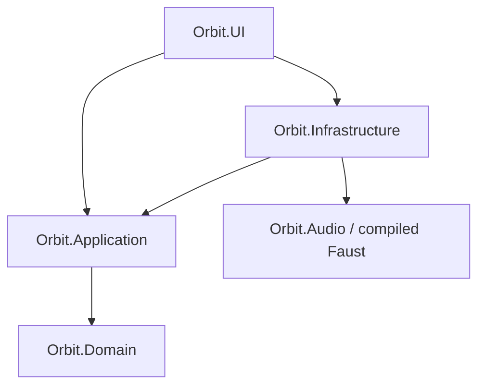
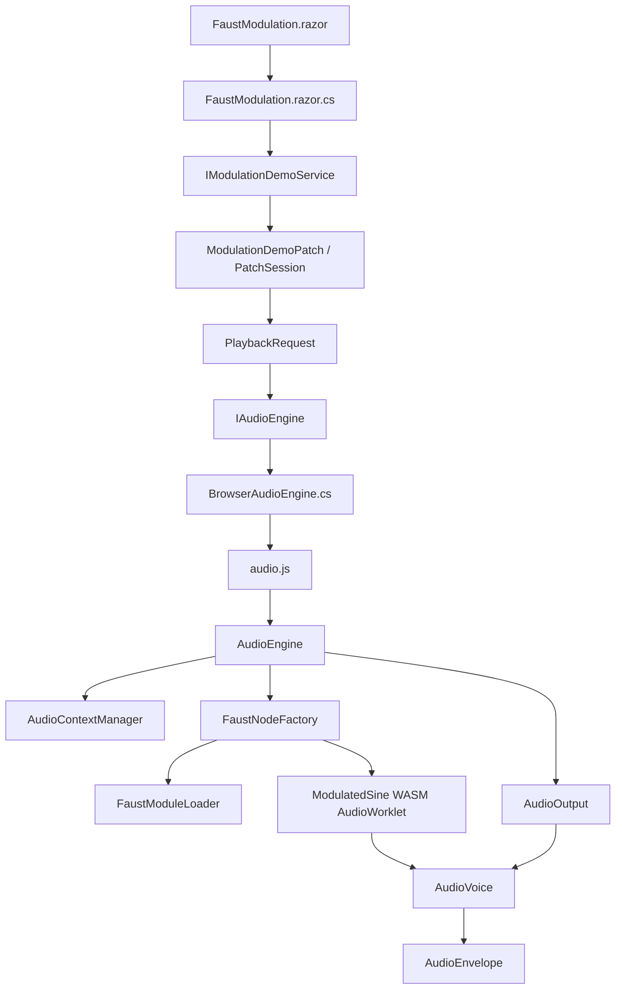

# Orbit 2

A browser-based modular synthesizer built with independent C# application logic, Blazor WebAssembly UI and Faust DSP. No React or TypeScript is used.

The long-term modular synthesizer design is documented in [ORBIT2-ARCHITECTURE.md](ORBIT2-ARCHITECTURE.md). Phase 1 adds the independent signal graph model. Phase 2 executes a fixed modulation graph using Faust and exposes the shared audio clock. Phase 3 begins with a session-owned command and committed event system.

## Requirements and local execution

- .NET 10 SDK
- Node.js 24 with npm (build tooling and infrastructure tests only)
- A modern browser supporting Web Audio and AudioWorklet

From the repository root:

```sh
npm exec --yes --package=@grame/faustwasm@0.19.0 -- faust2wasm-ts src/Orbit.Audio/Dsp/Oscillators/ModulatedSine.dsp src/Orbit.Infrastructure/wwwroot/audio/generated/modulated-sine
node src/Orbit.UI/DesignSystem/generate-tokens.mjs
dotnet run --project src/Orbit.UI --urls http://localhost:5000
```

Open http://localhost:5000. **Start modulation** plays a continuous, modulated sine wave; **Stop** releases it with a short fade. Settings can be changed between playbacks. All three settings now use the shared parameter slider, with units, limits, validated numeric input and inline errors. The carrier frequency also shows the expected modulation band and a live marker from Faust.

## Project boundaries



| Layer | Project | Responsibility |
| --- | --- | --- |
| UI/presentation | Orbit.UI | Razor components, code-behind, view state and styles. |
| Application | Orbit.Application | Framework-neutral contracts, request models, node registry, timing contracts and audio use cases. |
| Domain | Orbit.Domain | Signal graphs, nodes, parameters, ports, connections and graph validation. |
| Infrastructure | Orbit.Infrastructure | C# adapter and modular browser audio runtime. No UI or use-case policy. |
| Processing/DSP | Orbit.Audio | Faust programs that generate samples. Compiled into WASM during build. |

The infrastructure implements contracts declared by Application. The UI composition root registers concrete implementations; UI components consume application-facing interfaces only. There is no database or persistence layer yet.

The infrastructure uses the .NET Razor class library SDK solely to package browser-side static assets. It exposes them under `_content/Orbit.Infrastructure/audio/` in the published app and contains no Razor views.

## Startup sequence

1. The browser loads the fingerprinted Blazor bootstrap from `src/Orbit.UI/wwwroot/index.html`.
2. Blazor starts .NET WebAssembly and invokes `Program.cs`, the composition root.
3. The composition root registers one `BrowserAudioEngine` behind both `IAudioEngine` and `IAudioClock`, plus `IModulationDemoService`.
4. The host renders `App.razor`, which mounts `FaustModulation`. Its code-behind initializes the audio module through the application service. AudioContext creation/resume is deferred to the Start button's user gesture.
5. Once initialized, the component enables the playback controls.

## Audio event flow



1. The Start control invokes the presentation handler, which delegates settings to the application service.
2. `ModulationDemoPatch` constructs and validates the fixed graph through typed session commands, then creates a framework-neutral `PlaybackRequest` with processor ID, sound ID, gain and named DSP parameters.
3. `BrowserAudioEngine` implements the engine port and calls the JavaScript entry module through Blazor JS interop.
4. `audio.js` composes the browser infrastructure and registers the active compiled DSP.
5. `AudioEngine` resumes the shared audio context, reserves the requested sound ID and creates a worklet using `FaustNodeFactory` and `FaustModuleLoader`.
6. `AudioOutput` connects the worklet through an independent voice gain to the master output. `AudioEnvelope` schedules the attack and release against the audio clock.
7. The worklet continuously renders the modulated audio signal. Stop releases the voice and frees its resources. The UI and application do not compute samples.

## Browser infrastructure components

| Component | Responsibility |
| --- | --- |
| audio.js | Compose dependencies and expose the narrow interop API; no playback or DSP logic. |
| AudioEngine.js | Coordinate playback, validate requests, manage active sound IDs and cleanup. |
| AudioContextManager.js | Create, resume and close the one shared AudioContext. |
| AudioClock.js | Read the existing context's frame-time snapshot without starting audio. |
| FaustModuleLoader.js | Download and cache compiled modules and metadata; retry failed loads. |
| FaustOutputMonitor.js | Cache passive Faust output meter readings for display-rate snapshots. |
| FaustNodeFactory.js | Create independent Faust worklet nodes and map parameters using their published paths. |
| AudioOutput.js | Own master output; create separate, initially silent voice paths. |
| AudioVoice.js | Own one playback's source/gain lifecycle; stop and release resources. |
| AudioEnvelope.js | Schedule gain changes on the audio clock, including click-reducing ramps. |

## Signal graph foundation (Phase 1)

The independent domain model describes topology without generating samples. It has no browser or Faust dependency. Signal nodes expose read-only port and parameter collections; SignalGraph owns validated connection and parameter edits.

- A sine generator has a frequency and amplitude parameter, each with its own modulation input. The same sine node can serve as an audible oscillator or an LFO.
- A gain processor has a mono audio input, gain modulation input and audio output; master output is a terminal mono input.
- Typed ports allow one output to feed several inputs, and modulatable parameters accept multiple sources. Connection amounts represent audio gain or target-specific modulation depth.
- Graph validation rejects missing or reversed endpoints, incompatible types/channels, duplicate edges, single-input conflicts and cycles (including modulation cycles).
- Removing a node removes its incident edges in the same operation. Parameter settings remain base values and never receive audio-rate samples.
- The application registry creates independently identified node instances. Phase 2 provides a specific mapping from a validated graph to a precompiled Faust program; general-purpose graph compilation is still planned for Phase 4.

A small graph can be built and validated without a UI or audio device:

```csharp
using Orbit.Application.Graphs;
using Orbit.Domain.Graphs;
using Orbit.Domain.Nodes.Generators;
using Orbit.Domain.Nodes.Outputs;
using Orbit.Domain.Parameters;
using Orbit.Domain.Ports;

var registry = BuiltInNodes.CreateRegistry();
var graph = new SignalGraph();
var lfo = registry.Create(SineGenerator.NodeType);
var oscillator = registry.Create(SineGenerator.NodeType);
var output = registry.Create(MasterOutput.NodeType);

graph.AddNode(lfo);
graph.AddNode(oscillator);
graph.AddNode(output);

var lfoFrequency = lfo.Parameters.Single(p => p.Definition.Key == "frequency");
graph.SetParameterValue(new ParameterAddress(lfo.Id, lfoFrequency.Id), 0.5);

var frequencyInput = oscillator.Inputs.Single(p => p.Key == "frequency-modulation-in");
graph.Connect(new PortAddress(lfo.Id, lfo.Outputs.Single().Id),
    new PortAddress(oscillator.Id, frequencyInput.Id), amount: 100);
graph.Connect(new PortAddress(oscillator.Id, oscillator.Outputs.Single().Id),
    new PortAddress(output.Id, output.Inputs.Single().Id));
```

This describes a 0.5 Hz LFO modulating the second oscillator's 440 Hz base frequency by ±100 Hz. Phase 2 implements this particular modulation topology, including a gain stage, as an audible proof.

## Shared timing and audio-rate modulation (Phase 2)

The current playback path builds a validated graph through ModulationDemoPatch and PatchSession, then maps its base frequency, LFO frequency, modulation depth and gain to the existing engine contract. It is a deliberately **fixed graph**, not a dynamic Faust compiler.

~~~mermaid
flowchart LR
    LFO["Sine LFO · 0.5 Hz"] --> P["Frequency · 440 ± 100 Hz"]
    P --> OSC["Sine carrier"]
    OSC --> G["Voice gain and envelope"]
    G --> O["Master output"]
~~~

- ModulatedSine.dsp computes the LFO, effective frequency and carrier at the real audio sample rate. It uses the same reusable sine function for both oscillators. Faust smooths base settings before applying sample-rate modulation and clamps the effective frequency to a safe range.
- ModulationDemoService invokes the browser adapter with a playback request. Playback is sustained until explicitly stopped. Stop schedules a release using Web Audio's time and then disposes the voice.
- The default values produce a frequency changing from approximately 340 Hz to 540 Hz every two seconds. Depth 0 produces the base frequency without vibrato.
- AudioClock observes the single existing AudioContext's actual sample rate and elapsed context time. Read audio clock in the UI returns the estimated frame position at the rendering quantum boundary, not an independent clock. It does not start or resume the context.
- MusicalTransport converts sample-frame differences into beats and tempo-synchronized frequency. Tempo changes preserve beat position, stopping freezes it, and resuming continues from that position. It is tested independently; live transport synchronization and graph editing are later features.

~~~mermaid
flowchart TD
    UI["FaustModulation component"] --> S["ModulationDemoService"]
    S --> P["Validated fixed SignalGraph"]
    P --> R["PlaybackRequest"]
    R --> E["Browser AudioEngine"]
    E --> DSP["ModulatedSine Faust WASM"]
    DSP --> O["Audio-clock-scheduled gain"]
    O --> OUT["Audio output"]
~~~

There is no per-sample C# or JavaScript event loop. The audio engine controls waveform generation; browser timers observe playback for resource cleanup, and the UI reads passive meter snapshots at display rate. The demo does not yet support changing topology/parameters during playback.

## Graph commands and committed events (Phase 3 foundation)

The application layer now owns graph edits through `IPatchSession`. Each session owns one root graph and its own notification dispatcher. Neither views nor processing components mutate the graph directly. Domain validation still occurs inside `SignalGraph`; no second set of graph rules is introduced.

~~~mermaid
sequenceDiagram
    participant Caller as Editor / patch builder
    participant Session as PatchSession
    participant Domain as SignalGraph
    participant Listeners as Subscribers
    Caller->>Session: Execute graph command
    Session->>Domain: Validate and apply edit
    Domain-->>Session: Success
    Session->>Session: Capture snapshot and revision
    Session->>Listeners: Publish one committed change set
    Session-->>Caller: Result and listener errors
~~~

| Command | Successful event |
| --- | --- |
| `AddNodeCommand` | `NodeAdded` |
| `ConnectNodesCommand` | `ConnectionCreated` |
| `RemoveConnectionCommand` | `ConnectionRemoved` |
| `RemoveNodeCommand` | All incident `ConnectionRemoved` facts, then `NodeRemoved`, in one change set |
| `SetParameterValueCommand` | `ParameterChanged` (not topology) |

Example: two independent listeners receive the same successful edit.

~~~csharp
using Orbit.Application.Graphs;
using Orbit.Application.Graphs.Commands;
using Orbit.Application.Graphs.Events;
using Orbit.Application.Graphs.Sessions;
using Orbit.Domain.Nodes.Generators;

using IPatchSession session = new PatchSession(BuiltInNodes.CreateRegistry());
using var graphListener = session.Subscribe(change =>
    Console.WriteLine($"Revision {change.Revision}, {change.Snapshot.Nodes.Count} nodes"));
using var nodeListener = session.Subscribe<NodeAdded>(change =>
    Console.WriteLine($"Added {change.Node.Name}"));

var result = session.Execute(new AddNodeCommand(session.GraphId, SineGenerator.NodeType));
~~~

- The result includes the immutable committed graph snapshot and ordered events. A revision identifies exactly which state a listener received, even after future edits.
- Rejected commands and unchanged base-value edits do not increment the revision or publish anything. Validation exceptions are returned to the caller through the existing exception contract.
- Subscriptions are disposable, session-scoped and optionally filtered by graph ID. Delivery is synchronous and serialized; listeners should schedule asynchronous work and return quickly. A failed listener is reported in `GraphCommandResult.SubscriberErrors`, without rolling back the change or blocking other subscribers.
- Layout events and DSP telemetry are separate from graph commands. Audio and canvas projections will subscribe to committed changes when the dynamic editor/compiler are introduced.
- The existing fixed demo now constructs its graph with these commands and derives its playback request from the final snapshot. Its UI, playback and timing remain unchanged.

See [the architecture document](ORBIT2-ARCHITECTURE.md#9-commands-events-and-transaction-boundaries) for the transaction boundary, event flow, and future nested-graph requirements.

## Shared UI components

`ParameterSlider` is the first reusable presentation building block. It takes a domain parameter definition, editable base value and optional read-only modulation range and effective value. The same component renders all three settings, validates draft input without committing invalid values and reports errors to its parent.

~~~mermaid
flowchart TD
    D["ParameterDefinition + base value"] --> UI["ParameterSlider"]
    UI --> V["Validated base edit"]
    V --> Parent["Owning editor"]
    DSP["Faust effective frequency meter"] --> M["FaustOutputMonitor"]
    M --> S["Application service"]
    S --> UI
~~~

The meter is read at ~20 Hz and never changes the base parameter. Future root and nested canvases share the same viewport, node frame, port connector and Bézier connection components. Their interaction and visual contracts are defined in [the architecture document](ORBIT2-ARCHITECTURE.md#shared-canvas-and-component-standards).

## Design system

All static UI colors, typography, spacing, borders, control dimensions and animation durations are defined in JSON in `src/Orbit.UI/DesignSystem/`. Presentation components consume CSS custom properties rather than hardcode visual values.

~~~mermaid
flowchart TD
    JSON["design-tokens.json"] --> Generator["generate-tokens.mjs"]
    Themes["Themes/dark.json and light.json"] --> Generator
    Generator --> Tokens["wwwroot/css/tokens.css"]
    Tokens --> CSS["Base and component styles"]
    CSS --> UI["Blazor UI"]
~~~

| Token level | Role | Example |
| --- | --- | --- |
| Primitive | Shared palette, spacing and other raw values | `primitive.color.ink-950` |
| Semantic | Meaning independent of component | `semantic.color.canvas` |
| Component | Specific reusable control appearance | `component.slider.thumb-size` |

The generator flattens token paths into CSS variables, e.g. `--component-slider-thumb-size`. A JSON value such as `"{semantic.color.modulation}"` is an alias, emitted as a CSS `var(...)` reference. The dark theme defines the default color roles; the light theme defines the identical roles with alternate palette aliases. Both share the same sizing and component rules. The default remains dark; an app-level theme controller can later set `data-theme="light"` on the root HTML element without rebuilding or changing Razor views.

To change the design, edit the token JSON or theme files, then regenerate and test:

~~~sh
node src/Orbit.UI/DesignSystem/generate-tokens.mjs
node src/Orbit.UI/DesignSystem/generate-tokens.mjs --check
node --test tests/ui/*.test.mjs
~~~

Commit the regenerated `wwwroot/css/tokens.css` together with source JSON. The generated file is tracked so a fresh checkout can build directly with .NET; do not edit it manually. CI regenerates it, rejects differences from the tracked output, tests token references and styles, and verifies all published CSS assets. Node is only used at build time, not in browser rendering.

`wwwroot/index.html` loads the generated variables first, then `base.css` and `components.css` (which imports each reusable component stylesheet). No styling constants belong in Razor markup or C#; computed geometry such as the live marker position and modulation band percentage remains presentation state. Audio values, ranges and DSP settings remain in the domain/application layers.

## Repository layout

```text
Orbit.slnx
src/
  Orbit.Domain/
    Orbit.Domain.csproj
    Graphs/
    Nodes/
    Parameters/
    Ports/
    Timing/
  Orbit.Application/
    Orbit.Application.csproj
    Interfaces/IAudioEngine.cs
    Models/PlaybackRequest.cs
    Graphs/NodeRegistry.cs
    Graphs/BuiltInNodes.cs
    Graphs/ModulationDemoPatch.cs
    Graphs/Commands/                  # typed commands and validated command handler
    Graphs/Events/                    # committed facts and session-local dispatcher
    Graphs/Sessions/                  # IPatchSession, PatchSession, result
    Graphs/Snapshots/                 # immutable graph/node/parameter read models
    Interfaces/IAudioClock.cs
    Models/ModulationDemoSettings.cs
    Services/
      IModulationDemoService.cs
      ModulationDemoService.cs
  Orbit.Audio/
    Dsp/Oscillators/ModulatedSine.dsp
  Orbit.Infrastructure/
    Orbit.Infrastructure.csproj
    Audio/BrowserAudioEngine.cs
    wwwroot/audio/
      audio.js
      AudioEngine.js
      Components/
        AudioContextManager.js
        AudioClock.js
        AudioOutput.js
        AudioVoice.js
        AudioEnvelope.js
      Faust/
        FaustModuleLoader.js
        FaustNodeFactory.js
        FaustOutputMonitor.js
      generated/                      # compiled WASM and runtime; ignored
  Orbit.UI/
    Orbit.UI.csproj
    Program.cs
    App.razor
    Components/FaustModulation.razor
    Components/FaustModulation.razor.cs
    Components/Parameters/ParameterSlider.razor
    Components/Parameters/ParameterSlider.razor.cs
    Components/Parameters/ParameterValidation.cs
    Components/Parameters/ValidationMessage.razor
    DesignSystem/
      design-tokens.json
      Themes/dark.json
      Themes/light.json
      generate-tokens.mjs
    wwwroot/index.html
    wwwroot/css/
      tokens.css                      # generated, tracked
      base.css
      components.css                  # shared stylesheet imports
      components/                     # button, panel, slider, validation, modulation view
tests/ui/                            # design token and stylesheet contract tests
tests/audio/                         # isolated browser infrastructure tests
tests/Orbit.Domain.Tests/            # graph, registry, transport and command/event tests
.github/workflows/build-and-deploy.yml
README.md
ORBIT2-ARCHITECTURE.md
.gitignore
```

## Development principles

- Single responsibility; constructor injection; composition over inheritance.
- Application contracts, data and use cases never depend on Blazor or browser APIs.
- UI logic remains in code-behind; no audio implementation or source parameters in Razor.
- Define static visual values in the design token JSON and consume semantic/component CSS variables in reusable styles. The only inline CSS values are computed presentation geometry.
- C# and JS composition roots are the only places where concrete dependencies are wired.
- Browser components are independently testable and have no global mutable state outside the composed engine.
- The real-time DSP and envelopes use the audio rendering system, not UI rendering or timers.
- Add new DSP programs by registering their generated artifacts in the processor catalog; extend infrastructure only for genuinely new capabilities.

## Build, tests and deployment

Run the Faust compile command shown above before building or running the complete audio test suite. The generated directory is ignored by Git. If upgrading an existing checkout, remove the obsolete locally generated sine folder before publishing. The official pinned FaustWasm compiler generates the browser-only runtime and WASM output; the compiler is not shipped or executed in the browser.

```sh
dotnet test tests/Orbit.Domain.Tests/Orbit.Domain.Tests.csproj -c Release
node src/Orbit.UI/DesignSystem/generate-tokens.mjs --check
node --test tests/ui/*.test.mjs
node --test tests/audio/*.test.mjs
dotnet build Orbit.slnx
dotnet publish src/Orbit.UI -c Release -o publish
```

GitHub Actions tests the domain, registry and transport, regenerates and tests the design system, compiles the active Faust program, tests infrastructure and renders the actual compiled modulation DSP at 44.1 and 48 kHz, builds the referenced .NET projects, checks the published static assets and deploys `publish/wwwroot` to GitHub Pages. For main deployments it rewrites the HTML base path to `/orbit2/`. Blazor's build-time fingerprinting and generated import map version the runtime assets, reducing mixed-version caching when a deployment replaces browser modules.

Open https://wgabel.github.io/orbit2/ after deployment.
