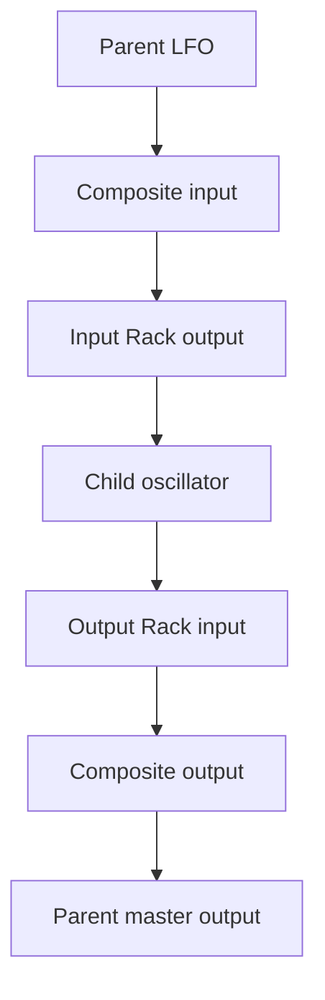

# Historical implementation record — compiler and composites

> Superseded 2026-11-23 README implementation notes, regrouped without changing their technical claims. These are **historical**, not current feature status. Go to the [archive index](legacy-readme.md), [roadmap](../roadmap/overview.md) and [feature contracts](../README.md) before implementing.

## Faust graph compiler (Phase 4)

`Orbit.Audio` is a plain .NET library that consumes a committed `GraphSnapshot` and produces a `FaustGraphProgram`: Faust source plus graph ID, revision and stable host control mappings. It does not load WASM, own the browser audio device or have any dependency on the canvas.

~~~mermaid
flowchart TD
    S["GraphSnapshot"] --> C["FaustGraphCompiler"]
    C --> B["GraphFlattener"]
    B --> O["GraphDependencyOrder"]
    O --> R["Registered node emitters"]
    R --> P["FaustNodeContext"]
    P --> F["Faust source + control mappings"]
    F --> W["Faust WASM compilation"]
    W --> T["Offline sample rendering tests"]
~~~

- The compiler walks backward from the sole master output and orders all reachable audio and modulation dependencies. Disconnected nodes are excluded; a disconnected master produces silence.
- `IFaustNodeEmitter` is the backend extension point. Oscillator and gain have independent implementations. `FaustNodeContext` handles routing, weighted input summation, parameter slider generation, smoothing, clamping, validated structural constants and the optional transport dependency.
- Each parameter control uses its node and parameter IDs, never user labels. The program source is stable across base-value edits; the latest values travel separately in the control map and must be applied before playback.
- For linear parameters, effective value = clamped (smoothed base + sum of incoming signals × connection amounts). Frequency also stays below the sample-rate-dependent Nyquist limit. Modulation signals themselves run at audio rate.
- Connection amounts are baked into this first source representation. Changing connection amounts or topology requires recompilation; a future runtime can expose depth controls without recompiling.
- The current backend supports mono free or tempo-synchronized periodic oscillators, gain, nested composite boundaries and exactly one root master output. Cycles and unsupported reachable node types are rejected.

CI exports an actual nested graph using `tests/Orbit.Audio.Probe`, compiles the generated source using the pinned Faust CLI, then renders it offline at 44.1 and 48 kHz. Tests verify that an external LFO can fan out through two rack inputs to internal pitch and gain, that audio returns through the output rack, and that a host can change an internal frequency control without recompiling.

To reproduce the graph compiler probe locally (Bash, .NET 10 and Node):

~~~bash
export ORBIT_GRAPH_PROBE_DIR="$(mktemp -d)"
dotnet run --project tests/Orbit.Audio.Probe/Orbit.Audio.Probe.csproj -- "$ORBIT_GRAPH_PROBE_DIR"
npm exec --yes --package=@grame/faustwasm@0.19.0 -- faust2wasm-ts "$ORBIT_GRAPH_PROBE_DIR/program.dsp" "$ORBIT_GRAPH_PROBE_DIR/compiled"
node --test tests/compiler/*.test.mjs
~~~

The browser compiler supports live base-value updates, automatic runtime replacement with revision tracking and passive meters for connected modulation parameters.

## Shared UI components

`ParameterSlider` is the first reusable presentation building block. It takes a domain parameter definition, editable base value and optional read-only modulation range and effective value. The same component renders all three settings, validates draft input without committing invalid values and reports errors to its parent.

~~~mermaid
flowchart TD
    D["ParameterDefinition + base value"] --> UI["ParameterSlider"]
    UI --> V["Validated base edit"]
    V --> Parent["Owning editor"]
    DSP["Faust effective frequency meter"] --> M["FaustOutputMonitor"]
    M --> S["Application service"]
    S --> UI
~~~

The editable thumb and numeric input stay at the base value. A colored band shows the effective range predicted by `GraphModulationRangeEstimator`, which resolves upstream signal bounds and connection amounts, sums modulation and applies parameter limits. Each registered DSP emitter supplies its optional output-bound rule; unsupported bounds are shown as unknown. For example, a 440 Hz base with a full-amplitude sine and a connection amount of 100 Hz gives a 340–540 Hz band.

The separate moving marker and Live label reflect actual Faust bargraph readings at 25 Hz, not a simulated LFO. Meter names map to stable node/parameter addresses. Frames are accepted only for the applied graph revision, and markers disappear while stopped or while a new graph is pending. The estimated band remains visible when stopped. Telemetry never changes the base parameter or emits graph commands.

Future root and nested canvases share the same viewport, node frame, port connector and Bézier connection components. Their interaction and visual contracts are defined in [the architecture document](../editor/design-system.md#shared-canvas-and-component-standards).

### Frequency control design note

The oscillator frequency control covers the complete 0.01–20,000 Hz range on a segmented logarithmic rail. The first 20% covers 0.01–40 Hz for sub-audio/LFO use, the middle 65% covers 40–1,000 Hz for musical tuning, and the last 15% covers 1,000–20,000 Hz. Drag or use the keyboard to adjust the frequency, or type an exact Hz value in the number field. The predicted modulation band and moving effective-value marker use the same rail mapping; all numeric readouts, modulation amounts, audio processing, patches and presets retain their original physical Hz values. Other parameters remain linear unless their definitions opt in to a display scale. The period is `1 / frequency`: higher rates produce shorter cycles and may be too fast to track visually.

## Composite graph foundation (Phase 5)

`CompositeNode` implements `ICompositeNode` and creates a distinct `SignalGraph`, one `InputRack` and one `OutputRack`. Each named `ExposedPort` is projected as a parent socket and an opposite-direction child rack socket with the same ID. Connections remain local to their graph; the boundary is the only permitted route between them.



The domain rejects recursive ownership, shared concrete node instances, cross-graph connections, standalone rack insertion/removal and child master outputs. `GraphNodeSnapshot.Composite` captures the child graph and rack IDs without referencing mutable objects. `GraphSnapshot.GetGraph` resolves nested graph IDs within the captured patch revision.

The existing commands now address the root or any owned child by its graph ID, with one serialized session commit and one patch revision. For example, after creating a composite (using a registered factory), add a generator to its child:

```csharp
var childGraphId = compositeSnapshot.Graph.Id;
session.Execute(new AddNodeCommand(childGraphId, OscillatorGenerator.NodeType));
```

`CanvasStateService(session, childGraphId)` projects that child and maintains its own layout, selection and viewport. It observes root commits to stay synchronized with the patch. If its owning composite is removed, the canvas becomes unavailable and emits `GraphRemoved`; stale commands are rejected by the session.

`GraphFlattener` now resolves the complete nested patch before DSP ordering. Each mirrored socket pair becomes a transparent backend-only route; both sides retain their own edge amounts. A disconnected receiving socket contributes zero. Fan-in sums at the receiving socket and fan-out reuses the resulting signal. No extra audio clock, DSP processor or sample delay is introduced at a boundary.

~~~mermaid
flowchart TD
    L["Root LFO"] -->|"× 100 Hz"| I["Pitch socket / Input Rack"]
    I --> F["Child sine frequency"]
    F --> S["Child sine"]
    S --> G["Child gain"]
    G --> O["Output Rack / Audio socket"]
    O --> M["Root master output"]
~~~

Child leaf identities are qualified by graph ID in generated Faust controls. The manifest maps each control back to the original graph ID and local parameter address, so live base edits reuse the current worklet and telemetry can be read using `frame.GetValues(childGraphId)`. The range estimator uses the same flattened routes via `Estimate(rootSnapshot, childGraphId)`, taking external modulation into account.

### Editing a drone

1. Select **Drone (composite)** in Add node, then click **Add**. Each instance starts with a sine, a gain processor, Input Parameters Rack (Pitch and Gain) and Output Rack (Audio), wired internally.
2. Route the drone's Audio output to the root master. Remove the existing master connection first if necessary (the master accepts one input).
3. Connect a root generator to the drone's Pitch or Gain socket. Click **Open Drone** to edit the internal graph. The exposed inputs appear as output sockets on the Input Parameters Rack.
4. Use the breadcrumbs to go back to an ancestor canvas. The same editor, interactions and parameter controls work at every depth, including adding another drone.

`BuiltInNodes.CreateEditorRegistry()` includes the starter `DroneTemplate` factory; the leaf registry remains available to custom callers. `CanvasNavigationService` owns and caches an independent `CanvasStateService` for each visited graph, preserving pan, zoom, positions and selection. Removed subtrees are disposed and navigation returns to the nearest surviving ancestor. The workspace sends edits to the active graph ID but keeps one playback controller bound to the **root** snapshot. Navigation alone does not advance the patch revision or restart audio.

### Layered fifth drone preset (Phase 6.6)

Choose **Drone — Layered fifth** in Add node. It instantiates a fresh editable composite with a 110 Hz sine, 165 Hz triangle, slightly detuned 220.7 Hz sine, quiet pink noise, a mono mixer and gain stage. Pitch routes use frequency ratios (1, 1.5, 220.7/110), so the external Pitch modulation shifts the voices together proportionally; Gain modulates the final stage. The default summed peak bound is 0.42 before the master stage. Each voice remains individually editable.

~~~mermaid
flowchart TD
    P[Pitch rack] --> A[110 Hz sine]
    P --> B[165 Hz triangle]
    P --> C[220.7 Hz sine]
    A --> M[Mixer]
    B --> M
    C --> M
    N[Pink noise] --> M
    M --> G[Gain]
    R[Gain rack] --> G
    G --> O[Audio out]
~~~

`NodeRegistry.RegisterCompositePreset` maps a catalog key to a factory producing the existing `composite.graph` node type. Labels are catalog metadata, not UI switch cases. `DroneTemplate` shares graph construction for the starter and layered factories. `MixerProcessor` has one summed mono input and a single output; each connection's amount controls its contribution. Its DSP emitter and range rule reuse the common weighted-input resolution. No new audio runtime or editor is required. The mixer does not normalize arbitrary input sums; use gain staging.

### Editing a rack interface

Open a drone and choose **Edit ports** on either rack. The shared editor supports adding a named mono Audio or Modulation port, selecting single-source or summed fan-in on its receiving socket, renaming, reordering, and removing ports. Changes immediately appear on both the rack and the parent node. Renaming/reordering maintains stable IDs and preserves connections; removing a port disconnects every affected edge on both sides in one committed revision. Audio continues using the root patch (topology changes can replace the worklet through the existing crossfade).

`CompositeBoundaryEditor` validates the full proposed boundary before mutation. `PatchSession` captures the entire resulting hierarchy and publishes `ConnectionRemoved` facts followed by two `BoundaryPortChanged` facts for the parent and child. Commands target the child graph ID with a direction relative to the **outer** composite:

```csharp
session.Execute(new AddBoundaryPortCommand(childGraphId, PortDirection.Input,
    "Cutoff", SignalType.Modulation, FanInPolicy.Sum));
```

Changing an existing port's signal type, channel count or fan-in, and undo are future operations; in this version those properties are chosen when creating a port.
