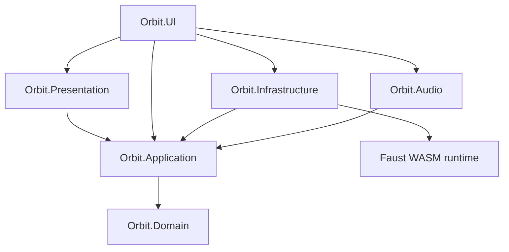
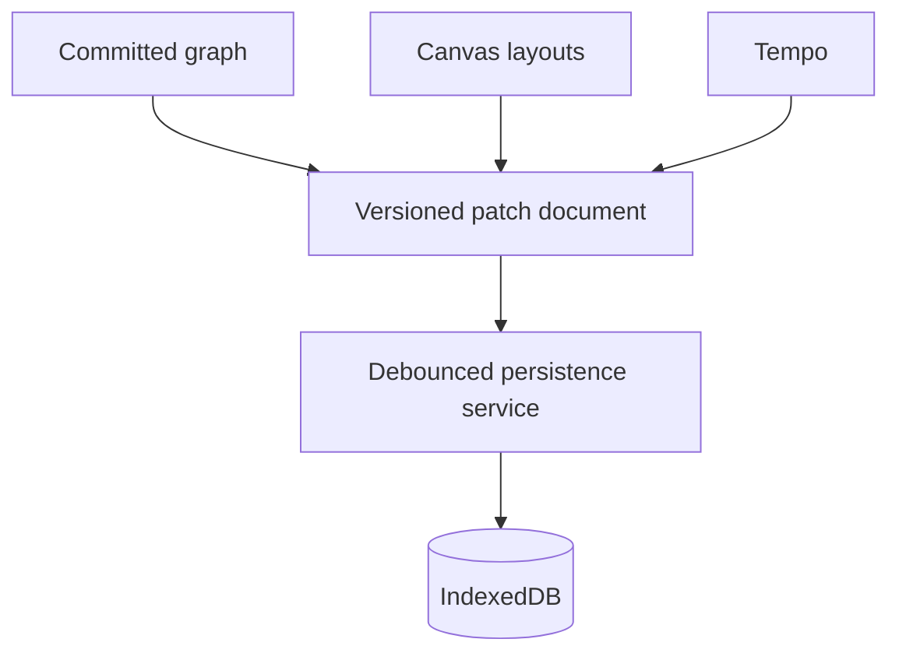

# Historical implementation record — setup and workspace

> Superseded 2026-11-23 README implementation notes, regrouped without changing their technical claims. These are **historical**, not current feature status. Go to the [archive index](legacy-readme.md), [roadmap](../roadmap/overview.md) and [feature contracts](../README.md) before implementing.

# Orbit 2

A browser-based modular synthesizer built with independent C# application logic, Blazor WebAssembly UI and Faust DSP. No React or TypeScript is used.

**Using the app:** start with the [user and agent usage guide](../usage/README.md) for patch editing, annotation visibility, recursive counts, plots, keyboard/pattern sequencing, rhythmic articulation, Resonator and the instrument composites. It links working examples with their actual implementation PRs.

**Canvas navigation:** see the [gesture-only controls](../usage/patch-editor.md#gesture-only-canvas-navigation-6214) (implemented, [PR #69](https://github.com/wgabel/orbit2/pull/69)): pinch or wheel to zoom, drag to pan, triple-tap/click to fit, and optional canvas-focused keyboard shortcuts.

**Creating music:** start with the [music creation guide](../examples/README.md) for composition, sound design, analysis and refinement. Before choosing generators, consult the [implemented instrument selection table](../examples/instrument-recipes.md#choose-an-instrument-for-the-musical-role) (physical models, composites, synthetic alternatives) and [actual pitch/articulation wiring](../usage/sound-and-instruments.md#faust-instrument-nodes); the new Faust models are musical candidates rather than automatic acoustic replicas. Browse the [sound-design foundations](../examples/foundations/catalogue.md) for reference patch downloads, musical character, analysis and validation status.

The long-term modular synthesizer design is documented in [ORBIT2-ARCHITECTURE.md](../architecture/overview.md). Phase 1 adds the independent signal graph model. Phase 2 executes a fixed modulation graph using Faust and exposes the shared audio clock. Phase 3 adds a session-owned command and committed event system plus the framework-neutral canvas presentation state. Phase 4 connects the editable graph to a runtime Faust compiler and AudioWorklet playback. Phase 5 begins with composite nodes and immutable nested graph snapshots.

## Requirements and local execution

- .NET 10 SDK
- Node.js 24 with npm (build tooling and infrastructure tests only)
- A modern browser supporting Web Audio and AudioWorklet

From the repository root:

```sh
npm exec --yes --package=@grame/faustwasm@0.19.0 -- faust2wasm-ts src/Orbit.Audio/Dsp/Oscillators/ModulatedSine.dsp src/Orbit.Infrastructure/wwwroot/audio/generated/modulated-sine
npm install --no-audit --no-fund --ignore-scripts --no-save @grame/faustwasm@0.19.0
node scripts/prepare-faust-compiler.mjs
node src/Orbit.UI/DesignSystem/generate-tokens.mjs
dotnet run --project src/Orbit.UI --urls http://localhost:5000
```

Open http://localhost:5000. Use **Play patch** to compile and play the current graph, and **Stop** to release it with a short fade. The initial patch is a sine LFO modulating a sine carrier through a gain node. The status reports the playing graph revision. Edit frequency, amplitude, gain or routing while audio runs: base values update in place, and changed DSP programs crossfade automatically.

## Project boundaries



| Layer | Project | Responsibility |
| --- | --- | --- |
| UI | Orbit.UI | Razor components, code-behind and styles. |
| Presentation state | Orbit.Presentation | Testable canvas layout, viewport transforms and selection; no Blazor or audio dependency. |
| Application | Orbit.Application | Framework-neutral contracts, request models, node registry, timing contracts and audio use cases. |
| Domain | Orbit.Domain | Signal graphs, nodes, parameters, ports, connections and graph validation. |
| Infrastructure | Orbit.Infrastructure | C# adapter and modular browser audio runtime. No UI or use-case policy. |
| Processing/DSP | Orbit.Audio | Graph-to-Faust source compiler and Faust programs that generate samples. |

The infrastructure implements contracts declared by Application. The UI composition root registers concrete implementations; UI components consume application-facing interfaces only. The current editor workspace is recovered from browser-local IndexedDB; no server database or account is required.

## Workspace recovery (Phases 6.8–6.9)

Orbit automatically saves the committed patch, including nested graphs, rack definitions, dormant connections, base parameter values, BPM, per-canvas node positions and viewport, and the active graph. After the last edit autosave waits 350 ms, then replaces the recovery document in IndexedDB in one transaction. Reload restores that document before the canvas is shown. Playback remains stopped and live telemetry, beat position, and selection are not persisted. A missing document opens the demo; an incompatible or unreadable document is retained and autosave disabled for that session with a visible warning. Browser data clearing/private browsing can remove this local data.

### Named patches and portable files (Phase 6.10)

Open **Patches** in the header to save the current workspace by name, open an existing snapshot, explicitly overwrite or delete it, create a new patch, or export/import a JSON file. Named snapshots are independent of the automatic recovery record. Use **Edit patch overview** for the musical title, description, usage instructions and tags; search saved patches by name, title, description or tag and preview metadata without opening them. **Annotated examples** exports modulation and AD percussion learning patches. New patches start with a master output; opening/importing requires stopped playback, validates the complete candidate before replacement, and commits recovery immediately. Invalid files leave the current graph intact. The JSON file uses the same versioned document as autosave.

### Graph history (Phase 6.11)

Undo and Redo in the shared toolbar restore up to 100 successful graph commands, including nested edits, parameter values, connections and rack boundaries, without stopping playback. Each operation publishes a new committed revision and uses the normal audio update and autosave paths. New edits discard redo history; loading a patch or refreshing starts a fresh history. Canvas pan, zoom, movement, selection and tempo are not graph commands and are not undoable. Recently deleted nodes and canvases recover their last layout when restored.

Dragging a parameter range slider is one undoable gesture, regardless of how many live values it emits. Keyboard range adjustment groups repeated key input until release; cancellation or blur finalizes the current value. Returning to the starting value leaves history unchanged. A separate gesture or unrelated graph command starts a separate undo step.



The infrastructure uses the .NET Razor class library SDK solely to package browser-side static assets. Local builds expose the default module directories under `_content/Orbit.Infrastructure/`; deployed builds use commit-versioned `audio-<commit>/` and `persistence-<commit>/` directories. The shared module-path resolver ensures .NET always imports matching JavaScript, including workers and generated Faust assets. IndexedDB names and keys stay unchanged across deployments. The library contains no Razor views.
