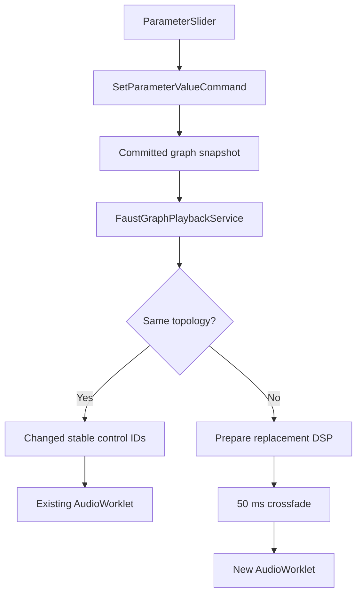

# Historical implementation record — startup and graph

> Superseded 2026-11-23 README implementation notes, regrouped without changing their technical claims. These are **historical**, not current feature status. Go to the [archive index](legacy-readme.md), [roadmap](../roadmap/overview.md) and [feature contracts](../README.md) before implementing.

## Startup sequence

1. The browser loads the fingerprinted Blazor bootstrap from `src/Orbit.UI/wwwroot/index.html`.
2. Blazor starts .NET WebAssembly and invokes `Program.cs`, the composition root.
3. The composition root registers one `BrowserAudioEngine` behind both `IAudioEngine` and `IAudioClock`, plus `IGraphPlaybackService` implemented by `FaustGraphPlaybackService` and the graph compiler.
4. The host renders `App.razor`, which mounts `GraphWorkspace` and `GraphPlaybackControls`. The controls initialize the audio module through the application service. AudioContext creation/resume is deferred to the Play button's user gesture.
5. Once initialized, the component enables the playback controls.

## Audio event flow

~~~mermaid
flowchart TD
    View["GraphPlaybackControls"] --> Service["IGraphPlaybackService"]
    Service --> Compiler["FaustGraphCompiler"]
    Compiler --> Request["PlaybackRequest"]
    Request --> Port["IAudioEngine"]
    Port --> Adapter["BrowserAudioEngine"]
    Adapter --> Entry["audio.js"]
    Entry --> Engine["AudioEngine"]
    Engine --> Context["AudioContextManager"]
    Engine --> Factory["FaustNodeFactory"]
    Factory --> Worker["FaustCompilerClient / Worker"]
    Worker --> DSP["WASM AudioWorklet"]
    Engine --> Output["AudioOutput"]
    DSP --> Output
    Output --> Voice["AudioVoice / AudioEnvelope"]
~~~

1. Play captures the committed graph snapshot. The C# service compiles it into Faust source and the initial host control values.
2. The adapter invokes the JavaScript entry module; the audio engine resumes the shared AudioContext before any worker download.
3. `FaustNodeFactory` requests a compiled factory from the lazy compiler worker. The worker loads the pinned packaged Faust bundle, compiles the source outside the main and audio threads, and returns the WebAssembly module and DSP metadata.
4. The node factory instantiates a mono AudioWorklet with a source-specific processor identity and applies the host values; the graph supplies gain, with additional output headroom.
5. `AudioOutput` connects the node through an independent initially silent voice. `AudioEnvelope` schedules the attack and release against the audio clock. Stop cancels pending startup or releases an active voice and frees its resources.
6. `GraphPlaybackControls` observes startup status and passes newly committed snapshots to the playback service. Base-only edits update the existing worklet; changed DSP programs are prepared and crossfaded automatically. It samples passive parameter meters at 25 Hz and passes revision-matched frames to the workspace.

### Live parameter update flow



The service compares the new snapshot to the last accepted playback topology, including edge amounts, ports and parameter definitions. Base-only changes use the compiler's existing control manifest and send only changed base values through `IAudioEngine.SetParametersAsync`. Structural edits regenerate source; if the source is identical (for example an unconnected node), the voice is reused. Otherwise `ReplaceAsync` prepares a new worklet while the old stays audible, then schedules a 50 ms complementary linear crossfade on the audio clock. The application serializes updates, announces new revisions immediately and skips superseded compilations before they become audible. A compilation failure leaves the last good graph playing and displays an error; correcting the graph retries automatically. Stop cancels pending replacements and releases every active voice. A replacement may reset oscillator/effect state; the crossfade reduces discontinuities, not a guarantee of phase preservation.

## Browser infrastructure components

| Component | Responsibility |
| --- | --- |
| audio.js | Compose dependencies and expose the narrow interop API; no playback or DSP logic. |
| AudioEngine.js | Coordinate playback, validate requests, manage active sound IDs and cleanup. |
| AudioContextManager.js | Create, resume and close the one shared AudioContext. |
| AudioClock.js | Read the existing context's frame-time snapshot without starting audio. |
| FaustCompilerClient.js | Own the lazy compiler worker, match asynchronous replies, propagate errors and dispose it. |
| FaustCompilerWorker.js | Serialize Faust compilations and return compiled modules and metadata; no audio render work. |
| FaustModuleLoader.js | Download and cache compiled modules and metadata; retry failed loads. |
| FaustOutputMonitor.js | Cache passive Faust output meter readings for display-rate snapshots. |
| FaustNodeFactory.js | Create independent Faust worklet nodes and map parameters using their published paths. |
| AudioOutput.js | Own master output; create separate, initially silent voice paths. |
| AudioVoice.js | Own one playback's source/gain lifecycle; stop and release resources. |
| AudioEnvelope.js | Schedule gain changes on the audio clock, including click-reducing ramps. |

## Signal graph foundation (Phase 1)

The independent domain model describes topology without generating samples. It has no browser or Faust dependency. Signal nodes expose read-only port and parameter collections; SignalGraph owns validated connection and parameter edits.

- One Oscillator generator supports sine, triangle, square and sawtooth. Frequency, amplitude and phase offset have modulation inputs; waveform is a discrete choice. The node can be an audible oscillator or an LFO.
- Oscillators display configured cycle, positive and negative durations in seconds, milliseconds or microseconds. In Free mode edit Period (s) and select Apply (or press Enter) to set the same frequency; in synchronized mode timing follows division and BPM. Square exposes modulatable pulse width (ratio 0.01–0.99; 0.5 is equal halves). For example, 5 s and width 0.2 produce 1 s positive and 4 s negative. Negative is not silence unless a downstream mapping or clamp makes it so.
- A gain processor has a mono audio input, gain modulation input and audio output; master output is a terminal mono input.
- Typed ports allow one output to feed several inputs, and modulatable parameters accept multiple sources. Connection amounts represent audio gain or target-specific modulation depth.
- Graph validation rejects missing or reversed endpoints, incompatible types/channels, duplicate edges, single-input conflicts and cycles (including modulation cycles).
- Removing a node removes its incident edges in the same operation. Parameter settings remain base values and never receive audio-rate samples.
- The application registry creates independently identified node instances. Phase 2 provides a specific mapping from a validated graph to a precompiled Faust program; Phase 4 implements general-purpose source compilation for the supported flat node types.

A small graph can be built and validated without a UI or audio device:

```csharp
using Orbit.Application.Graphs;
using Orbit.Domain.Graphs;
using Orbit.Domain.Nodes.Generators;
using Orbit.Domain.Nodes.Outputs;
using Orbit.Domain.Parameters;
using Orbit.Domain.Ports;

var registry = BuiltInNodes.CreateRegistry();
var graph = new SignalGraph();
var lfo = registry.Create(OscillatorGenerator.NodeType);
var oscillator = registry.Create(OscillatorGenerator.NodeType);
var output = registry.Create(MasterOutput.NodeType);

graph.AddNode(lfo);
graph.AddNode(oscillator);
graph.AddNode(output);

var lfoFrequency = lfo.Parameters.Single(p => p.Definition.Key == "frequency");
graph.SetParameterValue(new ParameterAddress(lfo.Id, lfoFrequency.Id), 0.5);

var frequencyInput = oscillator.Inputs.Single(p => p.Key == "frequency-modulation-in");
graph.Connect(new PortAddress(lfo.Id, lfo.Outputs.Single().Id),
    new PortAddress(oscillator.Id, frequencyInput.Id), amount: 100);
graph.Connect(new PortAddress(oscillator.Id, oscillator.Outputs.Single().Id),
    new PortAddress(output.Id, output.Inputs.Single().Id));
```

This describes a 0.5 Hz LFO modulating the second oscillator's 440 Hz base frequency by ±100 Hz. Phase 2 implements this particular modulation topology, including a gain stage, as an audible proof.
