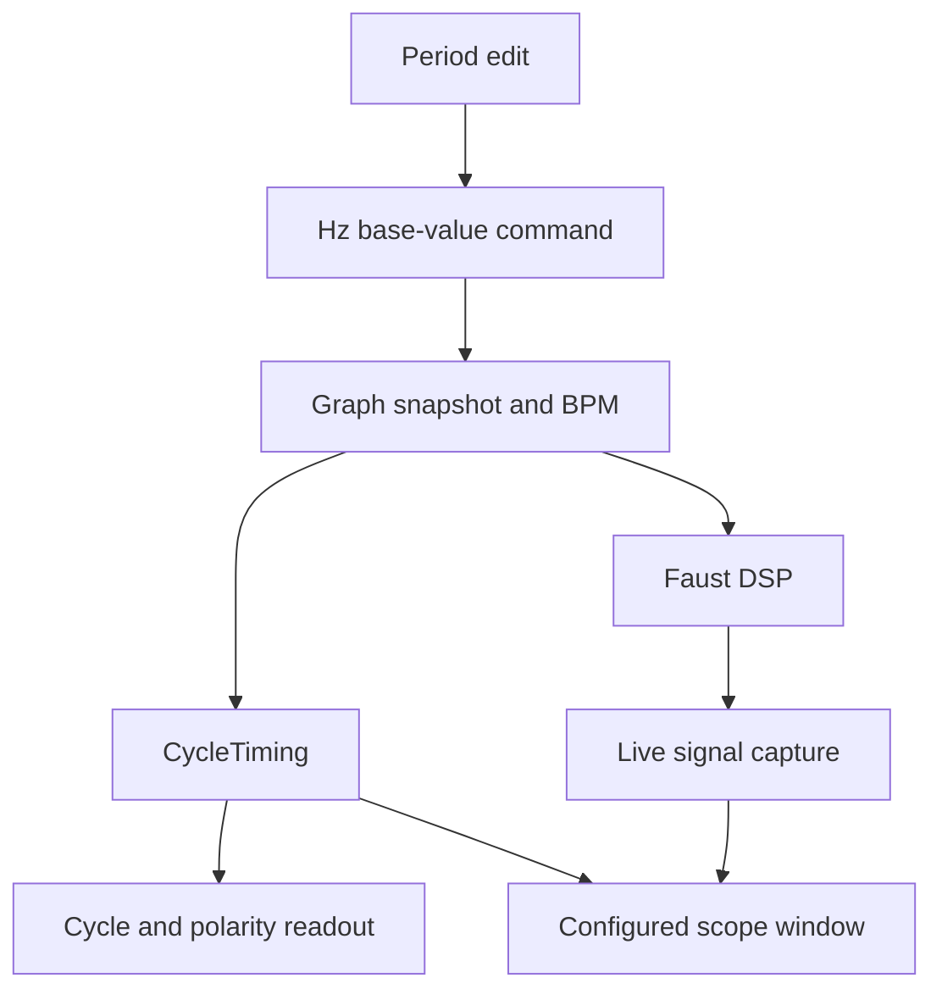

# Signal observation and analysis

[Architecture overview](../../ORBIT2-ARCHITECTURE.md) · [Roadmap](../../ROADMAP.md)

Related: [dsp engine](dsp-engine.md) · [visualizations](../editor/visualizations.md) · [testing](../quality/testing.md) · [performance](../../performance.md).

For practical plot selection and troubleshooting, see [inspecting signals](../usage/patch-editor.md#4-inspect-and-troubleshoot-signals).

### Signal observation and analysis (Phase 6.18 — partial)

**Phase 6.18.1 implementation.** Live playback enables up to eight auxiliary channels; the compiler's default mono-only mode remains available for offline comparisons and engines without capture support. The master input maps to channel zero, before the playback gain/envelope. The immutable manifest is keyed by patch, owning graph, node, port, direction and channel. The original deterministic fixed channel allocation is retained only for offline probes; the live allocator is described in 6.18.8. No new dependency roots are introduced. The fixed conservative cap (nine total channels) is a prototype limit, not a device-specific performance guarantee.

**Phase 6.18.8 — Dynamic signal tap allocation (implemented).** The original compiler reserved up to eight distinct auxiliary signal expressions even when no plot was open. In a reported patch with 19 nodes, 20 connections, zero visible plots and 15 reachable non-master node outputs, only eight outputs received auxiliary channels; a single plot on another reachable output could therefore show `Tap unavailable · unrouted or capacity limit`. Three nodes in that fixture were genuinely disconnected. This was a resource-allocation bug, not evidence that the user opened too many plots. Design: [PR #15](https://github.com/wgabel/orbit2/pull/15). Implementation: [PR #20](https://github.com/wgabel/orbit2/pull/20).

**Implementation:** the live compiler builds a deterministic graph-qualified `ObservationIds` catalog for every reachable eligible expression, with ID zero reserved for the pre-envelope master and positive IDs for auxiliary signals. Unity connections and transparent rack boundaries share identities; weighted inputs and post-audition outputs retain their actual DSP semantics. Up to eight physical slots use Faust `ba.selectn` with silent idle selection, sharing the existing DSP graph rather than adding dependency roots. The browser owns allocation: `SignalCapture` binds distinct selector identities to free slots on the first read, shares one analyzer per slot and reference-counts its leases, returns the slot to idle on the final release, and retries capacity-blocked views without eviction. A host-only integer control encodes assignment identity and selector in one exact float; a passive bargraph echoes that value from the DSP. The analyzer waits for this exact acknowledgement plus a complete fresh 8192-sample window before exposing samples, rejecting stale playback generations and clearing history and spectrum smoothing on source changes. Selector values are excluded from graph controls, history, stored patches and UI output-meter snapshots. The browser reports stopped, unrouted/inactive, unsupported, waiting, and genuine slot/lease capacity separately; `getSignalDiagnostics` exposes occupied/free auxiliary slots and active leases for future 7.3 diagnostics.

**Verification:** the generated twelve-oscillator mix exceeds eight reachable auxiliary outputs; real Faust/WASM probes select every oscillator in turn, select eight simultaneously, release to silence and compare master samples exactly against the mono-only program at 44.1 and 48 kHz. A nested modulation probe verifies weighted rack aliases and unchanged master samples. Host tests verify allocation/reuse, ninth-request refusal, same-signal sharing, fresh acknowledgement and buffer gating, stop/replacement and stale-generation release. A browser worklet regression also measures the selected frequencies through real analyzers, checks eight simultaneously, checks ninth refusal and shared-lease release, and verifies fresh samples on reuse. The offline benchmark reports median rendering time per audio second for mono, idle slots and all eight occupied (including buffer copies); one local 48 kHz run measured 13.43, 15.60 and 15.78 ms respectively. This is not a real-time AudioWorklet deadline or device performance guarantee; multi-drone browser profiling remains follow-up.

- **Desired contract:** keep channel zero reserved for the pre-envelope master; start with eight reusable auxiliary slots, allocated only to distinct reachable live signal expressions requested by visible compact/expanded plots. Master aliases and equivalent expressions may share a channel; multiple views of the same signal share one slot with reference-counted ownership. Closing, hiding, changing signal, navigating away, deleting a node, stopping or replacing playback releases obsolete requests; opening another plot reuses a free slot. A ninth distinct auxiliary request can be refused or queued with an explicit capacity message; do not silently evict an existing visible view. Static response previews do not reserve live taps. Graph-qualified addresses and weighted input/post-audition output semantics remain intact.
- **Implementation direction:** prototype a precompiled runtime signal selector (multiplexer) per auxiliary slot, selecting from the deterministic catalog of reachable signal expressions including an idle/silent option. Separate the catalog of available addresses from the current demand-driven slot mapping. Update selectors through host-only runtime controls, not persisted graph parameters, commands, history or graph revision. Keep the control/acknowledgement and capture lifecycle generation-qualified, including per-slot assignment identity; invalidate captured data, FFT smoothing and history when a slot changes source and wait for acknowledgement and fresh samples before rendering. Use the accepted runtime catalog following topology replacement, ignore stale requests, and rebind surviving visible requests. Do not recompile or replace the live Faust program merely to open, close or change plots; do not reset oscillator phase, transport or delay/reverb tails. Benchmark selector overhead and ensure shared DSP state is not duplicated; choose an alternative runtime routing design if the prototype fails these invariants. Raising the static cap alone does not solve the defect.
- **Status and diagnostics:** separately report unrouted/inactive signal, exhausted auxiliary slots (e.g. 8/8 occupied), pending/warming-up capture and stopped playback; unsupported capture engines should also be distinguishable. Do not compile disconnected branches implicitly to observe them (6.18.6 defines explicit analyzer-only reachability). Expose occupied/free slots and active capture leases separately to Phase 7.3 diagnostics; the monitor is not a prerequisite.
- **Implementation touchpoints:** `FaustGraphCompiler`, `SignalTapManifest`, `FaustGraphPlaybackService` / `ISignalAnalysisService`, browser audio runtime and `SignalCapture`, and the shared `SignalScope` / `NodeVisualizationPanel` lifecycle. Maintain graph-qualified addressing for nested racks, shared leases and compact/expanded hand-off.
- **Acceptance tests:** with more than eight reachable outputs and all plots hidden, independently open each reachable output and eligible input (including one previously excluded by identity order); verify the correct samples and zero false capacity warnings. Open eight distinct independent auxiliary signals, attempt a ninth and verify genuine exhaustion; close one and verify immediate reuse without stale samples. Verify duplicates share, expand/collapse and mode switches do not leak or unnecessarily release a slot, graph/canvas changes and stop/restart reconcile requests, and an unrouted node receives a distinct reason. Test nested graphs, concurrent requests and stale generations, rapid reassignment, browser capture lifecycle and performance on multi-drone patches; compare master samples with observation off/on and assert no view-triggered compile, playback replacement, audio discontinuity, transport reset, graph revision or undo entry.

The playback service also implements `ISignalAnalysisService`; both interfaces resolve to the same singleton. Each subscription lazily acquires a capture lease when read. Browser `SignalCapture` isolates master channel zero via a channel splitter for multichannel programs and allocates one analyser per requested channel, shared by at most 32 leases per voice. The diagnostic time-domain window is 1024 samples; Phase 6.18.2 extends the shared browser buffer to 8192 samples for coherent short windows, while diagnostic reads still copy only 1024 samples with sample rate and context time (not an exact sample-frame timestamp). Playback generation IDs change only on accepted voice replacement, not base edits or display subscriptions. Reads reject mismatched generations, warm-up is pending, and stop/replacement releases previous leases; a failed replacement leaves the last-good voice and manifest intact.

**Phase 6.18.2 implementation.** The selected-node scope is a reusable overlay, separate from graph history and node-specific editors. `NodeVisualizationPanel` (the successor to `SignalScopePanel` in Phase 6.18.4) chooses eligible graph-qualified mono ports; `SignalScope` owns a browser renderer and resolves a lightweight binding every 250 ms while visible. The renderer calls the same versioned audio module as playback directly, reads shared typed arrays at up to 30 Hz and never moves waveform samples through Blazor. A generation/source change, missing window, hidden view or disposal clears the bounded history; visibility changes release leases. Short windows use a newest complete zero-crossing or free-running window, with per-pixel min/max decimation. Long history stores up to 10,000 ten-millisecond extrema buckets, skips overlapping samples and leaves gaps on missed windows. Timing is approximate audio-context time, not an exact render-frame timestamp. Peak/RMS use the latest 20 ms and 0 dBFS at unit amplitude, independent of selected timebase. The view is stopped/unavailable until real capture is ready.

**Cycle timing refinement.** `CycleTiming` is a pure presentation projection from the immutable oscillator snapshot and committed BPM. Period is `1 / Hz`; positive and negative duration are period times the nominal positive/negative fractions (half for sine, triangle and saw; adjustable for square). The shared `CycleTimingReadout` uses fixed non-wrapping columns, adaptive units and an approximate instantaneous period from the existing frequency telemetry when modulated. Period edits in free mode invert seconds to Hertz and dispatch the ordinary validated base-value command, preserving modulation, undo, and serialization semantics. No new timing parameter or DSP state is stored. Negative signal does not necessarily mean silence, and modulation or downstream processing can change effective activity.

Square pulse width is a continuous, audio-rate modulatable ratio (0.01–0.99, default 0.5); its stable socket and parameter are active only for Square. The existing dormant-connection mechanism preserves links on other waveforms. The falling PolyBLEP edge moves with duty; rising edge, phase integration, amplitude bounds and transport behavior are unchanged. Schema-1 patches and presets with the original complete oscillator definition are upgraded with a default 0.5 width; old node, port and parameter identities remain intact. `One configured cycle` is eligible only on oscillator outputs, persisted as a display preference, and follows the projected frequency without changing the graph. Longer windows use bounded 100 s extrema history; shorter ones use raw samples and existing zero-crossing selection. It is not a phase-locked estimate of modulated cycles.

**Phase 6.18.3 implementation.** The same scope selects waveform or spectrum without touching the accepted runtime, graph history or capture lease. `SpectrumAnalyzer` is a pure browser-side radix-2 FFT plan with precomputed bit-reversal, twiddles and window weights, reusable typed arrays and bounded size 1024–8192. It reads the newest complete segment of the shared capture synchronously; DC mean is removed before applying the Hann/rectangular window. Single-sided peak amplitude uses the coherent window gain; the Nyquist bin is not doubled. Squared amplitudes are exponentially smoothed using elapsed audio-context time (off, 150 ms, 500 ms); repeat timestamps reuse the last result. Settings, mode, source, generation, visibility and capture loss reset the plan/smoothing. The positive-frequency log axis spans the first bin to Nyquist, the peak readout reports the dominant bin center rather than false continuous-frequency precision, and max-per-pixel decimation preserves narrow peaks. The amplitude dBFS scale references a full-scale peak sine, not RMS or power spectral density; window leakage and finite frequency resolution still apply. `signalPlot` centralizes theme-driven Canvas preparation and `spectrumPlot` owns frequency-domain geometry. No additional analyser nodes, audio callback work or sample interop are introduced.

~~~mermaid
flowchart TD
    C[Shared captured samples] --> V{Selected view}
    V --> T[Waveform and trigger]
    V --> F[Window and FFT]
    F --> S[Power smoothing]
    S --> P[Log frequency plot]
    C --> L[Peak and RMS]
~~~

~~~mermaid
flowchart TD
    P[Selected port address] --> B[Accepted binding]
    B --> C[Shared browser capture]
    C --> W[Window and trigger]
    C --> H[Bounded min/max history]
    C --> L[Peak and RMS]
    W --> D[Canvas renderer]
    H --> D
    L --> D
~~~

~~~mermaid
flowchart TD
    F[Faust program] --> S[Channel splitter]
    S -->|Channel zero| G[Voice envelope and gain]
    G --> D[Audio destination]
    S -->|Selected channels| A[Shared analyzers]
    A --> L[Bounded capture leases]
~~~

The current compiler lowers the entire reachable, flattened patch to one Faust program with a mono master output. `FaustOutputMonitor` reads passive scalar bargraphs for effective parameters; those readings are throttled scalar telemetry, not consecutive samples suitable for waveform or FFT analysis. Do not split the graph into one AudioWorklet per node, reconstruct oscillator samples in Blazor, or infer a live waveform from parameter telemetry. Extend the shared compiler/runtime with passive signal taps that reference actual existing expressions, never independent copies of oscillator or effect state.

**Addresses and manifest.** Use an immutable graph-qualified `SignalObservationAddress` (patch/graph/node/port identity plus direction and channel, where appropriate). An input observation reads the actual weighted/routed input expression; an output observation reads the emitted signal including mute/bypass gates, not the raw pre-gate expression. Resolve composite/rack boundary ports through `GraphFlattener` origins and routing mappings so parent and child views refer to the correct real signal. Return a `SignalTapManifest` alongside the existing Faust control manifest: map stable observation addresses to backend channels/slots and associate them with the accepted program/playback generation. Do not expose generated Faust identifiers as durable graph identities. The master output tap must have an explicit documented placement relative to the shared playback envelope/master gain.

**Initial backend strategy.** Prototype a bounded set of host-only observation channels in the compiled Faust output, in addition to channel zero carrying the existing mono master. Faust parallel composition can return multiple signals without introducing additional audible paths. The browser audio adapter must explicitly split/select the master channel before the existing gain/envelope/output path; observation channels must never be implicitly downmixed, connected to speakers or treated as user-facing multichannel ports. Prove the pinned FaustWasm worklet's output/channel configuration, browser limits and offline equivalence before integrating this strategy. Expose a bounded set of reachable observation addresses per compiled topology; support live slot selection with precompiled routing or a bounded set of fixed channels as practical, measuring the cost of evaluating selectors. Pick the strategy/capacity by profiling and expose an unavailable/capacity state for addresses that cannot be observed. Opening/collapsing a plot, changing modes or inspecting an available tap must not trigger a structural rebuild; avoid unbounded per-node auxiliary channels. Only intentional graph edits (such as adding a dedicated analyzer or changing its input) follow existing compilation/replacement policy. Keep optional observation failures isolated from the last good audio runtime.

~~~mermaid
flowchart TD
    F[Flattened Faust program] --> S[Channel splitter and tap manifest]
    S --> M[Master channel only]
    S --> T[Observation channels]
    M --> E[Existing gain and envelope]
    E --> O[Audio destination]
    T --> A[Shared analysis service]
    A --> W[Waveform and level]
    A --> P[Spectrum]
~~~

**Analysis lifecycle.** Define application-facing `ISignalAnalysisService`/subscription contracts that address signals without browser or Faust types and identify the accepted playback, sample rate, sample frame/time where available and availability. Keep latest observation data outside graph revisions; the runtime owns buffers and view lifetimes. `Orbit.Audio` compiles tap manifests and owns pure response math; `Orbit.Infrastructure` manages Web Audio channel isolation, `AnalyserNode` or bounded sample capture, FFT/level acquisition and disposal. Native `AnalyserNode` provides time-domain and frequency-domain buffers without altering its input; allocate reusable typed arrays and share analysis for multiple views of the same tap. Use a bounded decimated/min-max history for slow LFOs and long timebases rather than a huge FFT or unbounded history; preserve peaks when downsampling. Use coherent time windows and clearly labelled dBFS/reference levels. Render live Canvas plots on the browser side, with Blazor supplying sparse configuration and subscriptions, not sending sample-rate arrays or triggering render-tree updates per frame. Response curves are computed on parameter changes or throttled effective-value updates, independent of live audio capture.

~~~mermaid
sequenceDiagram
    participant V as Visualization panel
    participant S as Analysis service
    participant R as Active audio runtime
    V->>S: Subscribe by signal address
    S->>R: Resolve active tap
    loop Visible view refresh
        R-->>S: Latest bounded buffer
        S-->>V: Waveform or spectrum
    end
    V->>S: Hide, navigate or dispose
    S->>R: Release unused subscription
~~~

Keep analysis subscriptions reference-counted and restricted to visible compact/expanded plots; prioritize explicitly expanded/selected targets when capacity is reached. Suspend drawing and unnecessary analysis off-screen, in hidden tabs and on stopped playback; throttle visible refresh to a configurable target around 30 Hz. Bound memory, analyzer count, sample window and frequency-bin count. Avoid allocations, locks, blocking operations, FFT/UI drawing or message flooding in the audio rendering callback. Measure CPU and memory with representative nested drone patches at 44.1/48 kHz and establish device-appropriate limits. A shared analyser/tap must not create extra audible routing, change peak level, phase, timing, or transport, even while a graph is crossfading.

Rebind subscriptions atomically to the latest accepted runtime and manifest on graph replacement, discard stale frames/callbacks, and label a brief transition or missing tap rather than showing old-node data under a new identity. Failed replacement retains last-good audio and its corresponding analysis; Stop, workspace replacement and node removal release buffers and browser handles. Preserve the existing effective-parameter meter path independently. Analyzer-only graph branches, if added, are explicit reachability roots; ordinary visual preferences do not change graph reachability. Use deterministic offline fixtures to prove identical audible master samples with observations enabled/disabled, correct root/nested mapping, known sample and FFT/level results, and no output leakage even when taps contain a distinct louder signal.
