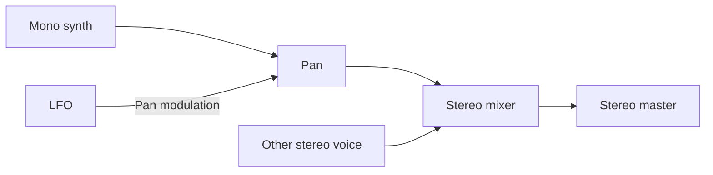

# Stereo audio, panning and oscillator unison

**Status:** Planned design · Phase 7.5. No new runtime capabilities or presets are implemented by this document.
**Recommended prerequisite:** Phase 7.3.1, 7.3.2 and the benchmark baseline of 7.3.4 (see [performance specification](../quality/performance.md)).

[Architecture overview](../architecture/overview.md) · [Roadmap](../roadmap/overview.md) · [Milestone register](../roadmap/advanced.md#phase-75--stereo-audio-panning-and-unison-planned)

Related: [oscillators](oscillators-and-noise.md), [signals and ports](../core/signals-and-ports.md), [parameters and modulation](../core/parameters-and-modulation.md), [DSP engine](dsp-engine.md), [composite nodes](../editor/composite-nodes.md), [effects](effects.md), [signal observation](signal-observation.md), [polyphony](../instruments/polyphony.md).

## Motivation and existing constraints

A panner positions sound between the left and right speakers. Unison produces several independently phased, slightly detuned instances of a waveform for one musical pitch; it creates beating, thickness and movement. Stereo unison distributes those voices across the stereo image. This is not keyboard polyphony (multiple independently articulated notes), chorus (a modulated delayed copy), or chord generation (distinct chord pitches). These capabilities serve drones, pads, supersaws, leads, layered sound and mixing equally well.

Serum 2's oscillator Unison, Detune, Blend, Pan and Width concepts are useful UX references, not a requirement to replicate proprietary algorithms or parameter curves. See the [Serum 2 user guide](https://xferrecords.com/manual/serum-2) and [Xfer's CPU guidance](https://support.xferrecords.com/article/51-serum2-sound-design-guidelines-for-optimizing-cpu-usage).

At the design baseline:
- `OscillatorGenerator` produces one mono `signal-out`; `OscillatorFaustEmitter` uses a shared timing and band-limited waveform implementation. Frequency, amplitude, phase, pulse width and pitch tracking already have established parameter semantics.
- `PortDefinition` and mirrored composite boundaries carry channel counts, but the compiler only lowers scalar ports. `IFaustMultiOutputEmitter` emits separate scalar ports, not a single stereo port.
- `MixerProcessor` is mono. `MasterOutput` has a mono input. `FaustGraphCompiler` emits the audible signal at channel zero; `SignalCapture.connectMaster` explicitly routes only that channel to playback. Further output channels are currently observation taps, not right-channel audio. Merely adding a Pan slider or passing two Faust outputs to the current host would not work.
- Playback uses one flattened Faust program, accepted-generation routing, runtime control updates and click-safe recompilation/crossfade. Preserve these foundations.

## 1. Performance first

Before implementing Phase 7.5, deliver the useful portion of Phase 7.3: passive Performance Monitor (7.3.1), compilation/replacement and resource metrics (7.3.2), and a reproducible DSP benchmark baseline (7.3.4). Prioritize those ahead of unison/stereo, even if unrelated editor or instrument milestones advance independently. 7.3.3 editor profiling is useful during cross-cutting UI work; 7.3.5 musical timing and broader 7.3.6 reporting are not hard prerequisites.

Record the existing mono implementation's baseline before modifying it. The monitor must report unsupported metrics honestly. Offline DSP timing plus external live renderer measurement is acceptable if a reliable in-app worklet CPU measure cannot be implemented. A 128-frame block at 48 kHz has only about 2.67 ms of rendering time: increasing oscillator count, duplicating stateful effects per channel and temporarily running two graphs during a crossfade all consume that budget. Do not treat a UI node count as an oscillator count.

Add benchmark profiles before enabling larger voice counts:
- Single oscillator, then 1/2/3/5/7/8/16 unison voices (16 experimental until measured); sine, saw and pulse; shared versus varying frequency/detune modulation.
- Mono vs stereo version of the same layered patch, with 1/4/8/16 sources or nested drones, mixers, filters, delay/reverb/chorus and no/one/maximum supported observations.
- Worst-case combined unison and future note-polyphony workloads: N notes × V oscillator voices × oscillator instances, plus channel-specific effects. Constrain actual reachable DSP cost and keep test amplitudes safe.
- Warm and cold compilation, control-only sweeps, graph replacement/crossfade (old and new graphs coexisting), repeated presets/import/stop and resource cleanup.
- At 44.1/48 kHz (and other supported rates when practical): repeat deterministic offline renders with warmup and comparable block sizes; separately measure live renderer capacity and supported underrun stats. Record build, device/browser, actual sample rate, fixture, channel layout, tap count, voice count, throughput, timing distribution and output validity. Offline throughput is not proof of glitch-free live playback.
- Show effective synthesis voice count separately from UI nodes, active/retiring runtime graph voices and future independently playing notes; track audible vs analytical channels, and filter/delay instances where known.

Use measured headroom and repeatable results to choose supported voice limits and optimize actual bottlenecks. Never silently reduce voice count, narrow stereo, disable effects or change a musician's patch. Report pressure and let the user decide. See [benchmark workflow](../quality/dsp-profiling.md).

## 2. Oscillator unison (7.5.1, 7.5.4)

Expand the current Oscillator node rather than adding one node per unison voice or a separate oscillator family. Preserve its type key and current stable parameter/port IDs. Unison belongs to audio generation, not modulation-only LFO behavior.

Proposed section (collapsed by default; controls meaningful for the selected mode):

| Control | Proposed default / range | Semantics |
|---|---|---|
| Voices | 1; integer 1–8 initially, consider 12/16 after profiling | Independent oscillator instances per pitch |
| Detune | 0 cents; 0–100 cents | Maximum signed deviation at the outermost voices |
| Blend | 100%; 0–100% | Side-voice weight relative to the central voice(s), normalized |
| Phase spread/randomization | 0%; 0–100% | Deliberate initial phase variation, reproducible per instance/seed |
| Pan | center; −100% left to +100% right | Stereo position of the complete oscillator (7.5.4) |
| Stereo width | 0%; 0–100% | Spread of voices around the pan position (7.5.4) |

Use discrete voice count as a structural setting initially; compile only N requested instances. Use the existing accepted-revision and crossfade path for structural edits. Continuous detune, blend, pan and width should accept the existing modulation socket mechanism, with smoothed base edits and audio-rate DSP modulation. Phase randomization is initialization configuration, not an unbounded per-sample noise source; document whether edits require replacement. Single-voice mode bypasses detune/spread/normalization and preserves legacy oscillator audio exactly. Keep hidden settings persisted. For synchronized BPM oscillators keep unison disabled at first (or expose only a deliberately defined phase-spread mode later); free-running detuned voices would break exact cycle locking. Do not change existing LFOs, pulse width, pitch tracking or shared clock semantics.

### DSP contract

For N > 1, place voices at symmetric normalized positions p_i = 2i/(N−1)−1, with i=0…N−1. For N=1 use p=0. In free mode derive the base frequency f from the existing effective Hz and semitone pitch tracking, then compute each voice frequency:

```text
f_i = f × 2^(p_i × detuneCents / 1200)
```

At 220 Hz with five voices and detune 12 cents, the offsets are −12, −6, 0, +6, +12 cents. Independent phase accumulators integrate their own instantaneous frequency at actual sample rate. Apply a deterministic per-node/voice initial phase offset, a shared effective phase control, and the existing band-limited waveform/pulse algorithm per voice. Clamp each effective voice frequency to the actual Nyquist-safe limit after detuning. Do not generate unison by summing phase-shifted copies of one identical frequency when detune is nonzero.

Choose a documented symmetric blend curve, including even counts with two central voices. For example, central voice(s) have weight 1; outer voices interpolate monotonically from central weight toward the Blend percentage. Normalize weights by their sum (with a nonzero fallback): a conservative bound prevents clipping even if phases align. Equal-energy normalization may be considered later, but must demonstrate safe peaks and perceptual behavior. Preserve existing amplitude/modulation semantics; update range estimates for the normalized sum and stereo gain. More voices need not mean a louder instrument. Do not promise exactly equal perceived loudness: interference and spectral differences affect it.

At zero detune and zero phase spread, aligned voices normalize to the original wave. At nonzero detune, even sines produce slow beating and possible temporary dips; phase spread changes early transients without introducing discontinuities. Use a deterministic seed by stable qualified node/voice identity where randomness is chosen, and never rerandomize every block or every slider update. Test stateful phase behavior on live parameter sweeps. Crossfade count changes using existing lifecycle and measure transient CPU cost.

## 3. Channel-aware graph and audible stereo (7.5.2)

Extend the current typed-port model to explicit mono (one channel) and stereo (two ordered channels, L/R) audio signals. Keep modulation, pitch, Trigger, Clock and Gate scalar; stereo-to-modulation must use explicit Left, Right or defined mono downmix selection. One stereo cable represents a paired signal with one stable port/edge identity and one connection amount, not two unrelated wires. Clearly label Mono/Stereo sockets and incompatible targets.

- Keep legacy port keys/IDs and stored channel counts. Default existing/new oscillators and processors to established mono mode until stereo is explicitly selected. Use versioned backwards-compatible migrations, stable IDs, deterministic flattening, and undo/redo/import/export/presets/module cloning. An existing all-mono graph must produce the same samples/levels and remain centered; preserve its legacy master path where appropriate.
- Support explicit adapters for mono→stereo (duplicate or documented equal-power distribution), stereo→mono (documented downmix, e.g. (L+R)/2 for a peak-safe average), and split/merge/select. Never silently discard one channel or fold stereo into a mono-only processor/parameter. Define an explicit promotion policy for mono contributions to a stereo mixer/master, consistent with established mono speaker levels and documented separately from the panner law. Validate mismatched ports and any channel-mode edits atomically across existing routes, including nested rack boundaries; do not silently remove cables.
- Extend graph flattening, weighted fan-in, bypass/mute, output range estimation, multi-output lowering and emitter contracts to carry ordered channel expressions, not C# audio buffers. Preserve graph-qualified identity and DSP state sharing. Keep one Faust program per accepted flattened graph.
- Make audible master layout explicit in the compiled program/manifest. For mono: channel 0 audible. For stereo: channels 0–1 audible L/R; auxiliary taps begin after these. Distinguish observation selector identity from physical output channel. Update host worklet configuration, SignalCapture splitter/merger routing, playback gain, crossfade, channel caps and offline export/probe paths. Never rely on implicit downmixing of auxiliary taps or send them to the speakers. Verify actual pinned FaustWasm/Web Audio multichannel behavior and device mono fallback.
- Support stereo Input/Output Racks with matching EXPOSED port definitions, zero for disconnected routes, channel-wise weights, nested/mirrored socket identity, and grouping/ungrouping when channel-compatible. Protect persisted legacy modules.

## 4. Panning and stereo mixing (7.5.3)

Add a reusable Pan processor with mono audio input, stereo output, and an independently modulatable Pan parameter. It can be placed after any oscillator, noise source, instrument/composite or mono effect chain. A stereo-capable version should explicitly distinguish balancing existing L/R from positioning a mono source; true stereo panning must not be mistaken for merely changing stereo balance.

For a mono sample x and pan p in [−1,+1], use equal-power panning:

```text
theta = (p + 1) × pi / 4
L = x × cos(theta)
R = x × sin(theta)
```

Hard left/right isolates the other channel; center produces x/sqrt(2) on each, and L²+R²=x². This is an electrical power convention, not a guarantee of identical perceived loudness in every room. Legacy mono speaker levels must remain unchanged unless explicitly using the panner; test and document gain compensation of implicit mono mixer/master promotion separately. The [Web Audio panning algorithm](https://www.w3.org/TR/2021/REC-webaudio-20210617/#panning-algorithm) is a useful reference; implement audio-rate panning in the Faust graph so LFO and modulation remain sample-aligned.

Add a stereo Mixer mode for channel-wise weighted sums; supported mono contributions follow the explicit documented promotion policy. Master accepts the resulting stereo pair. Default pan = center. Add reset-to-center, L/C/R labels and effective modulated position. A compact stereo position display and L/R meters can reuse editor design tokens; no telemetry-driven graph edits.

Example planned wiring:



A sine LFO of 0.1 Hz produces one left-right-left auto-pan cycle every 10 seconds when connected at appropriate symmetric depth. Keep important low bass, kick and other anchors centered; panning is a creative choice, not a way to fix masking alone.

## 5. Stereo oscillator width (7.5.4)

After verified stereo graph and Pan processor support, enable stereo mode on the existing oscillator. Pan positions the bank; stereo width controls the spread of individual voices. At width=0 all voices share the panner position; at width=100% they span the available L/R field when centered. Select a documented symmetric mapping around the pan value (e.g. constrain both sides by remaining distance to the edge) without a hidden gain boost. Apply per-voice weights and equal-power pans, then sum L and R independently. Test endpoints, even/odd voices, mono compatibility and the exact case of one voice. Mono downmix must be deliberate and check phase cancellation: wide does not automatically mean better. Use distinct stereo width and detune controls; never equate widening with pitch spread.

Stereo output must be an explicit structural mode with clear downstream compatibility; do not unexpectedly turn an existing mono oscillator connected to a modulation input into a stereo signal when a slider is touched.

## 6. Effects, visualization and musical examples (7.5.5)

Add genuine stereo-capable gain, filters, EQ, envelopes applied via common gain, delay, chorus and reverb incrementally. Channel-independent filters use separate state; stereo effects may deliberately crossfeed channels or use decorrelated tails (ping-pong delay, stereo chorus, stereo reverb). Document whether bypass preserves stereo layout, how dry/wet levels work and how tails/state behave on mode change. Do not relabel existing mono effects as stereo. Mid/side processing and width/balance processors are useful future expansions.

Extend observation to select Left, Right, Mid/mono (document averaging) and eventually Side. Provide stereo L/R level meters, peak per channel, optional correlation/goniometer and mono compatibility checks. Keep existing scopes/spectra and reusable tap leases working for scalar sources; reserve both master channels, allocate physical aux slots on demand with safe acknowledgement/reassignment and release, and distinguish true capacity from unsupported/unrouted. Choosing a plot or changing its channel must not recompile. Existing maximum auxiliary slots should only change on measured evidence.

Add expandable Unison controls to the current node UI using shared parameter editors and consistent compact layout. A static voice distribution graphic should communicate frequency offsets, relative weights and pan spread from effective configuration; label it as configuration, not a measured waveform. Reuse the measured scope for actual signal. Avoid label wrapping/layout jumps and hidden state loss.

Candidate recipes (starting settings, not shipped presets or listening-validated results):

| Sound | Waveform | Voices | Detune | Width |
|---|---|---:|---:|---:|
| Warm drone | Sine | 5 | 4 cents | 65% |
| Cinematic pad | Triangle | 7 | 12 cents | 100% |
| Supersaw | Saw | 7 | 20 cents | 100% |
| Thick lead | Saw | 3 | 8 cents | 40% |
| Focused sub bass | Sine | 1 | 0 cents | 0% |
| Experimental bass | Square | 5 | 35 cents | 80% |

For the supersaw, start with moderate oscillator amplitude and adjust envelope/filter and master headroom, not just voice count. For the warm drone, audition beating across a long interval; avoid fast detune on low fundamental unless intentional. In music, audition both stereo and mono, compare to the existing layered oscillator approach at matched level, and retain clean low-frequency anchors. Once implemented, update the usage guide, example/preset catalogue and musical agent guidance with verified settings and actual PR references. Until then agents must use current mono techniques and must not emit fictional stereo/unison parameter keys.

## 7. Delivery and acceptance

Follow the detailed [Phase 7.5 register](../roadmap/advanced.md#phase-75--stereo-audio-panning-and-unison-planned). Deliver independently testable increments after the 7.3 baseline; avoid combining a channel model rewrite, unison, stereo effects and UI overhaul into one implementation PR.

- Domain/serialization tests: stable legacy keys/IDs, defaults exactly one voice, compatible old snapshots/presets/patches, type/channel validation and atomic transitions, nested routes, group/ungroup and history.
- Faust/offline tests: deterministic one-voice equality, voice frequencies and symmetric detune, bound/normalization under worst-case phase alignment, zero detune/width behavior, safe frequencies and anti-aliasing, no NaN or unexpected discontinuities, exact synchronized clock behavior, L/R isolation and sum/pan equations at supported sample rates.
- Browser/host tests: both audible channels mapped correctly, aux taps never audible, mono fallback and stereo worklet output verified, graph replacement and cleanup, no recompile for continuous controls or inspection, tap leasing and fresh signal windows retained.
- Audio quality: capture actual per-channel samples, compare old mono render, exercise sweep and rapid structural crossfade, measure level/peak and mono fold, listen where available and document limitations.
- Performance: rerun the 7.3.4 baseline profiles after each increment, including maximum intended voice count and crossfade peak load. Compare actual distributions and externally measured renderer performance when possible, distinguish unavailable statistics, report regression and decide support limits from evidence.
- Update the authoritative feature description, usage status and roadmap with actual implementation PR links. Do not mark a feature implemented based on this design alone.
