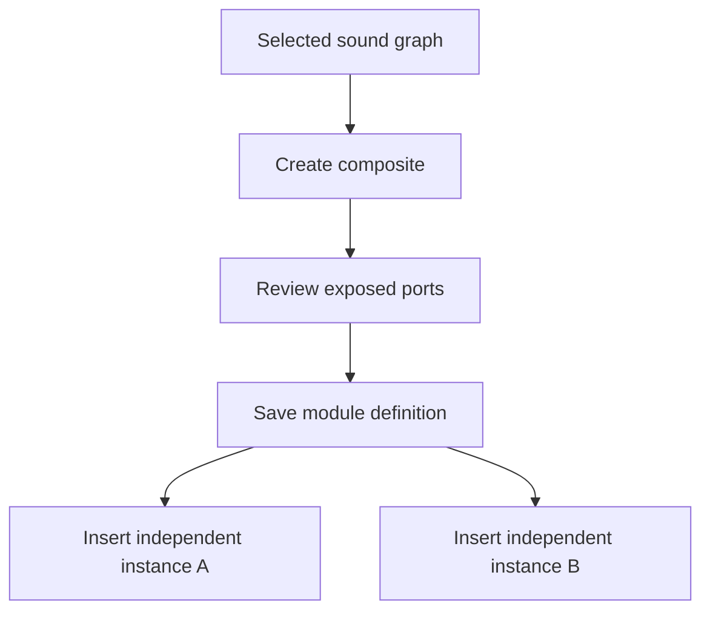
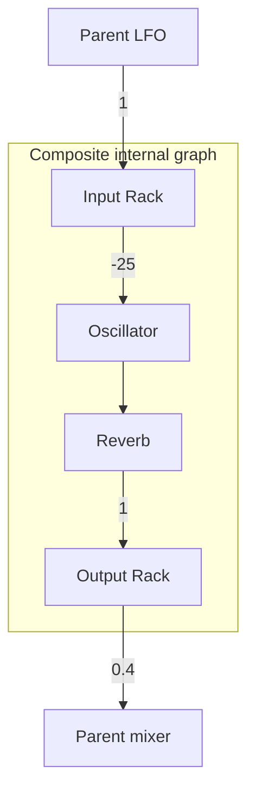

# Reusable composite modules and module library

[Architecture overview](../architecture/overview.md) · [Roadmap, Phase 7.4](../roadmap/advanced.md#phase-74--reusable-composite-modules-planned)

**Status:** Phase 7.4.1 multi-node selection and actions, 7.4.2a grouping and 7.4.2b conservative ungrouping are implemented. Phase 7.4.6 macro authoring and offline DSP lowering are merged; live playback integration is in progress. The module library and portability work remain planned. This is the design contract and implementation record for general-purpose reusable graphs. Existing composite graphs, boundary racks, built-in drone/impact factories and individual node presets are already implemented; see [composite nodes](composite-nodes.md) and [node presets](node-presets.md).

Related: [canvas](canvas.md) · [persistence and history](persistence-and-history.md) · [signals and ports](../core/signals-and-ports.md) · [commands and events](../core/commands-and-events.md) · [annotations](annotations-and-connections.md) · [generative ambient composition](../examples/generative-ambient-composition.md).

## 1. Purpose and terminology

A musician who creates a good sound or useful routing pattern in one patch should be able to preserve it and insert it into any other patch without rebuilding the graph. A drone is one use of this feature, not a special node family or a separate editor. The same mechanism should support instruments, modulation systems, rhythmic generators, effect chains, layered textures and even complete compositions.

| Concept | What it contains | How it is reused |
|---|---|---|
| Individual node preset | Base parameter configuration for one registered leaf type | Apply to an existing node without altering wiring (Phase 6.17) |
| Composite node | An owned, editable child graph with Input/Output Racks | Open and edit in the shared nested canvas (Phase 5) |
| Module preset/template | Immutable, reusable composite definition including graph, boundary and layout | Instantiate an independent composite in another graph (Phase 7.4) |
| Patch | Root graph, master destination, project transport and workspace | Open as a whole workspace or deliberately convert to a module |
| Visual group | Presentation-only collection of nodes (Phase 6.19.3) | Organize the canvas without changing signal topology |

Use **Module Library** for the user-facing catalog of reusable composites. “Drone”, “Instrument”, “Texture”, “Modulation” and “Effect” are usage categories, not different domain types. Do not extend the leaf parameter preset format to pretend a graph is a parameter list.

## 2. Musician workflows

Support the following independent entry points:

1. **Selection → Create composite:** select related nodes in any active canvas, choose Create composite, supply a name and review the automatically detected boundary. Replace the selection with a composite in the same patch; double-click to open its internal canvas.
2. **Composite → Save to Module Library:** capture a composite directly from its menu, choose a name, category and optional description/tags; the source remains unchanged. No need to ungroup and regroup an existing module.
3. **Patch → Save as Module:** capture a complete saved or current patch as an independent template without modifying or closing the original. Convert the Master Output connection into an internal Output Rack port. Review its external interface and timing assumptions before saving.
4. **Add Node → Module Library:** browse or search built-in and custom modules, inspect inputs/outputs, description, complexity and optional transport assumptions; insert a new independent instance at the intended position. It can be edited like any ordinary composite.
5. **Composite → Ungroup:** flatten exactly one composite level into its parent graph, preserving valid signal routing; nested composites remain composites.

The current editor already has additive node selection via Shift/Ctrl/Meta and graph-scoped selection state. Extend and reuse this foundation rather than build a second selection model. Add rectangle/marquee selection, keyboard access and a contextual count/actions if useful; keep connection selection distinct from moving nodes. Selection never changes playback, graph revision or history.

### Implementation: multi-node selection (7.4.1, implemented)

Implementation: [PR #45](https://github.com/wgabel/orbit2/pull/45).

Open **Selection** beside Connection labels. **Select all module nodes** replaces the selection with all eligible nodes in the current graph; **Individual module node** and **Toggle node selection** permit precise keyboard-accessible selection; **Clear selection** clears it. The summary distinguishes selected, eligible, protected, and cable targets. Rack nodes and the Master output remain selectable in ordinary editing but are excluded by the module selection actions. Eligibility here is only an ownership/type check: actual grouping must also validate the crossing connections and graph equivalence in 7.4.2.

Drag empty canvas with Shift, or activate **Marquee mode** and drag without a keyboard. An outlined rectangle previews the area until release; any measured node frame with positive-area intersection is selected. Ctrl/Meta adds to the existing eligible node set; otherwise the rectangle replaces it. A click or thin line is ignored. Escape cancels a marquee or exits selection mode without changing the existing selection. Use **Return to pan** or Escape to resume normal background panning. Bulk actions clear cable and annotation selection; drafts lock these actions. Canvas navigation resets the transient mode but preserves the existing graph-local selection as before.

`ModuleSelection` defines eligible node IDs and measured hit testing; `CanvasStateService.SelectModuleNodes` validates all requested IDs, deduplicates, filters protected types, and publishes one selection change without graph history. `GraphCanvas` previews in screen space and resolves the final rectangle against freshly measured world-space node geometry, rejecting stale graph/layout/viewport snapshots during the gesture. No new persistence schema or DSP behavior is required. Grouping is the separate structural operation below; saving reusable modules remains planned.

### Implementation: create composite (7.4.2a, implemented)

Implementation: [PR #47](https://github.com/wgabel/orbit2/pull/47).

Open **Selection**, select 1–512 eligible nodes, enter a composite name and expand **Boundary preview** to inspect generated names and actual signal types. Choose **Create composite**. The selected nodes become one editable composite, selected at the top-left of the previous selection. Open it to inspect the moved nodes, Input Rack and Output Rack; rename exposed ports using the rack editors. Empty boundaries and nested composites are supported. Master/rack nodes, selected cables and members of visual groups cannot be grouped; remove the affected visual-group membership first. Note cards and unrelated visual groups stay in the parent.

`CompositeGrouping` builds a detached candidate through the same saved-graph reconstruction and domain validation used by persistence/history. `GroupNodesCommand` verifies the expected revision; `NodesGrouped` describes the atomic ownership change. One port per crossing uses the original **source** type, preserving adapters (Audio → Modulation and Clock → Trigger). The segment entering the original receiver retains the original edge ID and amount; the new segment has unity amount. Internal edges are unchanged, even dormant modulation. Connection order at receivers is retained. Non-contiguous selections that create cycles fail before commit. No new schema or DSP emitter is required.

`CanvasNavigationService` creates a child layout with translated relative positions, rack placement, node/edge descriptions and visualization preferences; existing descendant canvases are retained. The parent layout keeps unrelated positions. One graph Undo restores the nodes and retained parent metadata; Redo restores the composite and retained child layout using existing bounded history caches. Grouping requires the normal structural recompile/crossfade, not guaranteed uninterrupted oscillator phase. Undo is not a general ungroup action: use the explicit expansion below for a composite's current edited routing. The independent Module Library is 7.4.3.

### Implementation: ungroup composite (7.4.2b, implemented)

Implementation: [PR #48](https://github.com/wgabel/orbit2/pull/48).

Select exactly one composite in its parent canvas, open **Selection** and choose **Ungroup composite**. The wrapper and its two racks disappear; its current internal ordinary nodes (including nested composites) move into the parent and become selected. The operation uses the current wiring, not the original grouping recipe. For example, an incoming boundary cable at 2 and its internal receiver cable at -25 become one cable at -50. Rack-to-rack passthrough and fan-out are supported when every used boundary has one source. The receiving edge retains its ID and dormant/zero amounts, and the product must be representable as a finite float. Event paths retain unity and the final direct type must pass domain validation.

`CompositeUngrouping.Preview` constructs the candidate routes; `UngroupCompositeCommand` verifies revision and restores a detached complete root candidate through domain validation. `CompositeUngrouped` publishes one structural fact. Reject muted wrappers, used one-sided boundaries, sums of multiple boundary sources, duplicate or colliding identities/routes and any incompatible or cyclic candidate. Completely unused ports are harmless. This deliberately conservative scope avoids inventing zero/default sources, hidden mixers or a replacement mute control; connect or remove one-sided cables, or expose a separate mixer before expanding. A refusal leaves graph, revision and history unchanged.

Before dispatch, `CanvasNavigationService.UngroupComposite` preflights `CompositeExpansionLayout` using the current child presentation. Relative positions are translated around the wrapper's location, including edited positions; neighboring nodes are untouched. Node aliases/descriptions, retained receiving-cable labels and node visualization preferences are transferred rather than recovered from stale grouping caches. Notes/visual groups within the child, parent visual membership of the wrapper, wrapper/rack descriptions and labels on discarded boundary segments prevent expansion until the user moves or removes the affected metadata. Wrapper-only plot state cannot survive its removal. Existing descendant canvases remain accessible with rebuilt breadcrumbs. Undo/redo use the bounded removed-layout caches and restore one structural edit; standalone annotation history remains separate. Normal save/reload and structural crossfade apply, with no promise of live phase continuity.

### Example: Deep Space Drone

Construct two oscillators, pink noise, a mixer and reverb. Select all five, leaving the Master Output outside. Group them into a composite named Deep Space Drone. The existing reverb-to-master edge becomes a composite Audio output; optional Pitch and Intensity inputs can be exposed deliberately through its Input Rack. A self-contained module can have no inputs. Open the composite to tune it, save it under Drones, then add it twice in a different patch and set their pitches independently.

### Example: reusable effect and musical layers

Select the delay/reverb/EQ chain in a patch, leaving its source and destination outside. Grouping exposes an Audio input and Audio output. Save it as Dark Echo Chamber in Effects. In another composition connect a melodic voice to its input. For a whole ambient piece, insert different modules for the harmonic bed, bass, melodic accents, environmental texture and slow modulation, and coordinate them with the shared patch transport. Use the [composition guide](../examples/generative-ambient-composition.md) for arrangement and independent musical timescales. Saving a sound module alone does not create a complete arranged piece.

## 3. Grouping and ungrouping contract

Grouping is a structural graph edit, not a visual group or a sequence of UI-driven delete/add calls. Build and validate a complete candidate from the current immutable root snapshot, then commit it through the existing session/command machinery as one atomic edit.

- Limit each selection to one owning graph, excluding its mandatory racks and root Master Output. Selecting a composite moves its owned descendants as a unit. Reject stale/missing IDs and invalid or empty selections clearly. Allow a single ordinary node if it is useful to wrap it. Disconnected selections may be useful as modules if valid.
- Keep selected node/parameter/port identities where compatible with ownership and graph-qualified addressing; move internal edges, including dormant connections and their signed/zero amounts. Do not duplicate internal DSP nodes, discard configuration or implicitly activate dormant routing.
- For each crossing edge generate typed boundary ports from actual endpoint contracts (signal type, channel count, direction, receiving fan-in); display candidate names derived from node/port labels and let the user rename them. Use stable IDs, not names, for both rack projections. Preserve Audio, Modulation, Trigger, Gate and Clock semantics, including allowed adapters and event unity rules.
- Initially favor a conservative one-to-one boundary per crossing edge or a provably equivalent shared port. Place original continuous-edge weight on exactly one segment; the other must be unity. Preserve distinct external sources, fan-out, receiving sums, modulation units and event alignment. Never multiply weights twice, drop a negative weight, merge independent sources illegally or introduce an artificial DSP operation. Reuse one output for identical sources only if equivalent.
- Keep the composite boundary public contract explicit. Grouping creates necessary crossings, not guessed pitch or volume ports for every internal parameter. Expose additional named ports deliberately via existing rack tools.
- Validate the parent graph, new child graph, boundary consistency, ownership, nesting, port compatibility, cycles, cardinalities and compiler reachability. Non-contiguous selections can produce a parent-level cycle (e.g. selected A and C with unselected B in A→B→C). Reject a currently unrepresentable selection with a useful explanation and offer selecting the intervening nodes; never silently add feedback or alter dependencies.
- Preserve existing neighboring placements. Place the new composite near the selection, transform selected relative positions into child coordinates, and use the established rack placement policy. Move/remap supported graph-qualified annotations and view preferences; keep unrelated parent layout intact. Reconcile selection and navigation after commit.
- One successful grouping/ungrouping operation yields one revision, coherent facts, one undo step and one autosave/playback update. Undo/redo restores both configurations and the associated layout/navigation mapping. If the current history mechanism cannot coordinate layout provenance, extend it deliberately; do not claim ordinary position history is already implemented.

### Crossing-edge example

Before grouping, a parent LFO reaches an oscillator's modulation input with amount -25 in the destination's units. After grouping, the LFO controls an exposed Modulation input and the corresponding Input Rack output connects to the oscillator. Apply -25 on the internal edge and unity on the external edge if the boundary contract preserves those units. A reverb output reaching an external mixer with amount 0.4 becomes an internal unity edge to an Audio Output Rack and an external 0.4 edge. Verify actual flattening, not just visible labels.

Ungrouping inverts the actual boundary routing, not merely the original grouping recipe. A user may have added internal branches, changed rack names, weights, fan-in, mute or nested graphs after grouping. Resolve current flattened dependencies, compose continuous weights once and preserve event unity. If a sum, unused/default input, macro, mute gate or other boundary behavior cannot be represented exactly by ordinary parent edges/nodes, reject with a concrete reason or explicitly materialize an equivalent supported adapter after preview/confirmation. Never silently change the sound. Ungroup can remove the wrapper/racks only after proving equivalence; preserve unrelated parent wiring and generate unique names/IDs where necessary.

Grouping and ungrouping should preserve the audible mathematical graph. A structural edit may currently require the ordinary compile/voice crossfade and thus restart some runtime state. Avoid gratuitous recompilation; test deterministic flattened signal equivalence and use the existing last-good-voice protection. Do not promise phase/tail continuity for a recompiled graph unless separately proven; reuse improved topology equivalence when available.

## 4. Module data, ownership and persistence

A module definition is an immutable, schema-versioned data document; it is neither compiled DSP nor a running voice. Suggested fields (names are design sketches):

- Definition ID, schema version, name, category, description, tags, optional attribution and template revision.
- Canonical composite boundary definitions (including port order and identity) and internal graph snapshot: recursive nodes/types, stable configuration keys, parameters, ports, connections, weights, nested composites, supported persisted note patterns, audition flags and future supported payloads.
- Child canvas layouts keyed by local graph/node IDs, supported annotation/visualization preferences, and optional macro definitions as Phase 7.4.6 becomes available.
- Optional descriptive source metadata and transport assumptions (e.g. intended BPM, whether using beats or free seconds). No dependency on the source patch ID, active canvas, history, open captures, transport phase, live telemetry or compiled binaries.

Reuse validated reconstruction/serialization infrastructure (currently `PatchDocumentSerializer`, `SavedGraph`, `SavedComposite`, `SavedCanvas`) where practical. Extend versioned payloads rather than silently dropping non-scalar graph features. Persist module definitions independently of named patches and individual node presets, through an application-facing repository and a dedicated IndexedDB logical namespace. Follow existing atomic compare-and-replace and storage error patterns; load the library independently of patch recovery.

Saved module IDs identify definitions, not graph instances. Insertion deep-clones the entire definition, assigns fresh graph/node/parameter/port/connection/rack IDs and remaps assignments consistently, including mirrored boundary ports, nested graph addresses, layouts, visualization settings, annotations and future macro mappings. Use one shared identity-remapping utility, not string replacement or shallow copies. A boundary's mirrored socket ID must be remapped once to both projections. No mutable object, musical playhead or DSP state is shared between inserted instances.

Existing instances carry their own complete serializable graph/parameters. Optional origin template ID/revision is provenance only. Editing, overwriting, renaming or deleting library entries never silently modifies an existing patch. Library management is not patch history; inserting/removing a module is normal atomic graph history. Undo insertion does not delete the definition.

### Library presentation and management

Reuse the Add Node catalog and shared menu/dialog patterns. Provide searchable categories (Drones, Instruments, Textures, Modulation, Effects, Rhythm, other/custom), user-defined labels where justified, input/output summary with signal types, internal node count, description, tags and usage example. Keep built-ins read-only and allow Save as copy. Existing built-in factory entries can coexist with data-driven user definitions; avoid one hardcoded UI case per module. Offer Save as, rename, category/description edit, explicit overwrite, delete, duplicate, preview and later import/export. Handle stale source snapshots and concurrent tabs, name/ID collisions and storage quota failures explicitly. A failing or canceled save must not mutate the current patch or the published catalog.

## 5. Convert a complete patch to a module

Use the same definition builder, not a second patch format. Read the complete root graph; substitute its terminal Master Output input with a public Audio Output Rack port (retaining actual receiver fan-in and weights), and add the mandatory Input Rack. Root-only sinks must not follow the graph into its child. Validate the supported Master topology; if missing, multiple or otherwise ambiguous in a future schema, prompt for a meaningful exported signal or reject. Do not invent a mix or omit audible branches.

- Preserve nested composites and actual saved configuration, layout and connections. Include disconnected editable nodes unless the user explicitly chooses to prune them; disclose that reachability remains governed by ordinary compilation.
- Root playback volume/envelope, physical device, running transport phase, current performance input focus and patch-specific history are not properties of the new module. Never introduce a second Master Output or audio destination.
- Transport-dependent internal nodes use the **destination patch's shared transport**. Preview source BPM and differing musical timing. Do not silently change the destination tempo or bake BPM-based rates into free seconds; allow deliberate conversion or future explicit local timing as a separate capability. A 10-minute patch with tempo-dependent sections cannot be promised the same duration under every BPM.
- Save as Module must not modify the source patch, even if it is playing. For a template intended as an effect/instrument rather than a self-contained source, provide an optional interface editing/preview step to expose inputs deliberately; do not auto-wire arbitrary external controls.

## 6. Portable module files

Export a single self-contained versioned module JSON (suggested `.orbit-module.json`) rather than a whole patch or leaf preset. Import previews name, version, graph complexity, boundary, category and dependencies before confirmation. Reuse strict schema validation and explicit identity-conflict choices from individual presets: preserve if unique, save a new definition copy, or deliberately replace a matching custom definition. Validate built-in identity protections, size/depth/node/edge/port limits, finite values, known type keys, schema and ownership, and all references on a detached graph. Reject invalid, unsupported or incomplete data without partial library changes or graph insertion. Future binary audio assets follow [Phase 8](../audio/sample-assets.md) portability/dependency rules; report or reject unresolved assets rather than silently substitute sound. No downloaded executable code or generated Faust is required in a module file.

## 7. Composite macro controls

A macro is a named, musician-facing control on a composite that maps one logical value to one or more internal parameters. Unlike an Input Rack socket alone, it has an editable base value and a parameter presentation (slider, units, range, default, optional modulation input). An exposed input can still be a pure audio, modulation or event routing port with no slider. A macro need not replace internal editing.

| Macro | Example mappings when macro value moves from 0 to 1 |
|---|---|
| Warmth | Low-pass cutoff 4000 → 700 Hz (log interpolation); EQ low gain 0 → +4 dB |
| Movement | Modulation depth 0.05 → 0.35; LFO rate 0.01 → 0.06 Hz |
| Space | Reverb mix 0.15 → 0.60; decay 2 → 8 s; delay feedback within safe bounds |
| Intensity | Multiple oscillator gains increase within estimated mix headroom |

Values are illustrative; validate against actual node definitions, parameter units/ranges and safe gain staging. Support direct one-target controls first, then multiple targets and inverse/linear/log mappings. A module creator selects a supported internal parameter, chooses its intended range and relationship and previews resulting values. Store stable macro IDs, metadata, default/base value, ordered mappings to graph-qualified stable parameter targets and an explicit mapping mode. Prefer normalized 0–1 controls for multi-target heterogeneous units; use physical units when a simple direct control is more meaningful.

Define an unambiguous control contract before shipping:

- A base-value edit uses one validated command and history entry. Avoid repeatedly overwriting or losing internal manual settings. Distinguish manual base value, macro-controlled contribution/override and other incoming modulation. Expose mapping status in the internal parameter UI. Define one deterministic ownership/combination rule for several macro targets; initially reject conflicting overrides instead of allowing last-writer-wins. Removing/unassigning a macro restores or retains the explicitly documented manual configuration rather than changing values unexpectedly.
- Continuous modulatable macros must use existing sample-rate parameter/control and modulation lowering semantics; never drive audio-rate modulation by periodic Blazor commands. A stable modulation socket should flow through the same boundary/compiler resolution. Include range prediction and effective-value telemetry where meaningful. Macros must be bounded and composable; no cycles, arbitrary scripts, event-to-number coercion or unvalidated choice mappings. Structural choices may be handled later through explicit transactions, not audio-rate modulation.
- Clone/remap macro mappings with graph copies, persist in portable modules and patch snapshots, and validate target deletion or ungrouping. Do not leave orphaned mappings. Mappings are configuration changes; ordinary continuous value edits should use existing live control smoothing without recompilation when topology is unchanged.

**First mapping slice (7.4.6-S1, merged, [PR #123](https://github.com/wgabel/orbit2/pull/123)).** `CompositeMacroMapping` is immutable data for a one-shot normalized edit. Each target is a direct child parameter address, with two endpoints in its native units and a bounded exponent (0.125–8). At a normalized value `v`, interpolate between endpoints using `v^exponent`; reversed endpoints invert the mapping. Both endpoints must be valid for currently active continuous targets; duplicate targets, foreign/missing targets and invalid values are rejected before any mutation. `SignalGraph.PreviewCompositeMacro` reports changed values without mutation; `ApplyCompositeMacroCommand` commits the same mapping atomically through the session with ordinary parameter-change facts and one undo entry. This explicit one-shot command edits the base configuration; it is not a persistent override, saved macro, slider, or audio-rate control. Persistent macros must instead preserve manual settings independently and define override ownership before exposing sliders. Do not drive continuous modulation by repeatedly issuing this command.

**Persistent definitions (7.4.6-S2a, merged, [PR #124](https://github.com/wgabel/orbit2/pull/124)).** Each composite owns an ordered immutable list of up to 64 macro definitions with a stable ID, unique case-insensitive name, normalized default/base and immutable mappings. The complete list is validated atomically, including ownership of direct-child parameter addresses, endpoint ranges, unique targets across macros and continuous parameter type. Conditional continuous targets may be stored while inactive; the one-shot mapping still requires active targets. Manual base values remain independent; this slice stores metadata only, without applying a persistent override or exposing sliders. The saved composite schema-1 payload has an optional `macros` array (missing means empty); invalid mappings fail reconstruction. Snapshot capture and duplication preserve definitions, remapping macro, node and parameter IDs for independent instances. The replacement command records one history entry; unchanged definitions are a no-op. Remove bindings before deleting targets or ungrouping a macro-bearing wrapper. Grouping a bound target out of the child graph is rejected by reconstruction validation. S2b adds effective-value resolution before front-panel controls.

**Effective macro bases (7.4.6-S2b, merged, [PR #126](https://github.com/wgabel/orbit2/pull/126)).** `GraphSnapshot.WithEffectiveMacroBaseValues` derives an immutable DSP/control snapshot using the stored macro base and the S1 mapping curve. Direct-child active continuous targets use the mapped physical base before ordinary modulation, clamping and smoothing; dormant targets retain their manual bases and reserved ownership, and use the current mapped base when activated. The authored snapshot is never rewritten: manual edits remain available for removal, undo/redo and serialization. The compiler and range estimator use the same flattened projection; live playback resolves the same bases for control batches, host patterns and note actions, reusing the existing voice when the structure is unchanged. Macro replacement/removal does not change graph topology. No macro sockets, UI or audio-rate macro modulation are introduced here.

**Macro value commands and gesture history (7.4.6-S3a, merged, [PR #159](https://github.com/wgabel/orbit2/pull/159)).** `SetCompositeMacroValueCommand` edits only the normalized base of a stable macro in its owning composite, emitting one `CompositeMacroValueChanged` non-topological fact per accepted value. Invalid values or identities fail atomically; unchanged values are no-ops. The shared session history groups consecutive edits by gesture ID, graph, node, control identity and control kind. Completion records one undo entry; cancellation restores the initial base through the same command path without consuming redo. Mapping definitions and manual child bases are preserved. No slider or mapping editor is introduced until S3b/S3c.

**Front-panel macro sliders (7.4.6-S3b, merged, [PR #161](https://github.com/wgabel/orbit2/pull/161)).** The shared composite wrapper renders one existing `ParameterSlider` per saved macro in definition order, keyed by stable macro ID. Normalized numeric/range input (0–1, range step 0.01) dispatches the S3a command to the active graph. Slider definition metadata is presentation-only, not a synthetic graph parameter or socket. Existing gesture completion, pinch cancellation, navigation and history paths are reused; the Open action and all boundary ports remain available. Composites remain exempt from leaf folding, and empty macro lists add no controls. There is no live modulation readout/socket or mapping authoring until the subsequent slices.

**Mapping draft, validation and preview (7.4.6-S3c.1, merged, [PR #162](https://github.com/wgabel/orbit2/pull/162)).** `CompositeMacroDraft` captures an authored root revision and the selected wrapper in its owning graph. It lists supported direct-child continuous parameters with their stable addresses, native definitions, manual bases, active status and existing owner. `CompositeMacroConfiguration` shares the persistent validation rules between the domain and preview (no structural/discrete targets, invalid ranges, duplicate ownership, names or IDs). Preview resolves the actual mapping curves without a graph command; dormant targets report the mapped value separately from their unchanged effective manual base. Apply constructs one immutable, revision-guarded `ReplaceCompositeMacrosCommand`; an intervening graph edit requires reopening the draft instead of silently overwriting changes. Existing unguarded programmatic replacement remains compatible. The editor UI and internal ownership indicators follow in S3c.2/S3c.3.

**Mapping editor (7.4.6-S3c.2, merged, [PR #165](https://github.com/wgabel/orbit2/pull/165)).** Edit macros on the wrapper opens a responsive workspace panel, including on composites without definitions. Select a macro, add/remove macros and direct-child bindings, edit names, normalized defaults/base, endpoints in native units and the exponent (0.125–8). New targets start at their manual value at both endpoints, so authoring does not immediately change sound. Already assigned targets are excluded from other draft bindings. Preview distinguishes mapped and dormant effective manual bases. All changes are local until the single revision-guarded Apply; invalid or stale drafts cannot commit. Cancel discards the draft. Navigation, patch replacement, history and opening another workspace tool dismiss the draft without applying it. No new gesture or DSP control is introduced.

**Internal ownership indicators (7.4.6-S3c.3, merged, [PR #167](https://github.com/wgabel/orbit2/pull/167)).** An active-canvas, authored-snapshot projection resolves only the immediate parent composite's mappings using the existing domain curve. The shared parameter slider retains its manual base and editing callbacks; an adjacent readout names the owning macro, manual base and mapped base in native units, explicitly noting that the mapped base precedes other modulation. Dormant targets retain reserved ownership and manual effective base, shown in a separate read-only list alongside any specialized sequencer controls. Folded leaves mount neither property editors nor readouts; unrelated frames retain stable per-node projection references. Mapping removal and navigation clear ownership without mutating manual settings. No new gestures, schema or DSP changes.

### Real-time macro modulation (S4)

**Status:** implemented increment in progress. S4a source audit/design, S4b static audio baseline, S4c association/persistence, S4d.1 flattened dependencies, S4d.2 Faust/offline verification and S4d.3 playback integration are merged through [PR #195](https://github.com/wgabel/orbit2/pull/195). S4e range estimation and effective-value telemetry is CI verified and awaiting merge in [PR #198](https://github.com/wgabel/orbit2/pull/198). The [delivery register](../roadmap/advanced.md) owns slice status. This is a new feature, not a 7.3.10 optimization; use the evidence-first audio-engine contract for changes touching execution.

#### Current source and constraints

| Owner (paths relative to repository root) | Observed behavior and consequence |
| --- | --- |
| `src/Orbit.Domain/Nodes/Composites/CompositeMacroDefinition.cs`, `CompositeMacroMapping.cs`, `CompositeMacroConfiguration.cs` | Immutable normalized base/default, stable macro ID, unique direct-child continuous targets, native endpoints and exponent 0.125–8. `ResolveBaseValues` applies the stored base only. Some eligible targets have no native modulation socket; do not make macro ownership depend on that socket. |
| `src/Orbit.Application/Graphs/Snapshots/GraphSnapshot.cs` | `WithEffectiveMacroBaseValues` derives a static copy for active targets; dormant targets keep manual values. Keep authored state unchanged. |
| `src/Orbit.Domain/Nodes/Composites/CompositeNode.cs`, `src/Orbit.Domain/Graphs/CompositeBoundaryEditor.cs`, `SignalGraphValidator.cs` | Mirrored stable rack ports, transactional removal of incident edges, typed compatibility and cycle validation. A macro-to-input association must be validated before replacing the boundary or definitions. |
| `src/Orbit.Audio/Compilation/GraphFlattener.cs`, `GraphDependencyOrder.cs`, `FaustGraphCompiler.cs` | Flattening resolves static bases, creates deterministic pass-through nodes per mirrored socket, maps local endpoints and remaps origins. Dependency order follows actual edges to the master; dormant destinations are excluded. Dynamic macro dependencies must be explicit, not an expression referring to a source outside topological order. |
| `src/Orbit.Audio/Compilation/FaustNodeContext.cs`, `FaustParameterControl.cs` | Base hslider uses a named semantic smoothing policy; existing native modulation is added afterwards and clamped. Optional pitch multiplier and sample-rate limits are applied by the existing emitter. Control metadata currently addresses an actual leaf parameter; a wrapper macro is not a leaf parameter. |
| `src/Orbit.Audio/Playback/GraphTopology.cs`, `FaustGraphPlaybackService.cs`, `ActiveGraphPlayback.cs` | Topology comparison ignores macro definitions and nonstructural base values; playback resolves static bases and looks up control addresses in real parameters. Reuses voice for source-identical changes and preserves accepted generation/revision. Dynamic configuration requires explicit topology semantics and macro control resolution. |
| `src/Orbit.Audio/Analysis/GraphModulationRangeEstimator.cs` | Signed weighted interval sums, unknown propagation, pitch-aware special case; currently analyses native modulation sockets and static bases, not macro signals. |
| `src/Orbit.Application/Persistence/PatchDocument.cs`, `PatchDocumentSerializer.cs` | Schema-1 saved macro definitions carry ID/name/default/base/bindings only; restore child before applying macro definitions. Preserve old documents and update native schema/Agent Kit exports and clone remapping together. |
| `tests/Orbit.Domain.Tests/CompositeMacroDefinitionTests.cs`, `FaustGraphPlaybackServiceTests.cs`, `FaustGraphCompilerTests.cs` | Existing tests cover immutable mapping, history, static control reuse and manual fallback. Add explicit dynamic reference cases rather than assume this coverage proves sample-rate behavior. |

#### Proposed input and numerical contract

Choose an optional association to an existing mirrored mono Modulation input on the wrapper, using its stable exposed-port ID (not display name, order, or a synthetic persisted port). This reuses typed boundary routing, signed weighted sums, Audio-to-Modulation compatibility where currently allowed, fan-in validation and existing canvas port editing. One macro may associate one input; one input may own at most one macro association in the first version. Ordinary child rack fan-out may remain valid, but the macro is a separate implicit consumer; do not create authored child cables or duplicate the incoming coefficient. No association, or no incoming connection, retains the exact S2b static path and manual fallback. Disallow missing, output, non-mono and non-Modulation associations. Event inputs are not coerced. Renaming/reordering must preserve the association; removing an associated port is rejected until explicitly unlinked in a separate undoable edit. Removing a macro releases its association without deleting the user's boundary port or cables. Clone remaps the association through the same mirrored identity remapping as its boundary. Add an optional schema-1 field (proposed `modulationInputId`); confirm native serializer and Agent Kit compatibility before exposing it. Unsupported older readers must not be presented as capable of preserving the new feature.

For an associated, connected input, at each sample:
- Smooth the single normalized base `b` via the centralized continuous control policy (use the existing ParameterSmoothing.Amplitude semantic, confirmed in S4b as the gain/normalized amplitude policy; 10 ms approximate 95% settling, never introduce a private smoothing constant). Compute `u = clamp(smooth(b) + sum(weight_i * signal_i), 0, 1)`. The cable amount is normalized macro depth, not Hz/dB. Unipolar inputs add; bipolar inputs can subtract. Zero depth is a valid no-contribution route.
- Each active binding evaluates `mapped = (1 - pow(u, exponent)) * atZero + pow(u, exponent) * atOne`. Clamp normalized input before the exponent, preserve reversed/constant endpoints, and preserve the domain curve rather than inventing another mapping. Example: b=0.5, source=-0.5 to +0.5, amount=0.4 gives u=0.3 to 0.7; 220–440 Hz linear gives 286–374 Hz. An inverse gain mapping 1→0 produces 0.7→0.3. Curves are independent per target.
- Replace only the target's *base expression*. Existing downstream native modulation, pitch multiplier, parameter and Nyquist limits retain their ordering and units. Do not feed mapped absolute values into native additive modulation sockets or subtract the manual base as a compensation trick. Do not smooth the per-sample mapped expression a second time; only the normalized base slider is smoothed. Dormant targets do not consume dynamic dependencies or override manual values.
- No per-sample C#/JS/UI commands; normalized control, fan-out and curves execute in Faust/WASM. Authored base, default, curve, manual fallback and history never depend on DSP observations.

#### Lowering and lifecycle

Prefer extending existing flattened graph lowering with backend-only stable macro-control node/dependency metadata and explicit per-target base-expression binding, rather than a new editable node family, duplicated rack wiring, or UI-rate updates. Use graph/composite/macro identities for stable synthetic IDs; test collisions and nested same-local-ID cases. Connect dependencies for active mapped targets even if they lack a native modulation socket. The synthetic node must be reachable only through actual active consumers; existing graph dependency/cycle checks must see the new edges. Inspect all reachable emitter parameter access paths before committing the lowering design; unsupported target paths must be rejected explicitly until implemented, not silently remain static. The exact internal metadata shape is deferred to S4d after baseline tests.

Use an explicit typed macro control address (graph, wrapper node, macro ID) in the compiler/playback manifest, not a fake authored ParameterSnapshot. Distinguish macro base writer from passive target meters. Keep stable names independent of labels. Dynamic topology comparison must include association, active connectivity, target addresses, endpoints/exponents and active modes whenever they affect source; exclude ordinary base/manual values and names where safe. Existing voice/source reuse must remain for plain static macros, no-op edits and dynamic base-only updates. Link/unlink, active/dormant transitions or curve edits may require a structural compile; use existing last-good voice and replacement lifecycle; do not claim state continuity across recompilation. No source or DSP generation is stored in patches.

Range estimator: sum signed intervals, clamp normalized range, transform both endpoints through each monotone curve and sort; combine with existing target-native modulation and multiplier rules. Unknown sources conservatively remain unknown (or a proved full [0,1] bound clearly distinguished from a precise prediction). Meter macro normalized effective value and actual target effective value, with graph-qualified accepted revision/generation; do not replace manual or mapped static UI values with live readings. Preserve no polling or rendering for inactive/folded consumers.

#### Static macro reference (S4b, merged, [PR #171](https://github.com/wgabel/orbit2/pull/171))

Baseline production revision [`58fa1d6`](https://github.com/wgabel/orbit2/commit/58fa1d629a4fe1ef80e991727ce9f5e31a167a0c). The existing native probe generates an importable nested composite fixture with an unused Modulation boundary input, one oscillator and gain, and static curved frequency, reversed amplitude, constant gain and conditional pulse-width mappings. For each normalized base 0, 0.5 and 1, plus square-wave activation and mapping removal, compare the authored macro snapshot to the identical graph with the same physical values set manually. Preserve independent authored bases; check graph-qualified control origins, exact source equality between paired cases, and unchanged source across sine base edits. The legacy fixture has no input association field. S4d must add the explicit associated-but-unconnected comparison when that contract exists.

`tests/Orbit.Audio.Probe/MacroBaselineFixtures.cs` generates `static-macro-baseline.json` containing exact serialized patches, paired sources and control values. `tests/compiler/StaticMacroBaseline.test.mjs` compiles the real generated Faust source with the existing pinned Faust WASM 0.19.0 toolchain, renders fresh independent 128-frame processors at 44.1/48 kHz, compares every sample with absolute tolerance 1e-6 and records peak, RMS, maximum adjacent-sample difference, settled positive-crossing frequency, max paired sample error and source/sample SHA-256. Assert finite bounded audible output and expected settled frequency. CI retains both input fixture and report as `static-macro-audio-reference`; identities are generated by native commands, so retain the actual fixture for a paired rerun, not a cross-run source-hash equality assumption. The playback service regression also exercises the existing curved base control and no voice replacement/manual fallback. No production changes. Baseline verified in [build #778](https://github.com/wgabel/orbit2/actions/runs/45827561950), head `4d5a792ac91867e7c83ec9e0a1787499b53a114b`; [retained artifact](https://github.com/wgabel/orbit2/actions/runs/45827561950/artifacts/15119809951). Ten cases (five per rate), all max paired sample error 0; maximum absolute measured frequency error 0.00257 Hz (440 Hz at 48 kHz). Peak range 0.0999985–0.2999981, RMS 0.07034–0.21110; square-wave steps are intentional. Native and published editor tests passed. Physical-device timing is not measured by this offline reference.

**Native association (S4c.1, merged, [PR #175](https://github.com/wgabel/orbit2/pull/175)):** `CompositeMacroDefinition.ModulationInputId` is optional and immutable; shared validation accepts only distinct existing mono Modulation wrapper inputs. Boundary replacement validates reservations before changing sockets or deleting edges. Native schema-1 saves omit null and restores missing as null; duplication remaps association through existing boundary identity map. Macro base edits and existing mapping editor preserve the association. No new UI association action or dynamic DSP yet: imported associations remain metadata and static audio behavior is unchanged. Agent Kit compatibility (S4c.2, merged, [PR #177](https://github.com/wgabel/orbit2/pull/177)) exports a separate deferred-feature declaration and native-accepted fixtures with and without association; the generated DTO schema includes the optional field. The root-leaf Python validator/load gate rejects both before mutation, and composite creation remains deferred. No offline structural editing is advertised. See [Agent Kit contract](../core/agent-kit.md).

**Flattened dependency projection (S4d.1, merged, [PR #181](https://github.com/wgabel/orbit2/pull/181)):** The existing boundary pass-through already provides the weighted sum; avoid a second synthetic DSP node or virtual editable socket. Opt-in `GraphFlattener.Flatten(root, includeMacroDependencies: true)` projects a dictionary keyed by flattened leaf ParameterAddress, with immutable MacroSource (parent graph, composite, macro ID, default/base and the mapped rack output PortAddress) and the original binding. Only connected associated inputs and active targets appear; zero-depth cables count as connected. `MacroDependencies` deduplicates source-node/target-node pairs, and `GraphDependencyOrder.Get` accepts those additional dependency links without introducing a second authored edge or changing native modulation amounts. The normalized expression is consumed by mapped target base expressions; no additional persisted nodes or ports. Dependency count includes implicit links when opted in. At S4d.1, default compiler/range/playback calls did not opt in; S4d.3 enables opt-in playback while static or disconnected cases remain on the existing path. Tests cover nested target origins, signed input coefficient, dormant/unconnected filtering, reachability and dependency cycle detection. Review of built-in emitters found shared Parameter calls (including oscillator pitch helpers and physical instrument aliases) and separate host scheduling for note patterns; unsupported host-managed parameters are rejected rather than silently ignored.

**Opt-in Faust expressions (S4d.2a, merged, [PR #186](https://github.com/wgabel/orbit2/pull/186)):** `Compile(..., enableMacroModulation: true)` requests the projected dependencies. `FaustMacroExpressions` generates a single normalized smoothed base plus the compiled weighted boundary signal per graph/composite/macro address; clamp before the independent power curves. Each target replaces only its base expression in `FaustNodeContext.Parameter` and retains existing pitch multiplication, additive modulation and clamps. A typed `FaustMacroControl` manifest supplies the initial base and normalized passive meter; no independent target writer. Host-managed Note Source and Note Sequencer targets fail closed until explicit semantics are designed. Base-only edits retain the same source.

**Offline DSP verification (S4d.2b, merged, [PR #193](https://github.com/wgabel/orbit2/pull/193)):** Generated Faust WASM checks at 44.1/48 kHz cover signed, inverted, clipped, zero-depth, constant-only, downstream pitch/modulation and disconnected reference cases. Faust-pruned zero-depth driver controls are optional while macro and carrier controls remain required; measured reports are retained as the `static-macro-audio-reference` CI artifact. Playback activation is the next increment.

**Playback integration (S4d.3, merged, [PR #195](https://github.com/wgabel/orbit2/pull/195); [build CI](https://github.com/wgabel/orbit2/actions/runs/46006912410), [compliance CI](https://github.com/wgabel/orbit2/actions/runs/46006912389); merge `9586ea8`):** The playback service opts into the verified lowering and resolves accepted macro controls by graph/composite/macro identity. Macro base edits update that control on the current voice; mapping, association, connectivity and existing structural edits flow through the topology comparison and ordinary compile/replace lifecycle. The topology signature excludes macro base values and display names but includes defaults, associations and target curve structure. Disconnecting the associated input drops the dynamic control and returns to the static mapped base. The program reports whether it contains active macro modulation. Last-good playback and generation-qualified acceptance continue to use the existing playback lifecycle. CI passed the .NET domain and presentation suites, generated Faust/WASM checks, published playback and editor checks, and documentation compliance. Physical-device audition and end-to-end Kick Drum verification remain in S4g.

**Range estimation and effective-value telemetry (S4e, CI verified, awaiting merge, [PR #198](https://github.com/wgabel/orbit2/pull/198); [build CI](https://github.com/wgabel/orbit2/actions/runs/46013313740), [compliance CI](https://github.com/wgabel/orbit2/actions/runs/46013377704); tested revision `80c26c7`):** The estimator opts into active macro dependencies for analysis only. It sums signed weighted source intervals, adds the current normalized macro base, clamps to 0–1, transforms both endpoints through each monotone target curve, then combines those mapped-base bounds with the target's existing modulation and pitch rules. Unknown inputs remain unknown; disconnected associations retain the exact static mapped base. Playback exposes normalized macro readings by graph/composite/macro identity and adds passive meters for each mapped target's final effective value. Both use the existing accepted graph revision and playback-generation guard; telemetry is transient and never changes authored macro bases or parameter values. CI passed domain and presentation tests, Faust/WASM generation and rendering, browser playback, published editor playback and the visualization lifecycle.

#### Acceptance and failure gates

| Slice | Required evidence before proceeding |
| --- | --- |
| S4b | Pin native baseline source/toolchain and fixtures; test static curve endpoints, reverse and constant curves, nested origins, dormant activation, removal and manual fallback, source-identical/live updates; deterministic 44.1/48 kHz baseline render. Keep known baseline results and existing test assertions. |
| S4c | Atomic valid/invalid association, connected input deletion guard, rename/reorder, undo/redo, clone remap, legacy JSON and new round-trip; update native/Agent Kit metadata and fixtures or explicitly gate unsupported kit edits. No public activation until S4d–f. |
| S4d | Native/generated Faust and offline render at 44.1/48 kHz: normalized sum and clipping, signed depth, zero amount, multiple independent linear/reverse/power targets, native additive modulation and pitch ordering, dormant behavior, nested IDs and rejected cycles. Static/unconnected legacy path should be source-identical to baseline; compare render with the same deterministic schedule. Connected control updates preserve program and generation; structural edits correctly recompile. Assert finite bounded output, not merely compilation. Record error tolerances from actual float/control precision; avoid promises of bit-exact results for changed DSP. |
| S4e–f | Predicted bounds enclose sampled values, unknown and dormant cases, accurate graph-qualified meters, stale rejection, exact manual fallback, desktop/touch association and removal, no added folded telemetry or gesture regression. |
| S4g | End-to-end import/export, clone, live edits, disconnect, undo/redo, nested navigation, both rates, paired offline and existing browser performance fixtures; record actual results with revision, workload and limitations. Physical Android audition/benchmark is separate evidence; do not claim it if unavailable. |

Go/no-go: no dynamic feature is exposed until native validation, compiler, live update and UI tests agree. Keep static macro behavior unchanged and avoid global smoothing, sample-rate, routing or schema migrations. If required compiler paths or metadata compatibility prove unsuitable, stop and revise the owning design before further production code. No Kick Drum implementation until S4 is verified.

### Unified percussion composites

The first Kick Drum is an ordinary editable composite, not a separate opaque engine. Its external interface is one typed Trigger input and Audio output, plus three normalized front-panel controls with optional modulation sockets: Power (strike force), Size (perceived drum dimensions), Damping (resonant to tight). The base controls remain usable without modulation. Sequencer Velocity should influence Power; define normalized additive input and a documented velocity mapping/offset so a zero-velocity event is silent when configured for velocity control. No separate required Gate or Velocity port. Trigger starts a natural decay; strike-specific controls must be held for the hit where necessary. Verify whether phase reset and velocity latching are supported before claiming them.

Power changes overall energy, transient intensity, harmonic balance, pitch excursion and optional saturation, not just volume. Size changes fundamental, relative modal frequencies and resonant duration, not just pitch. Damping shapes independent body, transient and shell/noise tails, not a single master envelope. Start with complementary sub/body/punch/beater/noise layers; each has independent envelope/filter behavior. Prefer distinct mappings for each control; when effects overlap use explicit independent signal contributions or a supported combination rule, never conflicting overrides or hidden last-writer-wins behavior. Preserve headroom and assess at comparable loudness. Use only shipped nodes; optional Distortion follows 7.6.6. Factory presets can change internal character without additional front-panel sliders. Extend the same three concepts to other percussion after Kick passes native measurements and listener audition. See the [advanced roadmap](../roadmap/advanced.md) for dependencies and status.

Example front panel for Deep Space Drone: Warmth, Movement, Space sliders, Pitch modulation input and Audio output, with Open internals always available. Rich macros can come after basic grouping/library support; the library must not depend on them.

## 8. Independent copies first; optional linked/versioned templates later

Initial implementation inserts independent copies only. Two instances can have different tuning, internal edits and runtime state, and a portable patch is self-contained.

Later investigate optional provenance-aware revision updates: user explicitly previews differences, maps old/new boundary IDs, resolves conflicts with local edits, and chooses which instances update. Support pinned revisions, safe undo, compatibility/migration and missing/deleted library entries without broken playback. Never replace a live graph just because a library entry changed. Avoid mandatory external references and do not require linked-template support before delivering useful independent modules.

## 9. Implementation boundaries and verification

Follow [project responsibility boundaries](../core/project-structure.md). Domain validates graph transformation and ownership; Application owns commands, template capture/clone and library services; Presentation owns selection/layout projection and preview; Infrastructure provides storage/portable files; UI assembles reusable controls; the existing compiler flattens normal composites, without module-name-specific synthesis rules. Use existing code and tests to determine precise implementation touchpoints; this design is not a fixed class-name prescription.

Deliver and test in [Phase 7.4 increments](../roadmap/advanced.md#phase-74--reusable-composite-modules-planned). Important acceptance cases:

| Area | Acceptance evidence |
|---|---|
| Selection | Additive/marquee selection, nested canvas isolation, rack/master exclusion, no audio revision for visual selection |
| Group/ungroup | Weighted Audio/Modulation, trigger/gate/clock, fan-out and sums, dormant links, nested graphs, invalid cyclic selections rejected atomically |
| Sound | Equivalent flattened routing and offline deterministic samples at 44.1/48 kHz where meaningful; no leakage or duplicate DSP roots; last-good live runtime on failed compilation |
| History/layout | One undo/redo for structural edit, restored parent/child positions, independent selections, retained annotations/preferences, save/reload |
| Module cloning | Repeated insert in root/child, distinct IDs and runtime state, no external references, rename/delete/overwrite leaves placed instances intact |
| Patch conversion | Original unchanged; same master-feed signal before host gain; destination transport rules explicit; no child Master Output |
| Storage/import | Restart and cross-tab conflict, malformed/oversized data and unsupported versions, no partial commits, repeat export/import and independent portable copies |
| Macros | Direct/multi-target mappings, inverse/log ranges, conflicts and removal, undo, modulation, independent instances and no unnecessary compile |

Use a substantial ambient graph as a worked end-to-end fixture alongside small deterministic unit cases. Profile resource usage for repeated large modules under Phase 7.3; reusable definitions are not an optimization that automatically shares DSP computation. Record actual implementation PRs in this module and the milestone register as work ships, distinguishing design, in-review and merged evidence.
