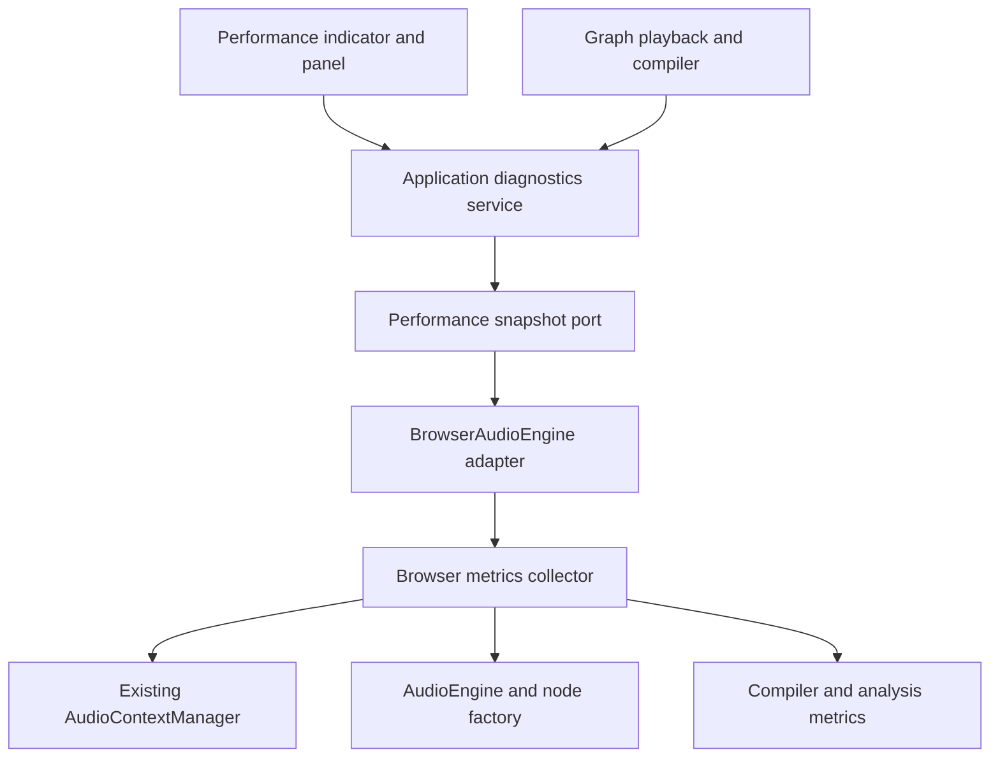

# Performance monitor implementation and collection contracts

[Architecture overview](../../ORBIT2-ARCHITECTURE.md) · [Roadmap](../../ROADMAP.md)

Related: [performance](../../performance.md) · [dsp engine](../audio/dsp-engine.md) · [testing](testing.md).

## Phase 7.3.1 — Passive monitor (in review)

Implementation: [PR #53](https://github.com/wgabel/orbit2/pull/53). `AudioPerformanceMonitor.js` is owned by the shared AudioEngine. It takes a local baseline when a logical playback is accepted, keeps it through structural replacement and freezes totals when the last active logical lifetime ends. Overlapping lifetimes share context-global statistics; startup compilation and later idle time are excluded. The monitor samples only the current context, never creates/resumes it or invokes the browser's reset method. Missing, throwing, invalid or decreasing counters yield unavailable or a new baseline; the missing fraction requires two valid counters with the same baseline interval and a positive denominator. A reset only changes the local epoch. The UI's read-only `IAudioPerformanceSource` resolves to the existing BrowserAudioEngine singleton; `AudioPerformanceSnapshot` has nullable numeric fields and explicit units. The workspace owns one PerformanceMonitor independent of nested canvas keys; one cancellable sequential 1 Hz observer reads a batched snapshot, with the hidden-document guard skipping stats collection. A hidden view retains its last foreground sample until the next foreground poll; it does not request any analyzer or add any worklet. Reset is scheduled on the same observer to avoid overlapping interop calls. Neither viewing nor resetting changes graph state, transport, history, compilation, or audio settings.

Read the [practical usage and limitations](performance-metrics.md#phase-731--passive-performance-monitor-in-review). Browser context latency is an estimate; DSP load, editor FPS, compilation stages, operation history and timing metrics remain planned. No claim of device-specific underrun coverage or exact render capacity is made. Metrics availability is determined at runtime.

## 6. Implementation architecture

### 6.1 Existing integration points (reviewed main)

| Area | Existing integration point | Performance responsibility |
|---|---|---|
| Application ports | `src/Orbit.Application/Interfaces/IAudioEngine.cs`, `IAudioClock.cs` | Reuse existing runtime identity/clock; add optional diagnostics-specific port rather than making every audio engine implementation provide unsupported metrics |
| Playback policy | `src/Orbit.Audio/Playback/FaustGraphPlaybackService.cs` | Accepted revisions/generations, C# source generation, live vs structural updates; capture operation timings |
| Compiler | `Orbit.Audio/Compilation/FaustGraphCompiler` and graph flattener/dependency order | Reachable leaf count, control manifest, output channels, compile time; omit synthetic adapters from node counts or label separately |
| Browser adapter | `src/Orbit.Infrastructure/Audio/BrowserAudioEngine.cs` | Narrow read-only interop through the existing versioned audio module |
| JavaScript composition root | `src/Orbit.Infrastructure/wwwroot/audio/audio.js` | Wire diagnostics collaborators, export one small diagnostics snapshot call |
| Shared context lifecycle | `audio/Components/AudioContextManager.js`, `AudioClock.js` | Read current context without creation/resume; sample rate, state, latency, optional playback stats |
| Runtime orchestration | `audio/AudioEngine.js`, AudioVoice/AudioEnvelope | Logical playback lifetime, accepted current/retiring voices, replacement and worklet error observations |
| Faust compilation | `audio/Faust/FaustCompilerClient.js`, `FaustCompilerWorker.js` | Request IDs, queueing, compiler initialization and request latency, errors and cache knowledge |
| Factory | `audio/Faust/FaustNodeFactory.js` | Worklet creation, parameter binding and initialization measurements |
| Analysis | `audio/Components/SignalCapture.js`, existing visualization/scope/FFT services | Active unique tap channels, analyzers, leases and visible views; cost sampling only in diagnostic mode |
| UI composition | `src/Orbit.UI/Program.cs`, `GraphPlaybackControls.razor(.cs)`, `GraphWorkspace.razor(.cs)`, shared transport toolbar and design tokens | One service/component, panel and display cadence; no direct Faust or browser dependency in Razor |
| Tests | `tests/Orbit.Domain.Tests/FaustGraphPlaybackServiceTests.cs`, `tests/audio/AudioEngine.test.mjs`, `FaustCompilerClient.test.mjs`, `SignalCapture.test.mjs`, compiler/probe and published UI tests | Extend existing suites; follow real project layout and naming at implementation time |

The current playback UI observes transport/effective telemetry about every 40 ms during playback, and the existing signal capture is bounded (maximum nine channels including master and 32 leases per voice in the reviewed implementation). Reuse that architecture; adding a performance read for every existing high-frequency meter tick would be unnecessary. Display performance snapshots at independent slower cadence. A current and retiring worklet can coexist during the existing 50 ms crossfade; report both rather than suggesting that only one DSP voice is active.

### 6.2 Contract and dependency direction

Introduce proposed interfaces/records under existing framework-neutral Application boundaries; names below are proposals and should follow existing project conventions. Keep Domain free of browser diagnostics and performance history. Do not change the persisted patch schema to carry a running session's timings.



Candidate ports:

- `IAudioPerformanceSource.GetSnapshotAsync(CancellationToken)`: optional passive browser audio statistics and runtime resources; context/generation-aware. Browser adapter can implement this alongside IAudioEngine, IAudioClock and ISignalCapture; register the same singleton through the interface in Program.cs.
- Application `IPerformanceDiagnosticsService`: merges valid browser, compiler and editor metrics; immutable snapshot/epoch, reset baseline, read bounded history, report export. Owns status/freshness/aggregation policy. Use dependency injection and deterministic fake clock in tests.
- `IPerformanceEventSink` or equivalent narrow metrics recorder: record compile/replace/command events at operation boundaries; use no-op sink by default where profiling disabled, never block successful playback on a metrics write.
- Presentation projection computes display labels/warnings without graph changes; UI owns accessibility, panel visibility and user actions. Browser-only editor metrics collector owns PerformanceObserver/rAF lifecycle, not musical or graph semantics.

Do not use IJSRuntime in Domain, graph compiler or UI view logic. Keep JavaScript composition in audio.js and small testable modules in Infrastructure; use versioned module-path conventions. A new diagnostics module must ship in the versioned deployment tree and lazy-load consistently with existing files.

### 6.3 Snapshot and event model

Use a single immutable, small, versioned snapshot passed at display rate; no audio samples, private patch names or unbounded lists in it. Use nullable numeric fields or structured values carrying availability. Keep unit suffixes in contract names (Ms, Hz, Frames, Bytes, Percent). All numeric values must be finite except a specially representable dBFS silence state.

Example JSON shape, for design discussion (all numeric values illustrative):

```json
{
  "schemaVersion": 1,
  "sessionId": "local-diagnostic-epoch",
  "contextGeneration": "current-audio-context",
  "playbackGeneration": "accepted-voice-generation",
  "graphRevision": 42,
  "sampledAtMonotonicMs": 126550,
  "state": "playing",
  "audio": {
    "sampleRateHz": 48000,
    "quantumFrames": null,
    "baseLatencyMs": 4,
    "outputLatencyMs": 8.4,
    "estimatedPipelineLatencyMs": 12.4,
    "underrunEvents": 0,
    "underrunDurationMs": 0,
    "playbackDurationMs": 30000,
    "renderCapacityPercent": null,
    "dspLoadAvailability": "unsupported"
  },
  "editor": {
    "fps": 60,
    "frameTimeP95Ms": 16.7,
    "windowMs": 5000,
    "longTasks": 0,
    "availability": "available"
  },
  "lastCompilation": {
    "operationId": "example-compile-id",
    "requestedRevision": 42,
    "sourceGenerationMs": 8,
    "workerRoundTripMs": 184,
    "workletCreateMs": 21,
    "result": "accepted",
    "cacheHit": null
  },
  "resources": {
    "editableNodeCount": 65,
    "reachableLeafCount": 42,
    "activeVoices": 1,
    "retiringVoices": 0,
    "activeAnalyzerChannels": 4
  }
}
```

An operation event records stable operation ID, operation type, requested revision, monotonic start/end or duration, attempted vs accepted generation, result (accepted, reused, superseded, cancelled, failed), optional known cache state and scoped timings. Do not conflate context-global statistics with voice-specific measurements. For context statistics use context identity and collection epoch, and attribute to a patch only with a clearly labeled session time range. For voice-specific measurements require generation and revision validity.

The snapshot is not a graph change-set, never enters PatchHistory, and must never be used to control oscillator state or BPM. A benchmark report is a separate versioned artifact. If optional metric data is missing, deserialization must not turn it into a default zero. Treat a snapshot error as an unavailable/stale diagnostics state; audio actions must continue.

### 6.4 Collection lifecycle and bounded overhead

- Create one collector per shared audio engine/session; reuse AudioContextManager.getCurrentContext, never getRunningContext for read-only operations.
- Context created on Play, not on opening the monitor. Stop/reset may leave an existing context around: display stopped state and freeze the completed session summary; start a new local baseline on next accepted playback.
- Timers/callbacks use cancellation/disposal on component replacement, navigation, hidden tabs and service shutdown. Keep samples ordered and avoid overlapping interop reads. An old async result cannot overwrite a cleared/reset or new-session view.
- Default to 1 Hz, one batched interop call for audio stats, one small immutable view update if changed. UI sampler measures foreground cadence using rAF but throttles aggregation/publication independently. Do not run the 1 Hz sampler as a musical timer.
- Avoid per-sample/per-quantum messages, logging, allocations, dictionary creation, sorting or interop. Reuse fixed-size buffers and aggregate counters/histograms outside the audio callback. If a timed DSP probe can safely run, use carefully sampled quantum measurements, fixed counters and bounded batch publication from the render thread; prove overhead before enabling it.
- Suggested initial history cap: 120 snapshots at 1 Hz and 100 recent operation events; upper bounds are configurable constants, not unlimited storage. Long-session reports use totals, bounded histograms or explicitly downsampled histories, not raw per-frame logs.
- No additional active analyzers or observation leases purely for the monitor. Consume existing capture counters and use any existing valid master meter rather than creating a hidden audio path.
- If the user enables advanced profiling, collect a separately identified short session, show that overhead exists and compare against passive-mode A/B results. Inactive/hidden profiling must stop.

## 7. Metric collection and measurement contracts

### 7.1 Audio reliability and session counters

At the start of accepted root playback (or explicit Reset counters), sample valid cumulative counters as a baseline. On each later valid snapshot:

```text
sessionUnderruns = currentUnderrunEvents - baselineUnderrunEvents
sessionMissingMs = 1000 × (currentUnderrunDurationSeconds - baselineSeconds)
sessionElapsedMs = 1000 × (currentTotalDurationSeconds - baselineTotalDuration)
missingPercent = 100 × sessionMissingMs / sessionElapsedMs, if elapsed > 0
```

Example: baseline 12 prior underrun events and 0.024 seconds missing; current event count 15 and missing duration 0.030 s after 60 seconds of valid total playback. The session exposes 3 new events and 6 ms missing, or 0.01% of that interval. It does not say "15 glitches in this patch".

Counter decrease, context change, missing fields or invalid denominator means rebaseline/reset or mark unknown; do not produce a negative count. Observe current context identity, not graph revisions alone. Continue context-level counters across ordinary accepted structural replacements within the same playback session. If playbackStats isn't updating, indicate last observed time where meaningful; identical values may also be a valid unchanged counter. Use reported context state and feature support, not timer guesses, to distinguish inactive data. Report processorerror/compile/stale/cancelled events separately; a DSP exception is not an underrun event.

### 7.2 Audio latency and keyboard timing

For context output estimates, convert seconds to milliseconds once. If base = 4 ms and output = 8.4 ms, estimated audio pipeline = 12.4 ms. This is not key-to-speaker latency. If only output is available, show that value with its correct label and leave the combined estimate unknown.

When Performance Mode (7.2.8) is implemented, instrument a representative note-on or latched pitch action:

1. Capture the input timestamp on the browser monotonic timebase (event dispatch timestamp, plus handler receipt time where useful). Track a scoped action ID and performance target; do not persist individual musical inputs in diagnostic reports by default.
2. Measure dispatch to C# application and interop message accepted. Distinguish dispatch-to-ack round-trip from one-way latency; C# completion does not establish sample application.
3. For a supported event bridge, capture the first render frame where the accepted action takes effect. Generation/sequence IDs prevent stale acknowledgments. Scheduled sequencer messages also carry intended frame or timing position.
4. Convert applied frame to audio context seconds (with the established frame origin), then map close to the current output via the browser timestamp pair:

```text
estimatedOutputPerformanceMs =
    timestamp.performanceTime +
    1000 × (appliedContextTimeSeconds - timestamp.contextTime)
estimatedEventToOutputMs =
    estimatedOutputPerformanceMs - inputPerformanceTimestampMs
```

Do not extrapolate long distances from old timestamps; reject when unavailable, context suspended, timestamps invalid or mapped latency implausible. Use timing from the same monotonic origin, and avoid adding the previously reported pipeline latency to a timestamp already mapped to output time. Compare repeated events as median/p95. A physical key-switch-to-ear measurement requires external equipment; for serious validation use an audio loopback/cross-correlation and a known stimulus, disclose hardware/driver path and distinguish microphone/ADC delay from output latency. Do not request microphone access routinely.

For scheduled events:

```text
frameError = appliedFrame - intendedFrame
errorMs = 1000 × frameError / sampleRateHz
```

A 48-frame error at 48 kHz is 1 ms. Deterministic internally generated sequencer events can target exact sample boundaries with fractional remainder handling. Incoming live host messages may initially be bounded by render-quantum scheduling; record the actual applied timing, not a promise of exact keyboard-to-sample alignment. Quantization intentionally schedules a recorded onset to the chosen slot; timing error is relative to the quantized target, not the original imprecise note time.

### 7.3 Compilation and replacement measurements

The current FaustCompilerClient lazily opens a worker, serializes compilation work in the worker, and vendor factories are cached by source hash. FaustGraphPlaybackService may avoid compilation for base-only edits or source-identical changes. AudioEngine prepares a replacement voice and crossfades it before disposing the retiring voice. Capture stages at existing boundaries, rather than timing a PlayAsync task which represents the entire logical playback lifetime.

Use separate staged measurements:

- C# generation of Faust source and manifest.
- Worker creation/startup, compiler initialization/asset load when distinguishable.
- Worker queue wait and actual compiler-call duration measured inside worker; a worker can return its own durations, not absolute timestamps assumed to share a clock origin.
- Request-to-reply round trip measured in client (includes waiting and message transfer). Classify cache hit only when explicitly exposed, not by assuming "fast means cache".
- Worklet creation and validated initial parameter binding.
- Replacement request-to-accept/first scheduled start; scheduled fade length and actual completion separately. Existing replacement method awaits old voice disposal, so its elapsed time includes transition.
- Base-only control update and source-identical graph edit: show "Reused existing DSP" without incrementing real compile count. Failed, cancelled and superseded attempts count separately and cannot overwrite the latest accepted revision's display.

Example timeline (illustrative):

```text
0 ms request edit       8 ms source built
       8–192 ms worker round trip
     192–213 ms worklet preparation
     213 ms new graph scheduled
     223–273 ms scheduled complementary crossfade
     273 ms old voice retired
```

The last compilation = 184 ms round trip, not 273 ms. Total replacement = 273 ms including scheduling and fade in this example. Existing audio keeps playing until the prepared replacement is accepted; a slow compile is not the same as increased steady-state output latency. Avoid double counting nested timings in aggregate totals.

Track C# source generation separately using Stopwatch; use injectable clock/time provider for JS components. Record only bounded aggregates and use timestamps at lifecycle boundaries. Observe replacement count, success/failure, skipped source-identical changes, and time spent with multiple simultaneous voices. Measure long-patch compile behavior under rapid routing edits; stale worker completions must retain existing last-good-graph handling.

### 7.4 Editor responsiveness and resources

Use a lightweight rAF sampler while the document is visible. FPS = completed observed frame intervals / elapsed seconds across a foreground window (e.g. 5 s). A frame gap is time between callbacks, not directly GPU render execution time; a large gap may represent a missed rendering opportunity. Track median/p95/max gaps and optionally a count above multiples of the nominal display cadence. Avoid fixed 60 FPS assumptions; a 60 Hz display gives about 16.7 ms per interval, 120 Hz about 8.3 ms. Resize observers, layout recalculations, component rendering, JavaScript and C# work may affect the gap.

Use PerformanceObserver only for supported entry types. Track long task count, total observed blocking duration and worst entries, separately from audio. Do not include hidden-tab gaps in statistics. An FPS sampler must not cause full component rerenders on each callback; aggregate and publish slowly.

For complexity and resources, count:
- Total editable nodes in current canvas and root tree separately.
- Reachable leaf DSP entities and edges in the compiled flattened program, synthetic boundary expressions separately when relevant. Unconnected graph nodes are not equivalent to audible/emitted nodes; analyzer-only reachability may need future explicit accounting.
- Number of controls, passive meters and observation channels.
- Current/retiring worklets in the browser voice sets; use "worklets/runtime voices" here rather than musical voice count until polyphony exists.
- Unique analysis channels, distinct capture leases, visible renderer instances and active FFT sizes/rates. An oscilloscope and FFT can share an observation buffer.
- Known cache/factory counts and bounded resources where actually accessible.

No exact per-node CPU percentage is obtained from these counts. They explain complexity and support comparisons. For memory, prefer observable retained resources and trends; use supported, explicitly scoped browser measurements or DevTools heap profiles. C# managed memory, JS heap and WASM linear memory are not interchangeable and browser-native allocations may be invisible. Test repeated start/stop, replacement, workspace navigation and expand/collapse cleanup.
