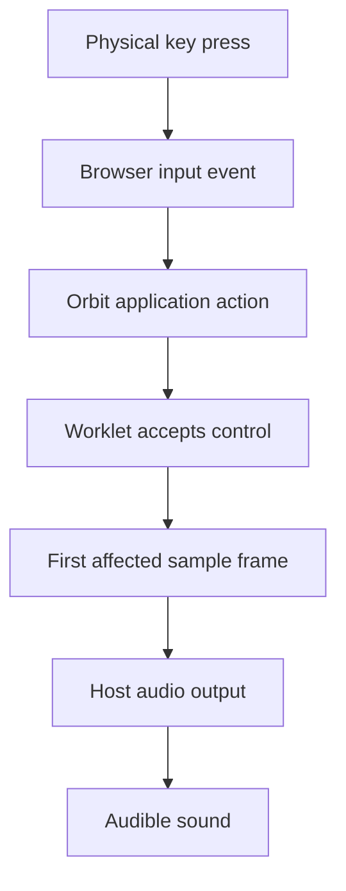

# Audio performance metrics and monitor UX

[Architecture overview](../../ORBIT2-ARCHITECTURE.md) · [Roadmap](../../ROADMAP.md)

Related: [performance](../../performance.md) · [dsp engine](../audio/dsp-engine.md) · [testing](testing.md).

## 2. Understand audio performance

### 2.1 Samples, frames, sample rate and render quantum

A sample is one numerical signal value at one point in time. A sample frame contains the simultaneous sample values for all channels. Sample rate (Fs), in Hz, is the number of frames per second. At 48 kHz the engine produces 48,000 frames every second; stereo has two samples per frame, not twice the time budget.

A render quantum is the block of frames processed in one render operation. 128 frames is common in Web Audio; never hardcode it as a universal constraint. Use the actual length of a worklet's render buffers if available, and distinguish this from the platform's device callback buffer, which can group several quanta.

The duration represented by a quantum is:

```text
budgetMs = 1000 × frameCount / sampleRateHz
loadPercent = 100 × processingMs / budgetMs
headroomPercent = 100 - loadPercent
```

Example budgets for 128 frames:

| Sample rate | Render-quantum duration |
|---:|---:|
| 44,100 Hz | 2.902 ms |
| 48,000 Hz | 2.667 ms |
| 96,000 Hz | 1.333 ms |

At 48 kHz, a DSP computation taking 0.75 ms consumes about 28.1% of a 2.667 ms quantum, leaving 1.917 ms for other rendering work in a simplified budget model. A computation of 2.2 ms consumes 82.5%; 3 ms exceeds the quantum budget (112.5%). Do not clamp the displayed load to 100%: a value above 100% is diagnostically significant.

These numbers illustrate **render budget consumption**, not average processor utilization across the laptop. The audio renderer, browser runtime, other worklets, operating system scheduling and device buffering also need resources. One busy audio rendering thread can fail even when total CPU usage in Task Manager looks low. Conversely, occasional longer quantum processing may be absorbed by platform buffering, so an individual budget overrun is a risk indicator, not proof of a device underrun.

### 2.2 Latency is not the DSP processing duration

Latency means delay between two identified events. A smaller audio quantum does not imply that a key press is heard only one quantum later. Input dispatch, C#/JS interop, queued controls, the first affected audio frame, device buffers and hardware all contribute.



Measure individual segments and label the endpoints. Intentional musical timing (quantization to the next step; a 20-second drone slot; a 4-second glide) and DSP smoothing/envelopes are not software lag. A phase-continuous pitch change can start immediately yet finish several seconds later by design. Some future effects, such as pitch shifting with internal buffering/lookahead, may have their own algorithmic delay; ordinary feedback-delay echoes and reverb tails are intentional musical behavior.

### 2.3 Underruns, glitches and clipping

An **underrun** occurs when the output system plays frames for which the audio context has not supplied actual audio. It may result in silence/repeated samples and audible clicks or dropouts. The browser's playback statistics can report occurrences and cumulative duration on supported platforms. An underrun is not necessarily a bug inside Faust; other application work, browser scheduling or the device may be involved.

A **glitch** is a more general audible discontinuity or unwanted artifact. A sudden oscillator phase reset, an abrupt gain change, a graph swap with a noncontinuous transition, filter instability, an invalid DSP value or a device underrun can all cause glitches. Zero reported underruns does not guarantee artifact-free audio.

**Clipping** occurs when signal magnitude exceeds the allowed output range or some stage applies saturation. For normalized floating-point audio, a magnitude of 1 corresponds to 0 dBFS (decibels relative to digital full scale). The internal float graph can temporarily carry values greater than 1; that is an overload warning, not proof that a particular internal stage clipped. Only the actual output stage determines audible clipping. The master path may apply additional gain/headroom.

```text
peakDbFS = 20 × log10(max(abs(samples)))
```

For zero amplitude, represent negative infinity safely in the UI (e.g. "−∞ dBFS"), not an invalid JSON number. A peak of +3.4 dBFS corresponds to approximately 1.48 normalized magnitude. Reduce the relevant gain or mixer contribution and verify the final output. Peak dBFS and DSP load belong to separate categories.

## 3. Metric catalog and interpretation

Use explicit provenance for each measurement. A value can be **direct browser reported**, **direct Orbit measured**, **derived**, **estimated**, **benchmark-only** or **unavailable**. Never present an estimate as a direct measurement.

| Metric | Unit and semantics | Source / availability | Suggested presentation |
|---|---|---|---|
| Audio context state | Running, suspended, closed, interrupted where exposed | Existing shared AudioContext | Always; idle before context exists |
| Actual sample rate | Hz | AudioContext.sampleRate / existing audio clock | Details and monitor |
| Actual render quantum | Frames per block | Supported worklet instrumentation or browser API if exposed | Details; otherwise labeled assumed example or N/A |
| Audio render budget | ms per quantum | Derived from actual Fs and frame count | Details; do not confuse with device callback buffer |
| Base latency | ms | AudioContext.baseLatency if finite | Details |
| Output latency | ms, browser estimate | AudioContext.outputLatency if supported | Compact summary and details |
| Estimated audio pipeline latency | ms | Sum of distinct base/output components when both supported | Clearly labeled estimate, no unknown component assumed zero |
| Playback latency statistics | min/mean/max ms over timed interval | AudioContext.playbackStats when available | Details; interval and source |
| Underrun events | Count of reported contiguous underrun events | AudioContext.playbackStats.underrunEvents | Compact; session delta |
| Underrun duration | ms of missing output | AudioContext.playbackStats.underrunDuration | Details; session delta |
| Missing audio fraction | Percent of duration | Derived from delta underrunDuration / delta totalDuration | Details; unavailable until valid positive denominator |
| Worklet processor errors | Count and last error category | AudioWorkletNode processorerror and runtime failures | Separate from underrun count |
| Render capacity | % of render budget | Chrome DevTools WebAudio (developer diagnostic); not a normal portable page API | External benchmark / optional supported source |
| DSP compute time | ms average, p95, peak; measured timed compute scope | Opt-in validated Faust/worklet instrumentation if available | Expanded; explicitly distinguish DSP-only from full renderer |
| DSP load / headroom | % of actual quantum budget | Derived from supported timed compute measurements | Compact only when a valid measurement exists |
| Input to engine | ms from captured DOM input to dispatch/acknowledgment | Application and worklet event instrumentation | Expanded; after performance input is implemented |
| Input to estimated output | ms to first affected output frame | Worklet frame acknowledgment + getOutputTimestamp mapping | Expanded, approximate and hardware-dependent |
| Scheduled event error | Frames and ms, actual frame minus intended frame | Sample-aligned event telemetry / deterministic probes | Sequencer and performance diagnostics |
| UI FPS | Frames per second in foreground | requestAnimationFrame observations | Compact or expanded |
| UI frame time | ms median/p95/max, gaps between rAF callbacks | Foreground frame observations | Details; show refresh context |
| Long tasks / long frames | Count and ms, browser-reported entries | PerformanceObserver feature detection | Details |
| Graph command duration | ms acceptance/commit elapsed | C# monotonic timing around validated command | Details, optional profiling |
| Faust source generation | ms | C# compiler timing around Compile | Details |
| Worker compile round trip | ms | Monotonic clock around worker request/reply | Compact last compilation and details |
| Worker queue/init/compiler | ms, separately scoped | Optional worker stage timings; cache status only when known | Expanded |
| Worklet creation / parameter binding | ms | Monotonic timing at FaustNodeFactory | Expanded |
| Graph replacement | ms request-to-accept, plus fade completion | AudioEngine and playback service | Details; distinguish control-only update |
| Runtime voices | Counts: current and retiring | AudioEngine active logical lifetimes and voice sets | Details; crossfades can temporarily double DSP |
| Graph complexity | Editable nodes, reachable leaf/emitted nodes, edges, controls, aux channels | Existing snapshots/compiler metadata | Details |
| Active analysis | Unique channels/analyzers, lease count, visible views, FFT size/rate | SignalCapture + visualization subsystem | Details |
| Heap / memory | Bytes and trend, explicitly scoped | Supported browser diagnostic API; JS heap only if actually measured | Optional details; no universal total |
| Peak/RMS / clip risk | dBFS and applicable observation window | Existing shared signal observation | Audio quality summary; independent of render load |

Definitions: mean = sum divided by count; median (p50) = middle observation; p95 = the value at or below which approximately 95% of observations fall; maximum identifies the largest observed value in a defined window. Report the sample count and window. A good mean can conceal occasional severe spikes: a typical 0.5 ms render with occasional 5 ms peaks can be worse for audible reliability than a steady 1.1 ms render.

### 3.1 Suggested health thresholds

These are initial UX heuristics, not universal guarantee limits. Revisit using measured data from actual devices.

| Dimension | Good | Caution | Critical / action |
|---|---|---|---|
| Measured render/DSP load | p95 below 60% | 60–85% or frequent budget pressure | p95 above 85% sustained, repeated budget exceedance or reported underrun |
| Audio underruns | None reported in current valid session | Isolated event: inspect duration/timing | Repeated events or growing missing duration |
| Interactive estimated output latency | Under ~20 ms is a useful starting goal | 20–50 ms can feel sluggish for playing | Above ~50 ms noticeable for many keyboard applications; inspect device/buffers first |
| Editor | Close to foreground display cadence, regular frame times | p95 frame gaps materially above refresh interval | Sustained slow frames or repeated long tasks during interaction |
| Compile/replacement | Stable relative to comparable patch/baseline | Regression or unexpectedly frequent compiles | Failures, stale results, repeated unnecessary recompilation |

Thresholds must not be used where metrics are unavailable or stale. Show independent dimension badges; an overall badge may summarize observed conditions but label "Monitoring limited" when key metrics are unsupported. Do not show "Healthy" based solely on a low latency number. A 25 ms output buffer can be musically fine for slow drones while being undesirable for a fast keyboard; no universal latency pass/fail.

## 4. Performance Monitor UX and usage

### 4.1 Compact toolbar indicator

Add a single shared, optional expandable Performance button in the workspace toolbar, next to Play/Stop/transport without increasing every node's dimensions. Reuse the design token system and existing buttons/panels. Do not introduce a specialized node or a second canvas. The compact indicator should be small enough for nested canvas use and responsive layouts; status text must remain stable in width.

Illustrative UI, not measured Orbit data:

```text
● Performance   Audio 12.4 ms   Underruns 0   UI 60 FPS
```

When verified render load becomes available, add "DSP 28%" with a short meter. Until then clearly show "DSP —" or omit it from the compact row. Never fabricate a number so the control looks complete. For unsupported browser underruns show "Underruns N/A", rather than 0. Use accessible text, not just red/green. Clicking the indicator opens the panel.

### 4.2 Expanded panel

Use a workspace-level nonmodal panel or anchored overlay following the existing editor panel conventions (placement bounded inside viewport, keyboard-accessible close, no canvas drag or shortcut propagation from its controls). Separate live values from historical/diagnostic-only values.

```text
PERFORMANCE                                           [×]
Audio engine                         Running · revision 42
  Estimated pipeline latency                      12.4 ms
  Underruns                                 0 · 0.0 ms lost
  Sample rate                  48,000 Hz · 128-frame block
  DSP load                    28% (measured DSP-only scope)
  DSP p95                           0.95 / 2.67 ms budget
  Peak output                                      −6 dBFS

Editor                               60 FPS · 16.7 ms p95
  Long tasks                                              0
  Active plots                             4 (3 FFT views)
  Nodes (editable / reachable)                      65 / 42

Compilation
  Last source generation                               8 ms
  Last compiler request                              184 ms
  Last worklet creation                                21 ms
  Last graph replacement                              273 ms
  Active voices                               1 (0 retiring)

[Reset session counters]   [Copy report]   [Start diagnostic]
```

All example values are hypothetical. Render missing metrics as N/A with a tooltip such as "This browser does not expose playback statistics". Use independent flags for estimated, stale, warming up, inactive, limited precision and unsupported. Show units, metric source and sampled interval in an explanation panel accessible without developer knowledge.

An expanded history view can later draw bounded charts for recent frames/latency, compile events and underrun deltas. Mark playback/replacement events so the user can correlate visible peaks with errors. Maintain fixed layout and limit history retention; do not redraw at sample rate or render charts when hidden. A compact bar may show current p95 load relative to 100%, with numerical overflow retained even if the bar saturates.

### 4.3 User controls and workflow

- Open the monitor during playback to see current session statistics. No metrics query may create or resume audio before Play.
- Reset session counters establishes a new local baseline, resets Orbit histories, and optionally calls the browser latency-stat reset method when supported and explicitly requested. It must not reset BPM, transport, graph or playback. Cumulative browser counters may not be resettable: subtract the new baseline.
- Copy or export a diagnostic JSON report to attach to a bug report. Include metric provenance, supported capabilities, environment, patch revision, timing windows, app revision, and a bounded recent timeline. Do not send anything automatically.
- Start diagnostic mode only after explaining extra measurement load. A developer can enable timed profiling, choose test duration, stop it, and compare with the passive baseline. Stress tests which render a different patch or deliberately increase load must be a separate opt-in workflow, normally run with interactive playback stopped.
- Refresh the basic monitor at about 1 Hz (browser stats can update slowly) and at most 2 Hz for compact updates. Reuse current shared data where possible. An expanded diagnostic view may sample faster if measured overhead is acceptable; do not make 25 Hz parameter updates cause the whole performance panel to rerender.

Examples:

1. A complex drone plays fine but key changes feel late. Check estimated output latency and input-to-engine delay. If the renderer has plenty of capacity and no underruns, test wired headphones versus Bluetooth rather than deleting oscillators.
2. A large patch occasionally clicks when changing routing. Compare underrun deltas, worklet errors and replacement timestamps. If a click occurs precisely during a graph replacement but no underrun is reported, investigate DSP state reset/crossfade continuity rather than treating it as insufficient CPU.
3. Dragging nodes stutters while audio stays clean. Editor p95/long frames increase, but no reported audio underruns. Inspect rendering, measurement/re-render frequency, labels and visualizations. Audio and UI are different scheduling domains.
4. Opening many spectrum plots causes CPU pressure. Compare the same patch with plots collapsed and expanded. Track active analyzer channels, capture leases and visible FFT renderers; distinguish the number of plots from actual unique sample captures.

## 5. Browser capabilities and measurement limitations

Orbit runs as a normal static browser app, not a desktop audio driver. Browser support varies by version, platform, secure context, timer precision, permissions and visibility.

- **AudioContext.baseLatency:** delay in passing a graph's output into the host audio subsystem. Returned in seconds.
- **AudioContext.outputLatency:** estimated output-device latency in seconds. It may be missing or imprecise and changes when the device changes.
- **AudioContext.getOutputTimestamp():** returns related audio context time and estimated performance clock time for the output frame. Useful for mapping an acknowledged audio frame to estimated audible time. Do not calculate latency by subtracting getOutputTimestamp().contextTime from currentTime; the spec explicitly warns that this is unreliable.
- **AudioContext.playbackStats:** newer capability exposing underrun duration/events, total playback duration and average/minimum/maximum latency. Chrome 146 shipped this API; feature-detect individual fields at runtime and check validity. A browser may update values infrequently (the Web Audio 1.1 draft specifies rate/visibility-related restrictions). Do not infer that unsupported or nonupdating statistics mean clean audio.
- **Chrome DevTools WebAudio panel:** provides renderer-specific Render Capacity, callback interval, sample rate and device callback buffer size. Chrome DevTools Protocol exposes WebAudio.getRealtimeData for controlled developer tooling. Ordinary page code cannot call this protocol by default; do not ship DevTools-only integration as a portable production metric or ask users to enable remote debugging just to see basic Orbit statistics.
- **Performance.now()/Stopwatch:** monotonic elapsed-time measurement in the respective execution context; not calendar timestamps and not CPU usage. Browser timer precision may be reduced. Do not assume unrelated clock origins (main window, worker, worklet, C# runtime) are interchangeable. Measure durations on each clock or explicitly map their origins using a supported synchronization method.
- **AudioWorkletGlobalScope:** exposes audio time/frame/sample rate. Audio time advances by frames, not by how long it took to compute a block. Do not use currentFrame or currentTime before/after one compute as a wall-clock DSP timer. High-resolution real-time timers and hooks in FaustWasm worklets are not guaranteed. Probe the actual supported target environment and vendor integration before adding timed profiling. The fallback is external DevTools measurements and offline benchmark results, not fake live load.
- **requestAnimationFrame:** foreground rendering opportunities, tied to display cadence and throttling; unreliable for hidden tabs. Pause the UI sampler or mark it inactive when hidden. A 120 Hz monitor may give a different FPS baseline than 60 Hz.
- **PerformanceObserver:** feature-detect longtask and long-animation-frame support independently; long tasks are typically entries for >50 ms work and do not describe the real-time audio thread.
- **Memory:** browser-specific estimates may cover different scopes and require isolation/permissions. Do not assume performance.memory represents Blazor WASM, Faust WASM, audio buffers and browser-native resources. No memory API is required for the initial monitor. If unsupported, track bounded resource counts and use DevTools profiles in diagnostic runs. Never add invasive permissions for ordinary monitoring.

Illustrative safe JavaScript sketch (not a replacement for the current adapter or production tests):

```js
const finiteNonnegative = value =>
    Number.isFinite(value) && value >= 0 ? value : null;
const secondsToMs = value => {
    const seconds = finiteNonnegative(value);
    return seconds === null ? null : seconds * 1000;
};

function readPlaybackMetrics(context) {
    if (!context) return { state: "not-created", sampleRateHz: null };
    const baseLatencyMs = secondsToMs(context.baseLatency);
    const outputLatencyMs = secondsToMs(context.outputLatency);
    let stats = null;
    try {
        const playback = context.playbackStats;
        if (playback) {
            stats = {
                underrunEvents: finiteNonnegative(playback.underrunEvents),
                underrunDurationMs: secondsToMs(playback.underrunDuration),
                totalDurationMs: secondsToMs(playback.totalDuration),
                avgPlaybackLatencyMs: secondsToMs(playback.averageLatency),
                minPlaybackLatencyMs: secondsToMs(playback.minimumLatency),
                maxPlaybackLatencyMs: secondsToMs(playback.maximumLatency)
            };
        }
    } catch {
        // Production: record an availability reason without stopping playback.
    }
    return {
        state: context.state,
        sampleRateHz: context.sampleRate,
        baseLatencyMs,
        outputLatencyMs,
        estimatedPipelineLatencyMs:
            baseLatencyMs === null || outputLatencyMs === null
                ? null
                : baseLatencyMs + outputLatencyMs,
        stats
    };
}
```

A valid 0 reported by a browser can be displayed, but a null or missing metric cannot become 0 through default deserialization. Derive availability and freshness, distinguish estimated components to avoid double counting, and do not add playbackStats.averageLatency a second time to the estimated base + output pipeline.

<a id="phase-731--passive-performance-monitor-in-review"></a>

## Phase 7.3.1 — Passive Performance Monitor (implemented)

[PR #53](https://github.com/wgabel/orbit2/pull/53). In the workspace toolbar (root or nested canvas), select **Performance** to open Audio performance diagnostics. Before Play, it reports idle and not-created without starting a context. During a patch, it updates roughly once per second: sample rate, audio context state, base and output latency (when available), estimated pipeline latency (their sum only when both are known), reported underrun events, missing output duration, reported playback duration and missing-audio fraction. Reset session counters while playing to start a fresh local baseline, e.g. immediately before adding a heavy sound layer. Stop freezes the completed session; Play starts a fresh baseline. A graph replacement does not reset the session. Close the panel to keep only the compact indicator; it continues foreground passive sampling. Unsupported data appears as unavailable, not zero.

Example: base 4 ms and output 8.4 ms yield an estimated pipeline of 12.4 ms; this is not physical key-to-speaker latency. An increase from 12 to 15 browser cumulative underrun events after a session begins appears as 3 reported events. If the platform lacks playbackStats, no underrun claims can be made. The browser stats describe the shared audio context, not a particular oscillator or isolated patch. Zero reported events cannot prove glitch-free audio. DSP load and headroom explicitly say Not measured until validated in-app timing is available. Phase 7.3.4 external/offline benchmark reports are separate and never shown as production load.

The feature does not allocate an audio analyzer or alter sound. Use [performance troubleshooting](performance-troubleshooting.md) when diagnosing clicks, and later Phase 7.3.2/7.3.4 instrumentation to investigate compilation and DSP load. Browser API reference: [Web Audio 1.1 playback statistics](https://www.w3.org/TR/webaudio-1.1/).

<a id="phase-732--compilation-and-runtime-diagnostics-in-review"></a>

## Phase 7.3.2 — Compilation and runtime diagnostics (implemented)

[PR #56](https://github.com/wgabel/orbit2/pull/56). Open **Performance** during playback. Runtime resources show current/retiring managed worklets, allocated output channels, occupied auxiliary slots, capture leases, operation outcomes and processor errors. Last accepted voice shows browser worker round trip, worklet creation, parameter binding, request-to-acceptance and request-to-completion; replacement also reports scheduled crossfade duration. Failed/stale attempts do not substitute their timing for the last accepted voice. Current patch shows source builds and their latest generation time, requested/applied/prepared revision, reused updates, control round-trip time, accepted replacements, failures and editable vs reachable complexity.

Example: moving a frequency slider should increase reused/control updates without increasing source builds or browser preparations. Adding a disconnected node can increase source builds but still reuse the accepted DSP. Rewiring an audible path may require a new source, worker call and worklet; request-to-completion includes the old voice fading out. Open a plot to inspect existing capture lease/slot counts; the monitor itself requires no extra plot.

Browser counts persist for the page lifetime; application counts reset on Play. The underrun reset button affects only its local underrun baseline. A long worker round trip explains editing delay, not increased steady-state device output latency or DSP load. Neither a fast compile nor an unchanged source proves a cache hit. See [implementation contract](performance-implementation.md#phase-732--compilation-and-runtime-diagnostics-in-review).

<a id="phase-733--editor-responsiveness-in-review"></a>

## Phase 7.3.3 — Editor responsiveness (implemented)

[PR #57](https://github.com/wgabel/orbit2/pull/57). Watch **UI FPS** in the Performance toolbar with or without playback. Open **Performance** for foreground frame gaps (median, p95 and maximum), observed interval count, long task and long animation frame counts/durations when supported, and the lowest FPS/worst p95 among up to 120 recent samples. The current measurements cover completed observations in the last five seconds. Wait about five seconds for a representative baseline, then pan or zoom the canvas, drag nodes, open plots or navigate into composites. Compare the same operation on the same device, display and browser. A 60 Hz display commonly produces ~16.7 ms gaps; a 120 Hz display ~8.3 ms. A p95 of 33 ms on a 60 Hz display can indicate missed rendering opportunities even when audio is stable. A rare 200 ms freeze may appear only in the maximum. History clears when the tab is hidden; on return wait for fresh measurements. Long task/long frame metrics may be unavailable independently; do not add their durations together. The editor sampler is not DSP load, audio latency or an input-to-sound measurement. Reset session counters still affects only audio statistics. See [implementation](performance-implementation.md#phase-733--editor-responsiveness-in-review).

For comparative DSP cost, use the [7.3.4 benchmark CLI/CI artifacts](dsp-profiling.md#phase-734--benchmark-baseline-in-review) ([PR #58](https://github.com/wgabel/orbit2/pull/58)). Offline throughput and external renderer capacity are distinct metrics and neither is a live Faust-only load meter.
