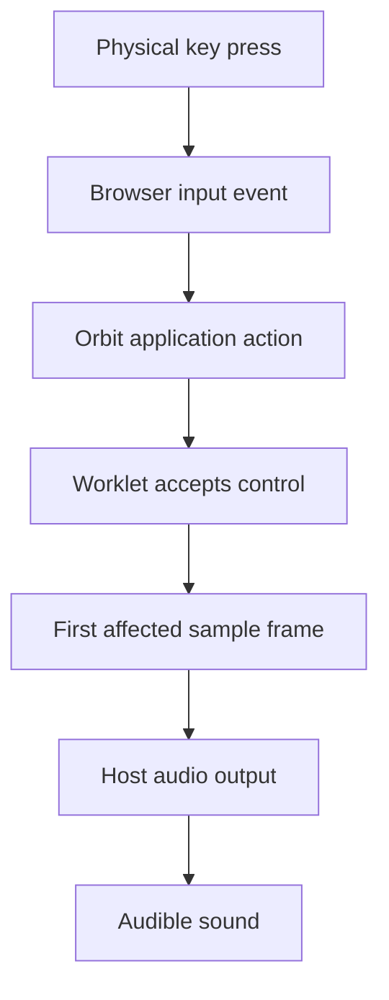
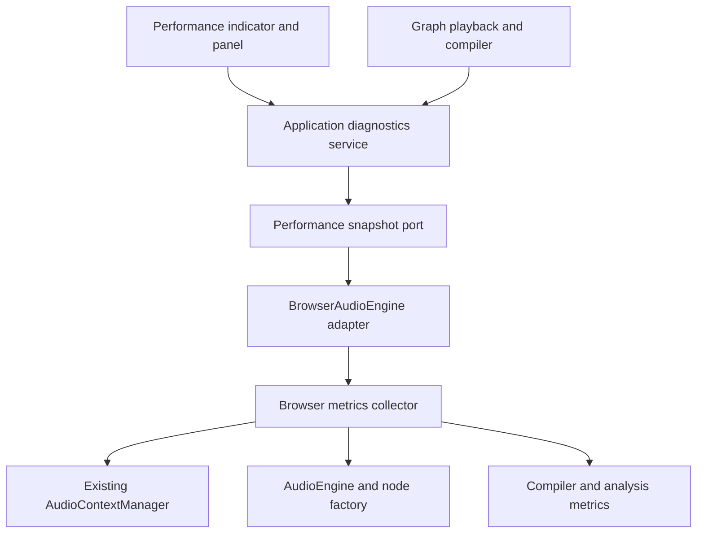

# Orbit 2 — Performance monitoring, profiling and diagnostics

**Status:** Planned specification · Phase 7.3  
**Scope:** Browser audio playback, Faust DSP, editing/UI, compilation, memory, musical timing and repeatable performance tests.  
**Repository:** [wgabel/orbit2](https://github.com/wgabel/orbit2)  
**Parent architecture:** [ORBIT2-ARCHITECTURE.md](ORBIT2-ARCHITECTURE.md)  
**Implementation baseline:** Reviewed main on 2026-11-21. Existing audio code is referenced below; the proposed monitor, instrumentation and benchmark harness are not implemented merely because this document exists.

## Contents

1. [Purpose and goals](#1-purpose-and-goals)
2. [Understand audio performance](#2-understand-audio-performance)
3. [Metric catalog and interpretation](#3-metric-catalog-and-interpretation)
4. [Performance Monitor UX and usage](#4-performance-monitor-ux-and-usage)
5. [Browser capabilities and measurement limitations](#5-browser-capabilities-and-measurement-limitations)
6. [Implementation architecture](#6-implementation-architecture)
7. [Metric collection and measurement contracts](#7-metric-collection-and-measurement-contracts)
8. [DSP profiling and headroom](#8-dsp-profiling-and-headroom)
9. [Benchmark patches and regression workflow](#9-benchmark-patches-and-regression-workflow)
10. [Diagnosing real problems](#10-diagnosing-real-problems)
11. [Performance improvement strategy](#11-performance-improvement-strategy)
12. [Testing and acceptance criteria](#12-testing-and-acceptance-criteria)
13. [Implementation roadmap](#13-implementation-roadmap)
14. [Glossary](#14-glossary)
15. [Technical references](#15-technical-references)

## 1. Purpose and goals

Orbit 2 is a browser-based modular synthesizer using C#, Blazor WebAssembly, a reusable graph compiler, Faust/WASM and Web Audio AudioWorklets. The primary performance requirement is **uninterrupted audio at the actual sample rate**, including complex drone patches, continuous LFO modulation, live edits, scope/spectrum display, and eventually keyboard performance, sequencing and multiple instrument voices.

Performance has several independent dimensions:

- **Real-time audio reliability:** can the rendering thread produce the next block of samples in time, every time? Are there underruns, interruptions or errors?
- **Audio latency:** how long between an input action and hearing its result? This matters for keyboard playing, although a sustained drone may tolerate more delay.
- **DSP processing demand:** how close is the audio engine to exhausting its rendering budget? Are we approaching a limit before an audible problem occurs?
- **Editor responsiveness:** is dragging nodes, changing sliders, interacting with wires or opening nested canvases smooth?
- **Compilation/replacement latency:** how quickly can Orbit generate Faust source, compile it, initialize a new worklet and accept a new graph without interrupting existing audio?
- **Resources:** how many reachable DSP nodes, parameter controls, observation taps, capture leases, FFTs and runtime voices are active? Do memory or resources grow over time?
- **Musical timing:** do multiple sequencers and event sources share exact boundaries, do long loops drift, and how late do manual performance events reach the engine?
- **Signal quality:** is the generated audio clipping or discontinuous? Signal clipping is not CPU overload.

A single number called "performance" cannot answer these questions. The monitor should expose a small number of useful, honest metrics and allow an expanded diagnostic view when something goes wrong. It should let a musician build richer patches with confidence and let a developer or AI coding agent identify the relevant subsystem before changing code.

### Non-goals and invariants

- Do not redesign the graph model, audio engine or Faust execution solely to display statistics.
- Do not create a second audio context or route new channels into the master merely for monitoring.
- Do not introduce server telemetry or require a network service. Statistics are local and reports are explicitly exported.
- Do not promise to measure total computer CPU, GPU, battery use or actual speaker latency from ordinary browser APIs.
- Do not silently change output latency, sample rate, patch settings, graph content, analyzer quality or sound to improve the meter. Suggest actions and let the user choose.
- A monitor read, toggle, reset or report export must not change command history, committed graph revision, persisted patch content, musical transport, DSP source, compiled identity or playback generation.
- Do not use a displayed peak, a worklet error count, a JavaScript timer delay or a made-up CPU estimate as a substitute for actual rendering capacity or underrun statistics.
- Separate **ordinary passive monitoring** (low overhead; enabled by default when supported) from **explicit diagnostic profiling and stress testing** (potentially expensive; opt-in).

## 2. Understand audio performance

### 2.1 Samples, frames, sample rate and render quantum

A sample is one numerical signal value at one point in time. A sample frame contains the simultaneous sample values for all channels. Sample rate (Fs), in Hz, is the number of frames per second. At 48 kHz the engine produces 48,000 frames every second; stereo has two samples per frame, not twice the time budget.

A render quantum is the block of frames processed in one render operation. 128 frames is common in Web Audio; never hardcode it as a universal constraint. Use the actual length of a worklet's render buffers if available, and distinguish this from the platform's device callback buffer, which can group several quanta.

The duration represented by a quantum is:

```text
budgetMs = 1000 × frameCount / sampleRateHz
loadPercent = 100 × processingMs / budgetMs
headroomPercent = 100 - loadPercent
```

Example budgets for 128 frames:

| Sample rate | Render-quantum duration |
|---:|---:|
| 44,100 Hz | 2.902 ms |
| 48,000 Hz | 2.667 ms |
| 96,000 Hz | 1.333 ms |

At 48 kHz, a DSP computation taking 0.75 ms consumes about 28.1% of a 2.667 ms quantum, leaving 1.917 ms for other rendering work in a simplified budget model. A computation of 2.2 ms consumes 82.5%; 3 ms exceeds the quantum budget (112.5%). Do not clamp the displayed load to 100%: a value above 100% is diagnostically significant.

These numbers illustrate **render budget consumption**, not average processor utilization across the laptop. The audio renderer, browser runtime, other worklets, operating system scheduling and device buffering also need resources. One busy audio rendering thread can fail even when total CPU usage in Task Manager looks low. Conversely, occasional longer quantum processing may be absorbed by platform buffering, so an individual budget overrun is a risk indicator, not proof of a device underrun.

### 2.2 Latency is not the DSP processing duration

Latency means delay between two identified events. A smaller audio quantum does not imply that a key press is heard only one quantum later. Input dispatch, C#/JS interop, queued controls, the first affected audio frame, device buffers and hardware all contribute.



Measure individual segments and label the endpoints. Intentional musical timing (quantization to the next step; a 20-second drone slot; a 4-second glide) and DSP smoothing/envelopes are not software lag. A phase-continuous pitch change can start immediately yet finish several seconds later by design. Some future effects, such as pitch shifting with internal buffering/lookahead, may have their own algorithmic delay; ordinary feedback-delay echoes and reverb tails are intentional musical behavior.

### 2.3 Underruns, glitches and clipping

An **underrun** occurs when the output system plays frames for which the audio context has not supplied actual audio. It may result in silence/repeated samples and audible clicks or dropouts. The browser's playback statistics can report occurrences and cumulative duration on supported platforms. An underrun is not necessarily a bug inside Faust; other application work, browser scheduling or the device may be involved.

A **glitch** is a more general audible discontinuity or unwanted artifact. A sudden oscillator phase reset, an abrupt gain change, a graph swap with a noncontinuous transition, filter instability, an invalid DSP value or a device underrun can all cause glitches. Zero reported underruns does not guarantee artifact-free audio.

**Clipping** occurs when signal magnitude exceeds the allowed output range or some stage applies saturation. For normalized floating-point audio, a magnitude of 1 corresponds to 0 dBFS (decibels relative to digital full scale). The internal float graph can temporarily carry values greater than 1; that is an overload warning, not proof that a particular internal stage clipped. Only the actual output stage determines audible clipping. The master path may apply additional gain/headroom.

```text
peakDbFS = 20 × log10(max(abs(samples)))
```

For zero amplitude, represent negative infinity safely in the UI (e.g. "−∞ dBFS"), not an invalid JSON number. A peak of +3.4 dBFS corresponds to approximately 1.48 normalized magnitude. Reduce the relevant gain or mixer contribution and verify the final output. Peak dBFS and DSP load belong to separate categories.

## 3. Metric catalog and interpretation

Use explicit provenance for each measurement. A value can be **direct browser reported**, **direct Orbit measured**, **derived**, **estimated**, **benchmark-only** or **unavailable**. Never present an estimate as a direct measurement.

| Metric | Unit and semantics | Source / availability | Suggested presentation |
|---|---|---|---|
| Audio context state | Running, suspended, closed, interrupted where exposed | Existing shared AudioContext | Always; idle before context exists |
| Actual sample rate | Hz | AudioContext.sampleRate / existing audio clock | Details and monitor |
| Actual render quantum | Frames per block | Supported worklet instrumentation or browser API if exposed | Details; otherwise labeled assumed example or N/A |
| Audio render budget | ms per quantum | Derived from actual Fs and frame count | Details; do not confuse with device callback buffer |
| Base latency | ms | AudioContext.baseLatency if finite | Details |
| Output latency | ms, browser estimate | AudioContext.outputLatency if supported | Compact summary and details |
| Estimated audio pipeline latency | ms | Sum of distinct base/output components when both supported | Clearly labeled estimate, no unknown component assumed zero |
| Playback latency statistics | min/mean/max ms over timed interval | AudioContext.playbackStats when available | Details; interval and source |
| Underrun events | Count of reported contiguous underrun events | AudioContext.playbackStats.underrunEvents | Compact; session delta |
| Underrun duration | ms of missing output | AudioContext.playbackStats.underrunDuration | Details; session delta |
| Missing audio fraction | Percent of duration | Derived from delta underrunDuration / delta totalDuration | Details; unavailable until valid positive denominator |
| Worklet processor errors | Count and last error category | AudioWorkletNode processorerror and runtime failures | Separate from underrun count |
| Render capacity | % of render budget | Chrome DevTools WebAudio (developer diagnostic); not a normal portable page API | External benchmark / optional supported source |
| DSP compute time | ms average, p95, peak; measured timed compute scope | Opt-in validated Faust/worklet instrumentation if available | Expanded; explicitly distinguish DSP-only from full renderer |
| DSP load / headroom | % of actual quantum budget | Derived from supported timed compute measurements | Compact only when a valid measurement exists |
| Input to engine | ms from captured DOM input to dispatch/acknowledgment | Application and worklet event instrumentation | Expanded; after performance input is implemented |
| Input to estimated output | ms to first affected output frame | Worklet frame acknowledgment + getOutputTimestamp mapping | Expanded, approximate and hardware-dependent |
| Scheduled event error | Frames and ms, actual frame minus intended frame | Sample-aligned event telemetry / deterministic probes | Sequencer and performance diagnostics |
| UI FPS | Frames per second in foreground | requestAnimationFrame observations | Compact or expanded |
| UI frame time | ms median/p95/max, gaps between rAF callbacks | Foreground frame observations | Details; show refresh context |
| Long tasks / long frames | Count and ms, browser-reported entries | PerformanceObserver feature detection | Details |
| Graph command duration | ms acceptance/commit elapsed | C# monotonic timing around validated command | Details, optional profiling |
| Faust source generation | ms | C# compiler timing around Compile | Details |
| Worker compile round trip | ms | Monotonic clock around worker request/reply | Compact last compilation and details |
| Worker queue/init/compiler | ms, separately scoped | Optional worker stage timings; cache status only when known | Expanded |
| Worklet creation / parameter binding | ms | Monotonic timing at FaustNodeFactory | Expanded |
| Graph replacement | ms request-to-accept, plus fade completion | AudioEngine and playback service | Details; distinguish control-only update |
| Runtime voices | Counts: current and retiring | AudioEngine active logical lifetimes and voice sets | Details; crossfades can temporarily double DSP |
| Graph complexity | Editable nodes, reachable leaf/emitted nodes, edges, controls, aux channels | Existing snapshots/compiler metadata | Details |
| Active analysis | Unique channels/analyzers, lease count, visible views, FFT size/rate | SignalCapture + visualization subsystem | Details |
| Heap / memory | Bytes and trend, explicitly scoped | Supported browser diagnostic API; JS heap only if actually measured | Optional details; no universal total |
| Peak/RMS / clip risk | dBFS and applicable observation window | Existing shared signal observation | Audio quality summary; independent of render load |

Definitions: mean = sum divided by count; median (p50) = middle observation; p95 = the value at or below which approximately 95% of observations fall; maximum identifies the largest observed value in a defined window. Report the sample count and window. A good mean can conceal occasional severe spikes: a typical 0.5 ms render with occasional 5 ms peaks can be worse for audible reliability than a steady 1.1 ms render.

### 3.1 Suggested health thresholds

These are initial UX heuristics, not universal guarantee limits. Revisit using measured data from actual devices.

| Dimension | Good | Caution | Critical / action |
|---|---|---|---|
| Measured render/DSP load | p95 below 60% | 60–85% or frequent budget pressure | p95 above 85% sustained, repeated budget exceedance or reported underrun |
| Audio underruns | None reported in current valid session | Isolated event: inspect duration/timing | Repeated events or growing missing duration |
| Interactive estimated output latency | Under ~20 ms is a useful starting goal | 20–50 ms can feel sluggish for playing | Above ~50 ms noticeable for many keyboard applications; inspect device/buffers first |
| Editor | Close to foreground display cadence, regular frame times | p95 frame gaps materially above refresh interval | Sustained slow frames or repeated long tasks during interaction |
| Compile/replacement | Stable relative to comparable patch/baseline | Regression or unexpectedly frequent compiles | Failures, stale results, repeated unnecessary recompilation |

Thresholds must not be used where metrics are unavailable or stale. Show independent dimension badges; an overall badge may summarize observed conditions but label "Monitoring limited" when key metrics are unsupported. Do not show "Healthy" based solely on a low latency number. A 25 ms output buffer can be musically fine for slow drones while being undesirable for a fast keyboard; no universal latency pass/fail.

## 4. Performance Monitor UX and usage

### 4.1 Compact toolbar indicator

Add a single shared, optional expandable Performance button in the workspace toolbar, next to Play/Stop/transport without increasing every node's dimensions. Reuse the design token system and existing buttons/panels. Do not introduce a specialized node or a second canvas. The compact indicator should be small enough for nested canvas use and responsive layouts; status text must remain stable in width.

Illustrative UI, not measured Orbit data:

```text
● Performance   Audio 12.4 ms   Underruns 0   UI 60 FPS
```

When verified render load becomes available, add "DSP 28%" with a short meter. Until then clearly show "DSP —" or omit it from the compact row. Never fabricate a number so the control looks complete. For unsupported browser underruns show "Underruns N/A", rather than 0. Use accessible text, not just red/green. Clicking the indicator opens the panel.

### 4.2 Expanded panel

Use a workspace-level nonmodal panel or anchored overlay following the existing editor panel conventions (placement bounded inside viewport, keyboard-accessible close, no canvas drag or shortcut propagation from its controls). Separate live values from historical/diagnostic-only values.

```text
PERFORMANCE                                           [×]
Audio engine                         Running · revision 42
  Estimated pipeline latency                      12.4 ms
  Underruns                                 0 · 0.0 ms lost
  Sample rate                  48,000 Hz · 128-frame block
  DSP load                    28% (measured DSP-only scope)
  DSP p95                           0.95 / 2.67 ms budget
  Peak output                                      −6 dBFS

Editor                               60 FPS · 16.7 ms p95
  Long tasks                                              0
  Active plots                             4 (3 FFT views)
  Nodes (editable / reachable)                      65 / 42

Compilation
  Last source generation                               8 ms
  Last compiler request                              184 ms
  Last worklet creation                                21 ms
  Last graph replacement                              273 ms
  Active voices                               1 (0 retiring)

[Reset session counters]   [Copy report]   [Start diagnostic]
```

All example values are hypothetical. Render missing metrics as N/A with a tooltip such as "This browser does not expose playback statistics". Use independent flags for estimated, stale, warming up, inactive, limited precision and unsupported. Show units, metric source and sampled interval in an explanation panel accessible without developer knowledge.

An expanded history view can later draw bounded charts for recent frames/latency, compile events and underrun deltas. Mark playback/replacement events so the user can correlate visible peaks with errors. Maintain fixed layout and limit history retention; do not redraw at sample rate or render charts when hidden. A compact bar may show current p95 load relative to 100%, with numerical overflow retained even if the bar saturates.

### 4.3 User controls and workflow

- Open the monitor during playback to see current session statistics. No metrics query may create or resume audio before Play.
- Reset session counters establishes a new local baseline, resets Orbit histories, and optionally calls the browser latency-stat reset method when supported and explicitly requested. It must not reset BPM, transport, graph or playback. Cumulative browser counters may not be resettable: subtract the new baseline.
- Copy or export a diagnostic JSON report to attach to a bug report. Include metric provenance, supported capabilities, environment, patch revision, timing windows, app revision, and a bounded recent timeline. Do not send anything automatically.
- Start diagnostic mode only after explaining extra measurement load. A developer can enable timed profiling, choose test duration, stop it, and compare with the passive baseline. Stress tests which render a different patch or deliberately increase load must be a separate opt-in workflow, normally run with interactive playback stopped.
- Refresh the basic monitor at about 1 Hz (browser stats can update slowly) and at most 2 Hz for compact updates. Reuse current shared data where possible. An expanded diagnostic view may sample faster if measured overhead is acceptable; do not make 25 Hz parameter updates cause the whole performance panel to rerender.

Examples:

1. A complex drone plays fine but key changes feel late. Check estimated output latency and input-to-engine delay. If the renderer has plenty of capacity and no underruns, test wired headphones versus Bluetooth rather than deleting oscillators.
2. A large patch occasionally clicks when changing routing. Compare underrun deltas, worklet errors and replacement timestamps. If a click occurs precisely during a graph replacement but no underrun is reported, investigate DSP state reset/crossfade continuity rather than treating it as insufficient CPU.
3. Dragging nodes stutters while audio stays clean. Editor p95/long frames increase, but no reported audio underruns. Inspect rendering, measurement/re-render frequency, labels and visualizations. Audio and UI are different scheduling domains.
4. Opening many spectrum plots causes CPU pressure. Compare the same patch with plots collapsed and expanded. Track active analyzer channels, capture leases and visible FFT renderers; distinguish the number of plots from actual unique sample captures.

## 5. Browser capabilities and measurement limitations

Orbit runs as a normal static browser app, not a desktop audio driver. Browser support varies by version, platform, secure context, timer precision, permissions and visibility.

- **AudioContext.baseLatency:** delay in passing a graph's output into the host audio subsystem. Returned in seconds.
- **AudioContext.outputLatency:** estimated output-device latency in seconds. It may be missing or imprecise and changes when the device changes.
- **AudioContext.getOutputTimestamp():** returns related audio context time and estimated performance clock time for the output frame. Useful for mapping an acknowledged audio frame to estimated audible time. Do not calculate latency by subtracting getOutputTimestamp().contextTime from currentTime; the spec explicitly warns that this is unreliable.
- **AudioContext.playbackStats:** newer capability exposing underrun duration/events, total playback duration and average/minimum/maximum latency. Chrome 146 shipped this API; feature-detect individual fields at runtime and check validity. A browser may update values infrequently (the Web Audio 1.1 draft specifies rate/visibility-related restrictions). Do not infer that unsupported or nonupdating statistics mean clean audio.
- **Chrome DevTools WebAudio panel:** provides renderer-specific Render Capacity, callback interval, sample rate and device callback buffer size. Chrome DevTools Protocol exposes WebAudio.getRealtimeData for controlled developer tooling. Ordinary page code cannot call this protocol by default; do not ship DevTools-only integration as a portable production metric or ask users to enable remote debugging just to see basic Orbit statistics.
- **Performance.now()/Stopwatch:** monotonic elapsed-time measurement in the respective execution context; not calendar timestamps and not CPU usage. Browser timer precision may be reduced. Do not assume unrelated clock origins (main window, worker, worklet, C# runtime) are interchangeable. Measure durations on each clock or explicitly map their origins using a supported synchronization method.
- **AudioWorkletGlobalScope:** exposes audio time/frame/sample rate. Audio time advances by frames, not by how long it took to compute a block. Do not use currentFrame or currentTime before/after one compute as a wall-clock DSP timer. High-resolution real-time timers and hooks in FaustWasm worklets are not guaranteed. Probe the actual supported target environment and vendor integration before adding timed profiling. The fallback is external DevTools measurements and offline benchmark results, not fake live load.
- **requestAnimationFrame:** foreground rendering opportunities, tied to display cadence and throttling; unreliable for hidden tabs. Pause the UI sampler or mark it inactive when hidden. A 120 Hz monitor may give a different FPS baseline than 60 Hz.
- **PerformanceObserver:** feature-detect longtask and long-animation-frame support independently; long tasks are typically entries for >50 ms work and do not describe the real-time audio thread.
- **Memory:** browser-specific estimates may cover different scopes and require isolation/permissions. Do not assume performance.memory represents Blazor WASM, Faust WASM, audio buffers and browser-native resources. No memory API is required for the initial monitor. If unsupported, track bounded resource counts and use DevTools profiles in diagnostic runs. Never add invasive permissions for ordinary monitoring.

Illustrative safe JavaScript sketch (not a replacement for the current adapter or production tests):

```js
const finiteNonnegative = value =>
    Number.isFinite(value) && value >= 0 ? value : null;
const secondsToMs = value => {
    const seconds = finiteNonnegative(value);
    return seconds === null ? null : seconds * 1000;
};

function readPlaybackMetrics(context) {
    if (!context) return { state: "not-created", sampleRateHz: null };
    const baseLatencyMs = secondsToMs(context.baseLatency);
    const outputLatencyMs = secondsToMs(context.outputLatency);
    let stats = null;
    try {
        const playback = context.playbackStats;
        if (playback) {
            stats = {
                underrunEvents: finiteNonnegative(playback.underrunEvents),
                underrunDurationMs: secondsToMs(playback.underrunDuration),
                totalDurationMs: secondsToMs(playback.totalDuration),
                avgPlaybackLatencyMs: secondsToMs(playback.averageLatency),
                minPlaybackLatencyMs: secondsToMs(playback.minimumLatency),
                maxPlaybackLatencyMs: secondsToMs(playback.maximumLatency)
            };
        }
    } catch {
        // Production: record an availability reason without stopping playback.
    }
    return {
        state: context.state,
        sampleRateHz: context.sampleRate,
        baseLatencyMs,
        outputLatencyMs,
        estimatedPipelineLatencyMs:
            baseLatencyMs === null || outputLatencyMs === null
                ? null
                : baseLatencyMs + outputLatencyMs,
        stats
    };
}
```

A valid 0 reported by a browser can be displayed, but a null or missing metric cannot become 0 through default deserialization. Derive availability and freshness, distinguish estimated components to avoid double counting, and do not add playbackStats.averageLatency a second time to the estimated base + output pipeline.

## 6. Implementation architecture

### 6.1 Existing integration points (reviewed main)

| Area | Existing integration point | Performance responsibility |
|---|---|---|
| Application ports | `src/Orbit.Application/Interfaces/IAudioEngine.cs`, `IAudioClock.cs` | Reuse existing runtime identity/clock; add optional diagnostics-specific port rather than making every audio engine implementation provide unsupported metrics |
| Playback policy | `src/Orbit.Audio/Playback/FaustGraphPlaybackService.cs` | Accepted revisions/generations, C# source generation, live vs structural updates; capture operation timings |
| Compiler | `Orbit.Audio/Compilation/FaustGraphCompiler` and graph flattener/dependency order | Reachable leaf count, control manifest, output channels, compile time; omit synthetic adapters from node counts or label separately |
| Browser adapter | `src/Orbit.Infrastructure/Audio/BrowserAudioEngine.cs` | Narrow read-only interop through the existing versioned audio module |
| JavaScript composition root | `src/Orbit.Infrastructure/wwwroot/audio/audio.js` | Wire diagnostics collaborators, export one small diagnostics snapshot call |
| Shared context lifecycle | `audio/Components/AudioContextManager.js`, `AudioClock.js` | Read current context without creation/resume; sample rate, state, latency, optional playback stats |
| Runtime orchestration | `audio/AudioEngine.js`, AudioVoice/AudioEnvelope | Logical playback lifetime, accepted current/retiring voices, replacement and worklet error observations |
| Faust compilation | `audio/Faust/FaustCompilerClient.js`, `FaustCompilerWorker.js` | Request IDs, queueing, compiler initialization and request latency, errors and cache knowledge |
| Factory | `audio/Faust/FaustNodeFactory.js` | Worklet creation, parameter binding and initialization measurements |
| Analysis | `audio/Components/SignalCapture.js`, existing visualization/scope/FFT services | Active unique tap channels, analyzers, leases and visible views; cost sampling only in diagnostic mode |
| UI composition | `src/Orbit.UI/Program.cs`, `GraphPlaybackControls.razor(.cs)`, `GraphWorkspace.razor(.cs)`, shared transport toolbar and design tokens | One service/component, panel and display cadence; no direct Faust or browser dependency in Razor |
| Tests | `tests/Orbit.Domain.Tests/FaustGraphPlaybackServiceTests.cs`, `tests/audio/AudioEngine.test.mjs`, `FaustCompilerClient.test.mjs`, `SignalCapture.test.mjs`, compiler/probe and published UI tests | Extend existing suites; follow real project layout and naming at implementation time |

The current playback UI observes transport/effective telemetry about every 40 ms during playback, and the existing signal capture is bounded (maximum nine channels including master and 32 leases per voice in the reviewed implementation). Reuse that architecture; adding a performance read for every existing high-frequency meter tick would be unnecessary. Display performance snapshots at independent slower cadence. A current and retiring worklet can coexist during the existing 50 ms crossfade; report both rather than suggesting that only one DSP voice is active.

### 6.2 Contract and dependency direction

Introduce proposed interfaces/records under existing framework-neutral Application boundaries; names below are proposals and should follow existing project conventions. Keep Domain free of browser diagnostics and performance history. Do not change the persisted patch schema to carry a running session's timings.



Candidate ports:

- `IAudioPerformanceSource.GetSnapshotAsync(CancellationToken)`: optional passive browser audio statistics and runtime resources; context/generation-aware. Browser adapter can implement this alongside IAudioEngine, IAudioClock and ISignalCapture; register the same singleton through the interface in Program.cs.
- Application `IPerformanceDiagnosticsService`: merges valid browser, compiler and editor metrics; immutable snapshot/epoch, reset baseline, read bounded history, report export. Owns status/freshness/aggregation policy. Use dependency injection and deterministic fake clock in tests.
- `IPerformanceEventSink` or equivalent narrow metrics recorder: record compile/replace/command events at operation boundaries; use no-op sink by default where profiling disabled, never block successful playback on a metrics write.
- Presentation projection computes display labels/warnings without graph changes; UI owns accessibility, panel visibility and user actions. Browser-only editor metrics collector owns PerformanceObserver/rAF lifecycle, not musical or graph semantics.

Do not use IJSRuntime in Domain, graph compiler or UI view logic. Keep JavaScript composition in audio.js and small testable modules in Infrastructure; use versioned module-path conventions. A new diagnostics module must ship in the versioned deployment tree and lazy-load consistently with existing files.

### 6.3 Snapshot and event model

Use a single immutable, small, versioned snapshot passed at display rate; no audio samples, private patch names or unbounded lists in it. Use nullable numeric fields or structured values carrying availability. Keep unit suffixes in contract names (Ms, Hz, Frames, Bytes, Percent). All numeric values must be finite except a specially representable dBFS silence state.

Example JSON shape, for design discussion (all numeric values illustrative):

```json
{
  "schemaVersion": 1,
  "sessionId": "local-diagnostic-epoch",
  "contextGeneration": "current-audio-context",
  "playbackGeneration": "accepted-voice-generation",
  "graphRevision": 42,
  "sampledAtMonotonicMs": 126550,
  "state": "playing",
  "audio": {
    "sampleRateHz": 48000,
    "quantumFrames": null,
    "baseLatencyMs": 4,
    "outputLatencyMs": 8.4,
    "estimatedPipelineLatencyMs": 12.4,
    "underrunEvents": 0,
    "underrunDurationMs": 0,
    "playbackDurationMs": 30000,
    "renderCapacityPercent": null,
    "dspLoadAvailability": "unsupported"
  },
  "editor": {
    "fps": 60,
    "frameTimeP95Ms": 16.7,
    "windowMs": 5000,
    "longTasks": 0,
    "availability": "available"
  },
  "lastCompilation": {
    "operationId": "example-compile-id",
    "requestedRevision": 42,
    "sourceGenerationMs": 8,
    "workerRoundTripMs": 184,
    "workletCreateMs": 21,
    "result": "accepted",
    "cacheHit": null
  },
  "resources": {
    "editableNodeCount": 65,
    "reachableLeafCount": 42,
    "activeVoices": 1,
    "retiringVoices": 0,
    "activeAnalyzerChannels": 4
  }
}
```

An operation event records stable operation ID, operation type, requested revision, monotonic start/end or duration, attempted vs accepted generation, result (accepted, reused, superseded, cancelled, failed), optional known cache state and scoped timings. Do not conflate context-global statistics with voice-specific measurements. For context statistics use context identity and collection epoch, and attribute to a patch only with a clearly labeled session time range. For voice-specific measurements require generation and revision validity.

The snapshot is not a graph change-set, never enters PatchHistory, and must never be used to control oscillator state or BPM. A benchmark report is a separate versioned artifact. If optional metric data is missing, deserialization must not turn it into a default zero. Treat a snapshot error as an unavailable/stale diagnostics state; audio actions must continue.

### 6.4 Collection lifecycle and bounded overhead

- Create one collector per shared audio engine/session; reuse AudioContextManager.getCurrentContext, never getRunningContext for read-only operations.
- Context created on Play, not on opening the monitor. Stop/reset may leave an existing context around: display stopped state and freeze the completed session summary; start a new local baseline on next accepted playback.
- Timers/callbacks use cancellation/disposal on component replacement, navigation, hidden tabs and service shutdown. Keep samples ordered and avoid overlapping interop reads. An old async result cannot overwrite a cleared/reset or new-session view.
- Default to 1 Hz, one batched interop call for audio stats, one small immutable view update if changed. UI sampler measures foreground cadence using rAF but throttles aggregation/publication independently. Do not run the 1 Hz sampler as a musical timer.
- Avoid per-sample/per-quantum messages, logging, allocations, dictionary creation, sorting or interop. Reuse fixed-size buffers and aggregate counters/histograms outside the audio callback. If a timed DSP probe can safely run, use carefully sampled quantum measurements, fixed counters and bounded batch publication from the render thread; prove overhead before enabling it.
- Suggested initial history cap: 120 snapshots at 1 Hz and 100 recent operation events; upper bounds are configurable constants, not unlimited storage. Long-session reports use totals, bounded histograms or explicitly downsampled histories, not raw per-frame logs.
- No additional active analyzers or observation leases purely for the monitor. Consume existing capture counters and use any existing valid master meter rather than creating a hidden audio path.
- If the user enables advanced profiling, collect a separately identified short session, show that overhead exists and compare against passive-mode A/B results. Inactive/hidden profiling must stop.

## 7. Metric collection and measurement contracts

### 7.1 Audio reliability and session counters

At the start of accepted root playback (or explicit Reset counters), sample valid cumulative counters as a baseline. On each later valid snapshot:

```text
sessionUnderruns = currentUnderrunEvents - baselineUnderrunEvents
sessionMissingMs = 1000 × (currentUnderrunDurationSeconds - baselineSeconds)
sessionElapsedMs = 1000 × (currentTotalDurationSeconds - baselineTotalDuration)
missingPercent = 100 × sessionMissingMs / sessionElapsedMs, if elapsed > 0
```

Example: baseline 12 prior underrun events and 0.024 seconds missing; current event count 15 and missing duration 0.030 s after 60 seconds of valid total playback. The session exposes 3 new events and 6 ms missing, or 0.01% of that interval. It does not say "15 glitches in this patch".

Counter decrease, context change, missing fields or invalid denominator means rebaseline/reset or mark unknown; do not produce a negative count. Observe current context identity, not graph revisions alone. Continue context-level counters across ordinary accepted structural replacements within the same playback session. If playbackStats isn't updating, indicate last observed time where meaningful; identical values may also be a valid unchanged counter. Use reported context state and feature support, not timer guesses, to distinguish inactive data. Report processorerror/compile/stale/cancelled events separately; a DSP exception is not an underrun event.

### 7.2 Audio latency and keyboard timing

For context output estimates, convert seconds to milliseconds once. If base = 4 ms and output = 8.4 ms, estimated audio pipeline = 12.4 ms. This is not key-to-speaker latency. If only output is available, show that value with its correct label and leave the combined estimate unknown.

When Performance Mode (7.2.8) is implemented, instrument a representative note-on or latched pitch action:

1. Capture the input timestamp on the browser monotonic timebase (event dispatch timestamp, plus handler receipt time where useful). Track a scoped action ID and performance target; do not persist individual musical inputs in diagnostic reports by default.
2. Measure dispatch to C# application and interop message accepted. Distinguish dispatch-to-ack round-trip from one-way latency; C# completion does not establish sample application.
3. For a supported event bridge, capture the first render frame where the accepted action takes effect. Generation/sequence IDs prevent stale acknowledgments. Scheduled sequencer messages also carry intended frame or timing position.
4. Convert applied frame to audio context seconds (with the established frame origin), then map close to the current output via the browser timestamp pair:

```text
estimatedOutputPerformanceMs =
    timestamp.performanceTime +
    1000 × (appliedContextTimeSeconds - timestamp.contextTime)
estimatedEventToOutputMs =
    estimatedOutputPerformanceMs - inputPerformanceTimestampMs
```

Do not extrapolate long distances from old timestamps; reject when unavailable, context suspended, timestamps invalid or mapped latency implausible. Use timing from the same monotonic origin, and avoid adding the previously reported pipeline latency to a timestamp already mapped to output time. Compare repeated events as median/p95. A physical key-switch-to-ear measurement requires external equipment; for serious validation use an audio loopback/cross-correlation and a known stimulus, disclose hardware/driver path and distinguish microphone/ADC delay from output latency. Do not request microphone access routinely.

For scheduled events:

```text
frameError = appliedFrame - intendedFrame
errorMs = 1000 × frameError / sampleRateHz
```

A 48-frame error at 48 kHz is 1 ms. Deterministic internally generated sequencer events can target exact sample boundaries with fractional remainder handling. Incoming live host messages may initially be bounded by render-quantum scheduling; record the actual applied timing, not a promise of exact keyboard-to-sample alignment. Quantization intentionally schedules a recorded onset to the chosen slot; timing error is relative to the quantized target, not the original imprecise note time.

### 7.3 Compilation and replacement measurements

The current FaustCompilerClient lazily opens a worker, serializes compilation work in the worker, and vendor factories are cached by source hash. FaustGraphPlaybackService may avoid compilation for base-only edits or source-identical changes. AudioEngine prepares a replacement voice and crossfades it before disposing the retiring voice. Capture stages at existing boundaries, rather than timing a PlayAsync task which represents the entire logical playback lifetime.

Use separate staged measurements:

- C# generation of Faust source and manifest.
- Worker creation/startup, compiler initialization/asset load when distinguishable.
- Worker queue wait and actual compiler-call duration measured inside worker; a worker can return its own durations, not absolute timestamps assumed to share a clock origin.
- Request-to-reply round trip measured in client (includes waiting and message transfer). Classify cache hit only when explicitly exposed, not by assuming "fast means cache".
- Worklet creation and validated initial parameter binding.
- Replacement request-to-accept/first scheduled start; scheduled fade length and actual completion separately. Existing replacement method awaits old voice disposal, so its elapsed time includes transition.
- Base-only control update and source-identical graph edit: show "Reused existing DSP" without incrementing real compile count. Failed, cancelled and superseded attempts count separately and cannot overwrite the latest accepted revision's display.

Example timeline (illustrative):

```text
0 ms request edit       8 ms source built
       8–192 ms worker round trip
     192–213 ms worklet preparation
     213 ms new graph scheduled
     223–273 ms scheduled complementary crossfade
     273 ms old voice retired
```

The last compilation = 184 ms round trip, not 273 ms. Total replacement = 273 ms including scheduling and fade in this example. Existing audio keeps playing until the prepared replacement is accepted; a slow compile is not the same as increased steady-state output latency. Avoid double counting nested timings in aggregate totals.

Track C# source generation separately using Stopwatch; use injectable clock/time provider for JS components. Record only bounded aggregates and use timestamps at lifecycle boundaries. Observe replacement count, success/failure, skipped source-identical changes, and time spent with multiple simultaneous voices. Measure long-patch compile behavior under rapid routing edits; stale worker completions must retain existing last-good-graph handling.

### 7.4 Editor responsiveness and resources

Use a lightweight rAF sampler while the document is visible. FPS = completed observed frame intervals / elapsed seconds across a foreground window (e.g. 5 s). A frame gap is time between callbacks, not directly GPU render execution time; a large gap may represent a missed rendering opportunity. Track median/p95/max gaps and optionally a count above multiples of the nominal display cadence. Avoid fixed 60 FPS assumptions; a 60 Hz display gives about 16.7 ms per interval, 120 Hz about 8.3 ms. Resize observers, layout recalculations, component rendering, JavaScript and C# work may affect the gap.

Use PerformanceObserver only for supported entry types. Track long task count, total observed blocking duration and worst entries, separately from audio. Do not include hidden-tab gaps in statistics. An FPS sampler must not cause full component rerenders on each callback; aggregate and publish slowly.

For complexity and resources, count:
- Total editable nodes in current canvas and root tree separately.
- Reachable leaf DSP entities and edges in the compiled flattened program, synthetic boundary expressions separately when relevant. Unconnected graph nodes are not equivalent to audible/emitted nodes; analyzer-only reachability may need future explicit accounting.
- Number of controls, passive meters and observation channels.
- Current/retiring worklets in the browser voice sets; use "worklets/runtime voices" here rather than musical voice count until polyphony exists.
- Unique analysis channels, distinct capture leases, visible renderer instances and active FFT sizes/rates. An oscilloscope and FFT can share an observation buffer.
- Known cache/factory counts and bounded resources where actually accessible.

No exact per-node CPU percentage is obtained from these counts. They explain complexity and support comparisons. For memory, prefer observable retained resources and trends; use supported, explicitly scoped browser measurements or DevTools heap profiles. C# managed memory, JS heap and WASM linear memory are not interchangeable and browser-native allocations may be invisible. Test repeated start/stop, replacement, workspace navigation and expand/collapse cleanup.

## 8. DSP profiling and headroom

### 8.1 Measure before claiming live DSP percentage

The most valuable long-term audio metric is rendering headroom: the fraction of the real-time processing budget still available. However, the browser's application-facing APIs do not guarantee an accurate whole-renderer CPU meter. The user must be able to trust the displayed number.

Start with three measurement paths, explicitly distinguish them:

1. **External live renderer measurement (developer workflow):** Chrome DevTools WebAudio Render Capacity measures time spent rendering the graph relative to its budget. It includes browser audio graph work, not just Orbit's Faust kernel. Use the DevTools UI manually or controlled Chrome DevTools Protocol tooling in benchmark automation; not in the production page. Record browser version and scope.
2. **Validated optional in-app DSP timing:** investigate how the pinned FaustWasm AudioWorklet actually calls its compute function. If a reliable monotonic timer is accessible, instrument only the relevant compute region and sample minimally. Validate timer precision and overhead; if unavailable, leave the in-app metric unsupported. Instrumentation must not alter the signal, schedule audio, create a second worklet, or fork generated vendor code unnecessarily. A measured "Faust compute load" excludes other graph/worklet/device work and is not the same as renderer capacity. If rendering quanta cannot be timed accurately, do not infer them from messages or callback gaps.
3. **Offline DSP benchmark:** compile deterministic patches and render a known number of frames as fast as possible. This measures throughput and relative algorithmic cost, not real-time scheduling, device latency or live underruns. Reuse the existing Orbit.Audio.Probe and compiled Faust test infrastructure. It is valuable across machines even when in-app live timing is unsupported.

A single worklet exception or difference between audio clock and wall clock cannot be converted into a trustworthy CPU percentage.

For optional timed profiling, accumulate processing-time histogram/counters over a bounded interval (e.g. five seconds), sample count, mean, p95 estimate, max, budget-exceedance count and budget fraction. Allocate all storage before rendering. Aggregate externally where possible; use fixed histogram bins and avoid per-block sort or message posts. Display the actual timed scope, sample rate and block size. If multiple worklets run during crossfade, separate per-generation observations and report concurrent rendering context; sum only compatible measured scopes in the same rendering interval, never sum unrelated p95s as an exact total. Do not profile a stale generation. A measured 0.75 ms kernel plus 0.1 ms observed analysis work is not automatically the full 0.85 ms renderer load.

**Instrumentation acceptance gate:** compare identical patches with profiling off/on. Timed profiling may ship only if its overhead is quantified and it preserves deterministic output and realtime behavior. If a measurement requires more privileged browser capabilities (such as debug protocol tooling or cross-origin isolation), make it explicitly developer-only, optional and separately documented. Do not change deployment/security policy merely to show a prettier meter.

### 8.2 Real-time factor and throughput

For offline tests, specify the meaning of the ratio; different audio tools call its inverse "real-time factor". Use explicit labels:

```text
audioDurationSeconds = renderedFrames / sampleRateHz
offlineRealtimeFactor = renderWallSeconds / audioDurationSeconds
throughputTimesRealtime = audioDurationSeconds / renderWallSeconds
framesPerWallSecond = renderedFrames / renderWallSeconds
```

Example: render 10 seconds (480,000 frames at 48 kHz) in 0.5 wall-clock seconds. Offline realtime factor = 0.05, throughput = 20× realtime, frames/s = 960,000. Rendering 10 seconds in 12 seconds yields factor 1.2 and throughput 0.833× realtime. This is an offline processing comparison, not a 5% guaranteed live DSP load reading: real-time buffering, worklet overhead, browser scheduling and compilation are different.

Warm up WebAssembly and JIT (just-in-time compilation) before steady-state profiling. Separate warm-up time, source generation, factory compilation, instance creation, and processing. Reuse a fixed block size and deterministic seed/input; avoid timing sample array allocation, JSON serialization or test assertion work as DSP compute. For an end-to-end render benchmark, time those stages explicitly instead. Repeat, report distribution and environment; do not use a single best run.

### 8.3 Node-level cost estimates

Orbit's compiler flattens and composes the connected graph into one Faust program; expressions may be shared, simplified or optimized. It is not generally possible to attach a stopwatch around every visible UI node within that single program without changing the generated DSP and biasing measurements. A node can have a different incremental cost at a different sample rate, modulation configuration, waveform, filter mode, delay allocation, output channel count or graph topology.

Instead develop a reproducible **incremental-cost benchmark**:

- Establish a minimal reachable baseline (source and master, required common plumbing) with identical output channel/capture configuration.
- Build paired test graphs containing N representative instances (e.g. 1, 10, 50) of a node type, all reachable via a safe mixer. Control input amplitude, ensure finite output, vary inputs enough to prevent accidental constant elimination, and measure all configurations and sample rates of interest.
- For processors, compare a graph with N pass-through/known baseline paths against N real processors with the same source and mixing cost. Ensure optimization does not eliminate useful work. Use a stable seed for noise and shared versus independent inputs as separate profiles.
- Subtract median baseline wall processing time from median candidate time over the same number of frames. Report a relative incremental cost per N instances where the measurement exceeds noise. If baseline variance dominates, label inconclusive rather than negative CPU.
- Include mixed graphs and true live renderer capacity tests to see whether stand-alone trends generalize. A muted node may still compute; bypass can intentionally preserve wet processor state. Do not label muted/bypassed nodes "free" without measurement.
- Cache summaries per benchmark profile/version, not as a fixed universal per-node weight. A cost estimate under one browser/device is not a promise about another.

Example hypothetical results for 10 seconds of steady-state offline DSP at 48 kHz:

| Same benchmark setup | Median wall processing time | Difference from baseline |
|---|---:|---:|
| Paired baseline (sources/mixer) | 200 ms | — |
| Baseline + 20 filters | 260 ms | +60 ms |
| Baseline + 20 reverbs | 440 ms | +240 ms |

The test indicates a larger incremental cost for that reverb configuration. It does not establish that every reverb is four times more expensive than every filter, or that 20 reverbs consume exactly 2.4% of the actual device renderer. Use estimates to guide an optimization investigation. A later inspector may describe expensive node categories (e.g. "Measured representative cost — high") with profile provenance, but never show fabricated precise percentages on each node.

## 9. Benchmark patches and regression workflow

### 9.1 Reusable benchmark fixtures

Generate deterministic patches through existing validated graph commands or the existing probe/fixture path, with a consistent root master and unique graph/port identities. Do not hand-edit invalid JSON or create disconnected nodes then assume they burden the DSP compiler. Keep fixtures ordinary editable Orbit patches where useful for manual reproduction; create programmatic larger fixtures in test code when UI usability would suffer. Save reproducible patch IDs, parameter values, seeds, graph size and fixture version. Do not add them to every user's preset catalog unless appropriate.

| Fixture | Variants | Purpose / metrics |
|---|---|---|
| Baseline sine → Gain → Master | 44.1/48 kHz; mono; analyzers closed | Establish startup, steady-state and control-update baseline |
| Oscillator bank | 10, 50, 100, 200 reachable oscillators into mixer; independent frequencies | Scaling, DSP throughput, reachable counts, peak safety, compilation |
| Waveforms and audio-rate modulation | Sine, saw, triangle, square with duty; 1/10/50 LFO routes | DSP cost, continuous frequency changes, no phase reset |
| Layered drones | 1, 4, 8, 16 nested drones, delay/reverb/chorus where applicable | Flattening, realistic sustained sound, runtime headroom, tails |
| FX chain | Filter, EQ, chorus, delay, reverb; repeat and parallel routing | Cost of DSP algorithms, bounded memory, clipping vs processing errors |
| Dense graph editor | Disconnected vs reachable nodes, 50/100/200; panning, zoom, node/edge drags | UI layout, connector geometry, graph compilation should skip unreachable/source-identical cases |
| Modulation/telemetry | Many active controls and incoming modulation sources | Interop payloads, meter refresh and responsiveness |
| Analysis-heavy | Same patch with 0/1/4/maximum supported views/capture channels; waveform vs FFT | Compare analyzer overhead and cleanup, respect existing channel/lease caps |
| Graph edit stress | Rapid slider updates, routing, amount changes, undo/redo, valid replacements, stale compile | Compile frequency, replacement latency, concurrent voices, no unintended recompilation |
| Lifecycle endurance | Repeated Play/Stop, patch switch, panel toggle, repeated crossfade; 10–30+ minute sustained run | Resource counts, memory trends, cleanup, underruns and stability |
| Musical timing (after event/sequence delivery) | Multiple sequencers, 120 BPM and tempo edits; 20-second drone steps and multi-minute loops | Frame error and drift; event queues; wrap, reset, suspension |
| Instrument/polyphony (after voice allocation) | 1/4/8/16 configured and active voices; rapid retrigger, tails | Voice allocation/stealing, worst-case load, peak headroom, memory |

Use safe gain staging. Example: for 100 oscillators with nominal magnitude 1, a conservative summed gain of 0.5/100 before master gives an upper bound of 0.5 if all waves align; add headroom where modulation/effects invalidate simple bounds. Do not make a loud test patch to demonstrate performance. Limit maximum complexity and test duration, make large/stress fixtures opt-in. Never auto-load a 200-node stress case for every user.

### 9.2 Reproducible workflow for developers and agents

1. Record environment: Orbit commit/build, browser/engine and version, OS, CPU when manually supplied, sample rate, audio output type (speaker/wired/Bluetooth; optional manually supplied), battery/power mode, display cadence, visible tabs/plots, audio buffer information where available, graph fixture version. Do not collect invasive fingerprints.
2. Build using current README instructions; distinguish development build from the deployed/published Release build. Startup/download/bundle cold-cache results are separate from warm DSP results. Ensure generated Faust compiler/tools match the pinned versions.
3. Run functional tests first; performance claims do not replace numerical DSP safety and correctness. Verify finite outputs and safe peak levels for test graphs.
4. Warm up, then run the identical fixture several times with fixed sample duration and configuration (suggest 3–5 repeats for a quick investigation, more when noise is high). For live tests use a meaningful duration and a defined workload, e.g. 60 seconds idle playback and 30 seconds of repeated controlled editing. Include min/median/p95/max where justified by sample count and report variance.
5. Capture offline throughput and live renderer capacity/underruns separately. Compare monitor hidden vs visible, passive vs profiling, and no-analysis vs multiple plots. Report CPU/load scope and missing capabilities.
6. Compare the previous accepted baseline on the same environment. Record both absolute numbers and relative change with known variability. If a result looks implausible, rerun and isolate cache, build, thermal or hardware variance.
7. Store an optional bounded JSON or CSV benchmark artifact in CI/diagnostics (not in every user's patch). Include fixture identifier, version, all settings, metrics and units, output validity checks and exact app revision. Never automatically transmit user patches or musical key data.

A simple regression calculation:

```text
relativeChangePercent = 100 × (candidate - baseline) / baseline
```

Example: median compiler round trip rising from 200 ms to 250 ms is +25%; offline throughput dropping from 20× to 16× is −20%. Direction matters. A 1 ms rise from 1 to 2 ms is +100% but may be within timing noise; decide with an absolute minimum threshold and repeated runs. Flag large regressions for investigation rather than declaring a universal limit before calibration.

### 9.3 CI strategy

Functional tests use deterministic fake clocks, synthetic timings and compiled signal fixtures; they must not rely on arbitrary sleep or an unstable CI host to pass. Add deterministic performance contracts (bounded buffers, no unnecessary recompilation, no growing event queue, correct session deltas, stable generation checks) to normal CI. A separate performance job can measure throughput against a published baseline. Shared-host wall-time fluctuations make strict timing gates flaky; initially report trends with generous noise margins and enforce only well-established regressions on comparable runners. Test performance in a real browser for UI/latency/capabilities and on actual laptops for audio underruns; headless/offline CI cannot guarantee device playback quality.

Define pass/fail targets through measured baselines at each supported sample rate. Candidate initial engineering targets (not claims):
- no valid reported underruns during standard representative 60-second foreground patch on a documented reference machine;
- monitoring changes no samples, graph revisions or runtime identity; demonstrate negligible overhead through paired runs (start with <2 percentage points of observed renderer capacity when measurement supports that precision, otherwise report uncertainty);
- no leaked worklets/capture leases across repeated cycles;
- no per-note compile, and no compilation for base-only or source-identical changes;
- stable UI frame cadence for normal editing on measured reference hardware, not a universal 60 FPS requirement.

## 10. Diagnosing real problems

### 10.1 Problem → measurement → likely subsystem

| Observed issue | Useful first measurements | Investigation |
|---|---|---|
| Sound occasionally cracks, even when not editing | Underrun delta, duration, renderer capacity, real-time workload, device changes | If counters grow, investigate headroom and competing system load; if clean, examine oscillator/signal discontinuities |
| Crack immediately on patch routing change | Replacement stages/events, active voices, underruns, last-good status, waveform around transition | Crossfade/replacement scheduling, tail or phase discontinuity, peak safety; compare old/new DSP |
| Master or mixer displays +3.4 dBFS | Actual signal peak at affected source and final master, node gains | Signal amplitude/gain staging, not DSP timing; reduce contributions |
| Mouse interaction is laggy, but sound stays smooth | FPS, p95 gaps, long tasks, graph command and rerender timing | UI layout/measurement, canvas labels, high-frequency telemetry, plot drawing |
| Audio gets worse as scopes are expanded | Unique analysis channels/leasing, visible FFTs, renderer load, editor frame metrics | Compare same graph with plots hidden; avoid duplicate FFT/capture, limit refresh |
| Sound stops while many nodes are added | Runtime errors, compiler failure, requested vs accepted revision, underruns | Last-good graph policy, memory/CPU pressure, stale updates; don't replace audible graph on failure |
| Keyboard response feels late | Input-to-ack, estimated first-output latency, device type, event queue | Device and application input path; distinguish scheduled quantization and glide from processing delay |
| Loop drifts after several minutes | Intended and observed sample/beat positions, tempo/reset epoch | Shared transport and fractional remainder math; avoid browser timer scheduling |
| RAM rises after each graph edit | Retained voice/worklet count, analyzer leases, cache growth, heap profiles | Disposal, event listeners, worker pending requests, factory/cache lifetime |
| First press of Play slow, subsequent plays fast | Cold/warm compiler and asset-load stages, known factory cache | Worker initialization/download/WASM startup, not steady-state DSP load |

The table contains hypotheses, not automatic diagnoses. Correlate timestamps and reproduce; avoid "optimization" that changes signal behavior without evidence.

### 10.2 Practical example: locate a drone clicking problem

1. Open the same saved patch and set one known safe output level. Start Playback and Reset counters after initialization; note the environment.
2. Run 60 seconds with all optional plots closed. Listen, record timestamps of audible artifacts, and export a report.
3. Repeat with all desired scopes/spectra visible. Compare context underrun deltas, renderer headroom (externally if necessary), editor timing and resource counts.
4. If cracks appear when toggling an LFO or editing frequency, reproduce a single edit against the same patch. Use the existing scope/probe to inspect sample continuity; match the operation event to the accepted revision.
5. An increasing underrun count during a load spike suggests insufficient real-time headroom. A click at the same phase-reset or graph-replacement boundary with reported underruns unchanged suggests a different DSP continuity problem; inspect attack/release/phase handling and verify with deterministic tests. An unsupported underrun counter cannot rule anything out.
6. If you instead see a red mixer peak while capacity is low and no timing pressure occurs, lower gain and measure actual master peaks. Do not "fix" clipping by increasing latency.
7. Confirm a proposed fix by rerunning the same sequence and comparing output, latency, error counts and benchmark performance. Retain the previous accepted patch and avoid changing multiple settings simultaneously.

### 10.3 Check render capacity now, before the feature is implemented

In Chrome or compatible DevTools environments:

1. Open Orbit and start a representative patch.
2. Open Chrome DevTools (F12 or Ctrl+Shift+I on Windows), then press Ctrl+Shift+P for the Command Menu.
3. Search for "Show WebAudio". Select the active AudioContext in the panel.
4. Observe Sample Rate, Callback Buffer Size and Render Capacity while the patch plays. Record readings during idle playback, live editing and with plots expanded. A value nearing/exceeding 100% indicates pressure on the renderer; it is not the total system CPU. The device callback buffer is not necessarily the worklet render quantum.
5. Use the Performance panel for UI long tasks/reflows and the Memory panel for leak investigation. These developer tools can themselves add measurement overhead; use them for focused diagnosis.
6. Compare the same test with a simpler patch and then with optional plots closed. Do not assume Bluetooth and wired outputs have the same latency.

This is also the initial external reference for validating the future Orbit monitor.

## 11. Performance improvement strategy

Measure first, optimize the dominant cost, and retain audio correctness. A faster application with broken pitch tracking or missing audio tails is not an acceptable result.

### Real-time audio

- Keep all audio-rate work in the DSP/worklet; use host controls, stateful generators and existing modulation semantics, not a high-frequency C#/JS callback loop.
- Reuse buffers and avoid allocation-heavy work, I/O, logging, locks and compilation on the real-time rendering thread. Bound feedback, delay storage, polyphony and event queues.
- Avoid recompiling on scalar controls or live keyboard/sequence events. Continue comparing topology/source identity and coalescing obsolete revisions safely.
- Profile stateful effects and large oscillator banks with realistic modulation. Optimize shared mathematical primitives/emitters and control-rate work only where it preserves required audio-rate semantics.
- Profile old/new voices during crossfade, especially expensive patches. Maintain the existing last-good graph safety contract; do not prematurely dispose sound to reduce load.
- Keep the intended distinction between mute/bypass and CPU suspension: current live controls preserve wet/state behavior; a truly suspended branch could reset or lose its tail. Only design a separate explicit optimization with tested semantics.
- Treat sample rate and latency hint as user/device configuration decisions. Increasing the buffer can improve reliability at the cost of responsiveness; reducing sample rate can reduce per-second computational demand but affects fidelity/filter limits and may force a context restart. Do not silently change them; current context creation is user-gesture-owned and browsers may ignore requested latency.

### Editor and analysis

- Measure expensive layout, canvas re-render and JavaScript interop before optimizing. Keep display-only state independent from audio commands.
- Coalesce render updates; avoid triggering whole graph rerenders for telemetry or the performance monitor. Respect the established 25 Hz effective-parameter telemetry rather than increasing rates unnecessarily.
- Reuse analysis capture/FFT buffers and capability-discovered views; prioritize visible/expanded plots within bounded channel/lease capacity. Hidden/off-screen views should not draw unnecessarily. Test lower diagnostic refresh rates and adaptive resolution only as explicit choices; never silently alter sound or existing user visual preferences.
- Reduce avoidable layout shifts, redundant measurements and large per-event allocations. Maintain pointer/keyboard usability and design tokens.
- For startup/compilation profile worker loading, source generation, compile cache, factory initialization and JS/.NET asset download separately before changing dependencies or runtime packaging. Public benchmark patch cold startup is not the same as warm live replacement.

### Diagnostics export and engineering policy

A report should include:
- app/build revision, diagnostic schema version, timestamp/elapsed sample window and available environment fields;
- relevant metrics, units, availability and source; observed graph/voice counts (not all patch details by default);
- bounded history/events with accepted/superseded/failed labels;
- capability flags and errors, with sensitive data stripped; optional patch export goes through the existing explicit export workflow;
- explicit distinction between simulated/illustrative data, real browser-reported data and measured benchmark results.

A diagnostic report must not contain arbitrary raw audio, keyboard event stream, complete graph JSON, browsing history, user paths, credentials, fingerprint identifiers or personal data. Provide clear opt-in for attaching a patch. A report may be copied or downloaded locally; the feature must not introduce a network upload.

## 12. Testing and acceptance criteria

### 12.1 Unit and contract tests (C# and JavaScript)

- Quantum budget conversion: 128/48 kHz, 128/44.1 kHz, other actual sizes; reject zero/negative/nonfinite sample rates or frame counts. Preserve load above 100%.
- Latency: seconds→ms once; zero vs null; partial browser support; no double-counting; output timestamp timebase mapping and stale/invalid values.
- Session counters: nonzero initial baselines, positive deltas, reset, context change, stop/restart, cumulative counter decreases, empty/zero total duration, unsupported fields. Report 3 rather than 15 events in the example above.
- Aggregation: bounded history, correct median/p95 for deterministic samples, samples/window labels, no false zeros or fake load, correct state and stale behavior.
- Timing stages: fake clock, worker request and reply, cold/warm cache classification without guessing, requested and accepted operation IDs, failed/cancelled/superseded events; distinguish source-reused operation.
- Runtime: read-only metrics never create/resume context, reconnect master, alter active voice, increment graph revision, change undo/persistence, or touch transport. Diagnostics exceptions and missing APIs do not stop audio.
- Lifecycle: no overlapping interop reads, late results cannot overwrite a new session, disposal cancels timers/observers, visibility transitions don't generate gigantic frame gaps, repeated panel opens don't leak listeners.
- UI: accessible compact control/expanded panel, separate badges, missing state and tooltip, stable sizing, readable units and responsive/nested canvas behavior, no graph manipulation on panel interaction, local report export.
- Resource counts: distinction between reachable and editable, current and retiring voices, unique capture channel vs lease; verify counts match ownership and cleanup after stop/replace/dispose.
- DSP profiler if supported: synthetic deterministic clock examples, actual block shape, scope labels, overhead and identical sample output; unsupported path must remain functional.
- Report schema: finite numeric fields, provenance/capabilities, bounded sizes, no audio buffers or personal/patch content by default.

### 12.2 Integration/browser tests

Run against the published app, not only unit mocks. Test both browser-supported and deliberately missing optional APIs. Add deterministic fakes for playback statistics as needed to avoid requiring a real physical underrun in CI.

- Startup: monitor can be opened in a stopped workspace; context remains uncreated until Play.
- Playback: displayed sample rate and context state; counters update at display cadence; missing feature states correct.
- Live parameter edit: no transition/compilation count change except the control update; monitor visibility/toggle does not change source or generation.
- Structural edit: valid source generation and worker/factory timing, accepted generation and replacement stage separation, retiring count resolves; stale/failed replacements obey last-good policy.
- Expand/collapse visualization, nested navigation, patch save/load, repeated play/stop: bounded observers/leasing and independent diagnostics.
- Background/visibility changes: paused or stale UI sample, resumed fresh window, no fabricated performance crisis from inactivity.
- Basic benchmark protocol with deterministic fixtures at 44.1 and 48 kHz, and optional real hardware smoke check. Document actual hardware/browser and real-vs-simulated statistics.

### 12.3 Numerical DSP and long-runtime acceptance

Use existing offline/probe tests to check that enabling diagnostics leaves signal output unchanged (identical deterministic samples or documented numeric tolerance), maintains phase continuity, preserves master channel isolation and does not add latency/samples to the DSP signal path. Future sequencer tests prove intended versus actual event frames across 12-beat wrap extensions, tempo changes, long loops and free/synchronized timing.

During repeated runtime replacement and prolonged playback, collect resource-count trends, sample continuity checks, latency/underrun deltas, and external renderer measurements where available. Assess profiler overhead separately from the base app. Do not claim "zero clicks" based on a single test or a browser's unsupported stats. Use benchmark logs to document observed constraints and revise the thresholds.

## 13. Implementation roadmap

Each phase should be a separate reviewable increment. Before implementation read the parent architecture, README, project layout and current test infrastructure; inspect merged repo history to reconcile exact dependencies and naming. Implement production code only with tests, use the existing architecture boundaries and design tokens, run available local/CI checks, and update this document with measured results, browser support and actual behavior. Retain milestone IDs when independent work ships out of sequence.

| Milestone | Status | Deliverable |
|---|---|---|
| 7.3.1 | Planned | Passive context statistics + shared Performance Monitor |
| 7.3.2 | Planned | Compilation, update/replacement, runtime and analysis resource diagnostics |
| 7.3.3 | Planned | Foreground editor responsiveness and bounded diagnostics history |
| 7.3.4 | Planned | Validated DSP profiling and reproducible benchmark fixtures |
| 7.3.5 | Planned | Input-to-engine and musical timing diagnostics, when note/sequencer events exist |
| 7.3.6 | Planned | Advanced local reports, stress/regression automation and measured improvement cycles |

### 7.3.1 — Passive monitor

Implement framework-neutral snapshot and optional metrics port, browser context reads, capability/availability states, session baseline/reset and slow polling, compact toolbar and expanded details. Include sample rate, context state, estimated latency and supported playback statistics; unavailable metrics must stay unavailable. Test no graph/audio mutations and lifecycle/disposal. Ship even when render load is unavailable. Do not block on profiling or sequencer work.

### 7.3.2 — Compilation and runtime resources

Instrument existing compiler and playback stages with attempt/accepted IDs, known cache information, compile/replacement timings and counters. Expose editable/reachable counts, current/retiring voices, auxiliary channels, analyzer/capture counts, and runtime errors. Add bounded operation events. Verify base-only and source-identical edits do not add unnecessary compilation. This can ship independently of worklet instrumentation.

### 7.3.3 — UI performance

Add feature-detected foreground frame/long-task monitoring, p95 frame gaps, slow publication and bounded history. Implement independent observer lifecycle and test visibility handling; measure normal editor interactions, node plots and nested views. Include no automatic quality changes.

### 7.3.4 — DSP profiling and benchmark baseline

First build the deterministic fixture harness (baseline, increasing oscillator counts, layered/analysis-heavy graphs, edit/lifecycle suites) and record offline throughput plus external DevTools renderer measurements. Evaluate in-app worklet timing feasibility on the pinned library/platform; ship a live DSP-only load/headroom metric only if the timing source and measured overhead meet acceptance. Otherwise preserve "unavailable" and document how to use the external/offline approach. Measure node categories only as relative profile-specific costs. Establish baseline before introducing costly resonator/modal, sample or polyphonic DSP.

### 7.3.5 — Musical timing diagnostics

After Phase 7.1 runtime event delivery and 7.2.3/7.2.8 performance actions exist, add generation-qualified action IDs and measured application dispatch/ack, actual frame, expected frame error and output timestamp estimate. Validate the shared clock with long drone loops and tempo changes. Optional external physical latency measurement documented as a diagnostic exercise. Do not introduce keyboard actions or sequencer functionality merely to implement metrics.

### 7.3.6 — Reports and regression improvements

Add opt-in history charts, local report/copy/export, stress testing with safe fixture workload controls, optional machine-comparable CI benchmark job, long-running leak tests, analysis comparisons and regression summaries. Record actual current-vs-baseline results and prioritize measured bottlenecks; review resource and quality changes separately. No unbounded histories, automatic uploads, hidden audio paths or speculative optimizations.

Dependencies: 7.3.1–7.3.4 can start from the current architecture without waiting for musical instrument milestones; 7.3.5 depends on the relevant runtime event/keyboard work; 7.3.6 may progressively extend earlier reporting/benchmark facilities. Phase 6.18 signal-analysis observations can contribute resource metrics but must not duplicate the diagnostics system. Maintain performance acceptance as a cross-cutting requirement for all subsequent DSP nodes.

## 14. Glossary

| Term | Meaning in Orbit 2 |
|---|---|
| AudioContext | Shared browser object owning audio time, device output and audio graph |
| AudioWorklet | Browser mechanism for custom real-time audio calculations off the UI thread |
| DSP | Digital signal processing: synthesis, modulation, filters and effects that calculate audio/control samples |
| Faust | Functional audio programming language compiled to WebAssembly for Orbit DSP |
| WASM / WebAssembly | Portable execution format for compiled Faust and the .NET browser runtime |
| Sample / frame | One channel value / simultaneous values across all channels at a time point |
| Sample rate (Fs) | Frames processed per second, measured in Hz |
| Render quantum | Audio block handled by one rendering operation (often 128 frames) |
| Callback buffer | Device/platform callback buffer; may include more than one quantum |
| Render budget | Audio duration represented by the quantum; processing must keep up over time |
| Render capacity | Renderer-specific fraction/percentage of its time budget consumed; Chrome DevTools metric |
| DSP-only load | Measured kernel compute time divided by budget; excludes other renderer overhead |
| Headroom (performance) | Unused fraction of processing budget; different from signal amplitude headroom |
| Headroom (signal) | Remaining amplitude margin before the relevant clipping limit |
| Latency | Elapsed time between identified events; specify endpoints and measurement method |
| Underrun / dropout | Missing frames at the output because audio was not supplied in time |
| Glitch | A perceptible unwanted artifact; can have processing, signal or device causes |
| Clipping | Signal amplitude exceeds an output range, causing distortion/saturation where clipped |
| dBFS | Decibels relative to digital full scale; 0 dBFS corresponds to normalized peak magnitude 1 |
| RMS | Root mean square, an amplitude/energy-related level over a window, not CPU |
| FFT | Fast Fourier transform, computing spectrum from a time-domain sample window |
| LFO | Low-frequency oscillator used to modulate another parameter |
| BPM / transport | Beats per minute and shared musical-time reference |
| Quantization | Mapping musical event onset to a defined rhythmic grid; different from audio render quantum |
| Glide | Intentional gradual transition between pitch targets |
| Phase continuity | Keeping oscillator cycle state as frequency changes, avoiding unintended discontinuity |
| Crossfade | Temporarily overlap old/new audio graphs while fading gains in complementary directions |
| Revision / generation | Committed graph change identity / accepted runtime voice identity used to reject stale observations |
| Cache hit | Reuse of previously compiled artifact if known; not determined by elapsed time alone |
| p50, p95 | Median and approximately 95th-percentile values within an observed sample set |
| FPS | Foreground observed frames per second; influenced by display cadence |
| Long task | Browser-reported main-thread work with a duration typically exceeding 50 ms |
| Offline throughput | Amount of generated audio per wall-clock second in a benchmark; not guaranteed live capacity |
| Monotonic clock | Increasing elapsed-time reference, independent of calendar/system-time changes |
| Jitter | Variation in timing around a target or between events |
| Drift | Accumulating difference over repeated timing intervals |
| Telemetry | Read-only observed runtime information; here local, not remote analytics |
| Interop | Boundary communication between Blazor/C# and JavaScript modules |
| Provenance | Where a metric came from, its scope and measurement method |
| Feature detection | Checking actual browser support at runtime, rather than assuming from version or device |

## 15. Technical references

Prefer primary specifications and official browser documentation. Recheck browser compatibility and pinned Faust library behavior when implementing.

- [Web Audio API specification (AudioContext, output latency, timestamps, audio rendering and AudioPlaybackStats)](https://webaudio.github.io/web-audio-api/)
- [Chrome DevTools WebAudio panel](https://developer.chrome.com/docs/devtools/webaudio)
- [Chrome DevTools Protocol WebAudio domain](https://chromedevtools.github.io/devtools-protocol/tot/WebAudio/) — experimental developer-tool renderer availability, not a normal page API.
- [Chrome 146 release notes](https://developer.chrome.com/release-notes/146) — WebAudio Playback Statistics API.
- [High Resolution Time specification](https://www.w3.org/TR/hr-time/) — monotonic timing.
- [Performance Timeline specification](https://www.w3.org/TR/performance-timeline/) — observation and performance entries.
- [Long Tasks API specification](https://w3c.github.io/longtasks/) — optional main-thread measurements.
- [HTML animation frame processing](https://html.spec.whatwg.org/multipage/imagebitmap-and-animations.html#animation-frames) — rendering callbacks.
- [Faust documentation](https://faustdoc.grame.fr/) and pinned [faustwasm project](https://github.com/grame-cncm/faustwasm) — inspect the actual supported worklet integration before profiling.
- [Orbit 2 architecture](ORBIT2-ARCHITECTURE.md) — layers, real-time requirements, signal graph and transport contracts.
- [Orbit 2 README](README.md) — build, existing features, local execution and test workflows.

